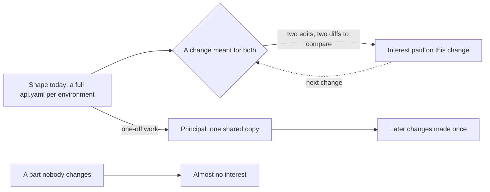

## Before you start

- [[devops.l3.promoting-between-environments]] — you know `envs/staging` and `envs/production` each hold a full set of manifests, so a change meant for both is made in both folders.
- [[foundation.l1.code-smells-basic]] — you know duplicated code is a smell, and that refactoring changes the structure of code without changing its behaviour.

## The situation

In the first config repository, `deploy/gitops/config-repo`, your lead asks you to raise the api's memory limit in staging and production. You change `memory: 512Mi` under `limits` in `envs/staging/api.yaml`, then open `envs/production/api.yaml` and make the same edit at the same line. The reviewer reads both diffs and checks that they match. Nothing is broken: both files are valid, short and easy to read. Yet every change meant for both environments costs two edits and a careful comparison. What is the name for a cost like this, and when is it worth removing?

## Core concepts

- **technical debt** — the extra cost a team pays on later changes because of how its code or setup is shaped today, compared with a shape that would make those changes easier.
- principal — the work it would take, once, to change that shape; here, replacing the two full copies with one shared copy plus what each environment changes.
- interest — the extra effort every change pays while the shape stays; here, the second edit and the comparison of two diffs.

## How it works



The two `api.yaml` files are not wrong: each one describes its environment correctly. The debt is not in either file on its own. It is in the shape of the pair, compared with a shape in which the shared parts live once.

The interest is what each change pays because of that shape. Raising the memory limit took two edits and a comparison of two diffs; a new probe would take the same. A change made in one copy and forgotten in the other leaves the environments different without anyone choosing it. Every such change pays again, which is why the diagram loops back.

The principal is the one-off work of moving to the easier shape. For this folder, that is the move to a base and overlays in [[k8s.l2.config-repo-overlays]]; after it, a change meant for every environment is made once. Paying the principal costs work too, and it pays back only through the later changes that would have paid interest.

So how often the team changes an area decides what its debt costs. The `Service` at the end of both files is copied too, but if nobody changes it, its second copy charges almost nothing. Debt becomes expensive where the team keeps working around it: here, the api's Deployment, edited for every probe or resource change.

Taking on debt can be sound. A full copy per environment is quick to set up and easy to read. When delivering sooner is worth more than the interest, it is a fair trade, provided the team knows it took the debt and what each change will pay. A team that cannot name the interest cannot weigh it against the principal, so it cannot tell when the trade has stopped being worth it.

## In the Đơn Hàng system

Staging's `api.yaml`, at the replica count:

```yaml file=deploy/gitops/config-repo/envs/staging/api.yaml tag=stage-3 lines=16-20
spec:
  # lesson: devops.l3.promoting-between-environments
  # What differs between envs/staging and envs/production: the number of
  # replicas here and the image tag below.
  replicas: 2
```

Lines 18–19 are the repository's own note on what is meant to differ between the two folders: the replicas here and the image tag further down. At this tag the image tag on line 42 is the same in both files, because production already runs the image staging runs; it differs only between a deploy to staging and the next promotion. Production's file has the same five lines with `replicas: 3`. Everything else in the Deployment is meant to be the same in both.

Production's `api.yaml`, at the probes and resources:

```yaml file=deploy/gitops/config-repo/envs/production/api.yaml tag=stage-3 lines=54-71
          # lesson: devops.l3.synced-versus-healthy
          # Argo CD reports the Deployment Healthy only once its Pods pass this
          # probe; until then the Application is Synced but Progressing.
          livenessProbe:
            httpGet:
              path: /health/live
              port: 8080
          readinessProbe:
            httpGet:
              path: /health/ready
              port: 8080
          resources:
            requests:
              cpu: 250m
              memory: 256Mi
            limits:
              cpu: 500m
              memory: 512Mi
```

The comment at the top belongs to an earlier lesson; the lines to look at are the probes and resources. Staging's `api.yaml` has these same 18 lines at the same line numbers. At this tag the two files differ in only two lines: the header comment on line 1, which names the environment, and the replica count on line 20. The memory limit from the situation is line 71. Each of these lines is a place where a change meant for both environments is made twice; that second edit, and the check that the two match, is this debt's interest.

## Seniors often assume…

- **"Technical debt is just another name for badly written code."** → Actually both `api.yaml` files are short, valid and easy to read, and they still charge interest, because the debt is in how the copies relate, not in either copy. Badly written code that nobody changes, on the other hand, charges almost no interest of this kind, because no change has to work around it. You notice this when a review finds nothing wrong in a diff and still has to check that the same edit was made in a second place.
- **"All technical debt should be paid off as soon as the team finds it."** → Actually paying the principal is work too, and it pays back only through later changes in that area. Debt in a part nobody changes may never repay the effort, while the team has less time for the part it edits every week. You notice this when a cleanup rewrites a part that then goes untouched for months, while the folder everyone edits stays as it was.
- **"Technical debt lives only in application code, never in configuration or data."** → Actually any shape that makes later changes costlier is debt: the example in this lesson is a set of manifests, with no application code in it. You notice this when a change with no application code in it still takes two edits and twice the review.

## Try it (3 minutes)

In the `don-hang` repository folder:

1. Run `git diff --no-index deploy/gitops/config-repo/envs/staging/api.yaml deploy/gitops/config-repo/envs/production/api.yaml`.
2. Count the places it reports, and compare that with the length of either file.

Expected result: two changed places, each a line marked `-` followed by a line marked `+`: line 1 (the header comment naming staging or production) and line 20 (`replicas: 2` against `replicas: 3`). The other lines of the two files are the same, so a change to any of them, meant for both environments, is made twice.

A teammate proposes to spend the next sprint moving every folder of the config repository to one shared copy, including parts nobody has changed since they were written. What would you ask first?

<details><summary>Suggested answer</summary>

Ask how often the team changes each part. Interest is paid per change, so the move pays back where shared changes keep coming, such as the api's probes and resources, and returns little for parts nobody changes, such as the `Service`. Also ask whether the team can say what each change pays today: a team that cannot name the interest cannot weigh it against the principal.

</details>

## Connections

- [[devops.l3.promoting-between-environments]] — prerequisite: where the full copy per environment, and the cost of a forgotten copy, first appeared.
- [[foundation.l1.code-smells-basic]] — duplicated code is a smell; technical debt names what such a shape costs each change.
- [[k8s.l2.config-repo-overlays]] — the principal of this debt, paid: the move to a base and overlays, after which a shared change is made once.
- [[management.l2.risk-register]] — the list for what might go wrong; debt is already here and already charging.
- [[management.l3.technical-debt-register]] — the next step: writing down the debt a team knows it carries.

## Five-line summary

1. Technical debt is the extra cost later changes pay because of how code or setup is shaped today, compared with an easier shape.
2. The principal is the one-off work to change the shape; the interest is the extra effort each change pays while it stays.
3. In the first config repository, a full `api.yaml` per environment makes every shared change two edits and a comparison.
4. Debt in a part nobody changes charges almost no interest; it gets expensive where the team keeps working around it.
5. Taking on debt can be sound when delivering sooner is worth more than the interest, provided the team knows it took it.
