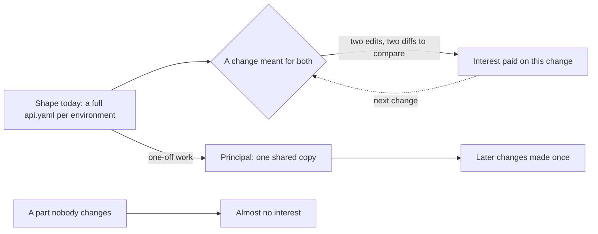

## Bạn cần biết trước

- [[devops.l3.promoting-between-environments]] — bạn biết `envs/staging` và `envs/production` mỗi thư mục giữ một bộ manifest đầy đủ, nên thay đổi dành cho cả hai phải làm ở cả hai thư mục.
- [[foundation.l1.code-smells-basic]] — bạn biết code lặp lại là một code smell, và refactoring đổi cấu trúc của code mà không đổi hành vi.

## Tình huống

Trong repo cấu hình đầu tiên, `deploy/gitops/config-repo`, trưởng nhóm nhờ bạn tăng giới hạn bộ nhớ của api ở staging và production. Bạn sửa `memory: 512Mi` dưới `limits` trong `envs/staging/api.yaml`, rồi mở `envs/production/api.yaml` và sửa y hệt ở đúng dòng đó. Người review đọc cả hai diff và kiểm tra chúng khớp nhau. Không có gì hỏng: cả hai file đều hợp lệ, ngắn và dễ đọc. Vậy mà mỗi thay đổi dành cho cả hai môi trường đều tốn hai lần sửa và một lần so sánh cẩn thận. Chi phí kiểu này gọi là gì, và khi nào thì đáng bỏ nó đi?

## Khái niệm cốt lõi

- **nợ kỹ thuật** (technical debt) — chi phí thêm mà đội phải trả ở các lần sửa sau vì hình dạng hiện tại của code hay cấu hình, so với một hình dạng giúp các lần sửa đó dễ hơn.
- tiền gốc — phần việc phải làm, một lần, để đổi hình dạng đó. Ở đây là thay hai bản sao đầy đủ bằng một bản dùng chung, cộng với phần mỗi môi trường thay đổi.
- tiền lãi — công sức thêm mà mỗi lần sửa phải trả chừng nào hình dạng còn giữ nguyên. Ở đây là lần sửa thứ hai và lần so sánh hai diff.

## Cơ chế hoạt động



Hai file `api.yaml` không sai: mỗi file mô tả đúng môi trường của nó. Nợ không nằm trong riêng file nào. Nó nằm ở hình dạng của cặp file, so với một hình dạng mà phần dùng chung chỉ có ở một chỗ.

Tiền lãi là cái mỗi lần sửa phải trả vì hình dạng đó. Tăng giới hạn bộ nhớ tốn hai lần sửa và một lần so hai diff. Thêm một probe mới cũng tốn y như vậy. Một thay đổi làm ở bản này mà quên ở bản kia sẽ khiến hai môi trường khác nhau mà không ai chọn điều đó. Lần sửa nào như thế cũng trả lãi lại từ đầu, vì vậy sơ đồ có mũi tên vòng ngược lại.

Tiền gốc là phần việc một lần để chuyển sang hình dạng dễ sửa hơn. Với thư mục này, đó là chuyển sang base và overlay như trong [[k8s.l2.config-repo-overlays]]. Sau đó, thay đổi dành cho mọi môi trường chỉ cần làm một lần. Trả tiền gốc cũng tốn công, và nó chỉ hoàn vốn qua những lần sửa sau, những lần lẽ ra phải trả lãi.

Vậy nên tần suất đội sửa một vùng quyết định món nợ ở đó đắt hay rẻ. `Service` ở cuối cả hai file cũng bị chép, nhưng nếu không ai sửa nó thì bản sao thứ hai gần như không tốn gì. Nợ trở nên đắt ở chỗ đội cứ phải làm vòng qua nó: ở đây là Deployment của api, chỗ phải sửa mỗi lần đổi probe hay resource.

Vay nợ có thể là lựa chọn đúng. Mỗi môi trường một bản đầy đủ thì dựng nhanh và dễ đọc. Khi giao sớm đáng giá hơn tiền lãi, đó là một trao đổi công bằng, miễn là đội biết mình đã vay và biết mỗi lần sửa sẽ phải trả bao nhiêu. Đội không gọi tên được tiền lãi thì không đặt nó cạnh tiền gốc mà cân được, nên cũng không biết lúc nào trao đổi đó đã hết đáng.

## Trong hệ thống Đơn Hàng

`api.yaml` của staging, ở chỗ số replica:

```yaml file=deploy/gitops/config-repo/envs/staging/api.yaml tag=stage-3 lines=16-20
spec:
  # lesson: devops.l3.promoting-between-environments
  # What differs between envs/staging and envs/production: the number of
  # replicas here and the image tag below.
  replicas: 2
```

Dòng 18–19 là ghi chú của chính repo về những gì được phép khác giữa hai thư mục: số replica ở đây và tag của image ở phía dưới. Ở tag này, tag của image ở dòng 42 giống nhau trong cả hai file, vì production đang chạy đúng image mà staging chạy. Nó chỉ khác trong khoảng giữa một lần deploy lên staging và lần promotion kế tiếp. File của production có đúng năm dòng này, với `replicas: 3`. Mọi thứ khác trong Deployment đều được định là giống nhau ở cả hai.

`api.yaml` của production, ở chỗ probe và resource:

```yaml file=deploy/gitops/config-repo/envs/production/api.yaml tag=stage-3 lines=54-71
          # lesson: devops.l3.synced-versus-healthy
          # Argo CD reports the Deployment Healthy only once its Pods pass this
          # probe; until then the Application is Synced but Progressing.
          livenessProbe:
            httpGet:
              path: /health/live
              port: 8080
          readinessProbe:
            httpGet:
              path: /health/ready
              port: 8080
          resources:
            requests:
              cpu: 250m
              memory: 256Mi
            limits:
              cpu: 500m
              memory: 512Mi
```

Comment ở đầu thuộc về một bài trước, phần cần nhìn là probe và resource. `api.yaml` của staging có đúng 18 dòng này ở đúng các số dòng đó. Ở tag này, hai file chỉ khác nhau hai dòng: comment đầu file ở dòng 1, ghi tên môi trường, và số replica ở dòng 20. Giới hạn bộ nhớ trong tình huống là dòng 71. Mỗi dòng như vậy là một chỗ mà thay đổi dành cho cả hai môi trường phải làm hai lần. Lần sửa thứ hai đó, cùng lần kiểm tra hai bản khớp nhau, chính là tiền lãi của món nợ này.

## Senior hay nhầm rằng…

- **"Nợ kỹ thuật chỉ là tên khác của code viết dở."** → Thực ra cả hai file `api.yaml` đều ngắn, hợp lệ và dễ đọc, mà vẫn đòi lãi, vì nợ nằm ở quan hệ giữa các bản sao chứ không nằm trong bản nào. Ngược lại, code viết dở mà không ai sửa thì gần như không đòi loại lãi này, vì chẳng lần sửa nào phải làm vòng qua nó. Bạn sẽ nhận ra khi một buổi review không thấy gì sai trong diff mà vẫn phải kiểm tra xem cùng thay đổi đó đã được làm ở chỗ thứ hai chưa.
- **"Nợ kỹ thuật nào cũng nên trả ngay khi đội phát hiện ra."** → Thực ra trả tiền gốc cũng tốn công, và nó chỉ hoàn vốn qua những lần sửa sau ở vùng đó. Nợ ở phần không ai sửa có thể không bao giờ bù lại công bỏ ra, trong khi đội còn ít thời gian hơn cho phần mình sửa hằng tuần. Bạn sẽ nhận ra khi một đợt dọn dẹp viết lại một phần rồi phần đó nằm yên hàng tháng, còn thư mục ai cũng sửa thì vẫn y nguyên.
- **"Nợ kỹ thuật chỉ có trong code ứng dụng, không bao giờ có trong cấu hình hay dữ liệu."** → Thực ra hình dạng nào làm các lần sửa sau tốn hơn đều là nợ: ví dụ trong bài này là một bộ manifest, không có dòng code ứng dụng nào. Bạn sẽ nhận ra khi một thay đổi không đụng tới code ứng dụng mà vẫn tốn hai lần sửa và gấp đôi công review.

## Thử ngay (3 phút)

Trong thư mục repo `don-hang`:

1. Chạy `git diff --no-index deploy/gitops/config-repo/envs/staging/api.yaml deploy/gitops/config-repo/envs/production/api.yaml`.
2. Đếm số chỗ lệnh báo khác, rồi so với độ dài của một file.

Kết quả mong đợi: hai chỗ khác, mỗi chỗ là một dòng đánh dấu `-` rồi tới một dòng đánh dấu `+`: dòng 1 (comment đầu file ghi tên staging hoặc production) và dòng 20 (`replicas: 2` so với `replicas: 3`). Các dòng còn lại của hai file giống nhau, nên thay đổi ở bất kỳ dòng nào trong đó, nếu dành cho cả hai môi trường, đều phải làm hai lần.

Một đồng đội đề xuất dành sprint tới để chuyển mọi thư mục của repo cấu hình sang một bản dùng chung, kể cả những phần chưa ai sửa từ lúc viết ra. Bạn sẽ hỏi gì trước tiên?

<details><summary>Gợi ý đáp án</summary>

Hỏi đội sửa từng phần thường xuyên đến đâu. Tiền lãi trả theo từng lần sửa, nên chuyển sang bản dùng chung sẽ hoàn vốn ở chỗ thay đổi dùng chung cứ liên tục tới, như probe và resource của api, và đem lại rất ít ở những phần không ai sửa, như `Service`. Hỏi thêm đội có nói được hôm nay mỗi lần sửa phải trả bao nhiêu không: đội không gọi tên được tiền lãi thì không cân nó với tiền gốc được.

</details>

## Liên hệ

- [[devops.l3.promoting-between-environments]] — bài cần trước: nơi mỗi môi trường một bản đầy đủ, và cái giá của một bản bị quên, xuất hiện lần đầu.
- [[foundation.l1.code-smells-basic]] — code lặp lại là một code smell, còn nợ kỹ thuật gọi tên cái giá mà hình dạng đó bắt mỗi lần sửa phải trả.
- [[k8s.l2.config-repo-overlays]] — tiền gốc của món nợ này, khi đã trả: chuyển sang base và overlay, sau đó thay đổi dùng chung chỉ làm một lần.
- [[management.l2.risk-register]] — danh sách những gì có thể hỏng, còn nợ thì đã ở đây và đang đòi lãi.
- [[management.l3.technical-debt-register]] — bước tiếp theo: ghi lại những món nợ đội biết mình đang mang.

## Tóm tắt 5 dòng

1. Nợ kỹ thuật là chi phí thêm mà các lần sửa sau phải trả vì hình dạng hiện tại của code hay cấu hình, so với một hình dạng dễ sửa hơn.
2. Tiền gốc là phần việc một lần để đổi hình dạng, tiền lãi là công sức thêm mỗi lần sửa phải trả chừng nào hình dạng còn giữ nguyên.
3. Trong repo cấu hình đầu tiên, mỗi môi trường một `api.yaml` đầy đủ khiến mỗi thay đổi dùng chung thành hai lần sửa và một lần so sánh.
4. Nợ ở phần không ai sửa gần như không đòi lãi, nó chỉ đắt ở chỗ đội cứ phải làm vòng qua nó.
5. Vay nợ có thể là lựa chọn đúng khi giao sớm đáng giá hơn tiền lãi, miễn là đội biết mình đã vay.
