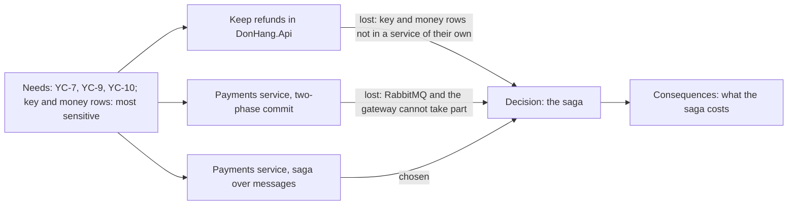

## Before you start

- [[management.l3.architecture-decision-record]] — you know an ADR keeps one decision with its title, status, context, decision and consequences, as numbered files in `docs/adr/`.
- [[backend.l3.two-phase-commit]] — you know two-phase commit needs every participant to prepare first, and that RabbitMQ and the gateway have no prepare step.
- [[backend.l3.eventual-consistency]] — you know that while a refund saga runs, the order and Payments can disagree for a while before they agree.
- [[design.l3.when-not-to-event-source]] — you know `order-history-design.md` weighed event-sourcing `Order` against a read model and chose the read model.

## The situation

In Sprint 17 a developer comments on a pull request that touches `DonHang.Payments`. Their idea: use two-phase commit, so the order and the refund change together again, as they did at stage-2. A second reviewer asks why refunds did not simply stay in `DonHang.Api`. You open ADR `0003` to answer them. If it said only "we chose a saga", you could not show that either idea had been considered, or what the saga costs next to them. What must an ADR hold so that a reader can check the choice, not only learn what it was?

## Core concepts

- option — one way of meeting the need that the team seriously considered; the template asks for what it gains and what it costs.
- needs — the requirements and constraints in the context section: the one list against which every option is judged.
- keeping things as they are — the option that keeps the current design, even if it adds a small piece; it has costs of its own and is judged like the others.
- rejection reason — the need an option fails, or the reason it cannot be built at all, stated for each option that lost.
- reasons to revisit — the changes that would make the team weigh the options again.

## How it works



Between context and decision, Đơn Hàng's `docs/adr/template.md` has an options section, which the previous lesson skipped. It asks for each option the team seriously considered, keeping things as they are among them, weighed against the same needs from the context.

Every option starts from the needs box. Its arrows mean each option was proposed to meet those needs, not that each was scored against every one. In ADR `0003` the needs are YC-7, accept a refund request within 2 seconds even when the gateway fails; YC-9, never refund twice; YC-10, resend on its own within 24 hours. The context adds that the gateway's API key, which lets Đơn Hàng call the gateway, and the money rows in `payments` are the most sensitive part. Yet in version 1 every copy of `DonHang.Api` holds that key and can read and write that table.

The first option keeps things as they are: refunds stay in `DonHang.Api`, as version 1 of `refund-design.md` planned at stage-2. The template asks for each option's gain and cost. This one has both: one transaction, against the key sitting in the biggest service. The saga option states its gain, and its costs come in the consequences.

Each losing arrow carries its rejection reason. Keeping refunds in the API loses on the last need: the key and the money rows would not sit in a service of their own. Two-phase commit loses before any need is weighed, because RabbitMQ and the gateway cannot take part in one such transaction. The ADR does not say that any option fails YC-7, YC-9 or YC-10.

The consequences list what the chosen option costs, so nobody reads the decision as free, and a later reader can check whether each reason still holds.

## In the Đơn Hàng system

ADR `0003`'s options and its decision:

```markdown file=docs/adr/0003-tach-payments-thanh-service.md tag=stage-3 lines=19-36
### Các phương án

- Giữ hoàn tiền trong `DonHang.Api`, như bản 1 của thiết kế ở stage-2: một
  database, một transaction cho đơn và dòng hoàn tiền. Nhưng khóa của cổng và
  dòng tiền vẫn nằm trong service lớn nhất, ai deploy API cũng chạm tới chúng.
- `DonHang.Payments` là service riêng với database `donhang_payments`, nối với
  API bằng saga qua message (outbox, inbox, RabbitMQ): khóa và dòng tiền chỉ ở
  một service, được triển khai và cấp quyền riêng.
- `DonHang.Payments` riêng, giữ một transaction chung bằng two-phase commit
  qua hai database, RabbitMQ và cổng.

### Quyết định

Chọn service riêng nối bằng saga. Loại two-phase commit vì RabbitMQ và cổng
thanh toán không tham gia được một transaction như thế: API HTTP của cổng
không có bước chuẩn bị, RabbitMQ không tham gia transaction của PostgreSQL.
Loại phương án giữ trong API vì khóa của cổng và dòng tiền không nằm trong
một service của riêng chúng.
```

Lines 21–23 keep things as they are: one database and one transaction for the order and the refund row, but the key and the money rows stay in the biggest service, within reach of anyone who deploys the API. Lines 24–26 give the saga option's gain: the key and the money rows sit in one service, deployed and granted access on its own. The two-phase commit bullet, lines 27–28, says only what it would be; its loss comes in the decision.

Lines 32–36 choose the saga. Two-phase commit fails because the gateway's HTTP API has no prepare step and RabbitMQ does not take part in a PostgreSQL transaction. The in-API option fails on the part the context calls the most sensitive.

The consequences that follow, read in the previous lesson, put the saga's costs in writing: the order sits at `refunding` while the Payments row is still `pending`, and there is one more service to run, with its own database, image and dashboard.

An ADR can also record a decision not to do something. ADR `0004`:

```markdown file=docs/adr/0004-giu-order-luu-theo-trang-thai.md tag=stage-3 lines=18-38
### Các phương án

- Event sourcing cho `Order`.
- Giữ `Order` lưu theo trạng thái, thêm read model `order_status_history` cập
  nhật từ domain event trong cùng transaction.
- Đọc bảng `outbox_messages`.

### Quyết định

Không event-source `Order`; dùng read model. Nhu cầu chỉ là một danh sách cho
từng đơn, trong khi event sourcing đổi cách mọi use case, truy vấn và test
nạp và lưu đơn.

### Hệ quả

- Đơn có trước stage-3 chỉ có một dòng `placed` trong lịch sử.
- Mỗi lần đổi trạng thái thêm một lệnh INSERT.

Xem lại quyết định này khi có yêu cầu cho biết cả đơn trông thế nào ở một
thời điểm bất kỳ trong quá khứ, khi nhiều read model mới cùng cần các thay đổi
của đơn, hoặc khi kiểm toán đòi chứng minh lịch sử chưa từng bị sửa.
```

Lines 20–23 list three options. The second, the read model, keeps things as they are: it keeps how `Order` is stored, even though it adds one table. Lines 27–29 reject event sourcing against the one need: a list per order, while event sourcing changes how every use case, query and test loads and saves an order. The ADR does not repeat the full comparison; its lines 9–10, above this excerpt, point to `order-history-design.md` for it, including why reading `outbox_messages` lost.

Lines 33–34 are its costs: orders from before stage-3 have only a `placed` row in their history, and each status change adds one INSERT. Lines 36–38 are the reasons to revisit: a requirement to show the whole order at any past moment, many new read models needing the order's changes, or an audit demanding proof that the history was never edited.

## Seniors often assume…

- **"Listing rejected options is wasted text once the decision is made."** → Actually the rejected options are what lets a reader check the choice, and what keeps an old idea from coming back as new. In the situation, the two-phase commit proposal is answered by lines 27–28 and 32–34 of ADR `0003`, without a new meeting. You notice this when an idea the team already rejected is proposed again, and nobody can find why it lost.
- **"An ADR should show only the benefits of the option it chose."** → Actually a record that hides the costs reads as a promise the system cannot keep. ADR `0003` lists the saga's costs, among them an order and a refund that agree only after a while and one more service to run. You notice the omission when a known cost of a decision is reported as a bug, or when the team first meets it in operations.
- **"'Keep what we have' is not a real option worth writing down."** → Actually changing nothing has costs too, and a reader needs to see them to judge whether a change was worth its own costs. In ADR `0004` keeping the way orders are stored is the option that wins. You notice it is missing when someone asks "why not just leave it as it was", and the record has no answer.

## Try it (3 minutes)

Open `docs/adr/0003-tach-payments-thanh-service.md` and `docs/adr/0004-giu-order-luu-theo-trang-thai.md` in the `don-hang` repository at tag `stage-3`.

1. In each file, find the option that keeps things as they are, and the lines that reject the other options.
2. In `0004`, find the lines that say when to weigh the options again.

Expected result: in `0003`, lines 21–23 keep refunds in `DonHang.Api`, and lines 32–36 reject both two-phase commit and the in-API option. In `0004`, lines 21–22 keep `Order` state-based with a read model, and lines 27–29 reject event sourcing. Lines 36–38 of `0004` give three reasons to revisit.

A teammate shortens the options section of `0003` to the saga bullet alone and deletes the first two consequences. Which questions from the situation could the record no longer answer, and what would a later reader get wrong?

<details><summary>Suggested answer</summary>

Neither question from the situation: whether two-phase commit was considered and why it lost, and why refunds did not stay in `DonHang.Api`. A later reader would also not know that the order and the refund agree only after a while, or that the saga added a service to run, so they could take an order at `refunding` for a fault and read the decision as free.

</details>

## Connections

- [[management.l3.architecture-decision-record]] — the structure whose options section this lesson fills in.
- [[backend.l3.two-phase-commit]] — the reason against two-phase commit, in full.
- [[backend.l3.eventual-consistency]] — the first cost in ADR `0003`'s consequences, seen while a refund runs.
- [[design.l3.when-not-to-event-source]] — the full comparison that ADR `0004` points to instead of repeating.
- [[design.l3.when-to-extract-a-service]] — the same weighing, for Notifications.
- [[management.l2.non-functional-requirements]] — where needs like YC-7 come from.
- [[management.l3.proposing-an-adr]] — the next step: putting a weighed ADR up for comment before it is accepted.

## Five-line summary

1. An ADR lists the options the team seriously considered, keeping things as they are among them, and judges each against the same needs.
2. ADR `0003` weighs refunds in `DonHang.Api`, a Payments service joined by a saga, and a Payments service using two-phase commit.
3. It rejects two-phase commit because RabbitMQ and the gateway cannot take part, and the API option because the key stays in the biggest service.
4. Its consequences name the saga's costs too, such as agreement only after a while and one more service to run.
5. ADR `0004` records a decision not to event-source `Order`, points to the design doc for the comparison, and names what would reopen it.
