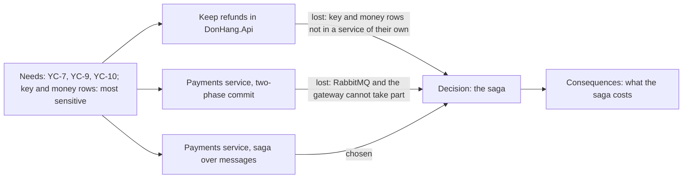

## Bạn cần biết trước

- [[management.l3.architecture-decision-record]] — bạn biết một ADR giữ một quyết định với tiêu đề, trạng thái, bối cảnh, quyết định và hệ quả, thành các file đánh số trong `docs/adr/`.
- [[backend.l3.two-phase-commit]] — bạn biết two-phase commit cần mọi bên tham gia chuẩn bị trước, và RabbitMQ lẫn cổng thanh toán đều không có bước chuẩn bị.
- [[backend.l3.eventual-consistency]] — bạn biết trong lúc một saga hoàn tiền đang chạy, đơn và Payments có thể lệch nhau một lúc rồi mới khớp.
- [[design.l3.when-not-to-event-source]] — bạn biết `order-history-design.md` đã cân giữa event sourcing cho `Order` và một read model, rồi chọn read model.

## Tình huống

Ở Sprint 17, một lập trình viên comment trên một pull request đụng tới `DonHang.Payments`. Ý của họ: dùng two-phase commit, để đơn và lần hoàn tiền lại đổi cùng nhau như ở stage-2. Một reviewer khác hỏi sao hoàn tiền không cứ để trong `DonHang.Api`. Bạn mở ADR `0003` để trả lời hai người. Nếu nó chỉ ghi "chúng tôi chọn saga", bạn không chứng minh được đội đã từng xét tới ý nào trong hai ý đó, cũng không nói được saga tốn gì so với chúng. Một ADR phải chứa gì để người đọc kiểm tra được lựa chọn, chứ không chỉ biết đội đã chọn gì?

## Khái niệm cốt lõi

- phương án — một hướng đáp ứng nhu cầu mà đội đã xét nghiêm túc. Mẫu ADR hỏi mỗi phương án được gì và mất gì.
- nhu cầu — các yêu cầu và ràng buộc trong phần bối cảnh: một danh sách duy nhất để đem mọi phương án ra so.
- giữ nguyên hiện trạng — phương án giữ thiết kế đang có, kể cả khi thêm một phần nhỏ. Nó cũng có cái giá riêng và được xét như các phương án khác.
- lý do loại — nhu cầu mà một phương án không đáp ứng, hoặc lý do nó không xây được, ghi cho từng phương án bị loại.
- lý do xem lại — những thay đổi sẽ khiến đội phải cân lại các phương án.

## Cơ chế hoạt động



Giữa bối cảnh và quyết định, `docs/adr/template.md` của Đơn Hàng có một phần phương án, phần mà bài trước đã bỏ qua. Phần này đòi liệt kê mọi phương án đội đã xét nghiêm túc, trong đó có giữ nguyên hiện trạng, và đem tất cả so với cùng những nhu cầu trong bối cảnh.

Phương án nào cũng xuất phát từ ô nhu cầu. Mũi tên ở đây nghĩa là mỗi phương án được đưa ra để đáp ứng các nhu cầu đó, không phải phương án nào cũng được chấm theo từng nhu cầu. Trong ADR `0003`, nhu cầu là YC-7, nhận yêu cầu hoàn tiền trong 2 giây kể cả khi cổng thanh toán lỗi. YC-9, không bao giờ hoàn tiền hai lần. YC-10, tự gửi lại trong 24 giờ. Bối cảnh nói thêm rằng khóa API của cổng, thứ cho phép Đơn Hàng gọi cổng, và các dòng tiền trong `payments` là phần nhạy cảm nhất. Vậy mà ở bản 1, mọi bản sao của `DonHang.Api` đều giữ khóa đó và đọc ghi được bảng này.

Phương án đầu tiên giữ nguyên hiện trạng: hoàn tiền ở lại trong `DonHang.Api`, như bản 1 của `refund-design.md` đã định ở stage-2. Mẫu ADR hỏi mỗi phương án được gì và mất gì. Phương án này có đủ cả hai: được một giao dịch duy nhất, mất ở chỗ khóa nằm trong service lớn nhất. Phương án saga nêu cái được, còn cái giá của nó nằm ở phần hệ quả.

Mỗi mũi tên thua mang lý do loại của nó. Giữ hoàn tiền trong API thua ở nhu cầu cuối: khóa và các dòng tiền sẽ không nằm trong một service của riêng chúng. Two-phase commit thua trước khi xét tới nhu cầu nào, vì RabbitMQ và cổng thanh toán không tham gia được một giao dịch kiểu đó. ADR không nói phương án nào trượt YC-7, YC-9 hay YC-10.

Phần hệ quả liệt kê cái giá của phương án được chọn, để không ai đọc quyết định như thể nó miễn phí, và để người đọc sau này kiểm tra được từng lý do còn đúng hay không.

## Trong hệ thống Đơn Hàng

Phần phương án và phần quyết định của ADR `0003`:

```markdown file=docs/adr/0003-tach-payments-thanh-service.md tag=stage-3 lines=19-36
### Các phương án

- Giữ hoàn tiền trong `DonHang.Api`, như bản 1 của thiết kế ở stage-2: một
  database, một transaction cho đơn và dòng hoàn tiền. Nhưng khóa của cổng và
  dòng tiền vẫn nằm trong service lớn nhất, ai deploy API cũng chạm tới chúng.
- `DonHang.Payments` là service riêng với database `donhang_payments`, nối với
  API bằng saga qua message (outbox, inbox, RabbitMQ): khóa và dòng tiền chỉ ở
  một service, được triển khai và cấp quyền riêng.
- `DonHang.Payments` riêng, giữ một transaction chung bằng two-phase commit
  qua hai database, RabbitMQ và cổng.

### Quyết định

Chọn service riêng nối bằng saga. Loại two-phase commit vì RabbitMQ và cổng
thanh toán không tham gia được một transaction như thế: API HTTP của cổng
không có bước chuẩn bị, RabbitMQ không tham gia transaction của PostgreSQL.
Loại phương án giữ trong API vì khóa của cổng và dòng tiền không nằm trong
một service của riêng chúng.
```

Dòng 21–23 giữ nguyên hiện trạng: một database và một giao dịch cho đơn và dòng hoàn tiền, nhưng khóa và các dòng tiền vẫn ở trong service lớn nhất, ai deploy API cũng với tới được. Dòng 24–26 nêu cái được của phương án saga: khóa và các dòng tiền chỉ nằm ở một service, được deploy và cấp quyền riêng. Gạch đầu dòng two-phase commit, dòng 27–28, chỉ nói phương án đó sẽ trông thế nào. Lý do nó thua nằm ở phần quyết định.

Dòng 32–36 chọn saga. Two-phase commit trượt vì API HTTP của cổng không có bước chuẩn bị, và RabbitMQ không tham gia giao dịch của PostgreSQL. Phương án giữ trong API trượt ở đúng phần mà bối cảnh gọi là nhạy cảm nhất.

Các hệ quả ngay sau đó, đã đọc ở bài trước, ghi rõ cái giá của saga: đơn nằm ở `refunding` trong khi dòng bên Payments vẫn `pending`, và có thêm một service phải chạy, với database, image và dashboard riêng.

ADR cũng có thể ghi một quyết định không làm gì đó. ADR `0004`:

```markdown file=docs/adr/0004-giu-order-luu-theo-trang-thai.md tag=stage-3 lines=18-38
### Các phương án

- Event sourcing cho `Order`.
- Giữ `Order` lưu theo trạng thái, thêm read model `order_status_history` cập
  nhật từ domain event trong cùng transaction.
- Đọc bảng `outbox_messages`.

### Quyết định

Không event-source `Order`; dùng read model. Nhu cầu chỉ là một danh sách cho
từng đơn, trong khi event sourcing đổi cách mọi use case, truy vấn và test
nạp và lưu đơn.

### Hệ quả

- Đơn có trước stage-3 chỉ có một dòng `placed` trong lịch sử.
- Mỗi lần đổi trạng thái thêm một lệnh INSERT.

Xem lại quyết định này khi có yêu cầu cho biết cả đơn trông thế nào ở một
thời điểm bất kỳ trong quá khứ, khi nhiều read model mới cùng cần các thay đổi
của đơn, hoặc khi kiểm toán đòi chứng minh lịch sử chưa từng bị sửa.
```

Dòng 20–23 liệt kê ba phương án. Cái thứ hai, read model, là giữ nguyên hiện trạng: cách lưu `Order` vẫn như cũ, dù có thêm một bảng. Dòng 27–29 loại event sourcing theo đúng một nhu cầu: chỉ cần một danh sách cho từng đơn, trong khi event sourcing đổi cách mọi use case, truy vấn và test nạp và lưu đơn. ADR không chép lại toàn bộ phần so sánh. Dòng 9–10 của nó, phía trên đoạn trích này, trỏ tới `order-history-design.md`, nơi có cả lý do đọc `outbox_messages` bị loại.

Dòng 33–34 là cái giá: đơn có trước stage-3 chỉ có một dòng `placed` trong lịch sử, và mỗi lần đổi trạng thái thêm một lệnh INSERT. Dòng 36–38 là các lý do xem lại: có yêu cầu cho biết cả đơn trông thế nào ở một thời điểm bất kỳ trong quá khứ, nhiều read model mới cùng cần các thay đổi của đơn, hoặc kiểm toán đòi chứng minh lịch sử chưa từng bị sửa.

## Senior hay nhầm rằng…

- **"Đã quyết rồi thì liệt kê các phương án bị loại chỉ tốn chữ."** → Thực ra chính các phương án bị loại cho người đọc kiểm tra được lựa chọn, và giữ cho một ý cũ khỏi quay lại dưới vỏ ý mới. Trong tình huống trên, đề xuất two-phase commit đã có câu trả lời ở dòng 27–28 và 32–34 của ADR `0003`, không cần họp lại. Bạn sẽ nhận ra khi một ý đội đã loại được đề xuất lần nữa, mà không ai tìm ra vì sao nó từng thua.
- **"ADR chỉ nên nêu cái lợi của phương án được chọn."** → Thực ra một bản ghi giấu cái giá sẽ đọc như một lời hứa mà hệ thống không giữ được. ADR `0003` liệt kê cái giá của saga, trong đó có đơn và lần hoàn tiền chỉ khớp nhau sau một lúc, và thêm một service phải chạy. Bạn sẽ nhận ra chỗ thiếu khi một cái giá đã biết của quyết định bị báo thành bug, hoặc khi đội gặp nó lần đầu lúc vận hành.
- **"'Giữ cái đang có' không phải một phương án thật, chẳng đáng ghi."** → Thực ra không đổi gì cũng có cái giá, và người đọc cần thấy nó để đánh giá một thay đổi có đáng cái giá của chính nó không. Trong ADR `0004`, giữ cách lưu đơn hiện tại là phương án thắng. Bạn sẽ nhận ra nó bị thiếu khi có người hỏi "sao không cứ để như cũ", và bản ghi không có câu trả lời.

## Thử ngay (3 phút)

Mở `docs/adr/0003-tach-payments-thanh-service.md` và `docs/adr/0004-giu-order-luu-theo-trang-thai.md` trong repository `don-hang` ở tag `stage-3`.

1. Trong mỗi file, tìm phương án giữ nguyên hiện trạng, và các dòng loại những phương án còn lại.
2. Trong `0004`, tìm các dòng nói khi nào cần cân lại các phương án.

Kết quả mong đợi: trong `0003`, dòng 21–23 giữ hoàn tiền trong `DonHang.Api`, và dòng 32–36 loại cả two-phase commit lẫn phương án giữ trong API. Trong `0004`, dòng 21–22 giữ `Order` lưu theo trạng thái kèm một read model, và dòng 27–29 loại event sourcing. Dòng 36–38 của `0004` nêu ba lý do xem lại.

Một đồng đội rút gọn phần phương án của `0003` chỉ còn gạch đầu dòng saga, và xóa hai hệ quả đầu tiên. Bản ghi sẽ không còn trả lời được câu hỏi nào trong tình huống, và người đọc sau này sẽ hiểu sai điều gì?

<details><summary>Gợi ý đáp án</summary>

Cả hai câu hỏi trong tình huống đều không còn lời đáp: two-phase commit có từng được xét không và vì sao nó thua, và vì sao hoàn tiền không ở lại trong `DonHang.Api`. Người đọc sau này cũng không biết đơn và lần hoàn tiền chỉ khớp nhau sau một lúc, hay saga đã thêm một service phải chạy. Họ có thể coi một đơn đang ở `refunding` là lỗi, và đọc quyết định như thể nó miễn phí.

</details>

## Liên hệ

- [[management.l3.architecture-decision-record]] — cấu trúc mà bài này điền vào phần phương án.
- [[backend.l3.two-phase-commit]] — lý do không dùng two-phase commit, đầy đủ.
- [[backend.l3.eventual-consistency]] — cái giá đầu tiên trong phần hệ quả của ADR `0003`, nhìn từ lúc một lần hoàn tiền đang chạy.
- [[design.l3.when-not-to-event-source]] — phần so sánh đầy đủ mà ADR `0004` trỏ tới thay vì chép lại.
- [[design.l3.when-to-extract-a-service]] — cùng cách cân nhắc đó, cho Notifications.
- [[management.l2.non-functional-requirements]] — nơi các nhu cầu như YC-7 ra đời.
- [[management.l3.proposing-an-adr]] — bước tiếp theo: đưa một ADR đã cân nhắc ra cho mọi người góp ý trước khi chấp nhận.

## Tóm tắt 5 dòng

1. ADR liệt kê các phương án đội đã xét nghiêm túc, có cả giữ nguyên hiện trạng, và so từng cái với cùng những nhu cầu.
2. ADR `0003` cân hoàn tiền trong `DonHang.Api`, service Payments nối bằng saga, và service Payments dùng two-phase commit.
3. Nó loại two-phase commit vì RabbitMQ và cổng không tham gia được, và loại phương án trong API vì khóa vẫn ở service lớn nhất.
4. Phần hệ quả cũng nêu cái giá của saga, như chỉ khớp nhau sau một lúc và thêm một service phải chạy.
5. ADR `0004` ghi quyết định không event-source `Order`, trỏ tới design doc cho phần so sánh, và nêu điều gì sẽ mở lại câu hỏi.
