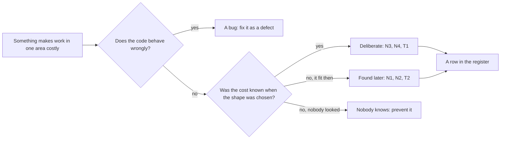

## Before you start

- [[management.l3.technical-debt-register]] — you know each row of the register says what a debt is, where it is, how it arose, its interest, its repayment and who watches it.
- [[design.l3.before-extracting-a-module]] — you know that at stage-2 `QueuedNotifier` added the email job to the order's DbContext, a tie that had to be cut before Notifications could run on its own.
- [[backend.l3.outbox-pattern]] — you know that at stage-3 an outbox row is saved in the same transaction as the order and published to RabbitMQ afterwards.

## The situation

At sprint planning you go through `docs/team/tech-debt-register.md` with the team. The column that says how each debt arose holds one of two answers. N3, the ignored `unitPriceVnd` field, and N4, the app's hard-coded `localhost`, say the team took them on purpose. N1, the old `notifications` table in the `donhang` database, says it was found later, and so does T2, the `QueuedNotifier` you remember as a sensible design when the API ran as one process. A teammate asks who cut corners on N1, and the answer is nobody. If debt is not always a shortcut, where does it come from, and does it matter how it arrived?

## Core concepts

- deliberate debt — debt a team takes on while knowing a better shape, choosing the quicker one for a stated reason, and able to say what it will cost.
- debt found later — a shape that suited the system when it was written and became costly once the system around it changed.
- debt nobody knows about — debt taken on without anyone seeing its cost, so it is never weighed, recorded or watched.
- a bug, not debt — wrong behaviour, fixed as a defect; debt is a shape that makes correct code costlier to change.

## How it works



If the code behaves wrongly, it is a bug, fixed as a defect. Debt is code that does the right thing but makes the next change cost more.

If the code is correct, ask whether anyone knew the cost when the shape was chosen. N3 and N4 are deliberate: the team knew a better shape, picked the quicker one for a reason, and could say what it costs. T1, the full copy of manifests per environment, arrived the same way.

The second answer is debt found later. Nobody took a shortcut on T2: saving the email job in the same transaction as the order suited one process and became work to undo when Notifications moved to its own service. N1 and N2, the old `notifications` and `payments` tables, were left behind by similar moves, so debt can sit in data as well as code.

The third answer is the one worth preventing. Debt nobody knows about cannot have its interest weighed against the cost of repaying it. Code review and tests are two places to catch it. A reviewer can ask what a shortcut will cost, and the team writes the answer down. A test makes the later repayment safe: the team changes the shape and sees whether the behaviour holds. Once found, it still gets a row: the register has only two labels, and `Phát hiện sau` is the nearer one because nobody knew the cost, even though the shape never really fit.

The first two kinds end as register rows. How a debt arrived does not change its interest, but it says what to check next. For deliberate debt, check whether the reason still holds: do old clients still send `unitPriceVnd`? For debt found later, look for leftovers after the next move, as N1 and N2 were.

## In the Đơn Hàng system

The register's opening and the debt Đơn Hàng carries at stage-3:

```markdown file=docs/team/tech-debt-register.md tag=stage-3 lines=3-21
Sổ này ghi những món nợ kỹ thuật đội biết mình đang mang: hình dạng của code
hay cấu hình làm mỗi lần sửa vùng đó tốn công hơn. Khác sổ rủi ro
(`risk-register-example.md`): rủi ro có thể không bao giờ xảy ra, còn món nợ
ở đây đã có sẵn và đang tính lãi mỗi lần sửa. Lỗi (code chạy sai) không ghi
vào đây; lỗi được sửa như lỗi.

Lãi ghi bằng lời của đội, như người đọc bị hiểu nhầm điều gì hay mỗi lần sửa
phải làm thêm việc gì, không bằng điểm số. Cột "Quyết định" là một trong bốn:
trả ngay, trả cùng lần sửa tới vùng đó, chấp nhận (tiếp tục trả lãi, biết rõ
vì sao), xóa sổ (vùng đó sắp bỏ).

### Nợ đang mang

| Số | Món nợ | Ở đâu | Từ đâu ra | Lãi mỗi lần sửa | Trả bằng cách nào | Quyết định | Người theo dõi |
|---|---|---|---|---|---|---|---|
| N1 | Bảng `notifications` cũ còn trong database `donhang` | `donhang`, `PostgresFixture` | Phát hiện sau: còn lại khi Notifications có database riêng (ADR 0002) | Người đọc schema tưởng API còn gửi email; mỗi migration của `donhang` lại phải hỏi bảng này còn dùng không | Dump rồi xóa bằng một migration (ADR 0008), khoảng 1 ngày | Trả ngay | Lập trình viên backend |
| N2 | Bảng `payments` cũ còn trong database `donhang` | `donhang`, `PostgresFixture` | Phát hiện sau: còn lại khi Payments có database riêng (ADR 0003) | Người đọc tưởng API còn giữ dòng tiền; kế toán hỏi nên đối soát với bảng nào | Như N1, sau khi kế toán xác nhận (ADR 0008), khoảng 1 ngày | Trả ngay, sau N1 | Lập trình viên backend |
| N3 | `POST /api/v1/orders` vẫn nhận `unitPriceVnd` của từng dòng nhưng bỏ qua, giá lấy từ Catalog | `DonHang.Api/Dtos.cs`, `OrdersController.cs` | Có chủ ý: giữ để client cũ không hỏng | Người đọc API tưởng mình đặt được giá; mỗi lần sửa DTO phải nhớ field này không làm gì | Bỏ field ở một phiên bản API mới, sau khi client cũ ngừng gửi nó | Chấp nhận: còn client cũ dùng `/api/v1`, bỏ field là thay đổi phá vỡ; xem lại khi `/api/v1` có ngày ngừng | Lập trình viên backend |
| N4 | App ghi cứng `localhost` cho địa chỉ API và Keycloak | `DonHang.App/lib/api_client.dart`, `lib/auth/keycloak_sign_in.dart` | Có chủ ý: app chỉ chạy trên máy dev | Chạy app ở bất kỳ địa chỉ nào khác phải sửa code và build lại; app chưa đưa được lên cluster | Đọc địa chỉ từ cấu hình lúc build, khoảng 2–3 ngày | Trả cùng lần sửa tới: khi app được đưa lên cluster | Lập trình viên frontend |
```

The sentence with `code chạy sai` (code that runs wrongly) keeps bugs out: they are fixed as bugs. The fourth column, `Từ đâu ra` (how it arose), carries this lesson. N3 and N4 read `Có chủ ý` (on purpose), each with its reason: older clients must not break, and the app runs only on a developer's machine. N1 and N2 read `Phát hiện sau` (found later): tables left behind when Notifications and Payments got databases of their own. N1 sits in data, a table in `donhang`: a reader of the schema believes the API still sends emails. The rows also list `PostgresFixture`, the test fixture that prepares the database for integration tests, as a place the tables reach.

The repaid list shows both kinds once more:

```markdown file=docs/team/tech-debt-register.md tag=stage-3 lines=23-28
### Nợ đã trả

| Số | Món nợ | Từ đâu ra | Trả bằng gì |
|---|---|---|---|
| T1 | Repo cấu hình chép đầy đủ manifest cho mỗi môi trường (`envs/staging`, `envs/production`), nên thay đổi chung phải sửa hai lần | Có chủ ý (ADR 0005) | Chuyển sang overlay Kustomize (ADR 0007) trong một commit, `scripts/k8s/kustomize-config-repo.sh`; kiểm bằng chỗ khác Argo CD báo: chỉ ConfigMap và Deployment của api |
| T2 | `QueuedNotifier` lưu job email cùng transaction với đơn qua chung một DbContext; hợp với một process, thành việc phải gỡ khi Notifications ra service riêng | Phát hiện sau | Outbox: API ghi message vào `outbox_messages` cùng transaction, relay gửi lên RabbitMQ, Notifications nhận qua inbox; `QueuedNotifier` và `INotifier` bị xóa |
```

The numbers such as `ADR 0005` point to numbered documents in the repository's `docs/adr/` folder, where the team writes down a decision and its reasons; this lesson uses only 0005. Line 27 marks T1 `Có chủ ý`, and its own words give the price: `thay đổi chung phải sửa hai lần` (every shared change made twice). Document 0005, written after the fact, says the team knew a better way and chose the quicker one because it had no time yet to learn a tool that builds each environment from one shared copy, which Kustomize later did. Line 28 is T2 in the team's own words: `hợp với một process` (suited one process). The repayment column belongs to the earlier lessons this one builds on.

## Seniors often assume…

- **"Technical debt always comes from someone cutting corners under deadline pressure."** → Actually a deadline is one possible reason, and some debt is not a shortcut at all. T2 and N1 came from designs that were right for their time and outgrown by a later change, and T1 was chosen with its price known. You notice this when a review of the register turns into finding who to blame, and debt found later never gets a row because nobody wants to own it.
- **"A design that was right when it was written cannot later become debt."** → Actually debt is measured against the changes the team makes now, not against the day the code was written. Sharing one DbContext with the order was right for one process; the same shape became work to undo once Notifications ran on its own. You notice this when a change keeps needing workarounds in code nobody would call badly written.
- **"Every known bug belongs in the debt register."** → Actually a bug is wrong behaviour and is fixed as a defect, which lines 6–7 of the register say outright. Debt is correct code that costs more to change. You notice this when the register grows a row per bug report and the rows that charge interest on every change are lost among them.

## Try it (3 minutes)

Open `docs/team/tech-debt-register.md` in the `don-hang` repository at tag `stage-3`.

1. Read the `Từ đâu ra` column for N1–N4 and for T1–T2.
2. Sort the six rows into "on purpose" (`Có chủ ý`) and "found later" (`Phát hiện sau`).

Expected result: N3, N4 and T1 are on purpose; N1, N2 and T2 were found later.

At the same sprint planning a teammate reports that one endpoint returns the wrong status code for a certain input and asks for a row in the register. Where does it go?

<details><summary>Suggested answer</summary>

Not in the register. The endpoint behaves wrongly, so it is a bug and is fixed as a defect, as lines 6–7 of the register say. It would be debt only if the code were correct and its shape made later changes cost more, for example if every new endpoint had to copy the same error handling by hand.

</details>

## Connections

- [[management.l3.technical-debt-register]] — prerequisite: the "how it arose" column this lesson explains.
- [[design.l3.before-extracting-a-module]] — the shared DbContext seen from the design side: a tie to cut before a split, here recorded as debt found later.
- [[backend.l3.outbox-pattern]] — how T2 was repaid: the outbox took over what `QueuedNotifier` did inside one transaction.
- [[management.l1.code-review-basics]] — where debt nobody knows about can be caught: a second reader can ask what a shortcut will cost before it merges.
- [[devops.l3.automated-dependency-updates]] — the same prevention for pinned versions: a routine that keeps them from falling behind unnoticed.
- [[management.l3.debt-as-a-portfolio]] — the next step: with the origins known, which debt to repay first.

## Five-line summary

1. Technical debt arrives either as a shortcut the team chose knowing its cost, or as a design that fit once and was outgrown.
2. N3, N4 and T1 in Đơn Hàng's register were taken on purpose, each with a stated reason and a known price.
3. T2, `QueuedNotifier`, suited one process and became debt once Notifications moved to its own service; nobody cut a corner.
4. N1, the old `notifications` table in `donhang`, shows that debt can sit in data as well as in code.
5. Debt nobody knows about is the kind to prevent through review and tests; a bug is not debt and is fixed as a defect.
