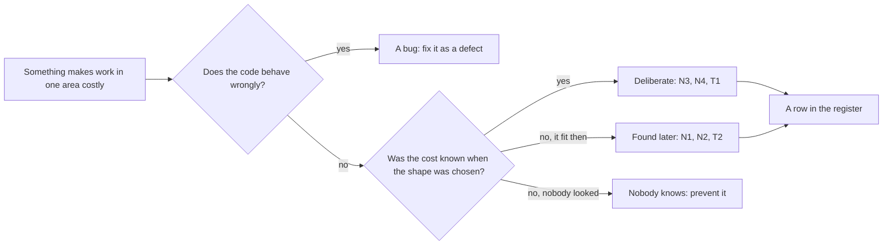

## Bạn cần biết trước

- [[management.l3.technical-debt-register]] — bạn biết mỗi dòng trong sổ nợ kỹ thuật ghi món nợ là gì, nằm ở đâu, từ đâu ra, tiền lãi ra sao, trả bằng cách nào và ai theo dõi.
- [[design.l3.before-extracting-a-module]] — bạn biết ở stage-2, `QueuedNotifier` thêm job email vào DbContext của đơn hàng, một mối buộc phải cắt trước khi Notifications chạy riêng được.
- [[backend.l3.outbox-pattern]] — bạn biết ở stage-3, một dòng outbox được lưu trong cùng giao dịch với đơn hàng rồi mới được đẩy lên RabbitMQ.

## Tình huống

Trong buổi sprint planning, bạn cùng đội đi qua `docs/team/tech-debt-register.md`. Cột ghi món nợ từ đâu ra chỉ có một trong hai câu trả lời. N3, field `unitPriceVnd` bị bỏ qua, và N4, `localhost` ghi cứng trong app, ghi là đội cố ý nhận. N1, bảng `notifications` cũ trong database `donhang`, ghi là phát hiện sau. T2 cũng vậy, đó là `QueuedNotifier` mà bạn còn nhớ là một thiết kế hợp lý khi API chạy trong một process. Một đồng đội hỏi ai đã làm ẩu ở N1, và câu trả lời là không ai cả. Nếu nợ không phải lúc nào cũng là lối tắt, vậy nó từ đâu ra, và nó đến bằng đường nào thì có quan trọng không?

## Khái niệm cốt lõi

- nợ có chủ ý — nợ đội nhận vào khi biết có hình dạng tốt hơn, chọn cách nhanh hơn vì một lý do nói rõ được, và nói được nó sẽ tốn gì.
- nợ phát hiện sau — một hình dạng hợp với hệ thống lúc viết ra, rồi thành đắt khi hệ thống xung quanh thay đổi.
- nợ không ai biết — nợ nhận vào mà không ai thấy cái giá của nó, nên không bao giờ được cân nhắc, ghi lại hay theo dõi.
- lỗi, không phải nợ — hành vi sai, được sửa như một lỗi. Còn nợ là hình dạng làm code chạy đúng trở nên tốn công hơn khi sửa.

## Cơ chế hoạt động



Nếu code chạy sai thì đó là lỗi, và được sửa như lỗi. Nợ là code làm đúng việc nhưng khiến lần sửa sau tốn hơn.

Nếu code đúng, hãy hỏi lúc chọn hình dạng đó có ai biết cái giá không. N3 và N4 là nợ có chủ ý: đội biết có hình dạng tốt hơn, chọn cách nhanh hơn vì một lý do, và nói được nó tốn gì. T1, mỗi môi trường chép đầy đủ một bộ manifest, cũng đến theo đường này.

Câu trả lời thứ hai là nợ phát hiện sau. Không ai đi lối tắt ở T2. Lưu job email trong cùng giao dịch với đơn hàng hợp với một process, rồi thành việc phải gỡ khi Notifications chuyển ra service riêng. N1 và N2, hai bảng `notifications` và `payments` cũ, bị bỏ lại sau những lần chuyển tương tự. Vậy nợ có thể nằm trong dữ liệu chứ không chỉ trong code.

Câu trả lời thứ ba là loại đáng ngăn trước. Nợ không ai biết thì không thể đem tiền lãi của nó ra cân với chi phí trả nợ. Code review và test là hai chỗ bắt được nó. Người review có thể hỏi một lối tắt sẽ tốn gì, và đội ghi câu trả lời lại. Test giúp lần trả nợ về sau an toàn: đội đổi hình dạng rồi xem hành vi có giữ nguyên không. Khi đã tìm ra, nó vẫn được một dòng trong sổ. Sổ chỉ có hai nhãn, và `Phát hiện sau` là nhãn gần hơn vì không ai biết cái giá, dù hình dạng đó chưa bao giờ thật sự vừa.

Hai loại đầu kết thúc thành các dòng trong sổ. Nợ đến bằng đường nào không đổi tiền lãi của nó, nhưng cho biết cần kiểm tra gì tiếp. Với nợ có chủ ý, kiểm tra lý do còn đứng không: client cũ còn gửi `unitPriceVnd` không? Với nợ phát hiện sau, tìm những thứ còn sót lại sau lần chuyển tới, như N1 và N2.

## Trong hệ thống Đơn Hàng

Phần mở đầu của sổ và những món nợ Đơn Hàng đang mang ở stage-3:

```markdown file=docs/team/tech-debt-register.md tag=stage-3 lines=3-21
Sổ này ghi những món nợ kỹ thuật đội biết mình đang mang: hình dạng của code
hay cấu hình làm mỗi lần sửa vùng đó tốn công hơn. Khác sổ rủi ro
(`risk-register-example.md`): rủi ro có thể không bao giờ xảy ra, còn món nợ
ở đây đã có sẵn và đang tính lãi mỗi lần sửa. Lỗi (code chạy sai) không ghi
vào đây; lỗi được sửa như lỗi.

Lãi ghi bằng lời của đội, như người đọc bị hiểu nhầm điều gì hay mỗi lần sửa
phải làm thêm việc gì, không bằng điểm số. Cột "Quyết định" là một trong bốn:
trả ngay, trả cùng lần sửa tới vùng đó, chấp nhận (tiếp tục trả lãi, biết rõ
vì sao), xóa sổ (vùng đó sắp bỏ).

### Nợ đang mang

| Số | Món nợ | Ở đâu | Từ đâu ra | Lãi mỗi lần sửa | Trả bằng cách nào | Quyết định | Người theo dõi |
|---|---|---|---|---|---|---|---|
| N1 | Bảng `notifications` cũ còn trong database `donhang` | `donhang`, `PostgresFixture` | Phát hiện sau: còn lại khi Notifications có database riêng (ADR 0002) | Người đọc schema tưởng API còn gửi email; mỗi migration của `donhang` lại phải hỏi bảng này còn dùng không | Dump rồi xóa bằng một migration (ADR 0008), khoảng 1 ngày | Trả ngay | Lập trình viên backend |
| N2 | Bảng `payments` cũ còn trong database `donhang` | `donhang`, `PostgresFixture` | Phát hiện sau: còn lại khi Payments có database riêng (ADR 0003) | Người đọc tưởng API còn giữ dòng tiền; kế toán hỏi nên đối soát với bảng nào | Như N1, sau khi kế toán xác nhận (ADR 0008), khoảng 1 ngày | Trả ngay, sau N1 | Lập trình viên backend |
| N3 | `POST /api/v1/orders` vẫn nhận `unitPriceVnd` của từng dòng nhưng bỏ qua, giá lấy từ Catalog | `DonHang.Api/Dtos.cs`, `OrdersController.cs` | Có chủ ý: giữ để client cũ không hỏng | Người đọc API tưởng mình đặt được giá; mỗi lần sửa DTO phải nhớ field này không làm gì | Bỏ field ở một phiên bản API mới, sau khi client cũ ngừng gửi nó | Chấp nhận: còn client cũ dùng `/api/v1`, bỏ field là thay đổi phá vỡ; xem lại khi `/api/v1` có ngày ngừng | Lập trình viên backend |
| N4 | App ghi cứng `localhost` cho địa chỉ API và Keycloak | `DonHang.App/lib/api_client.dart`, `lib/auth/keycloak_sign_in.dart` | Có chủ ý: app chỉ chạy trên máy dev | Chạy app ở bất kỳ địa chỉ nào khác phải sửa code và build lại; app chưa đưa được lên cluster | Đọc địa chỉ từ cấu hình lúc build, khoảng 2–3 ngày | Trả cùng lần sửa tới: khi app được đưa lên cluster | Lập trình viên frontend |
```

Câu có `code chạy sai` giữ lỗi ở ngoài sổ: lỗi được sửa như lỗi. Cột thứ tư, `Từ đâu ra`, là nội dung của bài này. N3 và N4 ghi `Có chủ ý`, mỗi dòng kèm lý do: client cũ không được hỏng, và app chỉ chạy trên máy của lập trình viên. N1 và N2 ghi `Phát hiện sau`: các bảng bị bỏ lại khi Notifications và Payments có database riêng. N1 nằm trong dữ liệu, một bảng trong `donhang`: người đọc schema tưởng API vẫn còn gửi email. Các dòng này cũng ghi `PostgresFixture`, test fixture chuẩn bị database cho integration test, là một chỗ các bảng đó chạm tới.

Danh sách nợ đã trả cho thấy cả hai loại thêm lần nữa:

```markdown file=docs/team/tech-debt-register.md tag=stage-3 lines=23-28
### Nợ đã trả

| Số | Món nợ | Từ đâu ra | Trả bằng gì |
|---|---|---|---|
| T1 | Repo cấu hình chép đầy đủ manifest cho mỗi môi trường (`envs/staging`, `envs/production`), nên thay đổi chung phải sửa hai lần | Có chủ ý (ADR 0005) | Chuyển sang overlay Kustomize (ADR 0007) trong một commit, `scripts/k8s/kustomize-config-repo.sh`; kiểm bằng chỗ khác Argo CD báo: chỉ ConfigMap và Deployment của api |
| T2 | `QueuedNotifier` lưu job email cùng transaction với đơn qua chung một DbContext; hợp với một process, thành việc phải gỡ khi Notifications ra service riêng | Phát hiện sau | Outbox: API ghi message vào `outbox_messages` cùng transaction, relay gửi lên RabbitMQ, Notifications nhận qua inbox; `QueuedNotifier` và `INotifier` bị xóa |
```

Những số như `ADR 0005` trỏ tới các tài liệu đánh số trong thư mục `docs/adr/` của repo, nơi đội ghi lại một quyết định và lý do của nó. Bài này chỉ dùng tài liệu 0005. Dòng 27 ghi T1 là `Có chủ ý`, và chính lời trong dòng đó nói ra cái giá: `thay đổi chung phải sửa hai lần`. Tài liệu 0005, viết lại sau khi việc đã xong, kể rằng đội biết có cách tốt hơn và chọn cách nhanh hơn, vì lúc đó chưa có thời gian học một công cụ dựng mỗi môi trường từ một bản dùng chung. Về sau Kustomize làm đúng việc đó. Dòng 28 là T2 bằng lời của đội: `hợp với một process`. Cột trả nợ thuộc về các bài trước mà bài này dựa vào.

## Senior hay nhầm rằng…

- **"Nợ kỹ thuật lúc nào cũng do ai đó làm ẩu vì bị ép deadline."** → Thực ra deadline chỉ là một lý do có thể có, và có những món nợ hoàn toàn không phải lối tắt. T2 và N1 đến từ những thiết kế đúng ở thời của chúng, rồi bị một thay đổi về sau vượt qua, còn T1 được chọn khi đã biết cái giá. Bạn sẽ nhận ra khi buổi xem lại sổ nợ biến thành buổi tìm người để đổ lỗi, và nợ phát hiện sau không bao giờ được ghi một dòng vì không ai muốn nhận nó.
- **"Một thiết kế đúng lúc viết ra thì về sau không thể thành nợ."** → Thực ra nợ được đo theo những thay đổi đội đang làm bây giờ, chứ không theo ngày code được viết. Dùng chung một DbContext với đơn hàng là đúng khi chỉ có một process. Cũng hình dạng đó thành việc phải gỡ khi Notifications chạy riêng. Bạn sẽ nhận ra khi một thay đổi cứ phải làm vòng qua đoạn code mà không ai gọi là viết dở.
- **"Lỗi nào đã biết cũng nên ghi vào sổ nợ."** → Thực ra lỗi là hành vi sai và được sửa như lỗi, điều mà dòng 6–7 của sổ nói thẳng ra. Nợ là code đúng nhưng tốn công hơn khi sửa. Bạn sẽ nhận ra khi sổ mọc thêm một dòng cho mỗi báo cáo lỗi, và những dòng đòi lãi ở mỗi lần sửa bị lẫn mất giữa chúng.

## Thử ngay (3 phút)

Mở `docs/team/tech-debt-register.md` trong repo `don-hang` ở tag `stage-3`.

1. Đọc cột `Từ đâu ra` của N1–N4 và T1–T2.
2. Chia sáu dòng thành hai nhóm: "có chủ ý" (`Có chủ ý`) và "phát hiện sau" (`Phát hiện sau`).

Kết quả mong đợi: N3, N4 và T1 là có chủ ý, còn N1, N2 và T2 là phát hiện sau.

Cũng trong buổi sprint planning đó, một đồng đội báo một endpoint trả sai status code với một loại input nào đó, và đề nghị thêm một dòng vào sổ. Nó nên được ghi ở đâu?

<details><summary>Gợi ý đáp án</summary>

Không ghi vào sổ. Endpoint chạy sai nên đó là lỗi, và được sửa như lỗi, đúng như dòng 6–7 của sổ nói. Nó chỉ là nợ nếu code chạy đúng mà hình dạng của nó làm các lần sửa sau tốn hơn, ví dụ mỗi endpoint mới đều phải tự tay chép lại cùng một đoạn xử lý lỗi.

</details>

## Liên hệ

- [[management.l3.technical-debt-register]] — bài cần trước: cột "từ đâu ra" mà bài này giải thích.
- [[design.l3.before-extracting-a-module]] — DbContext dùng chung nhìn từ phía thiết kế: một mối buộc phải cắt trước khi tách, ở đây được ghi là nợ phát hiện sau.
- [[backend.l3.outbox-pattern]] — cách T2 được trả: outbox nhận lại việc mà `QueuedNotifier` từng làm trong một giao dịch.
- [[management.l1.code-review-basics]] — nơi bắt được nợ không ai biết: người đọc thứ hai có thể hỏi một lối tắt sẽ tốn gì trước khi nó được merge.
- [[devops.l3.automated-dependency-updates]] — cùng cách ngăn trước, áp cho các phiên bản đã ghim: một việc làm đều đặn giữ chúng khỏi lặng lẽ bị tụt lại.
- [[management.l3.debt-as-a-portfolio]] — bước tiếp theo: khi đã biết nợ từ đâu ra, món nào nên trả trước.

## Tóm tắt 5 dòng

1. Nợ kỹ thuật đến theo hai đường: một lối tắt đội chọn khi biết cái giá, hoặc một thiết kế từng vừa rồi không còn vừa nữa.
2. N3, N4 và T1 trong sổ của Đơn Hàng được nhận có chủ ý, mỗi món có lý do nói rõ và cái giá đã biết.
3. T2, `QueuedNotifier`, hợp với một process và thành nợ khi Notifications chuyển ra service riêng, không ai làm ẩu cả.
4. N1, bảng `notifications` cũ trong `donhang`, cho thấy nợ có thể nằm trong dữ liệu chứ không chỉ trong code.
5. Nợ không ai biết là loại cần ngăn trước bằng review và test, còn lỗi không phải nợ và được sửa như lỗi.
