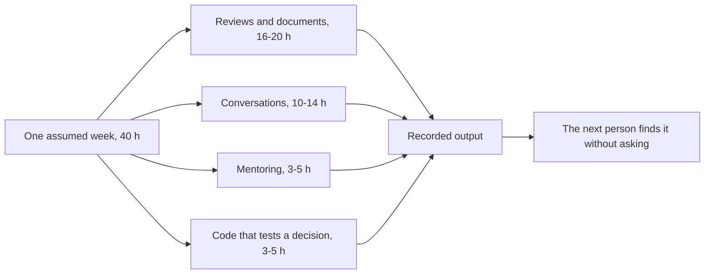

## Before you start

- [[sysdesign.l4.saas-challenges]] — you know a challenge in a review is answered from a recorded decision, and work left over gets an owner.
- [[sysdesign.l4.design-review-doc]] — you know a design review document is read in advance, and its open questions get an owner by role and a next step.
- [[management.l4.mentoring]] — you know mentoring hands over real work with shrinking support, and a weekly 1-1 picks the next task together.
- [[management.l4.presenting-to-leadership]] — you know a brief to leadership opens with the decision you need them to take.

## The situation

ADR `0025` has organised Đơn Hàng into the Ordering team, the Shop team and the platform team, and you now hold the architect role that works across all three. On Monday morning you open the week's calendar. It holds a design review, a proposed ADR waiting for comments, two pull requests, a postmortem, a roadmap meeting, a 1-1, pairing with a developer and a meeting with leadership. One slot writes code. None says "draw the architecture".

A developer from the Shop team asks what you will build this week. If the week is neither features nor diagrams, what does it produce?

## Core concepts

- architect role — in Đơn Hàng, a role that, as the project assumes, works with all three teams of ADR `0025` and belongs to none; the log does not name who holds it.
- recorded output — what an activity leaves for someone who was not there: a comment in a pull request, an open question with an owner, a note for the roadmap, an ADR.
- code that tests a decision — the small share of coding the role keeps for checks of a rule, such as a fitness function, rather than for features.
- audience — the people an activity's output is for: developers, the product owner (the person who decides what the team builds next, and so the roadmap's order) or leadership, each of whom needs something different first.

## How it works



In the situation above, the week is `architect-week.md`: one assumed week logged day by day, with who each activity involves and what it leaves behind.

The hours are assumed by the project for a team the size of Đơn Hàng, not taken from industry figures. Out of 40, reviews and documents take 16 to 20, conversations 10 to 14, mentoring 3 to 5 and code 3 to 5. The largest share covers reading a design review in advance, commenting on a proposed ADR, reviewing pull requests, reading a postmortem and updating the leadership brief. Conversations cover the review session, the roadmap meeting, leadership and answers to teams; mentoring covers the 1-1 and review comments that explain a reason.

Code is small, and it tests a decision rather than building a feature. On Thursday the pair makes the api refuse to start when `RateLimiting:CatalogReads` is below a minimum: the kind of change, with its test, that a team makes to follow a rule. Doing it once shows how much effort the rule costs; the log keeps this share so the role stays aware of that cost.

Every branch ends at the same node, a recorded output. A comment lands in the pull request, an unanswered question becomes a row with an owner by role, a gap becomes a note for the roadmap meeting. A decision said only in a meeting cannot be found later.

The audience changes through the week. Developers hear the reason behind a rule. The product owner hears trade-offs as results a shop can see. Leadership hears first the decision they are asked to take, then the reasons.

None of these activities is new: each has its own method, taught earlier in the path, and the week shows only how they sit side by side.

## In the Đơn Hàng system

The log opens with the calendar:

```markdown file=docs/team/architect-week.md tag=stage-4 lines=13-30
### Lịch trong tuần

Tuần giả định sau khi ADR 0025 được chấp nhận: đội platform và đội Đặt hàng đã
làm việc theo `team-structure.md`, đội Cửa hàng mới được lập.

| Ngày | Hoạt động | Với ai (vai trò) | Đầu ra | Cách làm ở |
|---|---|---|---|---|
| Thứ Hai | Đọc trước tài liệu review thiết kế chat hỗ trợ, ghi câu hỏi trước buổi review | Một mình | Danh sách câu hỏi gửi người đề xuất trước buổi review | `docs/design/design-review-template.md`, `docs/design/support-chat-design-review.md` |
| Thứ Hai | Góp ý pull request của một ADR ở trạng thái `Đề xuất`, trong thời gian góp ý (giả định: trần kết nối chat theo cửa hàng, rủi ro đầu tiên của `support-chat-design-review.md`) | Đội Đặt hàng | Ý kiến trong pull request; ý kiến làm đổi quyết định vào mục "Ý kiến đã nhận" của ADR | `docs/adr/README.md`, mục Quy trình |
| Thứ Ba | Dự buổi review thiết kế chat hỗ trợ | Đội Đặt hàng, đội platform, product owner | Mỗi câu hỏi chưa trả lời được thành một dòng trong mục "Rủi ro và câu hỏi mở", có người trả lời theo vai trò và hạn | `docs/design/design-review-template.md` |
| Thứ Ba | Review pull request của đội Cửa hàng đổi cách Catalog đọc cache | Đội Cửa hàng | Nhận xét review trỏ tới câu hỏi của checklist, không tới sở thích | `docs/design/backend-review-checklist.md`, mục Chủ dữ liệu và nhất quán |
| Thứ Ba | Review pull request đổi số replica của api trong repo cấu hình | Đội platform | Nhận xét review; câu "không biết" ghi thành câu hỏi mở trong pull request | `docs/design/cluster-review-checklist.md` |
| Thứ Tư | Đọc postmortem 0001, kiểm action item đã có chỗ trong kế hoạch | Một mình, rồi trưởng nhóm | Ghi chú cho buổi roadmap: action item "chọn thành phần gửi thông báo cho alert" chưa có mục trong `roadmap.md` | `docs/postmortems/0001-doc-san-pham-tra-503.md`, `docs/team/roadmap.md` |
| Thứ Tư | Xem roadmap với product owner | Product owner, trưởng nhóm | Thứ tự của mục "Tiếp theo" giữ hay đổi; mục đổi tầm ghi vào bảng "Đã dời" kèm lý do (giả định: tuần này không mục nào đổi tầm) | `docs/team/roadmap.md`, `docs/team/technical-strategy.md` |
| Thứ Năm | Buổi 1-1 kèm một lập trình viên mới | Lập trình viên mới | Việc tiếp theo được chọn cùng nhau | `docs/team/mentoring-plan.md`, `docs/team/architecture-skills-checklist.md` |
| Thứ Năm | Ghép cặp viết một phép kiểm cho một quy tắc (giả định: api từ chối khởi động khi `RateLimiting:CatalogReads` nhỏ hơn mức tối thiểu, action item của postmortem 0001) | Lập trình viên backend | Một pull request nhỏ có test; khi merge, phép kiểm thành một dòng của bảng "Phép kiểm đang có" trong `fitness-functions.md` | `docs/design/fitness-functions.md` |
| Thứ Sáu | Trình lãnh đạo bản cập nhật của brief đội platform | Lãnh đạo, trưởng nhóm | Quyết định được hỏi, nêu ở câu đầu (giả định: thêm người thứ tư cho đội platform, vì yêu cầu gửi sang đội này thường quá 2 ngày làm việc mới được trả lời), và câu trả lời ghi vào brief | `docs/team/leadership-brief-platform-team.md`, mục Điều chưa chắc |
| Thứ Sáu | Trả lời các yêu cầu gửi tới vai trò trong tuần | Các đội | Mỗi câu trả lời trỏ tới quy tắc, checklist hay ADR (mục dưới) | `docs/team/architecture-governance.md`, mục Ai quyết định gì |
```

Read the "Đầu ra" (output) column before the "Hoạt động" (activity) column: almost every row names something written; the 1-1's output is the next task, chosen together. Monday's comment on a proposed ADR is itself assumed: no ADR in `docs/adr/README.md` is in the `Đề xuất` (proposed) state at this point of the example repository, so the log imagines one, a cap on chat connections per shop. Thursday's pairing leaves a small pull request with a test; once merged, the check becomes a row of the "Phép kiểm đang có" (checks in place) table in `fitness-functions.md`. The last column points to the file that already holds each method, which is why the log teaches none of them.

The rest of the log explains the audience and the hours:

```markdown file=docs/team/architect-week.md tag=stage-4 lines=32-55
Người nghe đổi theo ngày: với lập trình viên, vai trò nói lý do đằng sau một
quy tắc; với product owner, nói đánh đổi bằng kết quả cửa hàng thấy được; với
lãnh đạo, nói quyết định cần họ đưa ra trước, rồi mới tới lý do.

Mỗi hoạt động kết thúc bằng một thứ được ghi lại: một ý kiến trong pull
request, một dòng câu hỏi mở có người trả lời, một ghi chú cho roadmap. Một
quyết định chỉ nói trong buổi họp thì người đến sau không tìm thấy, và phải
hỏi lại.

### Thời gian theo loại việc

Khoảng giờ trong một tuần 40 giờ, là giả định của dự án cho một nhóm cỡ Đơn
Hàng, không phải số liệu ngành.

| Loại việc | Giờ trong tuần (giả định) | Gồm |
|---|---|---|
| Review và tài liệu | 16 tới 20 | Đọc trước tài liệu review, góp ý ADR, review pull request, đọc postmortem, sửa brief |
| Trao đổi | 10 tới 14 | Buổi review thiết kế, buổi roadmap, trình lãnh đạo, trả lời yêu cầu của các đội |
| Kèm người | 3 tới 5 | Buổi 1-1, nhận xét review có giải thích lý do |
| Code | 3 tới 5 | Ghép cặp viết phép kiểm cho một quy tắc |

Phần code nhỏ nhưng không bằng không: nó giữ cho vai trò biết một quyết định
tốn bao nhiêu công khi đội phải làm theo, và nó dành cho việc kiểm một quyết
định (như một phép kiểm), không cho tính năng.
```

The first paragraph is the audience rule in the team's own words: a reason for developers, trade-offs as results a shop can see for the product owner, the decision first for leadership. The second says why a meeting is not enough: whoever comes later cannot find a decision that was only spoken. The hours table calls itself an assumption of the project, not an industry figure, so read it as a shape rather than a target. The last paragraph keeps code for checking a decision, not for features.

## Trade-offs

| How the architect's week is filled | When it is right | What it costs |
|---|---|---|
| The largest share on reviews and documents, a little code that tests decisions | several teams share decisions that cross their boundaries, as after ADR `0025` | the role ships few features itself; teams wait if its reviews are slow |
| Mostly code inside one team | there is one small team and few decisions cross a team boundary | decisions between teams have nobody reading them side by side |
| Mostly diagrams of the whole system | a new problem has no design yet, and the diagram is one section of a design review | a drawing alone records no driver, rejected option or owner |

The log's split has a fair opposing view. Some teams want their architect building features beside them every day, so the role feels what the code costs first-hand. That view is right for one small team, where the architect's decisions rarely leave it. Đơn Hàng after ADR `0025` has three teams, so the log keeps code for checks of decisions and spends the remaining hours where the teams meet.

## What would you choose if…

…a team asks you to build one of its features during a busy sprint? Under the log's split, the feature stays with the team that will own and run it. You offer to pair on the check that guards the rule the feature touches, which is the kind of code the role keeps.

…the leadership meeting ends with a clear answer, and everyone leaves without writing it down? Friday's row says the answer goes into the brief. You record it in `leadership-brief-platform-team.md` that day, so the platform team does not have to ask what was decided.

…a postmortem's action item has no place in the plan? Wednesday's row is that case: postmortem 0001 asks to choose a component that sends notifications for alerts, and `roadmap.md` has no item for it. The output is a note for the roadmap meeting, not a promise to fix it yourself.

## Seniors often assume…

- **"An architect spends most of the day drawing diagrams of the system."** → Actually the log has no slot for drawing; the largest share, 16 to 20 assumed hours, goes to reviews and documents, where a diagram is one section beside drivers, risks and owners. You notice this when a diagram is approved and a team still asks which option was rejected, and why.
- **"Once you become the architect, you stop writing code completely."** → Actually the log keeps 3 to 5 assumed hours of code, spent on checks such as the one pairing writes on Thursday, because the log keeps code to stay aware of what its rules cost. You notice this when a rule you expected to take an afternoon takes a team a week.
- **"A decision agreed in a meeting is done; writing it down afterwards is just paperwork."** → Actually the log says each activity ends in something recorded, because a decision only spoken in a meeting cannot be found by whoever was absent. You notice this when the same question comes back a month later from someone new.
- **"The architect talks mostly to developers; talking to leadership is the manager's job."** → Actually Friday's slot is the role presenting the platform team's updated brief to leadership, with the decision asked for first. You notice this when a technical limit reaches leadership second-hand and the decision they take misses it.

## Try it (3 minutes)

Three activities from the calendar are below. For each, name the recorded output, who the activity involves (the "Với ai" column), and the file the last column points to for its method.

1. A pull request from the platform team changes the api's replica count in the config repository, and one change is something you cannot judge.
2. The product owner asks whether the items under "Tiếp theo" (next) on the roadmap keep their order.
3. In the support chat design review, a question nobody can answer comes up.

Expected result: three outputs, each something written that a person who was absent can find.

<details><summary>Suggested answer</summary>

1. Review comments, with the "I don't know" written as an open question in the pull request; the platform team; `cluster-review-checklist.md`.
2. The order of "Tiếp theo" kept or changed, and any item moved to another part of the roadmap written into the "Đã dời" (moved) table with its reason; the product owner and the team lead; `roadmap.md` and `technical-strategy.md`.
3. A row in "Rủi ro và câu hỏi mở" (risks and open questions) with a person to answer it by role and a deadline; the Ordering team, the platform team and the product owner; `design-review-template.md`.

</details>

## Connections

- [[sysdesign.l4.design-review-doc]] — the method behind Monday's reading and Tuesday's review session.
- [[management.l3.proposing-an-adr]] — how the proposed ADR commented on during Monday moves through its comment period.
- [[backend.l4.backend-review-checklist]] — the checklist Tuesday's pull request review points to instead of taste.
- [[devops.l4.blameless-postmortems]] — where the postmortem read on Wednesday and its action items come from.
- [[management.l4.roadmap]] — the plan that Wednesday's note and the product owner meeting feed.
- [[management.l4.mentoring]] — the plan behind Thursday's 1-1.
- [[management.l4.presenting-to-leadership]] — the decision-first brief presented on Friday.
- [[management.l4.lightweight-governance]] — the decision rights that Friday's answers to the teams point to.
- [[sysdesign.l4.architecture-health-review]] — the next lesson: a quarterly review of whether past decisions still hold.

## Five-line summary

1. An architect's week gives its largest share to reviews and documents that become decisions others can carry out, not to diagrams or features.
2. `architect-week.md` logs one assumed week across ADR `0025`'s three teams and names the record each activity leaves.
3. Code takes a small assumed share, spent on checks of decisions, so the role stays aware of what its rules cost.
4. Every activity ends in a recorded output, so a decision outlives its meeting and the next person finds it without asking.
5. Developers get reasons, the product owner outcomes, leadership the decision first; every activity was taught earlier, and the week shows them together.
