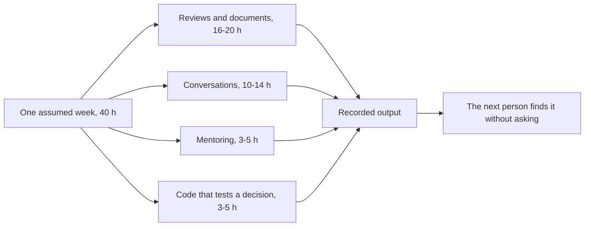

## Bạn cần biết trước

- [[sysdesign.l4.saas-challenges]] — bạn biết một câu phản biện trong buổi review được trả lời bằng một quyết định đã ghi, còn việc chưa xong thì phải có người phụ trách.
- [[sysdesign.l4.design-review-doc]] — bạn biết tài liệu review thiết kế được đọc trước, và mỗi câu hỏi mở trong đó có người trả lời theo vai trò cùng bước tiếp theo.
- [[management.l4.mentoring]] — bạn biết mentoring giao việc thật với mức hỗ trợ giảm dần, và buổi 1-1 hằng tuần cùng chọn việc tiếp theo.
- [[management.l4.presenting-to-leadership]] — bạn biết một brief gửi lãnh đạo mở đầu bằng quyết định bạn cần họ đưa ra.

## Tình huống

ADR `0025` đã chia Đơn Hàng thành đội Đặt hàng, đội Cửa hàng và đội platform, và giờ bạn giữ vai trò kiến trúc sư làm việc với cả ba đội. Sáng thứ Hai, bạn mở lịch của tuần. Trong đó có một buổi review thiết kế, một ADR đề xuất đang chờ góp ý, hai pull request, một postmortem, một buổi roadmap, một buổi 1-1, một buổi ghép cặp với lập trình viên và một buổi gặp lãnh đạo. Chỉ một ô là viết code. Không ô nào ghi "vẽ kiến trúc".

Một lập trình viên đội Cửa hàng hỏi tuần này bạn sẽ làm ra cái gì. Nếu tuần đó không phải tính năng, cũng không phải sơ đồ, thì nó tạo ra gì?

## Khái niệm cốt lõi

- vai trò kiến trúc sư — trong Đơn Hàng, theo giả định của dự án, là vai trò làm việc với cả ba đội của ADR `0025` mà không thuộc đội nào. Nhật ký không nêu tên người giữ vai trò này.
- đầu ra được ghi lại — thứ một hoạt động để lại cho người không có mặt: một ý kiến trong pull request, một câu hỏi mở có người trả lời, một ghi chú cho roadmap, một ADR.
- code để kiểm một quyết định — phần nhỏ thời gian viết code mà vai trò giữ lại cho các phép kiểm một quy tắc, như một fitness function, thay vì cho tính năng.
- người nghe — những người mà đầu ra của một hoạt động hướng tới: lập trình viên, product owner (người quyết định đội làm gì tiếp theo, tức thứ tự của roadmap) hay lãnh đạo. Mỗi nhóm cần nghe một điều khác nhau trước tiên.

## Cơ chế hoạt động



Trong tình huống trên, tuần đó chính là `architect-week.md`: một tuần giả định ghi theo từng ngày, với mỗi hoạt động có ai tham gia và để lại gì.

Số giờ là giả định của dự án cho một nhóm cỡ Đơn Hàng, không lấy từ số liệu ngành. Trong 40 giờ, review và tài liệu chiếm 16 tới 20, trao đổi 10 tới 14, kèm người 3 tới 5 và code 3 tới 5. Phần lớn nhất gồm đọc trước tài liệu review thiết kế, góp ý một ADR đề xuất, review pull request, đọc postmortem và cập nhật brief cho lãnh đạo. Trao đổi gồm buổi review, buổi roadmap, buổi gặp lãnh đạo và trả lời các đội. Kèm người gồm buổi 1-1 và những nhận xét review có giải thích lý do.

Phần code nhỏ, và nó kiểm một quyết định chứ không xây tính năng. Thứ Năm, hai người ghép cặp làm cho api từ chối khởi động khi `RateLimiting:CatalogReads` nhỏ hơn mức tối thiểu: đúng loại thay đổi, kèm test, mà một đội phải làm để theo một quy tắc. Tự làm một lần cho thấy quy tắc đó tốn bao nhiêu công. Nhật ký giữ phần này để vai trò luôn biết cái giá ấy.

Mọi nhánh đều kết thúc ở cùng một nút, một đầu ra được ghi lại. Một ý kiến nằm trong pull request, một câu hỏi chưa trả lời thành một dòng có người trả lời theo vai trò, một chỗ thiếu thành ghi chú cho buổi roadmap. Một quyết định chỉ nói trong buổi họp thì về sau không ai tìm thấy.

Người nghe thay đổi trong tuần. Lập trình viên nghe lý do đằng sau một quy tắc. Product owner nghe đánh đổi dưới dạng kết quả mà cửa hàng thấy được. Lãnh đạo nghe trước quyết định họ được yêu cầu đưa ra, rồi mới tới lý do.

Không hoạt động nào trong số này là mới: mỗi cái có phương pháp riêng, đã học ở phần trước của lộ trình, và tuần này chỉ cho thấy chúng đứng cạnh nhau ra sao.

## Trong hệ thống Đơn Hàng

Nhật ký mở đầu bằng lịch:

```markdown file=docs/team/architect-week.md tag=stage-4 lines=13-30
### Lịch trong tuần

Tuần giả định sau khi ADR 0025 được chấp nhận: đội platform và đội Đặt hàng đã
làm việc theo `team-structure.md`, đội Cửa hàng mới được lập.

| Ngày | Hoạt động | Với ai (vai trò) | Đầu ra | Cách làm ở |
|---|---|---|---|---|
| Thứ Hai | Đọc trước tài liệu review thiết kế chat hỗ trợ, ghi câu hỏi trước buổi review | Một mình | Danh sách câu hỏi gửi người đề xuất trước buổi review | `docs/design/design-review-template.md`, `docs/design/support-chat-design-review.md` |
| Thứ Hai | Góp ý pull request của một ADR ở trạng thái `Đề xuất`, trong thời gian góp ý (giả định: trần kết nối chat theo cửa hàng, rủi ro đầu tiên của `support-chat-design-review.md`) | Đội Đặt hàng | Ý kiến trong pull request; ý kiến làm đổi quyết định vào mục "Ý kiến đã nhận" của ADR | `docs/adr/README.md`, mục Quy trình |
| Thứ Ba | Dự buổi review thiết kế chat hỗ trợ | Đội Đặt hàng, đội platform, product owner | Mỗi câu hỏi chưa trả lời được thành một dòng trong mục "Rủi ro và câu hỏi mở", có người trả lời theo vai trò và hạn | `docs/design/design-review-template.md` |
| Thứ Ba | Review pull request của đội Cửa hàng đổi cách Catalog đọc cache | Đội Cửa hàng | Nhận xét review trỏ tới câu hỏi của checklist, không tới sở thích | `docs/design/backend-review-checklist.md`, mục Chủ dữ liệu và nhất quán |
| Thứ Ba | Review pull request đổi số replica của api trong repo cấu hình | Đội platform | Nhận xét review; câu "không biết" ghi thành câu hỏi mở trong pull request | `docs/design/cluster-review-checklist.md` |
| Thứ Tư | Đọc postmortem 0001, kiểm action item đã có chỗ trong kế hoạch | Một mình, rồi trưởng nhóm | Ghi chú cho buổi roadmap: action item "chọn thành phần gửi thông báo cho alert" chưa có mục trong `roadmap.md` | `docs/postmortems/0001-doc-san-pham-tra-503.md`, `docs/team/roadmap.md` |
| Thứ Tư | Xem roadmap với product owner | Product owner, trưởng nhóm | Thứ tự của mục "Tiếp theo" giữ hay đổi; mục đổi tầm ghi vào bảng "Đã dời" kèm lý do (giả định: tuần này không mục nào đổi tầm) | `docs/team/roadmap.md`, `docs/team/technical-strategy.md` |
| Thứ Năm | Buổi 1-1 kèm một lập trình viên mới | Lập trình viên mới | Việc tiếp theo được chọn cùng nhau | `docs/team/mentoring-plan.md`, `docs/team/architecture-skills-checklist.md` |
| Thứ Năm | Ghép cặp viết một phép kiểm cho một quy tắc (giả định: api từ chối khởi động khi `RateLimiting:CatalogReads` nhỏ hơn mức tối thiểu, action item của postmortem 0001) | Lập trình viên backend | Một pull request nhỏ có test; khi merge, phép kiểm thành một dòng của bảng "Phép kiểm đang có" trong `fitness-functions.md` | `docs/design/fitness-functions.md` |
| Thứ Sáu | Trình lãnh đạo bản cập nhật của brief đội platform | Lãnh đạo, trưởng nhóm | Quyết định được hỏi, nêu ở câu đầu (giả định: thêm người thứ tư cho đội platform, vì yêu cầu gửi sang đội này thường quá 2 ngày làm việc mới được trả lời), và câu trả lời ghi vào brief | `docs/team/leadership-brief-platform-team.md`, mục Điều chưa chắc |
| Thứ Sáu | Trả lời các yêu cầu gửi tới vai trò trong tuần | Các đội | Mỗi câu trả lời trỏ tới quy tắc, checklist hay ADR (mục dưới) | `docs/team/architecture-governance.md`, mục Ai quyết định gì |
```

Đọc cột "Đầu ra" trước cột "Hoạt động": gần như dòng nào cũng nêu một thứ được viết ra, còn đầu ra của buổi 1-1 là việc tiếp theo, chọn cùng nhau. Phần góp ý ADR đề xuất hôm thứ Hai cũng là giả định: ở thời điểm này của repo ví dụ, không ADR nào trong `docs/adr/README.md` đang ở trạng thái `Đề xuất`, nên nhật ký hình dung ra một ADR, về trần kết nối chat theo cửa hàng. Buổi ghép cặp thứ Năm để lại một pull request nhỏ có test. Khi merge, phép kiểm thành một dòng của bảng "Phép kiểm đang có" trong `fitness-functions.md`. Cột cuối trỏ tới file đã chứa phương pháp của từng hoạt động, vì thế nhật ký không dạy lại cái nào.

Phần còn lại của nhật ký giải thích người nghe và số giờ:

```markdown file=docs/team/architect-week.md tag=stage-4 lines=32-55
Người nghe đổi theo ngày: với lập trình viên, vai trò nói lý do đằng sau một
quy tắc; với product owner, nói đánh đổi bằng kết quả cửa hàng thấy được; với
lãnh đạo, nói quyết định cần họ đưa ra trước, rồi mới tới lý do.

Mỗi hoạt động kết thúc bằng một thứ được ghi lại: một ý kiến trong pull
request, một dòng câu hỏi mở có người trả lời, một ghi chú cho roadmap. Một
quyết định chỉ nói trong buổi họp thì người đến sau không tìm thấy, và phải
hỏi lại.

### Thời gian theo loại việc

Khoảng giờ trong một tuần 40 giờ, là giả định của dự án cho một nhóm cỡ Đơn
Hàng, không phải số liệu ngành.

| Loại việc | Giờ trong tuần (giả định) | Gồm |
|---|---|---|
| Review và tài liệu | 16 tới 20 | Đọc trước tài liệu review, góp ý ADR, review pull request, đọc postmortem, sửa brief |
| Trao đổi | 10 tới 14 | Buổi review thiết kế, buổi roadmap, trình lãnh đạo, trả lời yêu cầu của các đội |
| Kèm người | 3 tới 5 | Buổi 1-1, nhận xét review có giải thích lý do |
| Code | 3 tới 5 | Ghép cặp viết phép kiểm cho một quy tắc |

Phần code nhỏ nhưng không bằng không: nó giữ cho vai trò biết một quyết định
tốn bao nhiêu công khi đội phải làm theo, và nó dành cho việc kiểm một quyết
định (như một phép kiểm), không cho tính năng.
```

Đoạn đầu là quy tắc về người nghe, nói bằng lời của chính nhóm: lý do cho lập trình viên, đánh đổi dưới dạng kết quả cửa hàng thấy được cho product owner, quyết định đặt trước cho lãnh đạo. Đoạn thứ hai nói vì sao một buổi họp là chưa đủ: người đến sau không tìm được quyết định chỉ được nói ra. Bảng giờ tự nhận là giả định của dự án, không phải số liệu ngành, nên hãy đọc nó như một hình dạng chứ không phải chỉ tiêu. Đoạn cuối giữ phần code cho kiểm một quyết định, không cho tính năng.

## Đánh đổi

| Cách lấp đầy tuần của kiến trúc sư | Khi nào đúng | Phải trả gì |
|---|---|---|
| Phần lớn nhất cho review và tài liệu, một ít code kiểm quyết định | nhiều đội cùng dùng những quyết định vượt ranh giới giữa họ, như sau ADR `0025` | vai trò tự làm ra ít tính năng, và các đội phải chờ nếu review chậm |
| Chủ yếu viết code trong một đội | chỉ có một đội nhỏ và ít quyết định vượt ranh giới đội | các quyết định giữa các đội không có ai đọc đặt cạnh nhau |
| Chủ yếu vẽ sơ đồ toàn hệ thống | một bài toán mới chưa có thiết kế, và sơ đồ là một mục của tài liệu review thiết kế | chỉ một bản vẽ thì không ghi được driver, phương án bị loại hay người phụ trách |

Cách chia của nhật ký có một quan điểm ngược lại đáng xét. Có đội muốn kiến trúc sư của mình làm tính năng cùng họ mỗi ngày, để vai trò tự cảm nhận code tốn bao nhiêu công. Quan điểm này đúng với một đội nhỏ, nơi quyết định của kiến trúc sư hiếm khi đi ra ngoài đội. Đơn Hàng sau ADR `0025` có ba đội, nên nhật ký giữ code cho các phép kiểm quyết định và dành số giờ còn lại cho những chỗ các đội gặp nhau.

## Bạn sẽ chọn gì nếu…

…một đội nhờ bạn làm một tính năng của họ giữa một sprint bận rộn? Theo cách chia của nhật ký, tính năng ở lại với đội sẽ sở hữu và vận hành nó. Bạn đề nghị ghép cặp viết phép kiểm bảo vệ quy tắc mà tính năng đó chạm vào, đúng loại code vai trò giữ lại.

…buổi gặp lãnh đạo kết thúc với một câu trả lời rõ ràng, và mọi người ra về mà không ai ghi lại? Dòng thứ Sáu nói câu trả lời được ghi vào brief. Bạn ghi nó vào `leadership-brief-platform-team.md` ngay trong ngày, để đội platform không phải hỏi lại đã quyết định gì.

…một action item của postmortem chưa có chỗ trong kế hoạch? Dòng thứ Tư chính là trường hợp đó: postmortem 0001 yêu cầu chọn một thành phần gửi thông báo cho alert, và `roadmap.md` chưa có mục nào cho nó. Đầu ra là một ghi chú cho buổi roadmap, không phải lời hứa tự mình sửa.

## Senior hay nhầm rằng…

- **"Kiến trúc sư dành phần lớn thời gian mỗi ngày để vẽ sơ đồ hệ thống."** → Thực ra nhật ký không có ô nào cho vẽ. Phần lớn nhất, 16 tới 20 giờ giả định, dành cho review và tài liệu, nơi sơ đồ chỉ là một mục bên cạnh driver, rủi ro và người phụ trách. Bạn sẽ nhận ra khi một sơ đồ đã được duyệt mà một đội vẫn hỏi phương án nào bị loại, và vì sao.
- **"Đã làm kiến trúc sư thì thôi hẳn viết code."** → Thực ra nhật ký giữ 3 tới 5 giờ code giả định, dành cho những phép kiểm như cái được viết trong buổi ghép cặp thứ Năm, vì nhật ký giữ code để luôn biết các quy tắc của mình tốn bao nhiêu công. Bạn sẽ nhận ra khi một quy tắc bạn tưởng mất một buổi chiều lại khiến một đội mất cả tuần.
- **"Quyết định đã thống nhất trong buổi họp là xong, còn ghi lại sau đó chỉ là thủ tục giấy tờ."** → Thực ra nhật ký nói mỗi hoạt động kết thúc bằng một thứ được ghi lại, vì người vắng mặt không tìm được quyết định chỉ được nói trong buổi họp. Bạn sẽ nhận ra khi cùng một câu hỏi quay lại sau một tháng, từ một người mới.
- **"Kiến trúc sư chủ yếu nói chuyện với lập trình viên, còn nói với lãnh đạo là việc của quản lý."** → Thực ra ô thứ Sáu là vai trò trình lãnh đạo bản cập nhật brief của đội platform, với quyết định cần hỏi đặt lên đầu. Bạn sẽ nhận ra khi một giới hạn kỹ thuật đến tai lãnh đạo qua người khác và quyết định họ đưa ra bỏ sót nó.

## Thử ngay (3 phút)

Dưới đây là ba hoạt động trong lịch. Với mỗi hoạt động, nêu đầu ra được ghi lại, ai tham gia (cột "Với ai") và file mà cột cuối trỏ tới cho phương pháp của nó.

1. Một pull request của đội platform đổi số replica của api trong repo cấu hình, và có một thay đổi bạn không đánh giá được.
2. Product owner hỏi các mục trong "Tiếp theo" của roadmap có giữ nguyên thứ tự không.
3. Trong buổi review thiết kế chat hỗ trợ, nảy ra một câu hỏi không ai trả lời được.

Kết quả mong đợi: ba đầu ra, mỗi cái là một thứ được viết ra mà người vắng mặt tìm được.

<details><summary>Gợi ý đáp án</summary>

1. Đầu ra: nhận xét review, trong đó câu "không biết" được ghi thành câu hỏi mở trong pull request. Với ai: đội platform. File: `cluster-review-checklist.md`.
2. Đầu ra: thứ tự của "Tiếp theo" giữ hay đổi, và mục nào chuyển sang phần khác của roadmap thì ghi vào bảng "Đã dời" kèm lý do. Với ai: product owner và trưởng nhóm. File: `roadmap.md` và `technical-strategy.md`.
3. Đầu ra: một dòng trong "Rủi ro và câu hỏi mở" có người trả lời theo vai trò và hạn. Với ai: đội Đặt hàng, đội platform và product owner. File: `design-review-template.md`.

</details>

## Liên hệ

- [[sysdesign.l4.design-review-doc]] — phương pháp đứng sau buổi đọc trước hôm thứ Hai và buổi review hôm thứ Ba.
- [[management.l3.proposing-an-adr]] — cách ADR đề xuất được góp ý hôm thứ Hai đi qua thời gian góp ý.
- [[backend.l4.backend-review-checklist]] — checklist mà buổi review pull request hôm thứ Ba trỏ tới thay cho sở thích.
- [[devops.l4.blameless-postmortems]] — nguồn gốc của postmortem đọc hôm thứ Tư và các action item của nó.
- [[management.l4.roadmap]] — kế hoạch mà ghi chú thứ Tư và buổi gặp product owner đóng góp vào.
- [[management.l4.mentoring]] — kế hoạch đứng sau buổi 1-1 hôm thứ Năm.
- [[management.l4.presenting-to-leadership]] — brief đặt quyết định lên trước, được trình hôm thứ Sáu.
- [[management.l4.lightweight-governance]] — quyền quyết định mà các câu trả lời cho các đội hôm thứ Sáu trỏ tới.
- [[sysdesign.l4.architecture-health-review]] — bài tiếp theo: mỗi quý xem lại các quyết định cũ còn đúng không.

## Tóm tắt 5 dòng

1. Phần lớn nhất trong tuần của kiến trúc sư dành cho review và tài liệu thành quyết định người khác thực hiện được, không dành cho sơ đồ hay tính năng.
2. `architect-week.md` ghi một tuần giả định xuyên qua ba đội của ADR `0025` và nêu tên thứ mà mỗi hoạt động để lại.
3. Code chiếm một phần nhỏ giả định, dành cho các phép kiểm quyết định, để vai trò luôn biết các quy tắc của mình tốn bao nhiêu công.
4. Mọi hoạt động kết thúc bằng một đầu ra được ghi lại, nên quyết định sống lâu hơn buổi họp và người sau tìm thấy mà không phải hỏi.
5. Lập trình viên nhận lý do, product owner nhận kết quả, lãnh đạo nhận quyết định trước tiên. Mọi hoạt động đều đã học ở phần trước, và tuần này cho thấy chúng cùng nhau.
