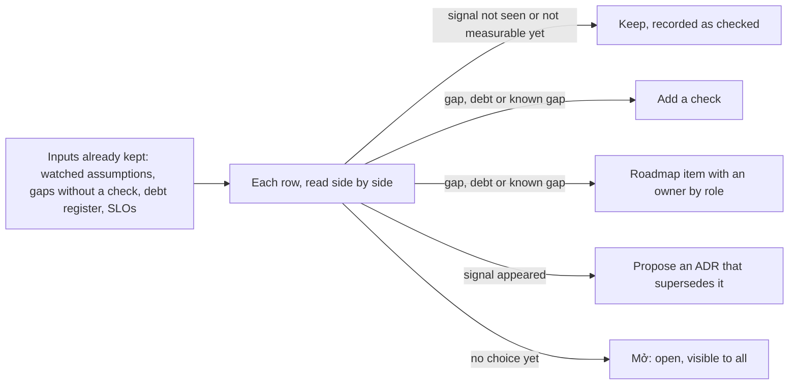

## Before you start

- [[sysdesign.l4.an-architects-week]] — you know the architect role spends its week on reviews and documents, and every activity ends in a recorded output.
- [[management.l4.deciding-under-uncertainty]] — you know an ADR states its assumptions and reopen signals, and `architecture-governance.md` lists where each signal shows and who watches it.
- [[design.l4.mapping-fitness-functions]] — you know every Đơn Hàng check runs on a change, none on a schedule, and each gap without a check has a recorded choice.
- [[design.l4.quantifying-technical-debt]] — you know each debt in the register carries an estimate of interest per quarter and principal, in hours.

## The situation

You hold Đơn Hàng's architect role, and the first quarterly review after Sprint 24 is on your calendar. Suppose every check listed in `fitness-functions.md` passes that morning. Nobody has edited ADR `0021`, which keeps Đơn Hàng without a service mesh, since it was accepted.

One assumption under it reads "one group, three .NET services". Since ADR `0025`, there are three teams. The ADR's text is unchanged, its checks are green, and nobody has reported a bug. The team lead asks whether there is anything to look at, since nothing is broken.

How do you tell whether a decision nobody has touched still holds?

## Core concepts

- stale decision — an accepted ADR whose assumptions have stopped holding while its text, and every check that guards it, stay exactly the same.
- quarterly health review — the session that `architecture-health-review.md` records, assumed to be the first one after Sprint 24, which asks one question: do the decisions already made still hold.
- reopen signal — the event an ADR names as the reason to look at it again, copied into the "Giả định cần theo dõi" (assumptions to watch) table of `architecture-governance.md` with where it shows and who watches it, by role.
- recorded choice — the one outcome each row read must end in: keep, add a check, put an item on the roadmap, or propose a new ADR that supersedes the old one; a row without one is marked "Mở" (open).
- known gap — a gap the whole team already knows about, such as production running without Prometheus; the review checks only that it has a roadmap item and an owner by role.

## How it works



In the situation above, the review starts from documents the teams already keep, not from the code. `architecture-health-review.md` lists seven inputs; this lesson follows four: the watched assumptions in `architecture-governance.md`, the "Chưa có phép kiểm tự động" (no automated check yet) section of `fitness-functions.md`, the interest and principal estimates in `tech-debt-register.md`, and the SLOs in `slo.md`. The other three are postmortem action items, delivery metrics and design reviews' open questions. The watched table is also read against the ADR index, `docs/adr/README.md`: an accepted ADR with a reopen condition but no row in the table shows up there.

The review reads them row by row, side by side, and each row ends in one recorded choice. A reopen signal has three possible results. A signal that has not appeared is written "Chưa thấy" (not seen): someone looked, so "still holds" is a finding rather than a guess. A signal that cannot be measured yet is written "Chưa đo được" (not measurable yet) instead of being skipped. A signal that has appeared leads its watcher to propose a new ADR; the accepted ADR is never edited to match.

For gaps without a check, debts and known gaps, the choice is to keep, add a check, or put an item on the roadmap with an owner by role. A row the meeting cannot settle is written "Mở", so everyone sees it is still open.

The meeting is short because every input exists before it starts. The architect's part is reading them side by side, which no single team's document does.

## In the Đơn Hàng system

The review's first table reads the watched assumptions:

```markdown file=docs/design/architecture-health-review.md tag=stage-4 lines=35-59
Mỗi dòng của bảng trong `architecture-governance.md`. Tín hiệu chép từ đó.
"Chưa thấy" là một kết quả đã kiểm, ghi lại, không phải một phỏng đoán.

| ADR | Tín hiệu mở lại | Đã thấy chưa (giả định) | Lựa chọn |
|---|---|---|---|
| 0012 | Một cửa hàng có hợp đồng đòi một bản hệ thống riêng | Chưa thấy: không hợp đồng nào trong quý đòi điều đó | Giữ |
| 0012 | Các đội phải chờ nhau để sửa cùng một module | Chưa thấy: không pull request nào bị chặn vì chờ đội khác | Giữ |
| 0019 | Một cửa hàng cần một bản triển khai riêng | Chưa thấy | Giữ |
| 0019 | Một thay đổi không làm tương thích được với bản trước | Chưa thấy: mọi thay đổi schema của quý qua mục thay đổi schema và message của `backend-review-checklist.md` | Giữ |
| 0019 | Notifications hoặc Payments nhận phần lớn việc qua Gateway | Chưa thấy: HTTPRoute tới hai service đó vẫn chỉ có `/api/v1/refunds` | Giữ |
| 0020 | Hợp đồng đòi RTO hoặc RPO thấp hơn số đo của DR drill | Chưa thấy | Giữ |
| 0020 | Dữ liệu một số cửa hàng phải nằm ở một vùng xác định | Chưa thấy | Giữ |
| 0021 | Hợp đồng đòi mã hóa lời gọi bên trong cluster | Chưa thấy | Giữ |
| 0021 | Service đến từ nhiều nhóm hoặc nhiều ngôn ngữ | Chưa thấy: đã có ba đội nhưng service vẫn là ba service .NET; xem lại khi `DonHang.Support` (ADR 0032) được xây | Giữ |
| 0021 | Service gọi nhau giữa các cluster | Chưa thấy | Giữ |
| 0022 | Hợp đồng đòi máy riêng hoặc dữ liệu ở một nơi xác định | Chưa thấy | Giữ |
| 0022 | Phí nhà cung cấp vượt chi phí giả định của việc tự chạy cluster | Chưa đo được: production chưa chạy trên Kubernetes managed, chưa có hóa đơn | Giữ |
| 0024 | Tỉ lệ email tới hộp thư thấp hơn mức giả định | Chưa đo được: chưa gửi email thật từ production | Giữ |
| 0024 | Giá vượt TCO giả định | Chưa đo được | Giữ |
| 0024 | Dịch vụ A ngừng nhận email qua SMTP | Chưa thấy | Giữ |

Quý này không tín hiệu nào xuất hiện, nên không dòng nào dẫn tới một ADR mới.
Quy tắc khi một tín hiệu xuất hiện: người theo dõi đề xuất một ADR mới thay ADR
cũ; ADR đã chấp nhận không được sửa cho khớp, chỉ được đổi trạng thái thành
`Bị thay thế bởi NNNN` (`docs/adr/README.md`).
```

Read the "Đã thấy chưa" (seen yet) column: many rows say what was looked at, such as no pull request blocked while waiting for another team, so "Chưa thấy" is a checked result. Three rows say "Chưa đo được"; two give the reason, no managed cluster bill and no real email from production yet. They stay "Giữ" (keep) without claiming evidence they lack.

The `0021` row from the situation is here. Its signal names services, not teams: services that come from many groups or in many languages. The teams grew to three, but the services are still the same three .NET services, so the signal is not seen. A new service is where it would show, so the row is looked at again when `DonHang.Support`, the separate support-chat service ADR `0032` accepted, is built. The paragraph under the table is the rule for the day a signal appears: the watcher proposes a new ADR, and the accepted one only changes its status to `Bị thay thế bởi NNNN` (superseded by NNNN). In `architecture-governance.md`, the backend developer watches the `0024` rows on delivery and SMTP.

The review ends with the known gaps and its results:

```markdown file=docs/design/architecture-health-review.md tag=stage-4 lines=91-115
### Khoảng trống đã biết

Những khoảng trống mọi người đều biết. Câu hỏi của buổi họp chỉ là: đã có mục
trong `roadmap.md` chưa, và có người phụ trách theo vai trò chưa. Một khoảng
trống ai cũng biết mà không ai phụ trách thì vẫn mở mãi.

| Khoảng trống | Nguồn | Mục trong roadmap | Người phụ trách (vai trò) | Lựa chọn |
|---|---|---|---|---|
| Production chưa có Prometheus: SLO chưa đo được ở production, không alert nào về production | `slo.md`, mục Chưa có | "Tiếp theo": đội biết production đang khỏe (H3) | Lập trình viên phụ trách nền tảng, nay trong đội platform | Giữ |
| Alert của staging chưa gửi tới người trực | `slo.md`, mục Chưa có; action item của postmortem 0001 | Chưa có | Lập trình viên phụ trách nền tảng | Đưa vào roadmap, cùng H3 |
| Bản sao lưu và WAL chưa rời máy chạy database | ADR 0020; TT-4 của `docs/team/compliance-controls.md` | "Bây giờ": base backup và WAL có bản ở region thứ hai (H4) | Lập trình viên phụ trách nền tảng | Giữ |
| Một commit của `gitops-promote.sh` đủ để đưa api lên production: người làm cũng là người duyệt | TT-1 của `compliance-controls.md` | "Tiếp theo": không thay đổi production nào lên mà chỉ một người làm và tự duyệt (H6) | Trưởng nhóm | Giữ |

### Kết quả

| Dòng | Lựa chọn | Người phụ trách (vai trò) | Lần xem lại |
|---|---|---|---|
| Bảng "Giả định cần theo dõi" thiếu các ADR 0004, 0013 tới 0018, 0023, 0025, 0026 tới 0033 | Thêm dòng vào bảng | Trưởng nhóm | Buổi quý sau |
| Image đang chạy không mang lỗ hổng công bố sau build | Mở: chưa chọn cách quét | Lập trình viên phụ trách nền tảng, mang hai cách tới buổi sau | Buổi quý sau, hoặc sớm hơn nếu production nhận khách trước đó |
| Trải nghiệm trên máy khách (A1–A3) | Đưa vào roadmap, mục "Sau đó" | Product owner | Lần xem roadmap kế tiếp |
| N2 | Đưa vào roadmap khi kế toán xác nhận | Lập trình viên backend | Mỗi sprint planning, theo sổ nợ |
| Alert của staging chưa gửi tới người trực | Đưa vào roadmap, cùng H3 | Lập trình viên phụ trách nền tảng | Lần xem roadmap kế tiếp |
| Mọi dòng còn lại | Giữ | Người theo dõi ghi ở từng bảng nguồn | Buổi quý sau |

Không dòng nào dẫn tới đề xuất ADR thay thế trong quý này.
```

The known gaps table asks two questions per row: is there an item in `roadmap.md`, and who owns it by role. H3, H4 and H6 name the action in `technical-strategy.md` that a roadmap item serves; H3 is monitoring production. Production without Prometheus already has both, so it is kept; staging alerts that reach nobody on call had no roadmap item, so the result puts one beside H3.

The "Kết quả" (results) table is the review's output: every row has a choice, an owner by role and the next time it is looked at. Its first row is a finding about the inputs themselves: the governance table has no rows for many accepted ADRs. "Thêm dòng vào bảng" (add rows to the table) is none of the four choices, because it completes an input rather than settling a row read; the team lead adds the rows. The scanning row stays "Mở", and its owner brings two options to the next session. The A1–A3 row (client experience, from `app-experience.md`) and debt N2 follow the roadmap pattern; N2 waits for accounting to confirm first.

## Trade-offs

| How past decisions are kept current | When it is right | What it costs |
|---|---|---|
| A quarterly review that reads the kept inputs side by side | several teams keep their own documents, and accepted ADRs name reopen signals | a short meeting each quarter, and inputs kept current between sessions |
| The checks in CI alone | the property is one a check can see on each change, like a module boundary | a check sees only what it tests, only on a change; contracts and fees change outside the code |
| A review only before a big new feature | the feature is the change most likely to break an assumption | assumptions that stop holding while nothing new is planned stay unseen until the next feature |
| Each watcher acts alone when a signal appears | one team, a handful of ADRs, each signal with a watcher | a gap between documents, such as rows missing from the watched table, belongs to nobody |

A fair opposing view skips the session and relies on the watchers, since every governance row names one by role. That is right when the team is small and every accepted ADR has its rows. Đơn Hàng's first session found many accepted ADRs with no rows, which only the ADR index beside the table showed.

## What would you choose if…

…a shop's contract, before signing, demands that its data stay in one region? That is a reopen signal of two rows, ADR `0020` and ADR `0022`, both watched by the product owner. Each row's choice is to propose a new ADR that supersedes it; neither ADR's text changes, and the review does not decide what the new ADRs say.

…production starts taking customers before the next quarterly session? The "Mở" scanning row comes back sooner, because the gap was accepted only while no environment before production held real customer data.

…someone says in a meeting that "everyone knows staging alerts reach nobody"? The review does not ask who knows. This row had no roadmap item, so the choice put it on the roadmap with an owner by role.

## Seniors often assume…

- **"Once an ADR is accepted, it stays correct until someone finds a bug in the code."** → Actually an ADR holds while its assumptions hold, and they change outside the code: a contract, a provider's fee, the number of teams. You notice this when a decision is questioned and nobody can say whether its reason still applies.
- **"If every check in CI is green, the architecture is healthy."** → Actually every check in `fitness-functions.md` runs on a change, none on a schedule, and each sees only what it tests; a vulnerability published after an image was built is seen by no check until the next build. You notice this when a running image carries a CVE published after its scan.
- **"An architecture review is only needed when a big new feature is planned."** → Actually the first scheduled session, tied to no feature, found the watched table missing rows for many accepted ADRs, because assumptions go stale on their own schedule. You notice this when an ADR's reopen condition appears and nobody was watching for it.
- **"When an ADR's assumption turns out wrong, the ADR should be edited to match."** → Actually a new ADR supersedes it, and the old one changes only its status to point at the replacement, because its reasons record why the choice was right at the time. You notice this when nobody can tell what an edited ADR first decided.

## Try it (3 minutes)

Three rows reach next quarter's session. For each, write the recorded choice and who acts, by role, using the two blocks above and the rule under the first table.

1. Dịch vụ A, the email service of ADR `0024`, announces it will stop accepting email over SMTP.
2. No shop's contract this quarter asked for a copy of the system of its own.
3. A postmortem action item has no item in `roadmap.md`.

Expected result: three choices, each with an owner by role where the lesson names one, and none of them edits an accepted ADR.

<details><summary>Suggested answer</summary>

1. The signal has appeared: the backend developer, its watcher, proposes a new ADR that supersedes `0024`; `0024` changes only its status once the new one is accepted.
2. ADR `0012`'s first signal, watched by the product owner: "Chưa thấy", keep.3. Put it on the roadmap with an owner by role, as the review did for staging alerts from postmortem `0001`.

</details>

## Connections

- [[management.l4.deciding-under-uncertainty]] — where the reopen signals read here are written.
- [[management.l3.superseding-an-adr]] — the procedure a row follows when its signal appears.
- [[design.l4.mapping-fitness-functions]] — the source of the gaps-without-a-check input.
- [[design.l4.quantifying-technical-debt]] — the source of the debt input.
- [[management.l4.lightweight-governance]] — the watched table the review keeps complete.
- [[management.l4.technical-strategy]] — reviewed each quarter alongside the governance table.
- [[backend.l4.error-budget]] — the budgets the SLO input is read against.
- [[devops.l4.delivery-metrics]] — the four measures compared quarter to quarter.
- [[sysdesign.l4.deciding-what-not-to-decide]] — the next lesson: which decisions the architect role keeps at all.

## Five-line summary

1. A quarterly health review checks that past decisions still hold, since an ADR can go stale while its text and checks stay unchanged.
2. `architecture-health-review.md` reads inputs already kept: watched assumptions, gaps without a check, the debt register and the SLOs.
3. Each row ends in one recorded choice: keep, add a check, a roadmap item or a superseding ADR; otherwise it stays visibly open.
4. A signal not seen is recorded as checked; a signal that appears leads to a proposed ADR, never an edit to the accepted one.
5. Known gaps need a roadmap item and an owner by role; the review is short because its inputs exist, read side by side.
