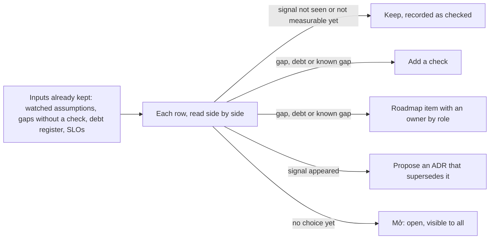

## Bạn cần biết trước

- [[sysdesign.l4.an-architects-week]] — bạn biết vai trò kiến trúc sư dành tuần làm việc cho review và tài liệu, và hoạt động nào cũng kết thúc bằng một đầu ra được ghi lại.
- [[management.l4.deciding-under-uncertainty]] — bạn biết một ADR nêu các giả định và tín hiệu mở lại của nó, còn `architecture-governance.md` ghi mỗi tín hiệu hiện ra ở đâu và ai theo dõi.
- [[design.l4.mapping-fitness-functions]] — bạn biết mọi phép kiểm của Đơn Hàng chạy khi có thay đổi, không cái nào chạy theo lịch, và mỗi khoảng trống chưa có phép kiểm đều có một lựa chọn đã ghi.
- [[design.l4.quantifying-technical-debt]] — bạn biết mỗi món nợ trong sổ mang một ước lượng lãi mỗi quý và gốc, tính bằng giờ.

## Tình huống

Bạn giữ vai trò kiến trúc sư của Đơn Hàng, và buổi xem lại hằng quý đầu tiên sau Sprint 24 đã có trên lịch. Giả sử sáng hôm đó mọi phép kiểm trong `fitness-functions.md` đều qua. ADR `0021`, quyết định giữ Đơn Hàng không dùng service mesh, chưa ai sửa từ khi được chấp nhận.

Một giả định đứng sau nó ghi "một nhóm, ba service .NET". Từ ADR `0025`, đã có ba đội. Văn bản ADR không đổi, các phép kiểm đều xanh, và chưa ai báo lỗi. Trưởng nhóm hỏi có gì cần xem không, khi chẳng có gì hỏng.

Làm sao biết một quyết định không ai đụng tới vẫn còn đúng?

## Khái niệm cốt lõi

- quyết định đã cũ — một ADR đã chấp nhận mà các giả định của nó thôi đúng, trong khi văn bản của nó và mọi phép kiểm canh giữ nó vẫn y nguyên.
- buổi xem lại sức khỏe hằng quý — buổi họp mà `architecture-health-review.md` ghi lại, giả định là buổi đầu tiên sau Sprint 24, với đúng một câu hỏi: các quyết định đã đưa ra còn đúng không.
- tín hiệu mở lại — sự kiện mà một ADR nêu làm lý do để xem lại nó, được chép vào bảng "Giả định cần theo dõi" của `architecture-governance.md`, kèm nơi nó hiện ra và ai theo dõi, theo vai trò.
- lựa chọn được ghi lại — kết quả duy nhất mà mỗi dòng được đọc phải dẫn tới: giữ, thêm phép kiểm, đưa một mục vào roadmap, hoặc đề xuất một ADR mới thay ADR cũ. Dòng chưa có lựa chọn thì ghi "Mở".
- khoảng trống đã biết — chỗ thiếu mà cả nhóm đều biết, như production chạy không có Prometheus. Buổi xem lại chỉ kiểm nó đã có mục trong roadmap và người phụ trách theo vai trò chưa.

## Cơ chế hoạt động



Trong tình huống trên, buổi xem lại bắt đầu từ các tài liệu các đội vẫn giữ, không từ code. `architecture-health-review.md` liệt kê bảy đầu vào, bài này theo bốn: các giả định cần theo dõi trong `architecture-governance.md`, mục "Chưa có phép kiểm tự động" của `fitness-functions.md`, ước lượng lãi và gốc trong `tech-debt-register.md`, và các SLO trong `slo.md`. Ba đầu vào còn lại là action item của postmortem, số đo việc giao phần mềm và câu hỏi mở của các buổi review thiết kế. Bảng theo dõi còn được đọc cạnh mục lục ADR, `docs/adr/README.md`: một ADR đã chấp nhận có điều kiện mở lại mà không có dòng nào trong bảng sẽ lộ ra ở đó.

Buổi xem lại đọc chúng từng dòng, đặt cạnh nhau, và mỗi dòng kết thúc bằng một lựa chọn được ghi lại. Một tín hiệu mở lại có ba kết quả. Tín hiệu chưa xuất hiện thì ghi "Chưa thấy": đã có người nhìn, nên "vẫn đúng" là một kết luận chứ không phải phỏng đoán. Tín hiệu chưa đo được thì ghi "Chưa đo được" thay vì bỏ qua. Tín hiệu đã xuất hiện thì người theo dõi đề xuất một ADR mới, còn ADR đã chấp nhận không bao giờ bị sửa cho khớp.

Với khoảng trống chưa có phép kiểm, món nợ và khoảng trống đã biết, lựa chọn là giữ, thêm phép kiểm, hoặc đưa một mục vào roadmap kèm người phụ trách theo vai trò. Dòng nào buổi họp chưa chốt được thì ghi "Mở", để ai cũng thấy nó còn bỏ ngỏ.

Buổi họp ngắn vì mọi đầu vào đã có sẵn trước khi bắt đầu. Phần của kiến trúc sư là đọc chúng cạnh nhau, điều mà tài liệu riêng của đội nào cũng không làm.

## Trong hệ thống Đơn Hàng

Bảng đầu tiên của buổi xem lại đọc các giả định cần theo dõi:

```markdown file=docs/design/architecture-health-review.md tag=stage-4 lines=35-59
Mỗi dòng của bảng trong `architecture-governance.md`. Tín hiệu chép từ đó.
"Chưa thấy" là một kết quả đã kiểm, ghi lại, không phải một phỏng đoán.

| ADR | Tín hiệu mở lại | Đã thấy chưa (giả định) | Lựa chọn |
|---|---|---|---|
| 0012 | Một cửa hàng có hợp đồng đòi một bản hệ thống riêng | Chưa thấy: không hợp đồng nào trong quý đòi điều đó | Giữ |
| 0012 | Các đội phải chờ nhau để sửa cùng một module | Chưa thấy: không pull request nào bị chặn vì chờ đội khác | Giữ |
| 0019 | Một cửa hàng cần một bản triển khai riêng | Chưa thấy | Giữ |
| 0019 | Một thay đổi không làm tương thích được với bản trước | Chưa thấy: mọi thay đổi schema của quý qua mục thay đổi schema và message của `backend-review-checklist.md` | Giữ |
| 0019 | Notifications hoặc Payments nhận phần lớn việc qua Gateway | Chưa thấy: HTTPRoute tới hai service đó vẫn chỉ có `/api/v1/refunds` | Giữ |
| 0020 | Hợp đồng đòi RTO hoặc RPO thấp hơn số đo của DR drill | Chưa thấy | Giữ |
| 0020 | Dữ liệu một số cửa hàng phải nằm ở một vùng xác định | Chưa thấy | Giữ |
| 0021 | Hợp đồng đòi mã hóa lời gọi bên trong cluster | Chưa thấy | Giữ |
| 0021 | Service đến từ nhiều nhóm hoặc nhiều ngôn ngữ | Chưa thấy: đã có ba đội nhưng service vẫn là ba service .NET; xem lại khi `DonHang.Support` (ADR 0032) được xây | Giữ |
| 0021 | Service gọi nhau giữa các cluster | Chưa thấy | Giữ |
| 0022 | Hợp đồng đòi máy riêng hoặc dữ liệu ở một nơi xác định | Chưa thấy | Giữ |
| 0022 | Phí nhà cung cấp vượt chi phí giả định của việc tự chạy cluster | Chưa đo được: production chưa chạy trên Kubernetes managed, chưa có hóa đơn | Giữ |
| 0024 | Tỉ lệ email tới hộp thư thấp hơn mức giả định | Chưa đo được: chưa gửi email thật từ production | Giữ |
| 0024 | Giá vượt TCO giả định | Chưa đo được | Giữ |
| 0024 | Dịch vụ A ngừng nhận email qua SMTP | Chưa thấy | Giữ |

Quý này không tín hiệu nào xuất hiện, nên không dòng nào dẫn tới một ADR mới.
Quy tắc khi một tín hiệu xuất hiện: người theo dõi đề xuất một ADR mới thay ADR
cũ; ADR đã chấp nhận không được sửa cho khớp, chỉ được đổi trạng thái thành
`Bị thay thế bởi NNNN` (`docs/adr/README.md`).
```

Hãy đọc cột "Đã thấy chưa": nhiều dòng nói rõ đã nhìn vào đâu, như không pull request nào bị chặn vì chờ đội khác, nên "Chưa thấy" là một kết quả đã kiểm. Ba dòng ghi "Chưa đo được", hai trong số đó nêu lý do: chưa có hóa đơn cluster managed và chưa gửi email thật nào từ production. Chúng vẫn "Giữ" mà không nhận mình có bằng chứng chưa có.

Dòng `0021` của tình huống nằm ở đây. Tín hiệu của nó nói về service, không về đội: service đến từ nhiều nhóm hoặc viết bằng nhiều ngôn ngữ. Số đội đã lên ba, nhưng service vẫn là ba service .NET cũ, nên tín hiệu chưa thấy. Nơi tín hiệu sẽ hiện ra là một service mới, vì thế dòng này được xem lại khi `DonHang.Support`, service chat hỗ trợ riêng mà ADR `0032` đã chấp nhận, được xây. Đoạn dưới bảng là quy tắc cho ngày một tín hiệu xuất hiện: người theo dõi đề xuất một ADR mới, còn ADR đã chấp nhận chỉ đổi trạng thái thành `Bị thay thế bởi NNNN`. Trong `architecture-governance.md`, lập trình viên backend theo dõi các dòng `0024` về tỉ lệ tới hộp thư và SMTP.

Buổi xem lại kết thúc bằng các khoảng trống đã biết và kết quả:

```markdown file=docs/design/architecture-health-review.md tag=stage-4 lines=91-115
### Khoảng trống đã biết

Những khoảng trống mọi người đều biết. Câu hỏi của buổi họp chỉ là: đã có mục
trong `roadmap.md` chưa, và có người phụ trách theo vai trò chưa. Một khoảng
trống ai cũng biết mà không ai phụ trách thì vẫn mở mãi.

| Khoảng trống | Nguồn | Mục trong roadmap | Người phụ trách (vai trò) | Lựa chọn |
|---|---|---|---|---|
| Production chưa có Prometheus: SLO chưa đo được ở production, không alert nào về production | `slo.md`, mục Chưa có | "Tiếp theo": đội biết production đang khỏe (H3) | Lập trình viên phụ trách nền tảng, nay trong đội platform | Giữ |
| Alert của staging chưa gửi tới người trực | `slo.md`, mục Chưa có; action item của postmortem 0001 | Chưa có | Lập trình viên phụ trách nền tảng | Đưa vào roadmap, cùng H3 |
| Bản sao lưu và WAL chưa rời máy chạy database | ADR 0020; TT-4 của `docs/team/compliance-controls.md` | "Bây giờ": base backup và WAL có bản ở region thứ hai (H4) | Lập trình viên phụ trách nền tảng | Giữ |
| Một commit của `gitops-promote.sh` đủ để đưa api lên production: người làm cũng là người duyệt | TT-1 của `compliance-controls.md` | "Tiếp theo": không thay đổi production nào lên mà chỉ một người làm và tự duyệt (H6) | Trưởng nhóm | Giữ |

### Kết quả

| Dòng | Lựa chọn | Người phụ trách (vai trò) | Lần xem lại |
|---|---|---|---|
| Bảng "Giả định cần theo dõi" thiếu các ADR 0004, 0013 tới 0018, 0023, 0025, 0026 tới 0033 | Thêm dòng vào bảng | Trưởng nhóm | Buổi quý sau |
| Image đang chạy không mang lỗ hổng công bố sau build | Mở: chưa chọn cách quét | Lập trình viên phụ trách nền tảng, mang hai cách tới buổi sau | Buổi quý sau, hoặc sớm hơn nếu production nhận khách trước đó |
| Trải nghiệm trên máy khách (A1–A3) | Đưa vào roadmap, mục "Sau đó" | Product owner | Lần xem roadmap kế tiếp |
| N2 | Đưa vào roadmap khi kế toán xác nhận | Lập trình viên backend | Mỗi sprint planning, theo sổ nợ |
| Alert của staging chưa gửi tới người trực | Đưa vào roadmap, cùng H3 | Lập trình viên phụ trách nền tảng | Lần xem roadmap kế tiếp |
| Mọi dòng còn lại | Giữ | Người theo dõi ghi ở từng bảng nguồn | Buổi quý sau |

Không dòng nào dẫn tới đề xuất ADR thay thế trong quý này.
```

Bảng khoảng trống đã biết hỏi hai câu cho mỗi dòng: đã có mục trong `roadmap.md` chưa, và ai phụ trách theo vai trò. H3, H4 và H6 chỉ tới hành động trong `technical-strategy.md` mà một mục roadmap phục vụ, H3 là giám sát production. Production thiếu Prometheus đã có đủ cả hai, nên được giữ. Cảnh báo của staging không tới ai đang trực sự cố thì chưa có mục roadmap, nên kết quả đặt một mục cạnh H3.

Bảng "Kết quả" là đầu ra của buổi xem lại: dòng nào cũng có lựa chọn, người phụ trách theo vai trò và lần xem lại tiếp theo. Dòng đầu tiên là một phát hiện về chính các đầu vào: bảng quản trị không có dòng nào cho nhiều ADR đã chấp nhận. "Thêm dòng vào bảng" không thuộc bốn lựa chọn, vì nó bổ sung một đầu vào chứ không chốt một dòng được đọc, và trưởng nhóm là người thêm. Dòng về cách quét vẫn "Mở", và người phụ trách mang hai cách tới buổi sau. Dòng A1–A3 (trải nghiệm trên máy khách, từ `app-experience.md`) và món nợ N2 đi theo lối roadmap, riêng N2 chờ kế toán xác nhận trước.

## Đánh đổi

| Cách giữ cho quyết định cũ còn đúng | Khi nào đúng | Phải trả gì |
|---|---|---|
| Buổi xem lại hằng quý đọc cạnh nhau các đầu vào đã có | nhiều đội giữ tài liệu riêng, và các ADR đã chấp nhận nêu tín hiệu mở lại | mỗi quý một buổi họp ngắn, và các đầu vào phải được cập nhật giữa hai buổi |
| Chỉ dựa vào phép kiểm trong CI | thuộc tính cần giữ là thứ một phép kiểm thấy được ở mỗi thay đổi, như ranh giới module | phép kiểm chỉ thấy điều nó kiểm, và chỉ khi có thay đổi, còn hợp đồng và phí thì đổi ở ngoài code |
| Chỉ xem lại trước một tính năng lớn | tính năng đó là thay đổi dễ phá một giả định nhất | giả định thôi đúng trong lúc không có gì mới được lên kế hoạch thì nằm im tới tính năng sau |
| Mỗi người theo dõi tự làm khi tín hiệu xuất hiện | một đội, vài ADR, tín hiệu nào cũng có người theo dõi | chỗ hở giữa các tài liệu, như những dòng thiếu trong bảng theo dõi, không thuộc về ai |

Một quan điểm ngược lại đáng xét là bỏ buổi họp và tin vào người theo dõi, vì dòng nào trong bảng quản trị cũng nêu một người theo vai trò. Cách đó đúng khi nhóm nhỏ và mọi ADR đã chấp nhận đều có dòng của mình. Buổi đầu tiên của Đơn Hàng lại thấy nhiều ADR đã chấp nhận không có dòng nào, và chỉ mục lục ADR đặt cạnh bảng mới cho thấy điều đó.

## Bạn sẽ chọn gì nếu…

…hợp đồng của một cửa hàng, trước khi ký, đòi dữ liệu của họ nằm ở một vùng xác định? Đó là tín hiệu mở lại của hai dòng, ADR `0020` và ADR `0022`, cả hai do product owner theo dõi. Lựa chọn của mỗi dòng là đề xuất một ADR mới thay nó. Văn bản của cả hai ADR không đổi, và buổi xem lại không quyết các ADR mới sẽ nói gì.

…production bắt đầu nhận khách trước buổi quý sau? Dòng "Mở" về cách quét được xem lại sớm hơn, vì khoảng trống đó chỉ được chấp nhận khi chưa môi trường nào trước production giữ dữ liệu khách thật.

…có người nói trong buổi họp rằng "ai cũng biết cảnh báo của staging chẳng tới ai"? Buổi xem lại không hỏi ai biết. Dòng này chưa có mục roadmap, nên lựa chọn là đưa vào roadmap kèm người phụ trách theo vai trò.

## Senior hay nhầm rằng…

- **"ADR đã được chấp nhận thì đúng mãi, tới khi có người tìm ra lỗi trong code."** → Thực ra một ADR chỉ đúng khi các giả định của nó còn đúng, và chúng đổi ở ngoài code: một hợp đồng, phí của nhà cung cấp, số đội. Bạn sẽ nhận ra khi một quyết định bị đặt câu hỏi mà không ai nói được lý do của nó còn áp dụng không.
- **"Phép kiểm nào trong CI cũng xanh thì kiến trúc khỏe."** → Thực ra mọi phép kiểm trong `fitness-functions.md` chạy khi có thay đổi, không cái nào chạy theo lịch, và mỗi cái chỉ thấy điều nó kiểm. Một lỗ hổng công bố sau khi image đã build thì không phép kiểm nào thấy cho tới lần build sau. Bạn sẽ nhận ra khi một image đang chạy mang một CVE công bố sau lần quét của nó.
- **"Chỉ cần xem lại kiến trúc khi sắp làm một tính năng lớn."** → Thực ra buổi đầu tiên theo lịch, không gắn với tính năng nào, đã thấy bảng theo dõi thiếu dòng cho nhiều ADR đã chấp nhận, vì giả định cũ đi theo nhịp riêng của nó. Bạn sẽ nhận ra khi điều kiện mở lại của một ADR xuất hiện mà không ai đang canh.
- **"Khi giả định của một ADR hóa ra sai, nên sửa ADR cho khớp."** → Thực ra một ADR mới thay nó, còn ADR cũ chỉ đổi trạng thái để trỏ tới bản thay thế, vì lý do trong đó ghi lại vì sao lựa chọn ấy đúng ở thời điểm đó. Bạn sẽ nhận ra khi không ai biết một ADR đã bị sửa ban đầu quyết định gì.

## Thử ngay (3 phút)

Ba dòng tới buổi của quý sau. Với mỗi dòng, ghi lựa chọn được ghi lại và ai làm, theo vai trò, dựa vào hai khối ở trên và quy tắc dưới bảng đầu tiên.

1. Dịch vụ A, dịch vụ email của ADR `0024`, thông báo sẽ ngừng nhận email qua SMTP.
2. Quý này không hợp đồng nào của cửa hàng đòi một bản hệ thống riêng.
3. Một action item của postmortem chưa có mục trong `roadmap.md`.

Kết quả mong đợi: ba lựa chọn, mỗi lựa chọn có người phụ trách theo vai trò ở chỗ bài nêu, và không lựa chọn nào sửa một ADR đã chấp nhận.

<details><summary>Gợi ý đáp án</summary>

1. Tín hiệu đã xuất hiện: lập trình viên backend, người theo dõi nó, đề xuất một ADR mới thay `0024`. `0024` chỉ đổi trạng thái khi ADR mới được chấp nhận.
2. Tín hiệu đầu tiên của ADR `0012`, do product owner theo dõi: "Chưa thấy", giữ.3. Đưa vào roadmap kèm người phụ trách theo vai trò, như buổi xem lại đã làm với cảnh báo của staging từ postmortem `0001`.

</details>

## Liên hệ

- [[management.l4.deciding-under-uncertainty]] — nơi các tín hiệu mở lại đọc ở đây được viết ra.
- [[management.l3.superseding-an-adr]] — quy trình một dòng đi theo khi tín hiệu của nó xuất hiện.
- [[design.l4.mapping-fitness-functions]] — nguồn của đầu vào khoảng trống chưa có phép kiểm.
- [[design.l4.quantifying-technical-debt]] — nguồn của đầu vào về nợ.
- [[management.l4.lightweight-governance]] — bảng theo dõi mà buổi xem lại giữ cho đầy đủ.
- [[management.l4.technical-strategy]] — được xem lại mỗi quý cùng bảng quản trị.
- [[backend.l4.error-budget]] — các budget mà đầu vào SLO được đọc đối chiếu.
- [[devops.l4.delivery-metrics]] — bốn số đo được so giữa các quý.
- [[sysdesign.l4.deciding-what-not-to-decide]] — bài tiếp theo: vai trò kiến trúc sư giữ lại những quyết định nào.

## Tóm tắt 5 dòng

1. Buổi xem lại sức khỏe hằng quý kiểm các quyết định cũ còn đúng không, vì một ADR có thể cũ đi trong khi văn bản và phép kiểm của nó không đổi.
2. `architecture-health-review.md` đọc các đầu vào đã có sẵn: giả định cần theo dõi, khoảng trống chưa có phép kiểm, sổ nợ và các SLO.
3. Mỗi dòng kết thúc bằng một lựa chọn được ghi lại: giữ, thêm phép kiểm, một mục roadmap hoặc một ADR thay thế. Nếu chưa có, dòng đó để "Mở" cho ai cũng thấy.
4. Tín hiệu chưa thấy được ghi là đã kiểm. Tín hiệu đã xuất hiện dẫn tới một ADR đề xuất, không bao giờ sửa ADR đã chấp nhận.
5. Khoảng trống đã biết cần một mục roadmap và người phụ trách theo vai trò. Buổi xem lại ngắn vì đầu vào đã có, chỉ cần đọc chúng cạnh nhau.
