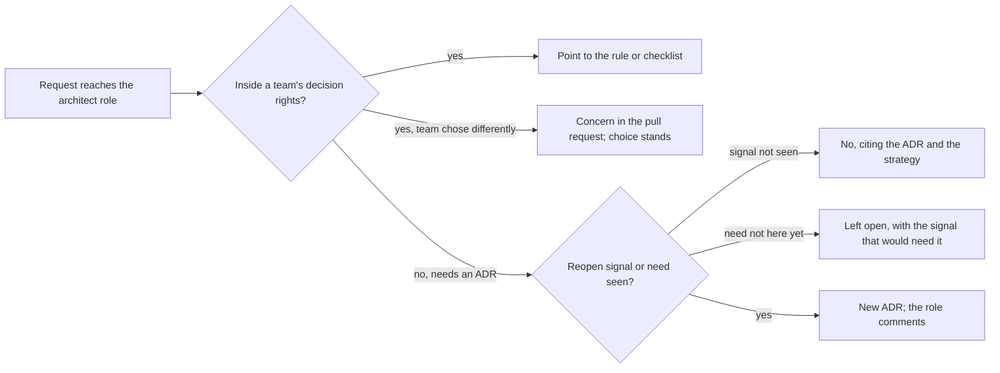

## Before you start

- [[sysdesign.l4.architecture-health-review]] — you know the quarterly review reads the watched assumptions, and "Chưa thấy" (not seen) is a checked result.
- [[management.l4.lightweight-governance]] — you know the "Ai quyết định gì" (who decides what) table says which changes need only a pull request review and which need an ADR.
- [[management.l4.deciding-under-uncertainty]] — you know the care a decision gets follows how costly it is to undo, and ADR `0021` names three reopen signals.
- [[management.l4.technical-strategy]] — you know `technical-strategy.md` lists, with reasons, what the team will not do.

## The situation

It is Friday of the assumed week that `architect-week.md` records. You hold Đơn Hàng's architect role, working with all three teams: Đặt hàng (ordering), Cửa hàng (shop) and platform. Five requests reached you.

Cửa hàng asks whether changing how Catalog reads its cache needs an ADR. Đặt hàng picked a library inside Payments that you would not have picked. A developer wants a service mesh in staging. Cửa hàng wants a separate search engine, a server of its own built for search, chosen now. And they want a new Keycloak role for shop staff.

You could rule on all five before lunch, and each ruling would be yours.

Which of these should you decide at all?

## Core concepts

- decision kept by the architect role — a decision that crosses team boundaries or is costly to undo; in Đơn Hàng these are the rows of "Ai quyết định gì" that need an ADR; the team lead decides them, and the role takes part by checking each request against written ADRs and commenting on the proposal.
- request handed back — a request answered by pointing to the rule, checklist or ADR that already settles it, so the team finds the answer alone next time.
- concern stated, choice kept — when a team chooses differently inside its own decision rights, the role writes its concern in the pull request and the team's choice stands.
- no with a written reason — a refusal that cites a document the team can read, such as an ADR's reopen conditions, rather than the architect's preference.
- decision left open on purpose — a choice not needed yet, recorded with the signal that would make it needed.

## How it works



In the situation above, every request starts with one question: whose decision is it? The "Ai quyết định gì" table answers it. A change inside one module or service, with no contract change, belongs to the person doing it, through an ordinary pull request review. The cache question and the library choice are both that kind.

For the cache question, the role does not rule. It points to the table's first row and to a section of `backend-review-checklist.md`. Next time, the team reads the table instead of asking. Where the rules are written down and several teams share them, each decision the role takes for a team is one that team does not practise taking.

For the library, the role writes its concern as a pull request comment. The team keeps its choice, because the team carries its cost.

Requests that need an ADR, such as a contract, a permission or a new component, are given by the table to the team lead. The role does not decide them alone; it checks each against what is written and comments on the ADR. The mesh is a no: ADR `0021` decided against one, none of its reopen conditions has appeared, and the strategy's "Không làm" list names it. Search differs: ADR `0030` chose PostgreSQL's full-text search in Catalog and recorded when to look again at a separate engine, so the request stays open. The Keycloak role falls under the table's third row, which covers shop data, permissions, keys and trust boundaries, so it needs an ADR.

Across quarters, fewer requests reaching the role is a sign that the decision table, checklists, templates and the golden path are doing their work.

## In the Đơn Hàng system

The Friday answers are recorded in `architect-week.md`:

```markdown file=docs/team/architect-week.md tag=stage-4 lines=57-72
### Yêu cầu chuyển lại cho đội

Các yêu cầu gửi tới vai trò trong tuần (giả định). Mỗi câu trả lời trỏ tới chỗ
đã giữ câu trả lời, theo bảng "Ai quyết định gì" của
`architecture-governance.md`, để lần sau đội tự tìm được.

| Yêu cầu | Thuộc quyền quyết định của ai | Câu trả lời |
|---|---|---|
| Đội Cửa hàng hỏi có cần ADR khi đổi cách Catalog đọc cache không | Người làm, qua review pull request: thay đổi bên trong một module, không đổi hợp đồng `ICatalog` | Không cần ADR. Trỏ dòng đầu của bảng "Ai quyết định gì" và mục Chủ dữ liệu và nhất quán của `backend-review-checklist.md` |
| Đội Đặt hàng chọn một thư viện bên trong Payments khác với thư viện vai trò kiến trúc sư sẽ chọn | Người làm, qua review pull request: thay đổi bên trong một service | Giữ lựa chọn của đội. Mối lo ghi thành một nhận xét trong pull request; đội là bên trả chi phí của lựa chọn đó |
| Một lập trình viên đề nghị thêm service mesh cho staging | Trưởng nhóm, bằng một ADR mới thay ADR 0021, nếu điều kiện mở lại đã xuất hiện | Chưa làm. Ba điều kiện mở lại của ADR 0021 chưa điều kiện nào xuất hiện (bảng "Giả định cần theo dõi" của `architecture-governance.md`), và "Không dùng service mesh" nằm trong mục Không làm của `technical-strategy.md` |
| Đội Cửa hàng đề nghị chọn ngay một công cụ tìm kiếm riêng, trước khi cần | Trưởng nhóm, bằng một ADR mới thay ADR 0030 | Để mở. ADR 0030 ghi lúc nào cần xem lại: khiếu nại về gõ sai hay từ đồng nghĩa vượt 5% số phản hồi về tìm kiếm trong một tháng (giả định), hoặc tải tìm kiếm vượt khoảng dư cả khi đã chuyển sang replica. Chưa tín hiệu nào xuất hiện |
| Đội Cửa hàng muốn thêm một role ở Keycloak cho nhân viên cửa hàng | Trưởng nhóm, có ADR, đối chiếu `docs/design/threat-model.md` | Không phải việc vai trò kiến trúc sư quyết một mình. Trỏ dòng thứ ba của bảng "Ai quyết định gì"; vai trò góp ý khi ADR được đề xuất |

Câu hỏi gửi tới vai trò ít đi qua từng quý là dấu hiệu checklist, mẫu và
golden path đang làm được việc của chúng.
```

Read the middle column first: "Thuộc quyền quyết định của ai" (whose decision rights it falls under). It is filled before the answer, and only the last three rows name the team lead. The first two rows name "Người làm" (the person doing it); `ICatalog` is Catalog's module contract. So the answers are "Không cần ADR" (no ADR needed) and "Giữ lựa chọn của đội" (keep the team's choice).

The search engine row is "Để mở" (left open), and it carries ADR `0030`'s conditions in numbers, so anyone can check them later. The last line says fewer questions each quarter is the sign that checklists, templates and the golden path work.

The mesh row cites two documents. Here is the first, the end of ADR `0021`:

```markdown file=docs/adr/0021-chua-dung-service-mesh.md tag=stage-4 lines=64-70
Ba điều kiện mở lại:

- Một hợp đồng đòi mã hóa lời gọi bên trong cluster. Nếu chỉ đòi mã hóa, làm
  C trước khi tính tới mesh.
- Service đến từ nhiều nhóm hoặc nhiều ngôn ngữ, nên mỗi codebase tự làm
  mutual TLS, retry và số đo theo lời gọi trở nên đắt hơn một mesh.
- Service bắt đầu gọi nhau giữa các cluster.
```

These three conditions are what "no" rests on: a contract that demands encryption inside the cluster (C, defined earlier in the ADR, encrypts only the hop from the Gateway into the api); services from many teams or languages, so each codebase doing mutual TLS, retry and per-call metrics costs more than a mesh; or calls between clusters. The second document, `technical-strategy.md`, lists "Không dùng service mesh" (no service mesh) under "Không làm" (will not do), with its reason, outside this excerpt. Neither document is the architect's taste. The refusal also names how it would change: a new ADR that supersedes `0021`, from the team lead, once a condition appears.

## Trade-offs

| Who settles a request | When it is right | What it costs |
|---|---|---|
| The role answers every technical question itself | one small team, no written rules yet | teams wait for one person and do not learn to decide; the role becomes the bottleneck |
| The role points to the rule or checklist | the answer is already written down | writing and keeping the rules; a rule that is out of date sends teams the wrong way |
| The team decides, the role comments in review | the change stays inside the team's decision rights | some choices differ from the role's, and the team carries their cost |
| The decision is left open with its signal | the facts it depends on do not exist yet | someone must watch the signal, or the open question is forgotten |

A fair opposing view says one person deciding everything keeps the system consistent. That holds while one team builds everything and the rules are not yet written. Đơn Hàng has three teams, so a single decider makes every team wait.

## What would you choose if…

…the Cửa hàng team swaps the cache library inside Catalog and you think the old one was better? Write the concern in the pull request. The change stays inside one module, so the team's choice stands.

…a shop's draft contract demands that calls inside the cluster be encrypted, and asks for nothing else? That is ADR `0021`'s first reopen condition. The answer changes from no to a new ADR by the team lead. The excerpt itself says to do option C before considering a mesh.

…the Cửa hàng team asks for a search engine again next month, with no new numbers? The answer stays open; you point to ADR `0030`'s conditions, which are what would change it.

## Seniors often assume…

- **"A good architect takes every technical decision, so that the system stays consistent."** → Actually, once several teams share written rules, consistency comes mostly from those rules; decisions inside a team's rights stay with that team, so it learns to take them. You notice this when the same question reaches you every week from the same team.
- **"If a team picks a solution I would not pick, I should overrule it."** → Actually, inside the team's decision rights, you write the concern in the pull request and the choice stands, because the team carries its cost. You notice this when teams stop explaining their choices and wait for yours.
- **"When the architect says no to a request, it is just the architect's personal opinion."** → Actually a no in Đơn Hàng cites documents anyone can read: ADR `0021`'s reopen conditions and the strategy's "Không làm" list. You notice this when a refused request comes back with a condition met, and the answer changes.
- **"Leaving a question undecided means the architect has not done the job."** → Actually a question left open on purpose carries the signal that would make it needed, as ADR `0030` does for search. You notice this when an early choice has to be undone because the facts it guessed never arrived.

## Try it (3 minutes)

Three new requests reach the architect role. For each, write whose decision it is, by role, and what the answer points to, using the two blocks above and the "Ai quyết định gì" rows described in this lesson.

1. The Đặt hàng team asks whether splitting one class inside Payments needs an ADR.
2. A developer asks to add a service mesh because a second team now owns Notifications, still a .NET service.
3. The Cửa hàng team asks you to approve adding `shop_id` to a table.

Expected result: three answers, each naming who decides and the document that settles it, and none of them a ruling by the architect role.

<details><summary>Suggested answer</summary>

1. The person doing it, through a pull request review: a change inside one service with no contract change. Point to the first row of "Ai quyết định gì"; no ADR.
2. Not the role's call. A second team owning a service is where ADR `0021`'s second signal is watched (services from many teams or languages, so each codebase doing mutual TLS, retry and metrics costs more than a mesh). The team lead, who watches that row, checks it; if it has appeared, a new ADR supersedes `0021` and the role comments.
3. The team lead, with an ADR checked against `docs/design/threat-model.md`: the third row of "Ai quyết định gì" lists this very example. The role comments when the ADR is proposed.

</details>

## Connections

- [[management.l4.lightweight-governance]] — the decision-rights table every answer here starts from.
- [[management.l4.deciding-under-uncertainty]] — why costly-to-undo decisions get an ADR and reopen signals.
- [[management.l4.technical-strategy]] — the "will not do" list a refusal cites.
- [[management.l4.mentoring]] — the same habit one person at a time: hand the decision back so the developer learns to take it.
- [[management.l4.team-interaction-modes]] — the same choice one level up: how much each team works with another, here how much a team works with the architect role.
- [[devops.l4.golden-path]] — one of the tools that lets teams decide without asking.
- [[k8s.l4.when-a-mesh-pays-off]] — where ADR `0021`'s decision and its option C are taught.
- [[design.l4.over-abstraction]] — the same restraint in code: no layer for a need that is not here yet.
- [[sysdesign.l4.where-to-go-next]] — the next lesson: which document you cannot yet write alone.

## Five-line summary

1. An architect keeps to decisions that cross teams or are costly to undo, taking part through their ADRs, and leaves the rest to the teams.
2. A request inside a team's decision rights is handed back by pointing to the rule or checklist that already settles it.
3. When a team chooses differently within its rights, the concern goes in the pull request and the team's choice stands.
4. A no cites written reasons, such as ADR `0021`'s reopen conditions; a decision not needed yet stays open with its signal.
5. Checklists, templates and the golden path let teams decide alone; fewer questions each quarter is a sign the role works.
