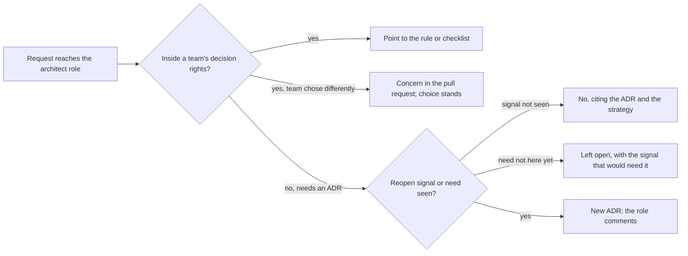

## Bạn cần biết trước

- [[sysdesign.l4.architecture-health-review]] — bạn biết buổi xem lại hằng quý đọc các giả định cần theo dõi, và "Chưa thấy" là một kết quả đã kiểm.
- [[management.l4.lightweight-governance]] — bạn biết bảng "Ai quyết định gì" nói thay đổi nào chỉ cần review pull request và thay đổi nào cần ADR.
- [[management.l4.deciding-under-uncertainty]] — bạn biết mức cẩn trọng dành cho một quyết định đi theo cái giá phải trả khi đảo ngược nó, và ADR `0021` nêu ba tín hiệu mở lại.
- [[management.l4.technical-strategy]] — bạn biết `technical-strategy.md` liệt kê, kèm lý do, những gì đội sẽ không làm.

## Tình huống

Hôm nay là thứ Sáu của tuần giả định mà `architect-week.md` ghi lại. Bạn giữ vai trò kiến trúc sư của Đơn Hàng, làm việc với cả ba đội: Đặt hàng, Cửa hàng và platform. Có năm yêu cầu gửi tới bạn.

Đội Cửa hàng hỏi đổi cách Catalog đọc cache có cần ADR không. Đội Đặt hàng chọn một thư viện bên trong Payments mà bạn sẽ không chọn. Một lập trình viên muốn có service mesh ở staging. Đội Cửa hàng muốn chọn ngay một công cụ tìm kiếm riêng, tức một server riêng chuyên cho tìm kiếm. Và họ muốn thêm một role mới ở Keycloak cho nhân viên cửa hàng.

Bạn có thể chốt cả năm trước giờ ăn trưa, và câu trả lời nào cũng là của bạn.

Trong số này, những yêu cầu nào thật sự là việc bạn phải quyết?

## Khái niệm cốt lõi

- quyết định do vai trò kiến trúc sư giữ — quyết định vắt qua ranh giới giữa các đội hoặc đảo ngược thì tốn kém. Ở Đơn Hàng, đó là các dòng cần ADR của bảng "Ai quyết định gì". Trưởng nhóm quyết các dòng này, còn vai trò tham gia bằng cách đối chiếu từng yêu cầu với các ADR đã viết và góp ý vào đề xuất.
- yêu cầu chuyển lại cho đội — yêu cầu được trả lời bằng cách trỏ tới quy tắc, checklist hoặc ADR đã giải quyết nó, để lần sau đội tự tìm ra câu trả lời.
- nêu mối lo, giữ lựa chọn — khi một đội chọn khác đi trong phạm vi quyền quyết định của mình, vai trò ghi mối lo vào pull request và lựa chọn của đội được giữ.
- từ chối có lý do viết ra — lời từ chối dẫn một tài liệu đội đọc được, như các điều kiện mở lại của một ADR, chứ không dựa vào sở thích của kiến trúc sư.
- quyết định cố ý để mở — một lựa chọn chưa cần tới, được ghi lại kèm tín hiệu sẽ khiến nó cần tới.

## Cơ chế hoạt động



Trong tình huống trên, yêu cầu nào cũng bắt đầu từ một câu hỏi: quyết định này là của ai? Bảng "Ai quyết định gì" trả lời câu đó. Thay đổi nằm trong một module hoặc một service, không đổi hợp đồng, thuộc về người làm, qua review pull request bình thường. Câu hỏi về cache và lựa chọn thư viện đều thuộc loại này.

Với câu hỏi về cache, vai trò không phán quyết. Nó trỏ tới dòng đầu của bảng và một mục trong `backend-review-checklist.md`. Lần sau, đội đọc bảng thay vì hỏi. Khi quy tắc đã được viết ra và nhiều đội cùng dùng, mỗi quyết định vai trò làm thay một đội là một lần đội đó mất cơ hội tập quyết.

Với thư viện, vai trò ghi mối lo thành một nhận xét trong pull request. Đội giữ lựa chọn của mình, vì đội là bên trả chi phí của nó.

Các yêu cầu cần ADR, như một hợp đồng, một quyền hay một thành phần mới, được bảng giao cho trưởng nhóm. Vai trò không tự quyết chúng. Nó đối chiếu từng yêu cầu với những gì đã viết và góp ý vào ADR. Service mesh là "không": ADR `0021` đã quyết không dùng, chưa điều kiện mở lại nào xuất hiện, và mục "Không làm" của chiến lược có tên nó. Tìm kiếm thì khác: ADR `0030` đã chọn full-text search của PostgreSQL trong Catalog và ghi lúc nào xem lại chuyện dùng một công cụ riêng, nên yêu cầu này để mở. Role ở Keycloak rơi vào dòng thứ ba của bảng, dòng về dữ liệu cửa hàng, quyền, khóa và ranh giới tin cậy, nên cần ADR.

Qua nhiều quý, việc ít yêu cầu gửi tới vai trò hơn là dấu hiệu bảng quyết định, checklist, mẫu và golden path đang làm được việc của chúng.

## Trong hệ thống Đơn Hàng

Các câu trả lời ngày thứ Sáu được ghi trong `architect-week.md`:

```markdown file=docs/team/architect-week.md tag=stage-4 lines=57-72
### Yêu cầu chuyển lại cho đội

Các yêu cầu gửi tới vai trò trong tuần (giả định). Mỗi câu trả lời trỏ tới chỗ
đã giữ câu trả lời, theo bảng "Ai quyết định gì" của
`architecture-governance.md`, để lần sau đội tự tìm được.

| Yêu cầu | Thuộc quyền quyết định của ai | Câu trả lời |
|---|---|---|
| Đội Cửa hàng hỏi có cần ADR khi đổi cách Catalog đọc cache không | Người làm, qua review pull request: thay đổi bên trong một module, không đổi hợp đồng `ICatalog` | Không cần ADR. Trỏ dòng đầu của bảng "Ai quyết định gì" và mục Chủ dữ liệu và nhất quán của `backend-review-checklist.md` |
| Đội Đặt hàng chọn một thư viện bên trong Payments khác với thư viện vai trò kiến trúc sư sẽ chọn | Người làm, qua review pull request: thay đổi bên trong một service | Giữ lựa chọn của đội. Mối lo ghi thành một nhận xét trong pull request; đội là bên trả chi phí của lựa chọn đó |
| Một lập trình viên đề nghị thêm service mesh cho staging | Trưởng nhóm, bằng một ADR mới thay ADR 0021, nếu điều kiện mở lại đã xuất hiện | Chưa làm. Ba điều kiện mở lại của ADR 0021 chưa điều kiện nào xuất hiện (bảng "Giả định cần theo dõi" của `architecture-governance.md`), và "Không dùng service mesh" nằm trong mục Không làm của `technical-strategy.md` |
| Đội Cửa hàng đề nghị chọn ngay một công cụ tìm kiếm riêng, trước khi cần | Trưởng nhóm, bằng một ADR mới thay ADR 0030 | Để mở. ADR 0030 ghi lúc nào cần xem lại: khiếu nại về gõ sai hay từ đồng nghĩa vượt 5% số phản hồi về tìm kiếm trong một tháng (giả định), hoặc tải tìm kiếm vượt khoảng dư cả khi đã chuyển sang replica. Chưa tín hiệu nào xuất hiện |
| Đội Cửa hàng muốn thêm một role ở Keycloak cho nhân viên cửa hàng | Trưởng nhóm, có ADR, đối chiếu `docs/design/threat-model.md` | Không phải việc vai trò kiến trúc sư quyết một mình. Trỏ dòng thứ ba của bảng "Ai quyết định gì"; vai trò góp ý khi ADR được đề xuất |

Câu hỏi gửi tới vai trò ít đi qua từng quý là dấu hiệu checklist, mẫu và
golden path đang làm được việc của chúng.
```

Hãy đọc cột giữa trước: "Thuộc quyền quyết định của ai". Cột này được điền trước câu trả lời, và chỉ ba dòng cuối ghi trưởng nhóm. Hai dòng đầu ghi "Người làm". `ICatalog` là hợp đồng module của Catalog. Vì thế câu trả lời là "Không cần ADR" và "Giữ lựa chọn của đội".

Dòng công cụ tìm kiếm ghi "Để mở", kèm các điều kiện của ADR `0030` bằng con số, nên sau này ai cũng kiểm lại được. Dòng cuối nói câu hỏi ít đi mỗi quý là dấu hiệu checklist, mẫu và golden path đang làm được việc.

Dòng service mesh dẫn hai tài liệu. Đây là tài liệu thứ nhất, phần cuối của ADR `0021`:

```markdown file=docs/adr/0021-chua-dung-service-mesh.md tag=stage-4 lines=64-70
Ba điều kiện mở lại:

- Một hợp đồng đòi mã hóa lời gọi bên trong cluster. Nếu chỉ đòi mã hóa, làm
  C trước khi tính tới mesh.
- Service đến từ nhiều nhóm hoặc nhiều ngôn ngữ, nên mỗi codebase tự làm
  mutual TLS, retry và số đo theo lời gọi trở nên đắt hơn một mesh.
- Service bắt đầu gọi nhau giữa các cluster.
```

Ba điều kiện này là chỗ dựa của câu "không". Một là hợp đồng đòi mã hóa bên trong cluster (C, định nghĩa ở phần trước của ADR, chỉ mã hóa chặng từ Gateway vào api). Hai là service đến từ nhiều đội hoặc nhiều ngôn ngữ, nên mỗi codebase tự làm mutual TLS, retry và số đo theo lời gọi tốn hơn một mesh. Ba là lời gọi giữa các cluster. Tài liệu thứ hai, `technical-strategy.md`, ghi "Không dùng service mesh" trong mục "Không làm", kèm lý do, ở ngoài đoạn trích này. Không tài liệu nào là khẩu vị của kiến trúc sư. Lời từ chối cũng nói rõ nó sẽ đổi thế nào: một ADR mới thay `0021`, do trưởng nhóm đưa ra, khi một điều kiện xuất hiện.

## Đánh đổi

| Ai giải quyết yêu cầu | Khi nào đúng | Phải trả gì |
|---|---|---|
| Vai trò tự trả lời mọi câu hỏi kỹ thuật | một đội nhỏ, chưa có quy tắc nào được viết ra | các đội chờ một người và không học được cách quyết, vai trò thành nút thắt |
| Vai trò trỏ tới quy tắc hoặc checklist | câu trả lời đã được viết ra | phải viết và giữ quy tắc, một quy tắc lỗi thời dẫn các đội đi sai |
| Đội quyết, vai trò góp ý khi review | thay đổi nằm trong quyền quyết định của đội | vài lựa chọn khác với lựa chọn của vai trò, và đội trả chi phí của chúng |
| Để mở quyết định kèm tín hiệu của nó | những dữ kiện nó phụ thuộc chưa có | phải có người canh tín hiệu, không thì câu hỏi bỏ ngỏ bị quên |

Một quan điểm ngược lại đáng xét là để một người quyết mọi thứ thì hệ thống nhất quán. Điều đó đúng khi một đội xây mọi thứ và quy tắc chưa được viết ra. Đơn Hàng có ba đội, nên một người quyết duy nhất bắt đội nào cũng phải chờ.

## Bạn sẽ chọn gì nếu…

…đội Cửa hàng thay thư viện cache bên trong Catalog, và bạn thấy thư viện cũ tốt hơn? Ghi mối lo vào pull request. Thay đổi nằm trong một module, nên lựa chọn của đội được giữ.

…bản hợp đồng nháp của một cửa hàng đòi mã hóa lời gọi bên trong cluster, và không đòi gì khác? Đó là điều kiện mở lại thứ nhất của ADR `0021`. Câu trả lời đổi từ "không" thành một ADR mới do trưởng nhóm đưa ra. Chính đoạn trích nói làm cách C trước khi tính tới mesh.

…tháng sau đội Cửa hàng lại xin một công cụ tìm kiếm, không có con số nào mới? Câu trả lời vẫn để mở. Bạn trỏ tới các điều kiện của ADR `0030`, vì chúng mới là thứ làm câu trả lời đổi.

## Senior hay nhầm rằng…

- **"Kiến trúc sư giỏi thì tự quyết mọi quyết định kỹ thuật, để hệ thống nhất quán."** → Thực ra khi nhiều đội đã dùng chung quy tắc viết ra, sự nhất quán chủ yếu đến từ các quy tắc đó, vì quyết định trong quyền của đội nào thì đội đó giữ, để họ học cách quyết. Bạn sẽ nhận ra khi cùng một câu hỏi tới bạn mỗi tuần từ cùng một đội.
- **"Nếu một đội chọn giải pháp mà mình sẽ không chọn, mình nên gạt nó đi."** → Thực ra trong quyền quyết định của đội, bạn ghi mối lo vào pull request và lựa chọn được giữ, vì đội là bên trả chi phí của nó. Bạn sẽ nhận ra khi các đội thôi giải thích lựa chọn của mình mà ngồi chờ lựa chọn của bạn.
- **"Kiến trúc sư từ chối một yêu cầu thì đó chỉ là ý kiến cá nhân."** → Thực ra một lời từ chối ở Đơn Hàng dẫn các tài liệu ai cũng đọc được, vì nó dựa vào các điều kiện mở lại của ADR `0021` và mục "Không làm" của chiến lược. Bạn sẽ nhận ra khi một yêu cầu bị từ chối quay lại với một điều kiện đã đạt, và câu trả lời đổi.
- **"Để một câu hỏi chưa quyết nghĩa là kiến trúc sư chưa làm xong việc."** → Thực ra một câu hỏi cố ý để mở mang theo tín hiệu sẽ khiến nó cần tới, vì ADR `0030` làm đúng như vậy cho tìm kiếm. Bạn sẽ nhận ra khi một lựa chọn chốt sớm phải gỡ ra vì những dữ kiện nó đoán trước không bao giờ tới.

## Thử ngay (3 phút)

Ba yêu cầu mới gửi tới vai trò kiến trúc sư. Với mỗi yêu cầu, ghi quyết định đó là của ai, theo vai trò, và câu trả lời trỏ tới đâu, dựa vào hai khối ở trên và các dòng của bảng "Ai quyết định gì" mà bài đã mô tả.

1. Đội Đặt hàng hỏi tách một class bên trong Payments có cần ADR không.
2. Một lập trình viên xin thêm service mesh vì giờ một đội thứ hai đã nhận Notifications, vẫn là một service .NET.
3. Đội Cửa hàng nhờ bạn duyệt việc thêm `shop_id` vào một bảng.

Kết quả mong đợi: ba câu trả lời, mỗi câu nêu ai quyết và tài liệu đã giải quyết nó, và không câu nào là phán quyết của vai trò kiến trúc sư.

<details><summary>Gợi ý đáp án</summary>

1. Người làm, qua review pull request: thay đổi bên trong một service, không đổi hợp đồng. Trỏ dòng đầu của "Ai quyết định gì", không cần ADR.
2. Không phải việc vai trò quyết. Một đội thứ hai nhận một service là chỗ tín hiệu thứ hai của ADR `0021` được canh (service đến từ nhiều đội hoặc nhiều ngôn ngữ, nên mỗi codebase tự làm mutual TLS, retry và số đo tốn hơn một mesh). Trưởng nhóm, người theo dõi dòng đó, sẽ kiểm. Nếu tín hiệu đã xuất hiện, một ADR mới thay `0021` và vai trò góp ý.
3. Trưởng nhóm, có ADR, đối chiếu `docs/design/threat-model.md`: dòng thứ ba của "Ai quyết định gì" nêu đúng ví dụ này. Vai trò góp ý khi ADR được đề xuất.

</details>

## Liên hệ

- [[management.l4.lightweight-governance]] — bảng quyền quyết định mà mọi câu trả lời ở đây bắt đầu từ đó.
- [[management.l4.deciding-under-uncertainty]] — vì sao quyết định khó đảo ngược cần ADR và tín hiệu mở lại.
- [[management.l4.technical-strategy]] — danh sách "sẽ không làm" mà lời từ chối dẫn ra.
- [[management.l4.mentoring]] — cùng thói quen đó với từng người: trả quyết định lại để lập trình viên học cách tự quyết.
- [[management.l4.team-interaction-modes]] — cùng lựa chọn đó ở tầng trên: mỗi đội làm việc với đội khác tới mức nào, ở đây là một đội làm việc với vai trò kiến trúc sư tới mức nào.
- [[devops.l4.golden-path]] — một trong những công cụ giúp các đội quyết mà không cần hỏi.
- [[k8s.l4.when-a-mesh-pays-off]] — nơi dạy quyết định của ADR `0021` và cách C của nó.
- [[design.l4.over-abstraction]] — cùng sự kiềm chế đó trong code: không thêm tầng cho một nhu cầu chưa tới.
- [[sysdesign.l4.where-to-go-next]] — bài tiếp theo: tài liệu nào bạn chưa tự viết được.

## Tóm tắt 5 dòng

1. Kiến trúc sư chỉ giữ những quyết định vắt qua nhiều đội hoặc tốn kém khi đảo ngược, tham gia qua ADR của chúng, và để phần còn lại cho các đội.
2. Yêu cầu nằm trong quyền quyết định của một đội được chuyển lại bằng cách trỏ tới quy tắc hoặc checklist đã giải quyết nó.
3. Khi một đội chọn khác trong phạm vi quyền của mình, mối lo được ghi vào pull request và lựa chọn của đội được giữ.
4. Lời từ chối dẫn lý do đã viết ra, như các điều kiện mở lại của ADR `0021`. Quyết định chưa cần tới thì để mở kèm tín hiệu của nó.
5. Checklist, mẫu và golden path giúp các đội tự quyết. Câu hỏi ít đi mỗi quý là dấu hiệu vai trò đang làm đúng việc.
