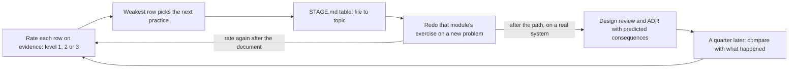

## Before you start

- [[sysdesign.l4.deciding-what-not-to-decide]] — you know checklists and templates let teams decide alone; here a checklist lets you rate yourself.
- [[sysdesign.l4.answering-challenges]] — you know a challenge is answered with the driver or trade-off behind the decision, which is what the top level here asks.
- [[sysdesign.l4.bank-signing-challenges]] — you know `bank-signing-design-review.md` keeps every challenge with its answer and the driver, ADR or risk it traces to.
- [[management.l4.mentoring]] — you know `mentoring-plan.md` hands a newcomer real work in steps and sets a weekly 1-1 with the mentor.

## The situation

You have reached the last lesson of the path. It is your weekly 1-1, the half hour that `mentoring-plan.md` sets aside. Your mentor opens `architecture-skills-checklist.md` and asks which row you will work on next.

You want to name the module you enjoyed most. You have read every lesson, some twice. Then your mentor asks where a rejected option of ADR `0021` beats the chosen one, without opening the file, and you hesitate. You have read many ADRs and written one, with the template open and help beside you.

What should you practise next, and how?

## Core concepts

- skills checklist row — one kind of document Đơn Hàng's decisions live in, with an example file in the repository and one challenge question to test yourself.
- the three levels — level 1: written with the template and a mentor; level 2: written alone, and the reviewer rewrites no part; level 3: defended under challenge with a driver, a measurement or an ADR, not with liking.
- evidence — a file you wrote, on Đơn Hàng or a real system, and what happened when others read it; the checklist rates on evidence, not on feeling.
- weakest row — the row at the lowest level, where a row with no evidence counts as below level 1; it picks what you practise next, and when two rows tie, the row your coming decision needs wins.
- prediction checked later — the consequences you wrote into the ADR or design review of a real decision, compared a quarter later with what happened.
- gap of the path — a topic the path left out on purpose, which the checklist names as a place to study when a decision needs it.

## How it works



In the situation above, the checklist turns "am I ready?" into fifteen smaller questions, one per row. You rate each row against evidence: a file you wrote and what its readers did with it. Reading lessons about a row is not that evidence.

Your hesitation is a level-3 test you did not pass: one ADR written with the template and help puts your KN3 at level 1, and the hesitation shows you cannot defend it yet. The checklist gives the reason it matters: a design you cannot defend is a design you have not fully understood. Each row carries one challenge question, so you can test level 3 alone. For ADRs, row KN3 asks where the rejected option beats the chosen one, and which signal would change your mind.

The lowest row picks the next practice, not the most interesting topic. Then the table in `STAGE.md` leads back: find the row's example file, read which course module used it, and return to that module's lessons.

Returning does not mean rereading. You redo the module's exercise on a new problem, such as a new Đơn Hàng feature. The checklist's reason: writing again from the start shows where a row is weak more clearly than reading.

After the path, practice moves to a real system. You write the design review and the ADR for its next real decision, with the consequences you predict. A quarter later, you compare those predictions with what happened, as the quarterly health review does when it checks whether past decisions still hold. You rate the row again after each document you finish, not on a calendar.

## In the Đơn Hàng system

The rating rules and the first rows of the checklist:

```markdown file=docs/team/architecture-skills-checklist.md tag=stage-4 lines=11-35
- Tự chấm, hoặc chấm cùng người kèm trong buổi 1-1 của `mentoring-plan.md`.
- Chấm theo bằng chứng, không theo cảm giác: bằng chứng là một file bạn đã
  viết (trên Đơn Hàng hay trên một hệ thống thật) và những gì xảy ra với nó
  khi người khác đọc.
- Mỗi dòng ở một trong ba bậc:
  - Bậc 1: viết được với mẫu và người kèm.
  - Bậc 2: tự viết một mình, người review không phải viết lại phần nào.
  - Bậc 3: bảo vệ được trước câu phản biện: trả lời được câu hỏi khó về nó,
    bằng driver, số đo hay ADR, không bằng ý thích.
- Bậc 3 quan trọng vì một thiết kế không bảo vệ được là một thiết kế chưa hiểu
  hết. Cột "Câu phản biện để thử" cho mỗi dòng một câu để tự thử bậc đó.

### Bảng kỹ năng

| Số | Loại tài liệu | File ví dụ | Câu phản biện để thử | Bậc đạt |
|---|---|---|---|---|
| KN1 | Tài liệu yêu cầu và yêu cầu phi chức năng | `docs/team/refund-requirements.md` | YC-7 (trả lời trong 2 giây) đo bằng gì, và ai thấy khi nó trượt? | |
| KN2 | Design doc | `docs/design/refund-design.md` | Cổng thanh toán không trả lời trong nhiều phút thì khoản hoàn tiền ở trạng thái nào? | |
| KN3 | ADR | `docs/adr/` (ví dụ 0021) | Phương án bị từ chối hơn phương án được chọn ở điểm nào, và tín hiệu nào làm bạn đổi ý? | |
| KN4 | Đánh giá nhà cung cấp bằng ma trận có trọng số | `docs/team/email-service-evaluation.md` | Đổi trọng số của một tiêu chí thì bên thắng có đổi không? | |
| KN5 | Threat model | `docs/design/threat-model.md` | Người có access token của một khách làm được gì, và điều gì chặn họ? | |
| KN6 | SLO và error budget | `docs/design/slo.md` | Vì sao `429` không tính là xấu mà `503` của `catalog-reads` thì có? | |
| KN7 | Kế hoạch dung lượng | `docs/design/capacity-plan.md` | Số nào trong kế hoạch là số đo, số nào là giả định, và giả định nào sai thì kế hoạch đổi? | |
| KN8 | Runbook | `docs/runbooks/` (ví dụ `product-reads-burn.md`) | Người trực lần đầu gặp alert này có làm theo được mà không phải hỏi ai không? | |
| KN9 | Postmortem | `docs/postmortems/0001-doc-san-pham-tra-503.md` | Action item nào ngăn sự cố lặp lại, cái nào chỉ giúp phát hiện sớm hơn? | |
```

Read the three "Bậc" (levels) first. Level 2 has a test anyone can check: "người review không phải viết lại phần nào" (the reviewer does not rewrite any part). Level 3 names what a defence may rest on: "driver, số đo hay ADR, không bằng ý thích" (a driver, a measurement or an ADR, not liking). The "Bậc đạt" (level reached) column is empty, because you fill it. The table continues outside this excerpt to KN15. KN6's `catalog-reads` is a limit that `slo.md` names.

How the weakest row turns into a next step:

```markdown file=docs/team/architecture-skills-checklist.md tag=stage-4 lines=43-67
### Chọn bước tiếp theo

- Dòng có bậc thấp nhất chọn việc luyện tiếp, không phải chủ đề thấy thú vị
  nhất. Hai dòng cùng bậc thì chọn dòng mà quyết định sắp tới của bạn cần.
- Bảng file → chủ đề trong `STAGE.md` (mục "What a lesson can learn from each
  new place") nối file ví dụ của dòng đó với chủ đề nó được dùng để học, để
  quay lại đúng chỗ.
- Làm lại bài tập của chủ đề đó trên một bài toán mới, như một tính năng mới
  của Đơn Hàng, thay vì đọc lại: viết lại từ đầu cho thấy dòng yếu ở đâu rõ
  hơn đọc.
- Với một hệ thống thật: viết tài liệu review thiết kế và ADR cho quyết định
  thật kế tiếp, ghi hệ quả mình dự đoán. Một quý sau, so hệ quả đã dự đoán với
  điều đã xảy ra, như buổi xem lại trong
  `docs/design/architecture-health-review.md`.
- Chấm lại sau mỗi tài liệu viết xong, không theo lịch.

### Khoảng trống của lộ trình

Những chủ đề lộ trình học đi cùng repo này cố ý không dạy. Chúng có ích cho
một kiến trúc sư; học chúng ở nơi khác khi một quyết định cần tới.

- Bảo mật ứng dụng ở mức code: injection, XSS. Threat model của Đơn Hàng dừng
  ở ranh giới tin cậy, không đi vào từng lỗ hổng trong code.
- Chủ động gây lỗi trên hệ thống đang chạy để thử độ bền (chaos engineering,
  game day).
```

Follow the second bullet with one row. Suppose KN6, SLO and error budget, is your lowest. Its file, `docs/design/slo.md`, appears in the table of `STAGE.md`, the repository file that describes the tag you are on, in a row whose module is `backend/capacity-and-slo`. That table lists files added or changed since `stage-3`; an older file such as KN2's `refund-design.md` is not in it, so use Connections below for such rows. If a row's file is in neither, ask your mentor in the 1-1 which module used it.

The last heading, "Khoảng trống của lộ trình" (gaps of the path), lists topics left out on purpose, to study elsewhere when a decision needs them. The excerpt shows two of six: security flaws at the level of code, and deliberately causing failures in a running system.

## Trade-offs

| How you choose the next practice | When it is right | What it costs |
|---|---|---|
| The topic you find most interesting | you are exploring with time to spare, not closing a gap | the weakest row stays weak until a real review exposes it |
| Reread the lessons of the weak row | you cannot yet say what that kind of document holds | familiar text feels understood; it shows little about writing alone |
| Redo the module's exercise on a new problem | the row is at level 1 or 2 and no real decision is coming | time to write a whole document, and a reviewer for level 2 |
| Write for a real decision, compare a quarter later | you work on a real system with decisions coming | slow feedback: a quarter before predictions can be checked |

A fair opposing view says interest keeps you studying, and a plan you abandon teaches nothing. That holds when you study alone with no decision coming. The checklist keeps part of it through its tie rule: between rows at the same level, the coming decision picks, not the lowest number.

## What would you choose if…

…KN7, the capacity plan, and KN13, the roadmap, are both at level 1, and next month you must size Đơn Hàng for a sales event? KN7. The rows tie, so the coming decision picks.

…you rated every row at level 2 from memory of the lessons? Rate again on evidence. A row with no file you wrote has no evidence for even level 1, so leave its "Bậc đạt" cell empty until you write one; such a row counts as below level 1.

…the path is done and your real team must decide next quarter whether to split a module into a service? Write the design review and the ADR, with the consequences you predict. A quarter after the change, compare them with what happened, then rate KN3 and KN10 again.

## Seniors often assume…

- **"Finishing every lesson of the path means I am now an architect."** → Actually the checklist rates documents you wrote and defended, not lessons read; finishing the path tells you which rows to practise. You notice this when a reviewer asks KN3's question about your ADR and your answer is a preference.
- **"The best next step is whichever topic I found most interesting."** → Actually the row at the lowest level picks, and the coming decision breaks a tie, because the weak row is where your next document is most likely to need rewriting. You notice this when the same row stays at level 1 for quarters while your favourite topics reach level 3.
- **"Reading a lesson again is the best way to fix a weak area."** → Actually redoing the module's exercise on a new problem shows more, because writing again from the start shows where the row is weak. You notice this when a reread lesson feels clear, yet a blank template still stops you at its first section.
- **"Once a decision is shipped, there is nothing more to learn from it."** → Actually the predictions you wrote are checked a quarter later against what happened, as the quarterly health review does. You notice this when the same wrong guess, such as expected load, appears again in your next ADR.

## Try it (3 minutes)

A developer brings this evidence to a 1-1. Rate each row with the three levels from the first block, then pick the next practice and say how to do it.

1. KN3 (ADR): wrote two ADRs alone; the reviewer rewrote nothing; in the review, could not say which signal would change the decision.
2. KN6 (SLO and error budget): wrote nothing yet; read the lessons twice.
3. KN9 (postmortem): wrote one with the template and the mentor.

Expected result: a level, or below level 1, for each row, one row chosen, and one sentence on how to practise it that is not "read again".

<details><summary>Suggested answer</summary>

1. KN3 is level 2: written alone with no part rewritten, but not defended under challenge, so not level 3.
2. KN6 has no evidence for even level 1: reading is not evidence, so its "Bậc đạt" cell stays empty and it counts as below level 1.
3. KN9 is level 1: written with the template and the mentor.

KN6 is below level 1, the weakest, so it picks. Its file, `docs/design/slo.md`, leads through the `STAGE.md` table to `backend/capacity-and-slo`. Redo that module's exercise on a new problem, such as a new Đơn Hàng feature, then rate KN6 again once the document is written.

</details>

## Connections

- [[management.l4.mentoring]] — the 1-1 where the checklist can be rated together, and the plan in which one kind of next task practises the newcomer's lowest row.
- [[sysdesign.l4.architecture-health-review]] — the quarterly comparison your real-system practice copies, applied to your own predictions.
- [[sysdesign.l4.system-design-steps]] — the steps to redo on a new problem when KN10, the design review, is your weakest row.
- [[management.l3.architecture-decision-record]] — where to return when KN3, the ADR, is your weakest row.
- [[management.l2.design-doc]] — where to return when KN2, the design doc, is your weakest row.
- [[design.l4.architecture-review-findings]] — where to return when KN11, the architecture review in `multi-shop-architecture-review.md`, is your weakest row. Unlike a design review, which reviews a design while parts are still open, it evaluates an architecture already chosen against scenarios of how it must behave.
- [[devops.l4.blameless-postmortems]] — the same habit after an incident: compare what was expected with what happened, then change what you do next.

## Five-line summary

1. Your next step is the kind of document you rate lowest, practised by writing it again, not the topic you like most.
2. `architecture-skills-checklist.md` lists fifteen kinds of document, each with an example file and one challenge question.
3. Each row is rated on evidence: written with help, written alone, then defended with a driver, a measurement or an ADR.
4. The `STAGE.md` table leads the weak row back to its module; redo that exercise on a new problem instead of rereading.
5. On a real system, write the design review and ADR, compare predictions with outcomes a quarter later, and rate again.
