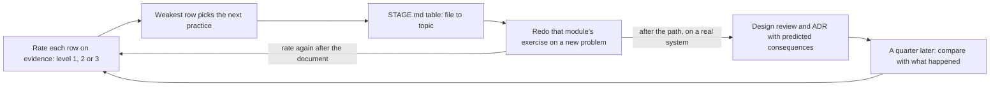

## Bạn cần biết trước

- [[sysdesign.l4.deciding-what-not-to-decide]] — bạn biết checklist và mẫu giúp các đội tự quyết. Ở đây, một checklist giúp bạn tự chấm mình.
- [[sysdesign.l4.answering-challenges]] — bạn biết câu phản biện được trả lời bằng driver hoặc sự đánh đổi đứng sau quyết định, đúng thứ bậc cao nhất ở đây đòi hỏi.
- [[sysdesign.l4.bank-signing-challenges]] — bạn biết `bank-signing-design-review.md` giữ mọi câu phản biện cùng câu trả lời, kèm driver, ADR hoặc rủi ro mà nó dẫn về.
- [[management.l4.mentoring]] — bạn biết `mentoring-plan.md` giao việc thật cho người mới theo từng bước và đặt một buổi 1-1 mỗi tuần với người kèm.

## Tình huống

Bạn đã tới bài cuối của lộ trình. Hôm nay là buổi 1-1 hằng tuần, nửa tiếng mà `mentoring-plan.md` dành riêng. Người kèm mở `architecture-skills-checklist.md` và hỏi bạn sẽ luyện dòng nào tiếp theo.

Bạn muốn nêu module mình thích nhất. Bạn đã đọc mọi bài, có bài đọc hai lần. Rồi người kèm hỏi, không mở file, phương án bị từ chối của ADR `0021` hơn phương án được chọn ở điểm nào, và bạn ngập ngừng. Bạn đã đọc nhiều ADR và viết một cái, với mẫu mở sẵn và có người giúp bên cạnh.

Bạn nên luyện gì tiếp theo, và luyện thế nào?

## Khái niệm cốt lõi

- dòng của checklist kỹ năng — một loại tài liệu chứa các quyết định của Đơn Hàng, kèm một file ví dụ trong repo và một câu phản biện để tự thử.
- ba bậc — bậc 1: viết được với mẫu và người kèm. Bậc 2: tự viết một mình, người review không phải viết lại phần nào. Bậc 3: bảo vệ được trước câu phản biện bằng driver, số đo hay ADR, không bằng ý thích.
- bằng chứng — một file bạn đã viết, trên Đơn Hàng hay một hệ thống thật, và những gì xảy ra khi người khác đọc nó. Checklist chấm theo bằng chứng, không theo cảm giác.
- dòng yếu nhất — dòng ở bậc thấp nhất, trong đó dòng chưa có bằng chứng tính là dưới bậc 1. Nó chọn việc bạn luyện tiếp. Khi hai dòng cùng bậc, dòng mà quyết định sắp tới của bạn cần sẽ thắng.
- dự đoán kiểm lại sau — các hệ quả bạn ghi vào ADR hoặc tài liệu review thiết kế của một quyết định thật, đem so một quý sau với điều đã xảy ra.
- khoảng trống của lộ trình — một chủ đề lộ trình cố ý bỏ qua, được checklist nêu tên như một chỗ để học khi một quyết định cần tới.

## Cơ chế hoạt động



Trong tình huống trên, checklist biến câu "mình đã sẵn sàng chưa?" thành mười lăm câu hỏi nhỏ hơn, mỗi dòng một câu. Bạn chấm từng dòng theo bằng chứng: một file bạn đã viết và những gì người đọc làm với nó. Đọc các bài về một dòng không phải bằng chứng đó.

Lúc ngập ngừng là một lần thử bậc 3 mà bạn chưa qua. Một ADR viết với mẫu và người giúp đặt KN3 của bạn ở bậc 1, và cái ngập ngừng cho thấy bạn chưa bảo vệ được nó. Checklist nêu lý do điều này quan trọng: một thiết kế không bảo vệ được là một thiết kế chưa hiểu hết. Mỗi dòng có một câu phản biện, nên bạn tự thử bậc 3 được. Với ADR, dòng KN3 hỏi phương án bị từ chối hơn phương án được chọn ở điểm nào, và tín hiệu nào làm bạn đổi ý.

Dòng thấp nhất chọn việc luyện tiếp, không phải chủ đề thú vị nhất. Sau đó bảng trong `STAGE.md` dẫn bạn quay lại: tìm file ví dụ của dòng, xem module nào của khóa học đã dùng nó, rồi trở về các bài của module đó.

Quay lại không có nghĩa là đọc lại. Bạn làm lại bài tập của module trên một bài toán mới, như một tính năng mới của Đơn Hàng. Lý do checklist đưa ra: viết lại từ đầu cho thấy dòng yếu ở đâu rõ hơn đọc.

Sau lộ trình, việc luyện chuyển sang một hệ thống thật. Bạn viết tài liệu review thiết kế và ADR cho quyết định thật kế tiếp của hệ thống, ghi các hệ quả mình dự đoán. Một quý sau, bạn so các dự đoán đó với điều đã xảy ra, như buổi xem lại hằng quý làm khi kiểm các quyết định cũ còn đứng vững không. Bạn chấm lại dòng đó sau mỗi tài liệu viết xong, không theo lịch.

## Trong hệ thống Đơn Hàng

Quy tắc chấm và các dòng đầu của checklist:

```markdown file=docs/team/architecture-skills-checklist.md tag=stage-4 lines=11-35
- Tự chấm, hoặc chấm cùng người kèm trong buổi 1-1 của `mentoring-plan.md`.
- Chấm theo bằng chứng, không theo cảm giác: bằng chứng là một file bạn đã
  viết (trên Đơn Hàng hay trên một hệ thống thật) và những gì xảy ra với nó
  khi người khác đọc.
- Mỗi dòng ở một trong ba bậc:
  - Bậc 1: viết được với mẫu và người kèm.
  - Bậc 2: tự viết một mình, người review không phải viết lại phần nào.
  - Bậc 3: bảo vệ được trước câu phản biện: trả lời được câu hỏi khó về nó,
    bằng driver, số đo hay ADR, không bằng ý thích.
- Bậc 3 quan trọng vì một thiết kế không bảo vệ được là một thiết kế chưa hiểu
  hết. Cột "Câu phản biện để thử" cho mỗi dòng một câu để tự thử bậc đó.

### Bảng kỹ năng

| Số | Loại tài liệu | File ví dụ | Câu phản biện để thử | Bậc đạt |
|---|---|---|---|---|
| KN1 | Tài liệu yêu cầu và yêu cầu phi chức năng | `docs/team/refund-requirements.md` | YC-7 (trả lời trong 2 giây) đo bằng gì, và ai thấy khi nó trượt? | |
| KN2 | Design doc | `docs/design/refund-design.md` | Cổng thanh toán không trả lời trong nhiều phút thì khoản hoàn tiền ở trạng thái nào? | |
| KN3 | ADR | `docs/adr/` (ví dụ 0021) | Phương án bị từ chối hơn phương án được chọn ở điểm nào, và tín hiệu nào làm bạn đổi ý? | |
| KN4 | Đánh giá nhà cung cấp bằng ma trận có trọng số | `docs/team/email-service-evaluation.md` | Đổi trọng số của một tiêu chí thì bên thắng có đổi không? | |
| KN5 | Threat model | `docs/design/threat-model.md` | Người có access token của một khách làm được gì, và điều gì chặn họ? | |
| KN6 | SLO và error budget | `docs/design/slo.md` | Vì sao `429` không tính là xấu mà `503` của `catalog-reads` thì có? | |
| KN7 | Kế hoạch dung lượng | `docs/design/capacity-plan.md` | Số nào trong kế hoạch là số đo, số nào là giả định, và giả định nào sai thì kế hoạch đổi? | |
| KN8 | Runbook | `docs/runbooks/` (ví dụ `product-reads-burn.md`) | Người trực lần đầu gặp alert này có làm theo được mà không phải hỏi ai không? | |
| KN9 | Postmortem | `docs/postmortems/0001-doc-san-pham-tra-503.md` | Action item nào ngăn sự cố lặp lại, cái nào chỉ giúp phát hiện sớm hơn? | |
```

Hãy đọc ba "Bậc" trước. Bậc 2 có một phép thử ai cũng kiểm được: "người review không phải viết lại phần nào". Bậc 3 nói rõ một lời bảo vệ được dựa vào gì: "driver, số đo hay ADR, không bằng ý thích". Cột "Bậc đạt" để trống, vì bạn là người điền. Bảng còn tiếp tới KN15, ở ngoài đoạn trích này. `catalog-reads` của KN6 là một giới hạn mà `slo.md` đặt tên.

Dòng yếu nhất biến thành bước tiếp theo như sau:

```markdown file=docs/team/architecture-skills-checklist.md tag=stage-4 lines=43-67
### Chọn bước tiếp theo

- Dòng có bậc thấp nhất chọn việc luyện tiếp, không phải chủ đề thấy thú vị
  nhất. Hai dòng cùng bậc thì chọn dòng mà quyết định sắp tới của bạn cần.
- Bảng file → chủ đề trong `STAGE.md` (mục "What a lesson can learn from each
  new place") nối file ví dụ của dòng đó với chủ đề nó được dùng để học, để
  quay lại đúng chỗ.
- Làm lại bài tập của chủ đề đó trên một bài toán mới, như một tính năng mới
  của Đơn Hàng, thay vì đọc lại: viết lại từ đầu cho thấy dòng yếu ở đâu rõ
  hơn đọc.
- Với một hệ thống thật: viết tài liệu review thiết kế và ADR cho quyết định
  thật kế tiếp, ghi hệ quả mình dự đoán. Một quý sau, so hệ quả đã dự đoán với
  điều đã xảy ra, như buổi xem lại trong
  `docs/design/architecture-health-review.md`.
- Chấm lại sau mỗi tài liệu viết xong, không theo lịch.

### Khoảng trống của lộ trình

Những chủ đề lộ trình học đi cùng repo này cố ý không dạy. Chúng có ích cho
một kiến trúc sư; học chúng ở nơi khác khi một quyết định cần tới.

- Bảo mật ứng dụng ở mức code: injection, XSS. Threat model của Đơn Hàng dừng
  ở ranh giới tin cậy, không đi vào từng lỗ hổng trong code.
- Chủ động gây lỗi trên hệ thống đang chạy để thử độ bền (chaos engineering,
  game day).
```

Thử đi theo gạch đầu dòng thứ hai với một dòng. Giả sử KN6, SLO và error budget, là dòng thấp nhất của bạn. File của nó, `docs/design/slo.md`, có trong bảng của `STAGE.md`, file trong repo mô tả tag bạn đang đứng, ở một dòng có module là `backend/capacity-and-slo`. Bảng đó chỉ liệt kê các file thêm mới hoặc thay đổi từ `stage-3`. Một file cũ hơn, như `refund-design.md` của KN2, không có trong đó, nên với những dòng như vậy hãy dùng mục Liên hệ bên dưới. Nếu file của một dòng không có ở cả hai chỗ, hãy hỏi người kèm trong buổi 1-1 xem module nào đã dùng nó.

Tiêu đề cuối, "Khoảng trống của lộ trình", liệt kê các chủ đề cố ý bỏ qua, để học ở nơi khác khi một quyết định cần tới. Đoạn trích cho thấy hai trong sáu: lỗ hổng bảo mật ở mức code, và chủ động gây lỗi trên một hệ thống đang chạy.

## Đánh đổi

| Bạn chọn việc luyện tiếp thế nào | Khi nào đúng | Phải trả gì |
|---|---|---|
| Chủ đề bạn thấy thú vị nhất | bạn đang khám phá, còn dư thời gian, không phải đang lấp một chỗ hổng | dòng yếu nhất vẫn yếu cho tới khi một buổi review thật phơi nó ra |
| Đọc lại các bài của dòng yếu | bạn chưa nói được loại tài liệu đó chứa những gì | chữ quen mắt tạo cảm giác đã hiểu, nhưng cho thấy rất ít về khả năng tự viết |
| Làm lại bài tập của module trên một bài toán mới | dòng đang ở bậc 1 hoặc 2 và chưa có quyết định thật nào sắp tới | thời gian viết trọn một tài liệu, và một người review cho bậc 2 |
| Viết cho một quyết định thật, so lại sau một quý | bạn làm trên một hệ thống thật và sắp có quyết định | phản hồi chậm: phải một quý mới kiểm được dự đoán |

Một quan điểm ngược lại đáng xét: hứng thú giữ bạn tiếp tục học, còn một kế hoạch bị bỏ dở chẳng dạy được gì. Điều đó đúng khi bạn học một mình và không có quyết định nào sắp tới. Checklist giữ lại một phần ý này qua quy tắc khi hòa: giữa các dòng cùng bậc, quyết định sắp tới chọn, chứ không phải số thứ tự nhỏ nhất.

## Bạn sẽ chọn gì nếu…

…KN7, kế hoạch dung lượng, và KN13, roadmap, cùng ở bậc 1, và tháng sau bạn phải tính dung lượng cho Đơn Hàng trước một đợt khuyến mãi? KN7. Hai dòng hòa nhau, nên quyết định sắp tới chọn.

…bạn chấm mọi dòng ở bậc 2 dựa vào trí nhớ về các bài học? Chấm lại theo bằng chứng. Dòng nào chưa có file bạn tự viết thì chưa có bằng chứng cho cả bậc 1, nên để trống ô "Bậc đạt" của nó cho tới khi bạn viết một file. Dòng như vậy tính là dưới bậc 1.

…lộ trình đã xong, và đội thật của bạn phải quyết trong quý tới có tách một module thành service không? Viết tài liệu review thiết kế và ADR, ghi các hệ quả bạn dự đoán. Một quý sau thay đổi, so chúng với điều đã xảy ra, rồi chấm lại KN3 và KN10.

## Senior hay nhầm rằng…

- **"Học xong mọi bài của lộ trình nghĩa là giờ mình đã là kiến trúc sư."** → Thực ra checklist chấm những tài liệu bạn đã viết và bảo vệ, không chấm số bài đã đọc, vì học xong lộ trình chỉ cho bạn biết cần luyện những dòng nào. Bạn sẽ nhận ra khi người review hỏi câu của KN3 về ADR của bạn và câu trả lời của bạn là một sở thích.
- **"Bước tiếp theo tốt nhất là chủ đề nào mình thấy thú vị nhất."** → Thực ra dòng ở bậc thấp nhất chọn, và quyết định sắp tới phân xử khi hòa, vì dòng yếu là chỗ tài liệu tiếp theo của bạn dễ phải viết lại nhất. Bạn sẽ nhận ra khi cùng một dòng nằm ở bậc 1 qua nhiều quý trong khi các chủ đề yêu thích lên tới bậc 3.
- **"Đọc lại bài học là cách tốt nhất để sửa một chỗ yếu."** → Thực ra làm lại bài tập của module trên một bài toán mới cho thấy nhiều hơn, vì viết lại từ đầu lộ ra dòng yếu ở đâu. Bạn sẽ nhận ra khi một bài đọc lại thấy rõ ràng, vậy mà một mẫu trống vẫn làm bạn khựng ngay ở mục đầu tiên.
- **"Quyết định đã triển khai rồi thì chẳng còn gì để học từ nó."** → Thực ra các dự đoán bạn đã ghi được kiểm lại sau một quý so với điều đã xảy ra, vì buổi xem lại hằng quý làm đúng như vậy. Bạn sẽ nhận ra khi cùng một phỏng đoán sai, như tải dự kiến, lại xuất hiện trong ADR tiếp theo của bạn.

## Thử ngay (3 phút)

Một lập trình viên mang bằng chứng này tới buổi 1-1. Chấm từng dòng theo ba bậc trong khối đầu tiên, rồi chọn việc luyện tiếp và nói cách luyện.

1. KN3 (ADR): đã tự viết hai ADR, người review không viết lại gì, nhưng trong buổi review không nói được tín hiệu nào sẽ làm đổi quyết định.
2. KN6 (SLO và error budget): chưa viết gì, đã đọc các bài hai lần.
3. KN9 (postmortem): đã viết một bản với mẫu và người kèm.

Kết quả mong đợi: mỗi dòng một bậc, hoặc dưới bậc 1, một dòng được chọn, và một câu về cách luyện dòng đó mà không phải "đọc lại".

<details><summary>Gợi ý đáp án</summary>

1. KN3 ở bậc 2: tự viết, không phần nào bị viết lại, nhưng chưa bảo vệ được trước câu phản biện, nên chưa tới bậc 3.
2. KN6 chưa có bằng chứng cho cả bậc 1: đọc không phải bằng chứng, nên ô "Bậc đạt" để trống và dòng này tính là dưới bậc 1.
3. KN9 ở bậc 1: viết với mẫu và người kèm.

KN6 dưới bậc 1, yếu nhất, nên nó được chọn. File của nó, `docs/design/slo.md`, dẫn qua bảng của `STAGE.md` tới `backend/capacity-and-slo`. Làm lại bài tập của module đó trên một bài toán mới, như một tính năng mới của Đơn Hàng, rồi chấm lại KN6 khi tài liệu đã viết xong.

</details>

## Liên hệ

- [[management.l4.mentoring]] — buổi 1-1 nơi có thể cùng chấm checklist, và kế hoạch trong đó một loại việc tiếp theo dùng để luyện dòng thấp nhất của người mới.
- [[sysdesign.l4.architecture-health-review]] — phép so sánh hằng quý mà việc luyện trên hệ thống thật của bạn làm theo, áp vào chính các dự đoán của bạn.
- [[sysdesign.l4.system-design-steps]] — các bước làm lại trên một bài toán mới khi KN10, review thiết kế, là dòng yếu nhất của bạn.
- [[management.l3.architecture-decision-record]] — chỗ quay lại khi KN3, ADR, là dòng yếu nhất của bạn.
- [[management.l2.design-doc]] — chỗ quay lại khi KN2, design doc, là dòng yếu nhất của bạn.
- [[design.l4.architecture-review-findings]] — chỗ quay lại khi KN11, buổi review kiến trúc trong `multi-shop-architecture-review.md`, là dòng yếu nhất của bạn. Khác với review thiết kế, vốn xem một thiết kế khi vài phần còn để mở, nó đánh giá một kiến trúc đã chọn theo các kịch bản về cách kiến trúc đó phải hoạt động.
- [[devops.l4.blameless-postmortems]] — cùng thói quen đó sau một sự cố: so điều đã dự kiến với điều đã xảy ra, rồi đổi cách làm lần tới.

## Tóm tắt 5 dòng

1. Bước tiếp theo của bạn là loại tài liệu bạn chấm thấp nhất, luyện bằng cách viết lại nó, không phải chủ đề bạn thích nhất.
2. `architecture-skills-checklist.md` liệt kê mười lăm loại tài liệu, mỗi loại có một file ví dụ và một câu phản biện.
3. Mỗi dòng được chấm theo bằng chứng: viết có người giúp, tự viết một mình, rồi bảo vệ được bằng driver, số đo hay ADR.
4. Bảng trong `STAGE.md` dẫn dòng yếu về module của nó. Làm lại bài tập đó trên một bài toán mới thay vì đọc lại.
5. Trên một hệ thống thật, viết tài liệu review thiết kế và ADR, sau một quý so dự đoán với kết quả, rồi chấm lại.
