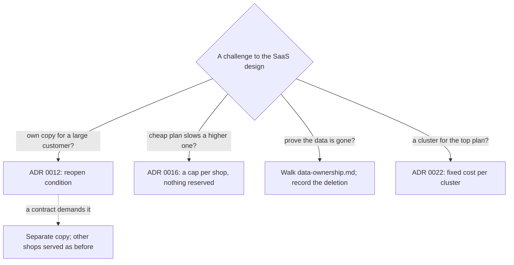

## Before you start

- [[sysdesign.l4.saas-trade-offs]] — you know most of a shop's cost is shared, so cost per shop is shared cost split by measured use.
- [[sysdesign.l4.answering-challenges]] — you know a good answer names the driver or ADR behind a decision, and a case the design does not cover gets an owner.
- [[backend.l4.data-ownership]] — you know each kind of data has one owner, and every other place holds a copy that needs its own rule.
- [[k8s.l4.choosing-managed-kubernetes]] — you know ADR `0022` runs production on managed Kubernetes from one provider, and what would reopen that choice.

## The situation

The review session for ADR `0033` starts. You proposed letting shops sign up, choose a plan and leave on their own; this self-service way of selling Đơn Hàng is the SaaS design. Four questions arrive.

The product owner, who decides what Đơn Hàng offers shops, asks whether a large customer could have its own copy of the system. A shop owner on the cheapest plan asks whether their sale day could slow a higher-plan shop. Another asks how Đơn Hàng proves their data is gone once they leave. Sales asks why the top plan has no cluster of its own.

Each sounds like a new decision. Where does each answer come from, and which leaves work behind?

## Core concepts

- decision already made — an ADR the SaaS design builds on and does not reopen, such as ADR `0012`, `0016` or `0022`; a challenge that touches it is answered by pointing to it.
- reopen condition — a change an ADR names in advance that would reopen it, such as a contract that demands a separate copy of the system for ADR `0012`.
- copies of a shop's data — every place `data-ownership.md` lists as holding a shop's rows, owner or copy; data is gone only when the last of them has ended.
- fixed cost per cluster — the platform every cluster runs whatever its traffic, such as Argo CD and its Git server; `cluster-cost.md` splits it from the part that grows with traffic, and each added cluster pays it again.

## How it works



In the situation above, three answers point to a decision already made, and one walks the copies of a shop's data.

ADR `0012` serves every shop from one deployment of the system and names two reopen conditions. The first answers the own-copy question: when a shop's contract demands a separate copy, that shop gets one of the same system, and every other shop is served as before. Until such a contract exists, nothing changes.

The plan question is answered by ADR `0016`. Each process serves only a set number of product reads at once, and each shop may use at most a fixed share of them, its cap; a read beyond the cap is refused. The cap reserves nothing: what one shop leaves unused stays open to the others. ADR `0033` makes a plan a set of numbers, one of them that share, so a higher plan gets a larger cap, not room held for it. Neither the cap per shop nor plans exist in code at stage-4; ADRs `0016` and `0033` decide them.

The deletion question walks `data-ownership.md`. Rows are deleted in each service's database, and the reporting database, which holds totals computed from the services' data (ADR `0031`), is rebuilt without the shop. Copies in Redis end by TTL, and copies in backups end when those backups expire. This answer leaves work: the Shop team records each deletion.

The cluster question is answered by ADR `0022` and `cluster-cost.md`: a cluster for one shop pays the fixed cost again, and that shop's plan would carry it alone.

## In the Đơn Hàng system

The design review ends with the challenges from the session:

```markdown file=docs/design/saas-platform-design-review.md tag=stage-4 lines=104-112
### Câu hỏi phản biện trong buổi review

| Câu hỏi | Trả lời, trỏ driver, ADR hoặc rủi ro | Việc tiếp theo | Người phụ trách (vai trò) |
|---|---|---|---|
| Cho một khách lớn bản nền tảng riêng được không? | Điều kiện xem lại của ADR 0012: hợp đồng đòi thì có, các cửa hàng khác vẫn phục vụ như cũ | Không | |
| Cửa hàng gói rẻ có làm chậm cửa hàng gói cao? | ADR 0016: trần giới hạn phần của mỗi cửa hàng; gói chỉ đổi cỡ trần, không giữ chỗ | Không | |
| Chứng minh dữ liệu của cửa hàng đã đi rồi thế nào? | Đi theo `data-ownership.md`: xóa trong từng database, dựng lại dòng báo cáo (ADR 0031), cache hết TTL, backup hết hạn | Ghi biên bản xóa | Đội Cửa hàng |
| Sao cửa hàng gói cao nhất không có cluster riêng? | ADR 0022 và phần nền cố định mỗi cluster của `cluster-cost.md`: gói đó phải gánh một mình | Không | |
| Cửa hàng có database riêng (ADR 0026) rời đi thì sao? | Bỏ database đó sau thời gian chờ | Không | |
```

Read the second column first: four answers name an ADR or a file, and the fifth applies the leaving deep dive below to a shop that moved to its own database under ADR `0026`; none makes a new argument. Four rows have the next step "none" and no owner. The deletion row alone has work left: a written record of each deletion, owned by the Shop team.

The deletion answer is not invented in the session. It repeats the leaving deep dive written before it:

```markdown file=docs/design/saas-platform-design-review.md tag=stage-4 lines=62-73
### Đi sâu: rời đi (bước 4)

Đi theo mọi chỗ có dữ liệu của cửa hàng trong `data-ownership.md`:

1. Cửa hàng chuyển `leaving`; job xuất dữ liệu của cửa hàng và gửi cho cửa hàng.
2. Hết 30 ngày chờ (giả định): xóa theo lô trong `donhang`, `donhang_payments`,
   `donhang_notifications` và `donhang_support`; hoặc bỏ database riêng nếu
   cửa hàng đã chuyển theo ADR 0026.
3. Dòng tổng trong database báo cáo được dựng lại không còn cửa hàng đó (ADR
   0031).
4. Bản sao trong Redis hết theo TTL; bản trong backup hết khi backup hết hạn
   giữ. Ngày cuối cùng dữ liệu còn tồn tại = ngày xóa + thời hạn giữ backup.
```

Step 2's 30-day wait (assumed) is the grace period: the time between a shop leaving and its rows being deleted. Step 2 names four databases, one per service, so deleting from `donhang` alone leaves three: `donhang_payments` for Payments, `donhang_notifications` for Notifications, `donhang_support` for the support chat. Deletion runs in batches so no lock is held long on tables other shops are using.

Step 4 gives the honest date: the last day the data exists is the deletion date plus how long backups are kept. The review's risks table records that gap: the product owner, with the legal department, states it in the terms a shop agrees to. The same table holds mass fake sign-ups, owned by the Shop team, and a leaving shop with a refund still `pending`, owned by the Ordering team.

## Trade-offs

| Way to answer a SaaS challenge | When it is right | What it costs |
|---|---|---|
| Point to a decision already made | the challenge asks about something ADR `0012`, `0016` or `0022` settled | nothing new; the asker must accept that the review does not reopen it |
| Name the reopen condition | the challenge asks for something a later event would bring, such as a contract demanding a separate copy | the asker waits for that event; the copy is then built and run as a second system |
| Walk the copies of a shop's data | the challenge asks for proof about data, not for a decision | every new copy, such as a cache or a reporting database, adds a step to the walk |
| Record work with an owner | the answer is known but leaves evidence to produce, such as a record of each deletion | a role carries a task beyond the session |

The cluster answer has a fair opposing view. A cluster of its own isolates a shop fully: under ADR `0012`, one error or failed deploy reaches every shop at once, and a separate cluster would not share it. That view is right when a contract demands own machines or data in a stated place, which is ADR `0022`'s reopen condition. No such contract is recorded in Đơn Hàng's documents, so ADR `0022` stands and the shop stays on the shared cluster, whose fixed cost every shop shares.

## What would you choose if…

…a large customer signs a contract that requires a copy of the system for itself? That meets ADR `0012`'s first reopen condition: the shop gets a separate copy of the same system, and the other shops are served as before. Whether that copy runs on machines of its own is a separate question, the one ADR `0022`'s reopen condition names.

…a premium shop asks for capacity held for it during its yearly sale? Every plan today is a cap. Among the reasons ADR `0033` names to reopen it are a plan that needs reserved capacity instead of a cap, and shops that need free colours or a logo. The team writes a new ADR rather than raising one number in the plans table.

…a leaving shop still has a refund in `pending`? The risks table holds this case, open: deletion waits until the refund is finished, and the grace period does not override it.

## Seniors often assume…

- **"A customer who pays more should always get a deployment of its own."** → Actually ADR `0012` gives a separate copy only when a contract demands one, because each copy multiplies deploys, migrations, dashboards and alerts. You notice this when a promise made to one customer becomes a second release schedule nobody planned for.
- **"A premium plan means capacity is set aside for that shop alone."** → Actually a plan under ADR `0033` is a set of numbers, and the one from ADR `0016` is a cap: what a shop leaves unused stays open to others. You notice this when a premium shop's sale reaches its larger cap and is refused, though it pays more.
- **"Deleting a shop's rows from the main database is enough to say its data is gone."** → Actually the review's walk lists four service databases, reporting totals, Redis and backups; the last copy ends at the deletion date plus backup retention. You notice this when a leaving shop asks for one date, and the honest answer names how long backups are kept.

## Try it (3 minutes)

Four more challenges arrive after the session. For each, say which kind it is: answered by a decision already made (name the ADR or file), a recorded risk or open question (name the owner by role), or a reopen condition (name the ADR it reopens).

1. "A shop that moved to its own database under ADR `0026` leaves. What happens to that database?"
2. "What stops someone from opening thousands of fake shops?"
3. "Can a shop upload its own colours and logo?"
4. "A customer's contract says its data must stay in one stated place. Does production change?"

Expected result: one kind and one source or owner per challenge, with exactly two reopen conditions.

<details><summary>Suggested answer</summary>

1. Answered by a decision already made: ADR `0033` and the review's fifth challenge row; the shop's own database is dropped after the grace period.
2. Recorded risk: mass fake sign-ups, owned by the Shop team, with a limit on sign-ups per email address and the email verified before the staff account is created.
3. Reopen condition: free colours or a logo reopen ADR `0033`, and the review plans a new ADR for it.
4. Reopen condition: a contract that demands data in a stated place reopens ADR `0022`.

</details>

## Connections

- [[sysdesign.l4.saas-trade-offs]] — the shared cost per shop that the cluster answer leans on.
- [[sysdesign.l4.answering-challenges]] — the method applied here.
- [[backend.l4.data-ownership]] — the owners and copies the deletion answer walks.
- [[k8s.l4.choosing-managed-kubernetes]] — where ADR `0022` and its reopen conditions were decided.
- [[design.l4.one-deployment-for-all-shops]] — where ADR `0012` chose one deployment and named the contract that reopens it.
- [[backend.l4.per-shop-limits]] — the cap per shop whose size a plan sets.
- [[sysdesign.l4.reporting-design]] — the reporting database whose totals are rebuilt when a shop leaves.
- [[management.l3.superseding-an-adr]] — what follows if a plan ever needs reserved capacity and ADR `0033` is replaced.
- [[sysdesign.l4.an-architects-week]] — the next module, where these review skills fill an architect's week.

## Five-line summary

1. A challenge to the SaaS design is answered from ADRs already made and from `data-ownership.md`, and only proof of deletion leaves work.
2. A large customer gets its own copy only under ADR `0012`'s reopen condition: a contract demands it, other shops unchanged.
3. A cheap plan's shop cannot pass its own cap: ADR `0016` caps each shop, a plan sizes the cap, the rest stays shared.
4. A departed shop's data is gone only when every copy has ended: each database, reporting totals, Redis, then backups.
5. The top plan gets no cluster of its own, since ADR `0022`'s fixed cost per cluster would fall on that plan alone.
