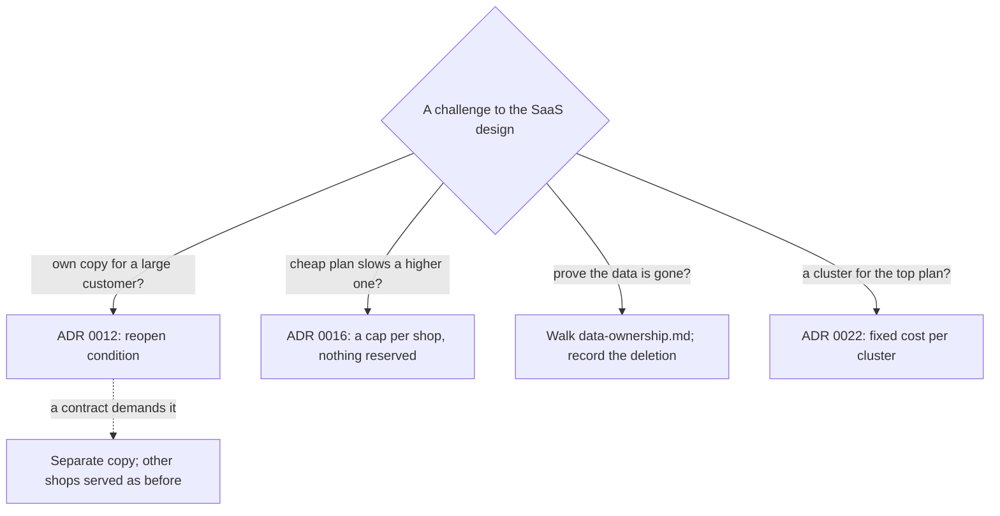

## Bạn cần biết trước

- [[sysdesign.l4.saas-trade-offs]] — bạn biết phần lớn chi phí của một cửa hàng là chi phí chung, nên chi phí mỗi cửa hàng là chi phí chung chia theo mức dùng đo được.
- [[sysdesign.l4.answering-challenges]] — bạn biết một câu trả lời tốt nêu tên driver hay ADR đứng sau quyết định, còn trường hợp thiết kế chưa bao được thì phải có người phụ trách.
- [[backend.l4.data-ownership]] — bạn biết mỗi loại dữ liệu có đúng một chủ, và mọi chỗ khác chỉ giữ bản sao, mỗi bản sao cần quy tắc riêng.
- [[k8s.l4.choosing-managed-kubernetes]] — bạn biết ADR `0022` chạy production trên Kubernetes managed của một nhà cung cấp, và điều gì sẽ mở lại lựa chọn đó.

## Tình huống

Buổi review cho ADR `0033` bắt đầu. Bạn đề xuất cho cửa hàng tự đăng ký, tự chọn gói và tự rời đi. Cách bán Đơn Hàng theo kiểu tự phục vụ này là thiết kế SaaS. Bốn câu hỏi được đặt ra.

Product owner, người quyết định Đơn Hàng cung cấp gì cho cửa hàng, hỏi một khách hàng lớn có thể có bản hệ thống riêng không. Một chủ cửa hàng ở gói rẻ nhất hỏi ngày khuyến mãi của họ có làm chậm một cửa hàng gói cao hơn không. Một người khác hỏi Đơn Hàng chứng minh thế nào rằng dữ liệu của họ đã đi hết khi họ rời đi. Bộ phận bán hàng hỏi vì sao gói cao nhất không có cluster riêng.

Câu nào nghe cũng như một quyết định mới. Mỗi câu trả lời lấy từ đâu, và câu nào để lại việc phải làm?

## Khái niệm cốt lõi

- quyết định đã có — một ADR mà thiết kế SaaS dựa vào và không mở lại, như ADR `0012`, `0016` hay `0022`. Câu phản biện nào chạm vào nó thì được trả lời bằng cách chỉ ra nó.
- điều kiện xem lại — một thay đổi mà ADR nêu tên từ trước là sẽ mở lại nó, như một hợp đồng đòi bản hệ thống riêng với ADR `0012`.
- các bản sao dữ liệu của một cửa hàng — mọi chỗ mà `data-ownership.md` liệt kê là đang giữ các dòng của cửa hàng, dù là chủ hay bản sao. Dữ liệu chỉ thật sự đi khi bản cuối cùng trong số đó đã hết.
- chi phí cố định mỗi cluster — phần nền tảng mà cluster nào cũng chạy, bất kể lưu lượng, như Argo CD và Git server của nó. `cluster-cost.md` tách phần này khỏi phần tăng theo lưu lượng, và mỗi cluster thêm vào lại trả nó thêm một lần.

## Cơ chế hoạt động



Trong tình huống trên, ba câu trả lời chỉ về một quyết định đã có, còn một câu đi qua các bản sao dữ liệu của cửa hàng.

ADR `0012` phục vụ mọi cửa hàng từ một bản triển khai duy nhất của hệ thống và nêu hai điều kiện xem lại. Điều kiện thứ nhất trả lời câu hỏi về bản riêng: khi hợp đồng của một cửa hàng đòi một bản hệ thống tách riêng, cửa hàng đó được một bản của chính hệ thống ấy, còn mọi cửa hàng khác vẫn được phục vụ như cũ. Chừng nào chưa có hợp đồng như vậy thì không gì thay đổi.

Câu hỏi về gói được ADR `0016` trả lời. Mỗi process chỉ phục vụ cùng lúc một số lượt đọc sản phẩm nhất định, và mỗi cửa hàng chỉ được dùng tối đa một phần cố định trong đó, gọi là trần của nó. Lượt đọc vượt trần bị từ chối. Trần không giữ chỗ cho ai: phần một cửa hàng không dùng vẫn để ngỏ cho các cửa hàng khác. ADR `0033` biến gói thành một bộ con số, trong đó có phần chia ấy, nên gói cao hơn được trần lớn hơn chứ không được giữ chỗ riêng. Ở stage-4, cả trần mỗi cửa hàng lẫn gói đều chưa có trong code. ADR `0016` và `0033` quyết định chúng.

Câu hỏi về xóa dữ liệu thì đi theo `data-ownership.md`. Các dòng bị xóa trong database của từng service. Database báo cáo, nơi giữ các con số tổng tính từ dữ liệu của các service (ADR `0031`), được dựng lại không còn cửa hàng đó. Bản sao trong Redis hết theo TTL, còn bản trong backup hết khi các backup đó hết hạn. Câu trả lời này để lại việc: đội Cửa hàng ghi biên bản cho từng lần xóa.

Câu hỏi về cluster được trả lời bằng ADR `0022` và `cluster-cost.md`: một cluster cho riêng một cửa hàng sẽ trả lại chi phí cố định thêm một lần nữa, và gói của cửa hàng đó phải gánh một mình.

## Trong hệ thống Đơn Hàng

Bản review thiết kế kết thúc bằng các câu phản biện trong buổi review:

```markdown file=docs/design/saas-platform-design-review.md tag=stage-4 lines=104-112
### Câu hỏi phản biện trong buổi review

| Câu hỏi | Trả lời, trỏ driver, ADR hoặc rủi ro | Việc tiếp theo | Người phụ trách (vai trò) |
|---|---|---|---|
| Cho một khách lớn bản nền tảng riêng được không? | Điều kiện xem lại của ADR 0012: hợp đồng đòi thì có, các cửa hàng khác vẫn phục vụ như cũ | Không | |
| Cửa hàng gói rẻ có làm chậm cửa hàng gói cao? | ADR 0016: trần giới hạn phần của mỗi cửa hàng; gói chỉ đổi cỡ trần, không giữ chỗ | Không | |
| Chứng minh dữ liệu của cửa hàng đã đi rồi thế nào? | Đi theo `data-ownership.md`: xóa trong từng database, dựng lại dòng báo cáo (ADR 0031), cache hết TTL, backup hết hạn | Ghi biên bản xóa | Đội Cửa hàng |
| Sao cửa hàng gói cao nhất không có cluster riêng? | ADR 0022 và phần nền cố định mỗi cluster của `cluster-cost.md`: gói đó phải gánh một mình | Không | |
| Cửa hàng có database riêng (ADR 0026) rời đi thì sao? | Bỏ database đó sau thời gian chờ | Không | |
```

Đọc cột thứ hai trước. Bốn câu trả lời nêu tên một ADR hay một file. Câu thứ năm áp dụng phần đi sâu về rời đi bên dưới cho một cửa hàng đã chuyển sang database riêng theo ADR `0026`. Không câu nào đưa ra lập luận mới. Bốn dòng có việc tiếp theo là "không" và không có người phụ trách. Chỉ dòng về xóa dữ liệu còn việc: biên bản ghi lại từng lần xóa, do đội Cửa hàng phụ trách.

Câu trả lời về xóa không phải nghĩ ra trong buổi review. Nó nhắc lại phần đi sâu về rời đi đã viết trước đó:

```markdown file=docs/design/saas-platform-design-review.md tag=stage-4 lines=62-73
### Đi sâu: rời đi (bước 4)

Đi theo mọi chỗ có dữ liệu của cửa hàng trong `data-ownership.md`:

1. Cửa hàng chuyển `leaving`; job xuất dữ liệu của cửa hàng và gửi cho cửa hàng.
2. Hết 30 ngày chờ (giả định): xóa theo lô trong `donhang`, `donhang_payments`,
   `donhang_notifications` và `donhang_support`; hoặc bỏ database riêng nếu
   cửa hàng đã chuyển theo ADR 0026.
3. Dòng tổng trong database báo cáo được dựng lại không còn cửa hàng đó (ADR
   0031).
4. Bản sao trong Redis hết theo TTL; bản trong backup hết khi backup hết hạn
   giữ. Ngày cuối cùng dữ liệu còn tồn tại = ngày xóa + thời hạn giữ backup.
```

30 ngày chờ (giả định) ở bước 2 là thời gian chờ: khoảng giữa lúc cửa hàng rời đi và lúc các dòng của nó bị xóa. Bước 2 nêu bốn database, mỗi service một cái, nên chỉ xóa trong `donhang` là còn sót ba: `donhang_payments` của Payments, `donhang_notifications` của Notifications, `donhang_support` của chat hỗ trợ. Xóa chạy theo lô để không giữ khóa lâu trên những bảng mà các cửa hàng khác đang dùng.

Bước 4 cho ra ngày trung thực: ngày cuối cùng dữ liệu còn tồn tại là ngày xóa cộng thời hạn giữ backup. Bảng rủi ro của buổi review ghi lại khoảng chênh đó: product owner, cùng bộ phận pháp lý, nêu nó trong điều khoản mà cửa hàng đồng ý. Cùng bảng đó còn có rủi ro đăng ký giả hàng loạt, do đội Cửa hàng phụ trách, và cửa hàng rời đi khi vẫn còn một yêu cầu hoàn tiền đang `pending`, do đội Đặt hàng phụ trách.

## Đánh đổi

| Cách trả lời một câu phản biện về SaaS | Khi nào đúng | Phải trả gì |
|---|---|---|
| Chỉ ra quyết định đã có | câu phản biện hỏi về điều ADR `0012`, `0016` hay `0022` đã chốt | không tốn gì mới, nhưng người hỏi phải chấp nhận buổi review không mở lại nó |
| Nêu điều kiện xem lại | câu phản biện đòi một điều mà sự kiện về sau sẽ mang tới, như hợp đồng đòi bản hệ thống riêng | người hỏi chờ sự kiện đó, rồi bản riêng được dựng và vận hành như một hệ thống thứ hai |
| Đi qua các bản sao dữ liệu của cửa hàng | câu phản biện đòi bằng chứng về dữ liệu, không đòi một quyết định | mỗi bản sao mới, như cache hay database báo cáo, thêm một bước vào lượt đi |
| Ghi việc kèm người phụ trách | đã có câu trả lời nhưng còn phải tạo bằng chứng, như biên bản cho từng lần xóa | một vai trò phải gánh việc kéo dài sau buổi review |

Câu trả lời về cluster có một quan điểm ngược lại đáng xét. Cluster riêng cô lập hoàn toàn một cửa hàng: theo ADR `0012`, một lỗi hay một lần deploy hỏng chạm tới mọi cửa hàng cùng lúc, còn cluster riêng thì không dùng chung lỗi đó. Quan điểm này đúng khi hợp đồng đòi máy riêng hay dữ liệu nằm ở một nơi đã nêu, và đó chính là điều kiện xem lại của ADR `0022`. Tài liệu của Đơn Hàng không ghi hợp đồng nào như vậy, nên ADR `0022` vẫn đứng, và cửa hàng ở lại cluster chung, nơi chi phí cố định được mọi cửa hàng cùng chia.

## Bạn sẽ chọn gì nếu…

…một khách hàng lớn ký hợp đồng đòi một bản hệ thống cho riêng mình? Điều đó khớp điều kiện xem lại thứ nhất của ADR `0012`: cửa hàng được một bản tách riêng của chính hệ thống ấy, còn các cửa hàng khác vẫn được phục vụ như cũ. Bản đó có chạy trên máy riêng hay không là câu hỏi khác, câu mà điều kiện xem lại của ADR `0022` nêu tên.

…một cửa hàng gói cao xin giữ sẵn công suất cho đợt khuyến mãi hằng năm? Hôm nay gói nào cũng là một cái trần. Trong các lý do mở lại mà ADR `0033` nêu có hai trường hợp: một gói cần công suất giữ sẵn thay vì trần, và cửa hàng cần màu hay logo tùy ý. Nhóm viết một ADR mới chứ không chỉ nâng một con số trong bảng gói.

…một cửa hàng rời đi khi vẫn còn một yêu cầu hoàn tiền ở `pending`? Bảng rủi ro giữ trường hợp này, vẫn đang mở: việc xóa chờ tới khi hoàn tiền xong, và thời gian chờ không ghi đè được điều đó.

## Senior hay nhầm rằng…

- **"Khách trả nhiều tiền hơn thì lúc nào cũng nên có bản triển khai riêng."** → Thực ra ADR `0012` chỉ cho bản tách riêng khi hợp đồng đòi, vì mỗi bản nhân thêm số lần deploy, migration, dashboard và cảnh báo. Bạn sẽ nhận ra khi một lời hứa với một khách hàng trở thành lịch phát hành thứ hai mà không ai lên kế hoạch.
- **"Gói cao cấp nghĩa là có công suất dành riêng cho cửa hàng đó."** → Thực ra gói theo ADR `0033` là một bộ con số, và con số đến từ ADR `0016` là một cái trần: phần cửa hàng không dùng vẫn để ngỏ cho người khác. Bạn sẽ nhận ra khi đợt khuyến mãi của một cửa hàng gói cao chạm trần lớn hơn của nó và bị từ chối, dù nó trả nhiều tiền hơn.
- **"Xóa các dòng của cửa hàng khỏi database chính là đủ để nói dữ liệu đã đi."** → Thực ra lượt đi của buổi review liệt kê bốn database service, các con số tổng báo cáo, Redis và backup, và bản cuối cùng chỉ hết vào ngày xóa cộng thời hạn giữ backup. Bạn sẽ nhận ra khi một cửa hàng rời đi hỏi một ngày cụ thể, và câu trả lời trung thực phải nêu backup được giữ bao lâu.

## Thử ngay (3 phút)

Sau buổi review có thêm bốn câu phản biện. Với mỗi câu, cho biết nó thuộc loại nào: được trả lời bằng quyết định đã có (nêu tên ADR hay file), một rủi ro hoặc câu hỏi mở đã ghi (nêu người phụ trách theo vai trò), hay một điều kiện xem lại (nêu tên ADR mà nó mở lại).

1. "Một cửa hàng đã chuyển sang database riêng theo ADR `0026` rời đi. Database đó sẽ ra sao?"
2. "Điều gì ngăn ai đó mở hàng nghìn cửa hàng giả?"
3. "Cửa hàng có tự tải lên màu và logo của mình được không?"
4. "Hợp đồng của một khách hàng nói dữ liệu của họ phải nằm ở một nơi đã nêu. Production có thay đổi không?"

Kết quả mong đợi: mỗi câu phản biện một loại và một nguồn hoặc một người phụ trách, trong đó có đúng hai điều kiện xem lại.

<details><summary>Gợi ý đáp án</summary>

1. Trả lời bằng quyết định đã có: ADR `0033` và dòng phản biện thứ năm của buổi review. Database riêng của cửa hàng bị bỏ sau thời gian chờ.
2. Rủi ro đã ghi: đăng ký giả hàng loạt, do đội Cửa hàng phụ trách, với giới hạn số lần đăng ký trên mỗi địa chỉ email và email được xác minh trước khi tạo tài khoản nhân viên.
3. Điều kiện xem lại: màu hay logo tùy ý mở lại ADR `0033`, và buổi review dự kiến một ADR mới cho việc này.
4. Điều kiện xem lại: hợp đồng đòi dữ liệu nằm ở một nơi đã nêu sẽ mở lại ADR `0022`.

</details>

## Liên hệ

- [[sysdesign.l4.saas-trade-offs]] — chi phí chung mỗi cửa hàng mà câu trả lời về cluster dựa vào.
- [[sysdesign.l4.answering-challenges]] — phương pháp được áp dụng ở đây.
- [[backend.l4.data-ownership]] — các chủ và bản sao mà câu trả lời về xóa dữ liệu đi qua.
- [[k8s.l4.choosing-managed-kubernetes]] — nơi ADR `0022` và các điều kiện xem lại của nó được quyết định.
- [[design.l4.one-deployment-for-all-shops]] — nơi ADR `0012` chọn một bản triển khai và nêu tên hợp đồng sẽ mở lại nó.
- [[backend.l4.per-shop-limits]] — trần mỗi cửa hàng mà gói quyết định cỡ.
- [[sysdesign.l4.reporting-design]] — database báo cáo có các con số tổng được dựng lại khi một cửa hàng rời đi.
- [[management.l3.superseding-an-adr]] — điều xảy ra tiếp nếu có lúc một gói cần công suất giữ sẵn và ADR `0033` bị thay thế.
- [[sysdesign.l4.an-architects-week]] — module tiếp theo, nơi các kỹ năng review này lấp đầy một tuần của architect.

## Tóm tắt 5 dòng

1. Câu phản biện về thiết kế SaaS được trả lời từ các ADR đã có và từ `data-ownership.md`, và chỉ phần chứng minh đã xóa để lại việc.
2. Khách hàng lớn chỉ có bản riêng theo điều kiện xem lại của ADR `0012`: hợp đồng đòi thì có, các cửa hàng khác không đổi.
3. Cửa hàng gói rẻ không vượt được trần của chính nó: ADR `0016` đặt trần cho từng cửa hàng, gói quyết định cỡ trần, phần còn lại vẫn dùng chung.
4. Dữ liệu của cửa hàng đã rời chỉ thật sự đi khi mọi bản sao đã hết: từng database, các con số tổng báo cáo, Redis, rồi tới backup.
5. Gói cao nhất không có cluster riêng, vì chi phí cố định mỗi cluster theo ADR `0022` sẽ dồn hết lên gói đó.
