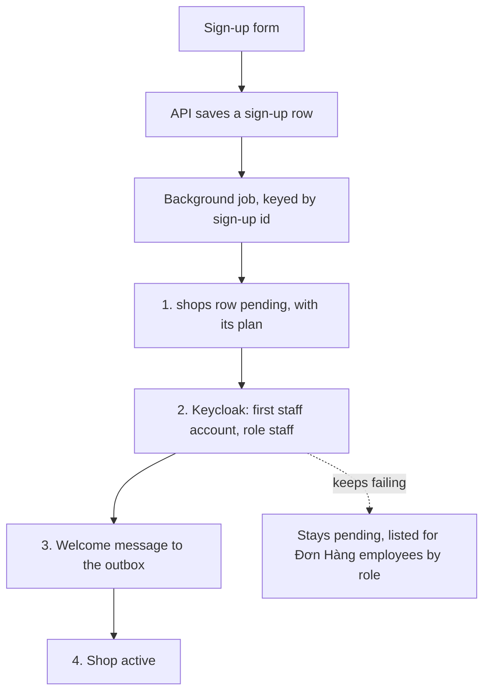

## Before you start

- [[sysdesign.l4.saas-requirements]] — you have the four ranked drivers: 1, a shop opens with nobody at Đơn Hàng acting; 2, no shop's settings reach another shop; 3, each plan's cost per shop is known; 4, a leaving shop's data is gone by a stated date.
- [[backend.l3.saga]] — you know a saga replaces one transaction across services with a chain of local transactions, each saving its change together with what starts the next.
- [[backend.l3.safe-to-repeat-saga-steps]] — you know a saga step whose outcome you cannot know after a failure must be safe to repeat.
- [[frontend.l3.brand-themes]] — you know a brand is a set of token values given to one theme builder, and DonHang.App ships one brand.

## The situation

The SaaS requirements are agreed, and a teammate drafts sign-up for the design review. The endpoint saves the shop in `shops`, then asks Keycloak to create the shop's first staff account, then sends a welcome email. In a test, Keycloak times out after the row is saved. The shop exists, and nobody can sign in to it. The teammate proposes one transaction around all three.

The person who decides what the product does adds two wishes: a shop changes plan without a deploy, and picks its own colours. How do you open a shop so a failure at any step never leaves it half open, and what about a shop must be data rather than code?

## Core concepts

- a plan as data — a plan is a set of numbers, and the shop's row in `shops` names its plan, so changing plan changes data, not code.
- a plan's features — settings read from the shop's data that last as long as the plan. A release flag is a feature flag used to roll a feature out; unlike a plan's feature, it is removed once every customer has the feature.
- a built-in brand — a `Brand` value shipped inside the app and covered by its contrast tests; a shop picks one by name.
- the sign-up saga — four steps run by a background job, keyed by the sign-up's id: `shops` row `pending`, first staff account, welcome message, shop `active`.
- check before doing — each step first uses the sign-up's id to look whether its result already exists, so the job can run again from the start; the id alone skips nothing.
- stuck pending — a shop whose step keeps failing stays `pending` and is listed for Đơn Hàng's own employees by role; it is never half open.

## How it works



In the situation above, the teammate's one transaction cannot exist. The `shops` row lives in Đơn Hàng's database, and Keycloak stores its users in its own database, so a PostgreSQL transaction in Đơn Hàng's database cannot include or undo creating the account. With two owners, sign-up becomes a saga: a chain of steps, each finished on its own.

The API only saves a sign-up row; a background job then runs four steps, keyed by that sign-up's id. Step 1 writes the shop's row as `pending`, with the plan it chose. Step 2 creates the first staff account in Keycloak, with the `staff` role and the shop. Step 3 writes a welcome message to the outbox, and Notifications sends the email at least once. Step 4 marks the shop `active`.

Before its work, each step checks if it is already done. The review names two checks, a `shops` row for this sign-up id and an account that exists; it says every step checks, without spelling out steps 3 and 4. So when the job stops halfway and runs again from the start, finished steps are skipped, not repeated. A step that keeps failing leaves the shop `pending`, listed for Đơn Hàng's own employees by role. The diagram draws that arrow from step 2, the step that calls Keycloak; any step that keeps failing ends the same way.

The two wishes split. A plan is data, so changing it writes a row and needs no deploy. Colours stay in code: a shop picks a brand by name among those built into the app.

## In the Đơn Hàng system

None of this is built at stage-4. ADR `0033` says so in its header: the repository has no sign-up, plan or shop-settings code. Its decision on plans, features and brands:

```markdown file=docs/adr/0033-cua-hang-tu-dang-ky-goi-la-du-lieu.md tag=stage-4 lines=34-43
- Dòng `shops` ghi gói, cài đặt và trạng thái `pending`, `active`, `leaving`.
- Gói là một tập con số: phần đọc đồng thời theo ADR 0016, số tài khoản nhân
  viên, chat bật hay tắt, thời gian giữ dữ liệu (giả định). Gói là trần, không
  giữ chỗ. Đổi gói không deploy; có hiệu lực khi cache bảng ánh xạ của mỗi Pod
  hết hạn (ADR 0026).
- Tính năng theo gói là cài đặt đọc từ dữ liệu cửa hàng, sống cùng gói; không
  phải flag phát hành, thứ bị gỡ khi tính năng đã bật cho mọi khách
  (`feature-flags.md`).
- Brand: cửa hàng chọn theo tên trong các `Brand` dựng sẵn trong app, đã qua
  test tương phản. Thêm một brand là một lần phát hành app.
```

The second bullet makes a plan a set of numbers: a share of concurrent reads, the number of staff accounts, chat on or off, how long data is kept (assumed).

The share comes from ADR `0016`, which caps how much of a shared limit each shop may use. A plan only sets the size of that cap, so it is a ceiling, not a reservation: a shop's unused share stays free for other shops.

ADR `0026` keeps the mapping table, the database holding each shop, as a column of `shops`, the row that also records the plan. Each Pod keeps that table in memory for a short time; ADR `0033` says a plan change takes effect when that copy expires.

The third bullet draws the line between a plan's features and release flags from Core concepts; `feature-flags.md` describes the flags. The fourth bullet keeps colours in code. `brand.dart`, outside these excerpts, ships one constant `Brand`, `donHangBrand`; its comment says each "on" colour keeps a contrast of at least 4.5:1 with its background, and the accessibility checks test it. So today there is one brand; picking by name matters once more are added, each in an app release.

The review's path and deep dive:

```markdown file=docs/design/saas-platform-design-review.md tag=stage-4 lines=44-60
Đường đi: form gửi đăng ký → API ghi một dòng đăng ký → job chạy từng bước theo
id đăng ký. App của khách đọc tên cửa hàng, cài đặt và tên brand của cửa hàng
qua API, rồi dùng brand dựng sẵn có cùng tên trong app.

### Đi sâu: đăng ký (bước 4)

1. Tạo dòng `shops` ở `pending`, với gói đã chọn.
2. Tạo tài khoản nhân viên đầu tiên trong Keycloak, role `staff`, mang cửa hàng
   (token mang cửa hàng từ release 2).
3. Ghi message chào mừng vào outbox; Notifications gửi email ít nhất một lần.
4. Đặt cửa hàng `active`.

Hai chủ (database của Đơn Hàng và Keycloak) nên không transaction nào bao cả
bốn bước. Mỗi bước kiểm đã làm chưa trước khi làm (dòng `shops` theo id đăng
ký đã có; tài khoản đã có), nên job chạy lại từ đầu an toàn. Một bước lỗi mãi:
cửa hàng ở `pending`, hiện cho nhân viên Đơn Hàng theo vai trò; không bao giờ
mở một nửa.
```

The first paragraph is the path: the customer's app reads the shop's name, settings and brand name through the API, then uses the built-in brand with that name. The last paragraph gives the reason for a saga, two owners, and examples of the check each step makes before its work, which makes running again from the start safe. Below the excerpt, the review adds that if Keycloak fails, sign-up stops at step 2 and the shop waits as `pending`, while running shops are unaffected. ADR `0033` also lists review conditions, events that reopen its decision: shops needing free colours or a logo, the saga job becoming a bottleneck, and a plan needing a reservation instead of a ceiling.

## Trade-offs

| Choice | What it gives | What it costs | Right when |
|---|---|---|---|
| Staff open each shop by hand | no new code; a person checks each shop | fails driver 1, and each opening is one more chance of a mistake | a few shops a week, each opened when its contract is signed |
| One transaction around every step | all or nothing, if it could exist | not possible: Keycloak keeps its users in its own database, which Đơn Hàng's transaction cannot include | every step writes to one database |
| A saga run by a background job, each step checking first (ADR `0033`) | a shop is open or visibly `pending`; a stopped job runs again from the start | one more job, a status on every shop, and a list of stuck shops someone must watch | the steps span owners that share no transaction |
| Built-in brands picked by name (ADR `0033`) | every colour a customer sees has passed the contrast tests | fewer choices for shops; a new brand needs an app release | readability must hold for every shop |
| Free colours set by each shop | any colour, no release | the contrast tests check only built-in brands, so they would have to run on each shop's data | ADR `0033`'s first review condition: shops need it |

The review names two trade-off points: built-in brands put readability for every shop before choice for each shop, and a plan as a ceiling leaves unused share to other shops, so a higher plan gets no guaranteed room.

## What would you choose if…

…Keycloak were down for an hour? The review answers: sign-ups stop at step 2 and wait as `pending`, and shops already open notice nothing. When the job next runs, step 1 finds its row and skips, and step 2 creates the account. The requirement that a shop opens within ten minutes (SA-1, assumed) slips for those sign-ups, but no shop opens half-way.

…a large shop asked for its own logo? ADR `0033` allows no logo and no free colours. Its first review condition names this case: a new ADR, with the contrast tests run on the shop's data.

…sign-ups grew until the saga job became a bottleneck? That is ADR `0033`'s second review condition, so the decision is reopened then. At about five sign-ups a day (assumed), today's estimate is far from it.

## Seniors often assume…

- **"Sign-up can be one transaction that writes the shop and its first staff account together."** → Actually the account lives in Keycloak's own database, which a PostgreSQL transaction in Đơn Hàng's database cannot include or undo. You notice this when Keycloak times out after the row is saved, and a shop exists that nobody can sign in to.
- **"A feature only for a higher plan is just another feature flag."** → Actually a release flag is removed once its feature is on for everyone, while a plan's feature lasts as long as the plan. You notice this when a flag's removal date comes and nobody can remove it, because removing it would change what a plan includes.
- **"Giving each shop its own colours means building a separate copy of the app for each shop."** → Actually one app carries every built-in brand, and a shop picks one by name, read through the API. You notice this when a shop changes brand in its settings and the customer's app shows it without a new build.

## Try it (3 minutes)

The job for sign-up 77 finishes step 2, creating the staff account in Keycloak, then stops before step 3. Later it runs again from the start.

Write what each of the four steps does on the second run, and what state the shop is in between the two runs.

Expected result: four lines and one state.

<details><summary>Suggested answer</summary>

Step 1 finds a `shops` row for sign-up 77 and skips. Step 2 finds the account and skips. Step 3 writes the welcome message to the outbox. Step 4 marks the shop `active`. Between the runs the shop is `pending`: not open, and listed for Đơn Hàng's own employees by role if it stays there.

</details>

## Connections

- [[sysdesign.l4.deep-dive]] — the step this lesson applies: sign-up is where driver 1 is hardest, so it gets the deep dive.
- [[devops.l4.feature-flags]] — the release flags a plan's features are not: flags that end once a feature is on for everyone.
- [[backend.l2.at-least-once-jobs]] — the delivery the welcome email gets: never lost, sometimes sent twice.
- [[frontend.l3.accessibility-checks]] — the contrast tests every built-in brand passes, the reason a shop picks among them.
- [[backend.l2.role-based-access]] — the `staff` role step 2 gives the first account; the review also lists stuck shops for Đơn Hàng's own employees by role.
- [[sysdesign.l4.saas-trade-offs]] — the next step: what knowing each shop's cost is paid for in.

## Five-line summary

1. Opening a shop is a chain of steps run by a background job, each checking if it is done, so running it again is safe.
2. ADR `0033` keeps a shop's plan and settings as data: a plan is a set of numbers, so changing plan needs no deploy.
3. A plan's features are settings that live with the plan, not release flags, which are removed once a feature is on for everyone.
4. A shop picks a brand by name among those built into the app, so every colour has passed the contrast tests.
5. Sign-up spans Đơn Hàng's database and Keycloak, so no transaction covers it; a step that keeps failing leaves the shop `pending`, never half open.
