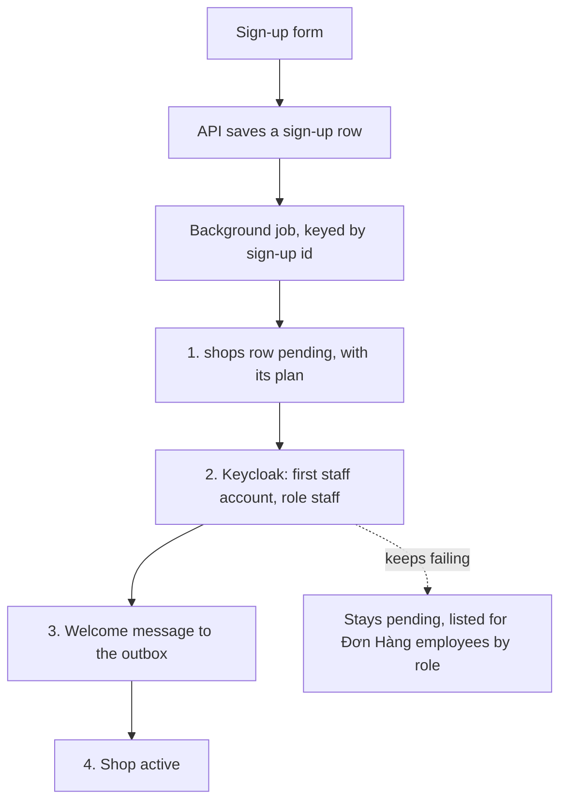

## Bạn cần biết trước

- [[sysdesign.l4.saas-requirements]] — bạn đã có bốn yếu tố xếp hạng. Một, cửa hàng mở mà không ai ở Đơn Hàng phải làm gì. Hai, không cài đặt của cửa hàng nào lọt sang cửa hàng khác. Ba, biết chi phí mỗi cửa hàng của từng gói. Bốn, dữ liệu của cửa hàng rời đi hết vào một ngày đã nói.
- [[backend.l3.saga]] — bạn biết saga thay một giao dịch xuyên nhiều service bằng một chuỗi giao dịch cục bộ, mỗi bước lưu thay đổi của mình cùng với thứ khởi động bước kế tiếp.
- [[backend.l3.safe-to-repeat-saga-steps]] — bạn biết một bước saga mà sau lỗi bạn không biết nó đã xong hay chưa thì phải chạy lại được an toàn.
- [[frontend.l3.brand-themes]] — bạn biết một brand là một bộ giá trị token đưa cho một hàm dựng theme, và DonHang.App đang đi kèm đúng một brand.

## Tình huống

Phần yêu cầu SaaS đã thống nhất, và một đồng đội phác phần đăng ký cho buổi review thiết kế. Endpoint lưu cửa hàng vào `shops`, rồi nhờ Keycloak tạo tài khoản nhân viên đầu tiên của cửa hàng, rồi gửi email chào mừng. Trong một lần test, Keycloak bị timeout sau khi dòng đã lưu. Cửa hàng tồn tại, nhưng không ai đăng nhập vào được. Đồng đội đề xuất bọc cả ba bước trong một giao dịch.

Người quyết định sản phẩm làm gì thêm hai mong muốn: cửa hàng đổi gói mà không cần deploy, và tự chọn màu của mình. Bạn mở một cửa hàng thế nào để lỗi ở bước nào cũng không bao giờ để nó mở dở dang? Và những gì của một cửa hàng phải là dữ liệu chứ không phải code?

## Khái niệm cốt lõi

- gói là dữ liệu — một gói là một bộ con số, và dòng của cửa hàng trong `shops` ghi tên gói của nó, nên đổi gói là đổi dữ liệu, không đổi code.
- tính năng theo gói — các cài đặt đọc từ dữ liệu của cửa hàng, sống cùng gói. Flag phát hành là feature flag dùng để tung một tính năng ra dần. Khác với tính năng theo gói, nó bị gỡ khi mọi khách đã có tính năng đó.
- brand dựng sẵn — một giá trị `Brand` đi kèm trong app và đã qua các test tương phản của app. Cửa hàng chọn một brand theo tên.
- saga đăng ký — bốn bước do một background job chạy, theo id của lượt đăng ký: dòng `shops` ở `pending`, tài khoản nhân viên đầu tiên, message chào mừng, cửa hàng `active`.
- kiểm trước khi làm — mỗi bước dùng id đăng ký để xem kết quả của mình đã có chưa, nên job chạy lại từ đầu được. Chỉ riêng id thì không bỏ qua được bước nào.
- kẹt ở pending — cửa hàng có một bước lỗi mãi thì ở lại `pending` và hiện trong danh sách cho chính nhân viên Đơn Hàng theo vai trò. Nó không bao giờ mở một nửa.

## Cơ chế hoạt động



Trong tình huống trên, giao dịch duy nhất mà đồng đội đề xuất không thể tồn tại. Dòng `shops` nằm trong database của Đơn Hàng, còn Keycloak lưu user trong database riêng của nó. Một giao dịch PostgreSQL trong database của Đơn Hàng không bao được, cũng không hoàn tác được, việc tạo tài khoản. Có hai chủ, nên đăng ký trở thành một saga: một chuỗi bước, bước nào xong riêng bước đó.

API chỉ lưu một dòng đăng ký. Sau đó một background job chạy bốn bước, theo id của lượt đăng ký đó. Bước 1 ghi dòng của cửa hàng ở `pending`, kèm gói cửa hàng đã chọn. Bước 2 tạo tài khoản nhân viên đầu tiên trong Keycloak, với role `staff` và mang cửa hàng. Bước 3 ghi message chào mừng vào outbox, và Notifications gửi email ít nhất một lần. Bước 4 đặt cửa hàng `active`.

Trước khi làm, mỗi bước kiểm xem mình đã xong chưa. Bản review nêu hai phép kiểm: đã có dòng `shops` cho id đăng ký này, và tài khoản đã có. Nó nói bước nào cũng kiểm, nhưng không ghi cụ thể cho bước 3 và 4. Vì vậy khi job dừng giữa chừng rồi chạy lại từ đầu, các bước đã xong được bỏ qua chứ không lặp lại. Một bước lỗi mãi để cửa hàng ở `pending`, hiện cho chính nhân viên Đơn Hàng theo vai trò. Sơ đồ vẽ mũi tên đó từ bước 2, bước gọi Keycloak, nhưng bước nào lỗi mãi cũng kết thúc như vậy.

Hai mong muốn tách ra hai hướng. Gói là dữ liệu, nên đổi gói là ghi một dòng, không cần deploy. Màu vẫn ở trong code: cửa hàng chọn một brand theo tên trong số các brand dựng sẵn trong app.

## Trong hệ thống Đơn Hàng

Ở stage-4 chưa có phần nào trong số này được xây. ADR `0033` nói rõ điều đó ở phần đầu: repository chưa có code đăng ký, gói hay cài đặt cửa hàng. Quyết định của nó về gói, tính năng và brand:

```markdown file=docs/adr/0033-cua-hang-tu-dang-ky-goi-la-du-lieu.md tag=stage-4 lines=34-43
- Dòng `shops` ghi gói, cài đặt và trạng thái `pending`, `active`, `leaving`.
- Gói là một tập con số: phần đọc đồng thời theo ADR 0016, số tài khoản nhân
  viên, chat bật hay tắt, thời gian giữ dữ liệu (giả định). Gói là trần, không
  giữ chỗ. Đổi gói không deploy; có hiệu lực khi cache bảng ánh xạ của mỗi Pod
  hết hạn (ADR 0026).
- Tính năng theo gói là cài đặt đọc từ dữ liệu cửa hàng, sống cùng gói; không
  phải flag phát hành, thứ bị gỡ khi tính năng đã bật cho mọi khách
  (`feature-flags.md`).
- Brand: cửa hàng chọn theo tên trong các `Brand` dựng sẵn trong app, đã qua
  test tương phản. Thêm một brand là một lần phát hành app.
```

Gạch đầu dòng thứ hai biến gói thành một bộ con số: phần đọc đồng thời, số tài khoản nhân viên, chat bật hay tắt, thời gian giữ dữ liệu (giả định).

Phần đọc đến từ ADR `0016`, ADR giới hạn mỗi cửa hàng được dùng bao nhiêu trong một giới hạn chung. Gói chỉ đặt độ lớn của giới hạn đó, nên nó là trần chứ không phải giữ chỗ: phần một cửa hàng không dùng vẫn để trống cho các cửa hàng khác.

ADR `0026` giữ bảng ánh xạ, tức database chứa từng cửa hàng, thành một cột của `shops`, chính dòng ghi gói. Mỗi Pod giữ bảng đó trong bộ nhớ một thời gian ngắn, và ADR `0033` nói đổi gói có hiệu lực khi bản sao đó hết hạn.

Gạch đầu dòng thứ ba vạch ranh giới giữa tính năng theo gói và flag phát hành, như ở Khái niệm cốt lõi. `feature-flags.md` mô tả các flag. Gạch đầu dòng thứ tư giữ màu trong code. `brand.dart`, nằm ngoài các đoạn trích này, có đúng một hằng `Brand` là `donHangBrand`. Comment của nó nói mỗi màu "on" giữ độ tương phản ít nhất 4,5:1 với nền của nó, và các phép kiểm accessibility test điều đó. Vậy hôm nay chỉ có một brand. Chọn theo tên chỉ có ý nghĩa khi có thêm brand, mỗi brand thêm vào là một lần phát hành app.

Đường đi và phần đi sâu của bản review:

```markdown file=docs/design/saas-platform-design-review.md tag=stage-4 lines=44-60
Đường đi: form gửi đăng ký → API ghi một dòng đăng ký → job chạy từng bước theo
id đăng ký. App của khách đọc tên cửa hàng, cài đặt và tên brand của cửa hàng
qua API, rồi dùng brand dựng sẵn có cùng tên trong app.

### Đi sâu: đăng ký (bước 4)

1. Tạo dòng `shops` ở `pending`, với gói đã chọn.
2. Tạo tài khoản nhân viên đầu tiên trong Keycloak, role `staff`, mang cửa hàng
   (token mang cửa hàng từ release 2).
3. Ghi message chào mừng vào outbox; Notifications gửi email ít nhất một lần.
4. Đặt cửa hàng `active`.

Hai chủ (database của Đơn Hàng và Keycloak) nên không transaction nào bao cả
bốn bước. Mỗi bước kiểm đã làm chưa trước khi làm (dòng `shops` theo id đăng
ký đã có; tài khoản đã có), nên job chạy lại từ đầu an toàn. Một bước lỗi mãi:
cửa hàng ở `pending`, hiện cho nhân viên Đơn Hàng theo vai trò; không bao giờ
mở một nửa.
```

Đoạn đầu là đường đi: app của khách đọc tên, cài đặt và tên brand của cửa hàng qua API, rồi dùng brand dựng sẵn có cùng tên. Đoạn cuối nêu lý do dùng saga, là hai chủ, và ví dụ về phép kiểm mỗi bước làm trước khi làm, thứ khiến chạy lại từ đầu trở nên an toàn. Bên dưới đoạn trích, bản review thêm rằng nếu Keycloak lỗi, đăng ký dừng ở bước 2 và cửa hàng chờ ở `pending`, còn các cửa hàng đang chạy không bị ảnh hưởng. ADR `0033` cũng liệt kê các điều kiện xét lại, tức những sự kiện mở lại quyết định của nó: cửa hàng cần màu tự do hoặc logo, job saga trở thành nút thắt, và một gói cần giữ chỗ thay vì trần.

## Đánh đổi

| Lựa chọn | Được gì | Mất gì | Đúng khi |
|---|---|---|---|
| Nhân viên mở từng cửa hàng bằng tay | không thêm code, có người kiểm từng cửa hàng | trượt yếu tố 1, và mỗi lần mở là thêm một cơ hội sai sót | vài cửa hàng mỗi tuần, mỗi cửa hàng mở khi ký hợp đồng |
| Một giao dịch bao mọi bước | tất cả hoặc không gì cả, nếu nó tồn tại được | không thể: Keycloak giữ user trong database riêng, giao dịch của Đơn Hàng không bao được | mọi bước ghi vào cùng một database |
| Saga do background job chạy, mỗi bước kiểm trước (ADR `0033`) | cửa hàng hoặc đã mở hoặc nằm ở `pending` cho ai cũng thấy, job dừng thì chạy lại từ đầu | thêm một job, một trạng thái trên mỗi cửa hàng, và một danh sách cửa hàng kẹt cần người theo dõi | các bước trải qua nhiều chủ không chung giao dịch nào |
| Brand dựng sẵn, chọn theo tên (ADR `0033`) | mọi màu khách nhìn thấy đều đã qua test tương phản | cửa hàng ít lựa chọn hơn, brand mới cần một lần phát hành app | chữ phải đọc được ở mọi cửa hàng |
| Mỗi cửa hàng tự đặt màu | màu nào cũng được, không cần phát hành | test tương phản chỉ kiểm brand dựng sẵn, nên phải chạy trên dữ liệu của từng cửa hàng | điều kiện xét lại đầu tiên của ADR `0033`: cửa hàng cần điều đó |

Bản review nêu hai điểm đánh đổi. Brand dựng sẵn đặt chuyện chữ đọc được ở mọi cửa hàng lên trước quyền chọn của từng cửa hàng. Gói là trần thì phần không dùng để lại cho cửa hàng khác, nên gói cao hơn không được bảo đảm chỗ.

## Bạn sẽ chọn gì nếu…

…Keycloak sập một giờ? Bản review đã trả lời: các lượt đăng ký dừng ở bước 2 và chờ ở `pending`, còn các cửa hàng đã mở không nhận ra gì. Lần job chạy kế tiếp, bước 1 thấy dòng của mình và bỏ qua, bước 2 tạo tài khoản. Yêu cầu cửa hàng mở trong mười phút (SA-1, giả định) bị trễ với các lượt đăng ký đó, nhưng không cửa hàng nào mở dở dang.

…một cửa hàng lớn xin dùng logo riêng? ADR `0033` không cho logo, cũng không cho màu tự do. Điều kiện xét lại đầu tiên của nó gọi tên đúng trường hợp này: một ADR mới, với test tương phản chạy trên dữ liệu của cửa hàng.

…lượt đăng ký tăng tới mức job saga thành nút thắt? Đó là điều kiện xét lại thứ hai của ADR `0033`, nên khi ấy quyết định được mở lại. Với khoảng năm lượt đăng ký mỗi ngày (giả định), ước lượng hiện tại còn xa mức đó.

## Senior hay nhầm rằng…

- **"Đăng ký có thể là một giao dịch ghi cửa hàng và tài khoản nhân viên đầu tiên cùng lúc."** → Thực ra tài khoản nằm trong database riêng của Keycloak, mà một giao dịch PostgreSQL trong database của Đơn Hàng không bao được, cũng không hoàn tác được. Bạn sẽ nhận ra khi Keycloak timeout sau khi dòng đã lưu, và có một cửa hàng tồn tại mà không ai đăng nhập vào được.
- **"Tính năng chỉ dành cho gói cao hơn thì cũng chỉ là một feature flag nữa."** → Thực ra flag phát hành bị gỡ khi tính năng đã bật cho mọi người, còn tính năng theo gói sống cùng gói. Bạn sẽ nhận ra khi tới ngày gỡ một flag mà không ai gỡ được, vì gỡ nó sẽ đổi những gì một gói bao gồm.
- **"Cho mỗi cửa hàng màu riêng nghĩa là dựng một bản app riêng cho từng cửa hàng."** → Thực ra một app mang mọi brand dựng sẵn, và cửa hàng chọn một brand theo tên, đọc qua API. Bạn sẽ nhận ra khi một cửa hàng đổi brand trong cài đặt và app của khách hiện brand mới mà không cần build lại.

## Thử ngay (3 phút)

Job của lượt đăng ký 77 làm xong bước 2, tạo tài khoản nhân viên trong Keycloak, rồi dừng trước bước 3. Sau đó nó chạy lại từ đầu.

Viết ra mỗi bước trong bốn bước làm gì ở lần chạy thứ hai, và cửa hàng ở trạng thái nào giữa hai lần chạy.

Kết quả mong đợi: bốn dòng và một trạng thái.

<details><summary>Gợi ý đáp án</summary>

Bước 1 thấy dòng `shops` cho lượt đăng ký 77 và bỏ qua. Bước 2 thấy tài khoản và bỏ qua. Bước 3 ghi message chào mừng vào outbox. Bước 4 đặt cửa hàng `active`. Giữa hai lần chạy, cửa hàng ở `pending`: chưa mở, và nếu kẹt ở đó thì hiện trong danh sách cho chính nhân viên Đơn Hàng theo vai trò.

</details>

## Liên hệ

- [[sysdesign.l4.deep-dive]] — bước mà bài này áp dụng: đăng ký là chỗ yếu tố 1 khó nhất, nên nó được chọn để đi sâu.
- [[devops.l4.feature-flags]] — các flag phát hành mà tính năng theo gói không phải: flag kết thúc khi tính năng đã bật cho mọi người.
- [[backend.l2.at-least-once-jobs]] — kiểu gửi mà email chào mừng nhận được: không bao giờ mất, đôi khi gửi hai lần.
- [[frontend.l3.accessibility-checks]] — các test tương phản mà mọi brand dựng sẵn đều qua, lý do cửa hàng chọn trong số chúng.
- [[backend.l2.role-based-access]] — role `staff` mà bước 2 gán cho tài khoản đầu tiên. Bản review cũng liệt kê cửa hàng kẹt cho chính nhân viên Đơn Hàng theo vai trò.
- [[sysdesign.l4.saas-trade-offs]] — bước tiếp theo: biết chi phí mỗi cửa hàng phải trả bằng gì.

## Tóm tắt 5 dòng

1. Mở một cửa hàng là chuỗi bước do một background job chạy, mỗi bước kiểm xem mình đã xong chưa, nên chạy lại là an toàn.
2. ADR `0033` giữ gói và cài đặt của cửa hàng là dữ liệu: gói là một bộ con số, nên đổi gói không cần deploy.
3. Tính năng theo gói là cài đặt sống cùng gói, không phải flag phát hành, thứ bị gỡ khi tính năng đã bật cho mọi người.
4. Cửa hàng chọn một brand theo tên trong số các brand dựng sẵn trong app, nên mọi màu đều đã qua test tương phản.
5. Đăng ký trải qua database của Đơn Hàng và Keycloak, nên không giao dịch nào bao được nó. Bước nào lỗi mãi thì cửa hàng ở `pending`, không bao giờ mở một nửa.
