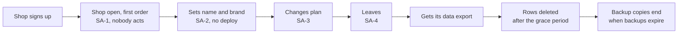

## Before you start

- [[sysdesign.l4.support-chat-challenges]] — you finished the chat problem by answering challenges from ADRs already made; this lesson starts the module's last problem at step 1, requirements.
- [[sysdesign.l4.multi-shop-challenges]] — you know a challenge that asks to decide ADR `0012` or `0013` again is answered with the reason that ADR already wrote.
- [[backend.l4.shop-data-layout]] — you know ADR `0013` keeps every shop in shared tables with `shop_id`, so opening a shop is adding a row to `shops`.
- [[design.l4.a-thousand-shops]] — you know `multi-shop-requirements.md` asks that each shop see only its data and open without a deploy.

## The situation

The product owner wants shops to join Đơn Hàng on their own: sign up at night, choose a plan, and leave when they want. A teammate says the hard part is done. ADRs `0012`, `0013`, `0016` and `0026` already decide deployment, tables, limits and large shops, so this is a sign-up form that adds a row to `shops`.

Then the questions start. Who adds that row when nobody at Đơn Hàng is awake? What may a shop change about itself? Which plan is it on? When a shop leaves, on what day is its data really gone? What do those four decisions leave open, and what must the requirements measure before anyone designs it?

## Core concepts

- a SaaS platform — here, one multi-tenancy system that shops join, configure, change plan on and leave by themselves, with nobody at Đơn Hàng acting.
- decisions the problem starts from — ADRs already accepted that the requirements name and do not reopen: one shared deployment, shared tables, per-shop limits, a large shop's own database.
- a shop's own path — the steps a shop takes by itself: sign up, set its name and brand, change plan, leave; none of the four ADRs the problem starts from covers them.
- a grace period — the wait between a shop leaving and its rows being deleted.
- cost per shop — the share of nodes, databases and platform work that one shop uses, which each plan's price must cover.
- ranked drivers — the scenarios, in order, that the design must satisfy first when two of them pull in different directions.

## How it works



The diagram is a shop's own path, left to right. In the situation above, the teammate's view covers only the first arrow: ADR `0013` makes opening a shop a row in `shops`. The requirements file says the same and adds what is missing: nobody has said who adds that row, what a shop may configure, which plan it is on, or how it leaves.

Boxes two to five are the file's scenarios SA-1 to SA-4, each with a measure; the last three boxes spell out what SA-4 means. A new shop is open and takes its first order within 10 minutes (assumed), with nobody at Đơn Hàng acting. It sets its name and brand, and they show in the customer's app without a deploy. It changes plan, and the new plan's limits and features apply within minutes (assumed). One scenario is not a step on the path: SA-5, no shop's settings reach another shop.

The last three boxes answer a clarifying question: what does leaving mean? The shop gets an export of its data. Its rows are deleted after a 30-day grace period (assumed). Copies inside backups end only when those backups expire. So "gone" has two dates after the shop leaves: when its rows are deleted and when the last backup holding them expires.

The estimate then sets the kind of problem. About five sign-ups a day (assumed) make opening a shop a question of correctness, not load. The order load of more shops is not estimated again here: per-shop limits and large shops belong to ADRs `0016` and `0026`, which the file does not reopen. The driver that grows with the number of shops is cost: nodes, databases and the platform serve every shop, and each plan's price must cover its shops' share.

## In the Đơn Hàng system

The team's requirements for the SaaS platform, at this tag, start with what they do not reopen:

```markdown file=docs/team/saas-platform-requirements.md tag=stage-4 lines=11-29
Các quyết định đã có, tài liệu này không mở lại: một bản triển khai chung (ADR
0012), bảng chung có `shop_id` (ADR 0013), giới hạn tải theo cửa hàng (ADR
0016), cửa hàng lớn sang database riêng (ADR 0026).

Còn để mở là đường đi của chính cửa hàng. Theo ADR 0013, mở cửa hàng là thêm
một dòng vào `shops`, nhưng chưa ai quy định ai thêm dòng đó, cửa hàng cấu hình
được gì, cửa hàng ở gói nào, và rời đi thế nào. CH-4 của
`multi-shop-requirements.md` (cấu hình riêng từng cửa hàng, đổi không cần
deploy) chưa có thiết kế.

### Kịch bản

| Số | Tình huống | Phản hồi | Đo |
|---|---|---|---|
| SA-1 | Một cửa hàng mới tự đăng ký | Cửa hàng mở, nhận được đơn đầu tiên | Trong 10 phút (giả định); không ai ở Đơn Hàng phải làm gì |
| SA-2 | Cửa hàng đặt tên và chọn brand | Tên và brand hiện trên app của khách | Không cần deploy |
| SA-3 | Cửa hàng tự đổi gói | Trần và tính năng của gói mới có hiệu lực | Trong vài phút (giả định) |
| SA-4 | Cửa hàng rời nền tảng | Nhận bản xuất dữ liệu của mình; dòng bị xóa sau thời gian chờ | Xóa sau 30 ngày chờ (giả định); bản trong backup hết khi backup hết hạn giữ |
| SA-5 | Cửa hàng A đổi cài đặt | Không cửa hàng nào khác thấy thay đổi | Không cài đặt nào lọt sang cửa hàng khác |
```

The first paragraph lists the four accepted ADRs and says the file does not reopen them. The second names the gap: the shop's own path. It also points back to CH-4 of `multi-shop-requirements.md`, a shop's own settings changed without a deploy, which had no design yet. SA-2 and SA-5 make CH-4 measurable: a setting shows without a deploy, and no setting reaches another shop. Đơn Hàng's own database has no `shops` table at stage-4 (only the lab file `db/tenancy/shared-schema.sql` has one). Release 1 of the data rollout plan, `docs/design/multi-shop-data-rollout.md`, creates it, so the row SA-1 adds goes into that table.

The rest of the file estimates and ranks:

```markdown file=docs/team/saas-platform-requirements.md tag=stage-4 lines=31-53
### Ước lượng

- Vài cửa hàng đăng ký mỗi ngày (giả định 5): mở cửa hàng là bài toán đúng
  sai, không phải bài toán tải.
- Chi phí là driver tăng theo số cửa hàng: node, database và platform phục vụ
  mọi cửa hàng. Giá mỗi gói phải trả được phần chi phí của các cửa hàng trong
  gói đó (giả định, không số tiền); cách chia ở `docs/design/cost-per-shop.md`.

### Giả định và người xác nhận

| Giả định | Người xác nhận (vai trò) |
|---|---|
| Đăng ký tới đơn đầu tiên trong 10 phút | Product owner |
| Thời gian chờ 30 ngày trước khi xóa | Product owner, cùng bộ phận pháp chế |
| Khoảng 5 đăng ký mỗi ngày | Product owner, bộ phận kinh doanh |
| Đội Cửa hàng phụ trách mở cửa hàng và gói | Trưởng nhóm (ADR 0025, giả định) |

### Driver xếp hạng

1. Cửa hàng mở mà không ai ở Đơn Hàng phải làm gì (SA-1).
2. Không cài đặt của cửa hàng nào lọt sang cửa hàng khác (SA-5).
3. Biết chi phí mỗi cửa hàng của từng gói.
4. Dữ liệu của cửa hàng rời đi hết vào một ngày đã nói (SA-4).
```

The estimate has two lines. Five sign-ups a day (assumed) is far too few to load anything, so the file calls opening a shop a correctness problem. In other words, the risk is a shop opened half-way, not a slow one. Cost is what grows, and the file names no amount; how it is split per shop is in `cost-per-shop.md`.

Every assumption has a role who confirms it: the 30-day wait goes to the product owner together with the legal department, and the Shop team owning opening and plans (assumed) goes to the team lead, with ADR `0025` on how teams are organised. The ranked drivers close the file. First, a shop opens with nobody at Đơn Hàng acting. Second, no shop's settings reach another shop. Third, each plan's cost per shop is known. Fourth, a leaving shop's data is gone by a stated date.

## Trade-offs

| How the team frames the SaaS problem | What the design gets | What it costs | Right when |
|---|---|---|---|
| Already designed: a sign-up form that adds a row to `shops` | the smallest piece of work | no answer for settings, plans or leaving; SA-2 to SA-5 have no design | shops never change plan or leave, which is not this product |
| Staff open each shop by hand when a contract is signed | no new automation; a person checks each shop | fails SA-1, since someone at Đơn Hàng must act | a few shops a week, each opened the day its contract is signed, as `multi-shop-requirements.md` assumed |
| The shop's whole path as scenarios with measures, judged on correctness and cost (the framing the requirements hand on) | SA-1 to SA-5 as written, and a known cost per plan | more to design: opening, settings, plans and deleting each need steps | shops sign up and leave on their own, at any hour |

The requirements do not pick how a shop is opened or deleted; the design lesson does. What they fix is the measure each option is judged against, and the fact that load is not the driver.

## What would you choose if…

…the business expects 500 sign-ups on the first day of a campaign? Redo the estimate: 500 in a day of 86,400 seconds is about one every three minutes. That is far below the busiest hour in `docs/design/capacity-plan.md`, about 3.3 orders per second, so the problem stays one of correctness: every one of those shops must open fully.

…the legal department says a leaving shop's data must be gone everywhere within 30 days, backups included? Change SA-4's measure first, with the legal department as confirmer. How long backups are kept then becomes part of the requirement, and the design is judged against the new date.

…a shop asks to have only its own data restored to an earlier point? ADR `0013` already wrote the answer: in shared tables, restoring one shop means extracting its rows from a temporary restore. ADR `0026` moves a shop to its own database when a contract requires restoring it alone (assumed), so the requirements reopen neither.

## Seniors often assume…

- **"Multi-tenancy is already designed, so a SaaS platform has nothing left to decide."** → Actually the four ADRs the problem starts from decide where shops live, not how a shop gets there or leaves. The file says nobody has decided who adds the row, what a shop configures, its plan, or how it leaves. You notice this when the first shop that wants to leave asks for its data, and nobody can say what it gets.
- **"Letting shops sign up on their own is mainly a question of load."** → Actually about five sign-ups a day (assumed) is no load at all. The risk is a shop left half-open, and the cost each plan must cover. You notice this when a load test of sign-up passes easily, and a shop still has a row in `shops` but cannot take an order.
- **"Once a shop's rows are deleted, its data is gone everywhere at the same moment."** → Actually SA-4 gives two dates: rows go after the 30-day wait (assumed), and copies in backups end only when those backups expire. You notice this when someone asks for the deletion date and the honest answer names how long backups are kept too.

## Try it (3 minutes)

A shop leaves the platform on 1 March. Use SA-4's 30-day grace period (assumed). For this exercise only, assume every backup of the database is kept 14 days and one is taken each morning, before any deletion that day runs. Work out when the shop's rows are deleted and when the last copy of them ends.

Expected result: two dates, and one sentence on why they differ.

<details><summary>Suggested answer</summary>

The rows are deleted 30 days after 1 March, on 31 March. The last backup that still holds them is the one taken on the morning of 31 March, before the deletion. It is kept 14 days, so the last copy ends on 14 April. They differ because deleting rows does not change backups already taken; each copy ends only when its backup expires, which is why SA-4 states both.

</details>

## Connections

- [[sysdesign.l4.clarifying-requirements]] — the general step this lesson applies: a request becomes scenarios with measures and answers to shape-changing questions such as what leaving means.
- [[backend.l4.shop-id-rollout]] — the three releases that create `shops` and add `shop_id`; the row this problem starts from does not exist before its first release.
- [[devops.l3.point-in-time-recovery]] — the backups; how long they are kept decides when a leaving shop's last copy ends.
- [[management.l4.compliance-controls]] — where a rule like "gone within 30 days" becomes a control with evidence, beyond what these requirements decide.
- [[sysdesign.l4.back-of-the-envelope]] — the estimating habit that turns five sign-ups a day into "correctness, not load".
- [[sysdesign.l4.saas-design]] — the next step: a design judged against these four ranked drivers.

## Five-line summary

1. The SaaS problem keeps ADRs `0012`, `0013`, `0016` and `0026`, and decides what they leave open: the shop's own path.
2. Opening a shop is a row in `shops`, but nobody has said who adds it, what a shop configures, its plan, or how it leaves.
3. `saas-platform-requirements.md` measures it: open within 10 minutes with nobody acting, brand without a deploy, plan changed within minutes (assumed).
4. Leaving means an export, rows deleted after 30 days (assumed), and copies in backups ending only when those backups expire.
5. About five sign-ups a day make opening a correctness problem; the driver that grows is each plan's cost per shop.
