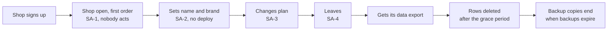

## Bạn cần biết trước

- [[sysdesign.l4.support-chat-challenges]] — bạn đã khép lại bài toán chat bằng cách trả lời các câu phản biện từ những ADR đã có. Bài này mở bài toán cuối của module ở bước 1, yêu cầu.
- [[sysdesign.l4.multi-shop-challenges]] — bạn biết câu phản biện đòi quyết lại ADR `0012` hay `0013` được trả lời bằng chính lý do ADR đó đã ghi.
- [[backend.l4.shop-data-layout]] — bạn biết ADR `0013` giữ mọi cửa hàng trong bảng chung có `shop_id`, nên mở một cửa hàng là thêm một dòng vào `shops`.
- [[design.l4.a-thousand-shops]] — bạn biết `multi-shop-requirements.md` yêu cầu mỗi cửa hàng chỉ thấy dữ liệu của mình và mở được mà không cần deploy.

## Tình huống

Product owner muốn các cửa hàng tự tham gia Đơn Hàng: đăng ký lúc nửa đêm, chọn gói, và rời đi khi muốn. Một đồng đội nói phần khó đã xong. Các ADR `0012`, `0013`, `0016` và `0026` đã quyết chuyện deploy, bảng, giới hạn và cửa hàng lớn, nên đây chỉ là một form đăng ký thêm một dòng vào `shops`.

Rồi các câu hỏi bắt đầu. Ai thêm dòng đó khi không ai ở Đơn Hàng còn thức? Cửa hàng được tự đổi những gì của mình? Nó đang ở gói nào? Khi cửa hàng rời đi, dữ liệu thật sự mất vào ngày nào? Bốn quyết định kia còn để mở điều gì, và phần yêu cầu phải đo những gì trước khi có người thiết kế?

## Khái niệm cốt lõi

- nền tảng SaaS — ở đây là một hệ thống multi-tenancy mà cửa hàng tự tham gia, tự cấu hình, tự đổi gói và tự rời đi, không ai ở Đơn Hàng phải làm gì.
- quyết định làm điểm xuất phát — các ADR đã được chấp nhận mà phần yêu cầu nêu tên và không mở lại: một bản triển khai chung, bảng chung, giới hạn theo cửa hàng, database riêng cho cửa hàng lớn.
- đường đi của chính cửa hàng — các bước cửa hàng tự làm: đăng ký, đặt tên và brand, đổi gói, rời đi. Không ADR nào trong bốn ADR xuất phát nói tới chúng.
- thời gian chờ — khoảng chờ từ lúc cửa hàng rời đi tới lúc các dòng của nó bị xóa.
- chi phí mỗi cửa hàng — phần node, database và công sức vận hành platform mà một cửa hàng dùng, và giá của mỗi gói phải trả được phần đó.
- yếu tố đã xếp hạng — các kịch bản, theo thứ tự, mà thiết kế phải ưu tiên đáp ứng khi hai kịch bản kéo về hai hướng khác nhau.

## Cơ chế hoạt động



Sơ đồ là đường đi của chính cửa hàng, từ trái sang phải. Trong tình huống trên, đồng đội kia chỉ nhìn thấy mũi tên đầu tiên: theo ADR `0013`, mở cửa hàng chỉ là thêm một dòng vào `shops`. File yêu cầu cũng nói vậy, rồi thêm phần còn thiếu: chưa ai quy định ai thêm dòng đó, cửa hàng cấu hình được gì, nó ở gói nào, và rời đi thế nào.

Ô thứ hai tới thứ năm là các kịch bản SA-1 tới SA-4 của file, mỗi kịch bản có một số đo. Ba ô cuối giải thích SA-4 nghĩa là gì. Một cửa hàng mới mở và nhận đơn đầu tiên trong 10 phút (giả định), không ai ở Đơn Hàng phải làm gì. Nó đặt tên và brand, và chúng hiện trên app của khách mà không cần deploy. Nó đổi gói, và giới hạn cùng tính năng của gói mới có hiệu lực trong vài phút (giả định). Có một kịch bản không phải bước trên đường đi: SA-5, cài đặt của cửa hàng này không lọt sang cửa hàng khác.

Ba ô cuối trả lời một câu hỏi làm rõ: rời đi nghĩa là gì? Cửa hàng nhận một bản xuất dữ liệu của mình. Các dòng của nó bị xóa sau 30 ngày chờ (giả định). Bản sao nằm trong backup chỉ hết khi các backup đó hết hạn. Vậy "mất hẳn" có hai ngày sau khi cửa hàng rời đi: ngày các dòng bị xóa, và ngày backup cuối cùng còn giữ chúng hết hạn.

Phần ước lượng sau đó xác định đây là loại bài toán gì. Khoảng năm lượt đăng ký mỗi ngày (giả định) khiến mở cửa hàng là chuyện đúng sai, không phải chuyện tải. Tải đơn hàng khi có thêm cửa hàng không được ước lượng lại ở đây: giới hạn theo cửa hàng và cửa hàng lớn thuộc ADR `0016` và `0026`, mà file không mở lại. Yếu tố tăng theo số cửa hàng là chi phí: node, database và platform phục vụ mọi cửa hàng, và giá mỗi gói phải trả được phần của các cửa hàng trong gói đó.

## Trong hệ thống Đơn Hàng

Phần yêu cầu của đội cho nền tảng SaaS, ở tag này, mở đầu bằng những gì không mở lại:

```markdown file=docs/team/saas-platform-requirements.md tag=stage-4 lines=11-29
Các quyết định đã có, tài liệu này không mở lại: một bản triển khai chung (ADR
0012), bảng chung có `shop_id` (ADR 0013), giới hạn tải theo cửa hàng (ADR
0016), cửa hàng lớn sang database riêng (ADR 0026).

Còn để mở là đường đi của chính cửa hàng. Theo ADR 0013, mở cửa hàng là thêm
một dòng vào `shops`, nhưng chưa ai quy định ai thêm dòng đó, cửa hàng cấu hình
được gì, cửa hàng ở gói nào, và rời đi thế nào. CH-4 của
`multi-shop-requirements.md` (cấu hình riêng từng cửa hàng, đổi không cần
deploy) chưa có thiết kế.

### Kịch bản

| Số | Tình huống | Phản hồi | Đo |
|---|---|---|---|
| SA-1 | Một cửa hàng mới tự đăng ký | Cửa hàng mở, nhận được đơn đầu tiên | Trong 10 phút (giả định); không ai ở Đơn Hàng phải làm gì |
| SA-2 | Cửa hàng đặt tên và chọn brand | Tên và brand hiện trên app của khách | Không cần deploy |
| SA-3 | Cửa hàng tự đổi gói | Trần và tính năng của gói mới có hiệu lực | Trong vài phút (giả định) |
| SA-4 | Cửa hàng rời nền tảng | Nhận bản xuất dữ liệu của mình; dòng bị xóa sau thời gian chờ | Xóa sau 30 ngày chờ (giả định); bản trong backup hết khi backup hết hạn giữ |
| SA-5 | Cửa hàng A đổi cài đặt | Không cửa hàng nào khác thấy thay đổi | Không cài đặt nào lọt sang cửa hàng khác |
```

Đoạn đầu liệt kê bốn ADR đã được chấp nhận và nói file không mở lại chúng. Đoạn thứ hai gọi tên chỗ trống: đường đi của chính cửa hàng. Nó cũng trỏ về CH-4 của `multi-shop-requirements.md`, cấu hình riêng của từng cửa hàng đổi được mà không cần deploy, vốn chưa có thiết kế. SA-2 và SA-5 biến CH-4 thành thứ đo được: một cài đặt hiện ra mà không cần deploy, và không cài đặt nào lọt sang cửa hàng khác. Database của chính Đơn Hàng chưa có bảng `shops` ở stage-4 (chỉ file thực hành `db/tenancy/shared-schema.sql` có). Release 1 của kế hoạch triển khai dữ liệu, `docs/design/multi-shop-data-rollout.md`, tạo bảng đó, nên dòng mà SA-1 thêm vào nằm trong bảng ấy.

Phần còn lại của file ước lượng và xếp hạng:

```markdown file=docs/team/saas-platform-requirements.md tag=stage-4 lines=31-53
### Ước lượng

- Vài cửa hàng đăng ký mỗi ngày (giả định 5): mở cửa hàng là bài toán đúng
  sai, không phải bài toán tải.
- Chi phí là driver tăng theo số cửa hàng: node, database và platform phục vụ
  mọi cửa hàng. Giá mỗi gói phải trả được phần chi phí của các cửa hàng trong
  gói đó (giả định, không số tiền); cách chia ở `docs/design/cost-per-shop.md`.

### Giả định và người xác nhận

| Giả định | Người xác nhận (vai trò) |
|---|---|
| Đăng ký tới đơn đầu tiên trong 10 phút | Product owner |
| Thời gian chờ 30 ngày trước khi xóa | Product owner, cùng bộ phận pháp chế |
| Khoảng 5 đăng ký mỗi ngày | Product owner, bộ phận kinh doanh |
| Đội Cửa hàng phụ trách mở cửa hàng và gói | Trưởng nhóm (ADR 0025, giả định) |

### Driver xếp hạng

1. Cửa hàng mở mà không ai ở Đơn Hàng phải làm gì (SA-1).
2. Không cài đặt của cửa hàng nào lọt sang cửa hàng khác (SA-5).
3. Biết chi phí mỗi cửa hàng của từng gói.
4. Dữ liệu của cửa hàng rời đi hết vào một ngày đã nói (SA-4).
```

Phần ước lượng có hai dòng. Năm lượt đăng ký mỗi ngày (giả định) quá ít để gây tải cho thứ gì, nên file gọi mở cửa hàng là bài toán đúng sai. Nói cách khác, rủi ro là một cửa hàng mở dở dang, không phải một cửa hàng mở chậm. Chi phí mới là thứ tăng lên, và file không nêu số tiền nào. Cách chia chi phí cho từng cửa hàng nằm ở `cost-per-shop.md`.

Mỗi giả định có một vai trò xác nhận: thời gian chờ 30 ngày thuộc về product owner cùng bộ phận pháp chế, còn chuyện Đội Cửa hàng phụ trách mở cửa hàng và gói (giả định) thuộc về trưởng nhóm, với ADR `0025` về cách tổ chức các đội. Các yếu tố đã xếp hạng khép lại file. Thứ nhất, cửa hàng mở mà không ai ở Đơn Hàng phải làm gì. Thứ hai, cài đặt của cửa hàng này không lọt sang cửa hàng khác. Thứ ba, biết chi phí mỗi cửa hàng của từng gói. Thứ tư, dữ liệu của cửa hàng rời đi hết vào một ngày đã nói.

## Đánh đổi

| Cách đội nhìn bài toán SaaS | Thiết kế được gì | Cái giá phải trả | Đúng khi |
|---|---|---|---|
| Đã thiết kế xong: một form đăng ký thêm một dòng vào `shops` | phần việc nhỏ nhất | không có câu trả lời cho cài đặt, gói hay rời đi, SA-2 tới SA-5 không có thiết kế | cửa hàng không bao giờ đổi gói hay rời đi, mà sản phẩm này không phải vậy |
| Nhân viên mở từng cửa hàng bằng tay khi ký hợp đồng | không thêm tự động hóa nào, có người kiểm từng cửa hàng | trượt SA-1, vì phải có người ở Đơn Hàng làm | vài cửa hàng mỗi tuần, mỗi cửa hàng mở đúng ngày ký hợp đồng, như `multi-shop-requirements.md` đã giả định |
| Toàn bộ đường đi của cửa hàng thành các kịch bản có số đo, xét theo đúng sai và chi phí (cách nhìn mà phần yêu cầu chuyển tiếp) | SA-1 tới SA-5 như đã viết, và biết chi phí theo từng gói | nhiều thứ phải thiết kế hơn: mở cửa hàng, cài đặt, gói và xóa đều cần các bước | cửa hàng tự đăng ký và tự rời đi, vào bất cứ giờ nào |

Phần yêu cầu không chọn cách mở hay xóa một cửa hàng, bài thiết kế sẽ chọn. Điều phần yêu cầu chốt là số đo dùng để xét từng phương án, và điều tải không phải yếu tố định hình.

## Bạn sẽ chọn gì nếu…

…bộ phận kinh doanh dự kiến 500 lượt đăng ký trong ngày đầu một đợt chiến dịch? Làm lại ước lượng: 500 lượt trong một ngày có 86.400 giây là khoảng ba phút một lượt. Con số đó thấp xa so với giờ bận nhất trong `docs/design/capacity-plan.md`, khoảng 3,3 đơn mỗi giây, nên bài toán vẫn là chuyện đúng sai: từng cửa hàng trong số đó phải mở trọn vẹn.

…bộ phận pháp chế nói dữ liệu của cửa hàng rời đi phải mất ở mọi nơi trong vòng 30 ngày, kể cả backup? Sửa số đo của SA-4 trước, với bộ phận pháp chế là người xác nhận. Khi đó thời gian giữ backup trở thành một phần của yêu cầu, và thiết kế được xét theo ngày mới.

…một cửa hàng xin khôi phục chỉ dữ liệu của mình về một thời điểm trước đó? ADR `0013` đã viết sẵn câu trả lời: với bảng chung, khôi phục một cửa hàng nghĩa là lấy các dòng của nó ra từ một bản khôi phục tạm. ADR `0026` chuyển một cửa hàng sang database riêng khi hợp đồng đòi khôi phục riêng cửa hàng đó (giả định), nên phần yêu cầu không mở lại ADR nào.

## Senior hay nhầm rằng…

- **"Multi-tenancy đã thiết kế xong, nên nền tảng SaaS không còn gì để quyết."** → Thực ra bốn ADR xuất phát quyết cửa hàng nằm ở đâu, không quyết cửa hàng vào bằng cách nào hay rời đi ra sao. File ghi rõ chưa ai quyết ai thêm dòng, cửa hàng cấu hình gì, ở gói nào, hay rời đi thế nào. Bạn sẽ nhận ra khi cửa hàng đầu tiên muốn rời đi hỏi xin dữ liệu, và không ai nói được nó nhận được gì.
- **"Cho cửa hàng tự đăng ký chủ yếu là bài toán tải."** → Thực ra khoảng năm lượt đăng ký mỗi ngày (giả định) chẳng gây tải gì. Rủi ro là một cửa hàng mở dở dang, và chi phí mà mỗi gói phải trả. Bạn sẽ nhận ra khi bài kiểm thử tải cho đăng ký qua dễ dàng, mà vẫn có cửa hàng có dòng trong `shops` nhưng không nhận được đơn.
- **"Xóa các dòng của một cửa hàng là dữ liệu mất ở mọi nơi cùng lúc."** → Thực ra SA-4 cho hai ngày: các dòng mất sau 30 ngày chờ (giả định), còn bản sao trong backup chỉ hết khi các backup đó hết hạn. Bạn sẽ nhận ra khi có người hỏi ngày xóa, và câu trả lời trung thực phải nêu cả thời gian giữ backup.

## Thử ngay (3 phút)

Một cửa hàng rời nền tảng ngày 1 tháng 3. Dùng thời gian chờ 30 ngày của SA-4 (giả định). Riêng cho bài tập này, giả sử mỗi backup của database được giữ 14 ngày, và mỗi sáng chụp một bản, trước mọi lần xóa trong ngày. Tính ngày các dòng của cửa hàng bị xóa, và ngày bản sao cuối cùng của chúng hết.

Kết quả mong đợi: hai ngày, và một câu giải thích vì sao chúng khác nhau.

<details><summary>Gợi ý đáp án</summary>

Các dòng bị xóa 30 ngày sau 1 tháng 3, tức ngày 31 tháng 3. Backup cuối cùng còn giữ chúng là bản chụp sáng 31 tháng 3, trước lần xóa. Bản đó được giữ 14 ngày, nên bản sao cuối cùng hết vào ngày 14 tháng 4. Hai ngày khác nhau vì xóa dòng không đổi các backup đã chụp. Mỗi bản sao chỉ hết khi backup của nó hết hạn, và đó là lý do SA-4 ghi cả hai.

</details>

## Liên hệ

- [[sysdesign.l4.clarifying-requirements]] — bước chung mà bài này áp dụng: một yêu cầu thành các kịch bản có số đo, cùng câu trả lời cho những câu hỏi làm đổi hình dạng bài toán, như rời đi nghĩa là gì.
- [[backend.l4.shop-id-rollout]] — ba release tạo `shops` và thêm `shop_id`. Dòng mà bài toán này xuất phát chưa tồn tại trước release đầu tiên.
- [[devops.l3.point-in-time-recovery]] — các backup. Thời gian giữ chúng quyết định khi nào bản sao cuối cùng của cửa hàng rời đi hết.
- [[management.l4.compliance-controls]] — nơi một quy định như "mất hẳn trong 30 ngày" trở thành một control có bằng chứng, vượt ra ngoài những gì phần yêu cầu này quyết.
- [[sysdesign.l4.back-of-the-envelope]] — thói quen ước lượng biến năm lượt đăng ký mỗi ngày thành "đúng sai, không phải tải".
- [[sysdesign.l4.saas-design]] — bước tiếp theo: một thiết kế được xét theo bốn yếu tố đã xếp hạng này.

## Tóm tắt 5 dòng

1. Bài toán SaaS giữ nguyên ADR `0012`, `0013`, `0016` và `0026`, và quyết những gì chúng để mở: đường đi của chính cửa hàng.
2. Mở cửa hàng là một dòng trong `shops`, nhưng chưa ai nói ai thêm dòng đó, cửa hàng cấu hình gì, ở gói nào, hay rời đi thế nào.
3. `saas-platform-requirements.md` đo nó: mở trong 10 phút không ai phải làm gì, brand không cần deploy, đổi gói trong vài phút (giả định).
4. Rời đi nghĩa là một bản xuất dữ liệu, các dòng bị xóa sau 30 ngày (giả định), và bản sao trong backup chỉ hết khi các backup đó hết hạn.
5. Khoảng năm lượt đăng ký mỗi ngày khiến mở cửa hàng là bài toán đúng sai, còn yếu tố tăng lên là chi phí mỗi cửa hàng của từng gói.
