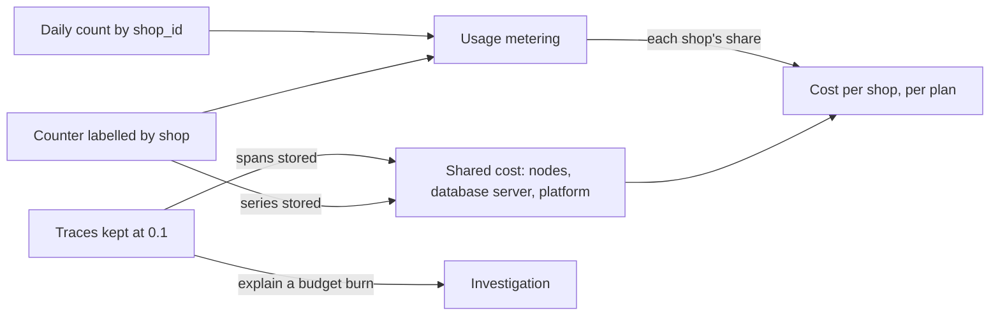

## Before you start

- [[sysdesign.l4.saas-design]] — you know ADR `0033` keeps a shop's plan as data, a set of numbers that the shop's row in `shops` names.
- [[backend.l3.trace-sampling]] — you know a parent-based sampler keeps or drops a whole trace, decided once where the trace starts, and that request metrics do not come from traces.
- [[k8s.l4.requests-drive-cluster-cost]] — you know the nodes a cluster pays for follow the sum of its Pods' requests, and that each cluster pays a fixed platform share.
- [[backend.l4.error-budget]] — you know the error budget is 1 minus the SLO over its window, and that every failed request spends it.

## The situation

With plans kept as data, the person who decides what the product does wants a price for each plan, and asks a plain question: what does one shop cost Đơn Hàng each month? A teammate proposes an answer in two parts. Put a shop label on every metric the api exports, the response-time histogram included. Then turn tracing on in production, which keeps no traces today, and keep every trace for a month, so any shop's slow request can be explained. Both give more detail. Both are also stored, and storage is a cost every shop shares.

How much does it cost to know each shop's cost, and how much detail is enough?

## Core concepts

- **usage metering** — counting what each tenant uses, such as requests, orders or stored rows, so that a shared cost can be split between tenants.
- shared cost split by use — nodes, the database server and the platform serve every shop at once, so a shop's cost is the month's shared cost times its measured share.
- a series per label value — each value of a metric label adds time series, so a shop label multiplies what Prometheus stores by the number of shops.
- a ratio chosen from the SLO — the share of traces kept is set so that an incident burning the error budget still leaves enough failing traces to explain it.
- retention chosen from the investigation — telemetry is kept as long as finding an incident's cause takes, and paid for no longer.

## How it works



In the situation above, "what does one shop cost" has no bill of its own to read. Nodes, the database server and the platform serve every shop at once, so the design doc `cost-per-shop.md` takes the month's shared cost and multiplies it by the shop's measured share. Usage metering would supply that share; at stage-4 it is a model, not code: requests per shop from the counter ADR `0016` decides on, orders and stored rows counted by `shop_id` once a day, and open chat connections once Support, the service for the support chat (ADR `0032`), exists. Each way of splitting is an estimate. The fixed platform cost per cluster is split evenly, because it does not grow with use.

The two arrows back into shared cost are the catch. Metrics and traces are stored too, so every series and every span becomes part of the cost being split. A shop label on a counter adds about one series per shop for each combination of its other labels. On a histogram it adds, per shop, one series for every bucket plus its `_sum` and `_count` series. So the design keeps per-shop detail on counters, and the response-time histogram stays without a shop label.

Traces grow with traffic, so they are sampled. A trace that starts in the api is kept with probability `Telemetry:SampleRatio`, 0.1 unless configured. SLIs come from metrics that count every request, so the ratio changes what can be explained, not what is measured. The ratio, and how long traces stay, are then chosen from the SLOs.

## In the Đơn Hàng system

The design doc lists what it meters and why the shop label stays on counters:

```markdown file=docs/design/cost-per-shop.md tag=stage-4 lines=20-39
### Đếm gì

Đếm mức dùng của từng cửa hàng (usage metering) bằng vài số:

| Số đếm | Nguồn | Chia phần nào của chi phí (ước lượng) |
|---|---|---|
| Request được phục vụ, bị từ chối, theo cửa hàng | Counter có nhãn cửa hàng của ADR 0016 | Node của api |
| Số đơn và số dòng lưu mỗi cửa hàng | Đếm theo `shop_id` trong database, mỗi ngày một lần | Server database, sao lưu |
| Kết nối chat mở mỗi cửa hàng | Support (ADR 0032), khi có | Node của Support |

Cửa hàng có database riêng (ADR 0026) mang trọn chi phí database đó, cộng phần
chia của phần còn lại.

### Nhãn cửa hàng chỉ trên counter

Mỗi giá trị của một nhãn thêm time series. Nhãn cửa hàng trên một counter thêm
một series cho mỗi cửa hàng: 1.000 cửa hàng là khoảng 1.000 series cho mỗi tổ
hợp nhãn khác. Trên một histogram, nó thêm một series cho mỗi cửa hàng nhân với
mỗi bucket. Vì vậy chi tiết theo cửa hàng chỉ nằm trên counter, như ADR 0016 đã
quyết; histogram thời gian trả lời giữ không có nhãn cửa hàng.
```

The table is the planned metering: each count names its source and the part of the shared cost it splits. A shop with its own database under ADR `0026` carries that database's whole cost, plus its share of the rest. The last paragraph puts numbers on the series argument.

Between the two excerpts, the doc records what tracing has today. `Program.cs` reads the ratio with a default of 0.1 and uses a parent-based sampler, so a trace is kept or dropped whole. Compose sets the ratio to `1.0`, so the lab keeps every trace, and the lab's Tempo keeps them 24 hours (`block_retention: 24h` in `tempo.yml`).

Staging and production are different. The api's ConfigMap there sets `OTEL_SDK_DISABLED: "true"`, so those environments keep no traces yet. The choice below is for when they do.

```markdown file=docs/design/cost-per-shop.md tag=stage-4 lines=54-76
### Chọn tỉ lệ sampling theo SLO

Câu hỏi: tỉ lệ nào để lại đủ trace lỗi để giải thích một lần đốt error budget.

- S1: khoảng 1,4 triệu request đặt đơn trong 28 ngày (50.000 mỗi ngày, giả
  định). SLO 99,5% cho phép khoảng 7.000 request xấu. Một sự cố tiêu một phần
  tư budget (ngưỡng viết postmortem của `slo.md`) là khoảng 1.750 request xấu;
  với tỉ lệ 0,1, khoảng 175 trace lỗi được giữ. Đủ.
- S4: khoảng 14.000 yêu cầu hoàn tiền trong 28 ngày (giả định), SLO 99% cho
  phép khoảng 140 request xấu; một phần tư là khoảng 35, với 0,1 còn khoảng 3
  trace. Ít, nhưng log của request vẫn có đủ.

Quyết định cho production (giả định): giữ 0,1, mặc định của code, không đổi
code. Giữ trace theo kết quả (chờ cả trace rồi giữ mọi trace lỗi) giải quyết
trường hợp S4, nhưng chỉ là phương án nói bằng lời, chưa làm.

### Thời gian giữ

- Trace: giữ lâu hơn thời gian điều tra một sự cố và viết postmortem, vài ngày;
  production giữ 7 ngày (giả định). 24 giờ của lab không đủ: sự cố tối thứ Sáu
  được điều tra sáng thứ Hai.
- Log: cùng lý do, 7 ngày (giả định).
- Metric: theo cửa sổ 28 ngày của SLO, tối thiểu 28 ngày.
```

S1 and S4 are two of the SLOs in `slo.md`: S1 is placing an order without a `5xx` (99.5% over 28 days), S4 is a refund request answered within 2 seconds (99%). The error budget sets the question: does the ratio leave enough failing traces to explain one burn? For S1, with the doc's assumed 50,000 order requests a day, a quarter of the budget, `slo.md`'s threshold for a postmortem, is about 1,750 bad requests, and about 175 of their traces are kept at 0.1. For S4 only about 3 remain, and the doc accepts that because each request's log is still there. So production keeps 0.1, the code's default. Keeping traces by outcome (waiting for the whole trace, then keeping every failing one) is only an option in words.

Retention follows the same logic. The lab's 24 hours are too short, because an incident late on a Friday is investigated on Monday morning, so traces and logs stay 7 days (assumed). Metrics are to stay at least the SLO's 28-day window — a target in the doc; staging's Prometheus keeps 2 days today and production has none.

## Trade-offs

The doc names one trade-off point behind every row: detail against cost. Its driver is to know each plan's cost per shop well enough to set prices, no more. Finer metering and more traces give fairer plan prices and faster diagnosis, but every series and span is paid for in storage, itself a shared cost.

| Trade-off point | What the design buys | What it pays | What limits the cost, or would reopen the choice |
|---|---|---|---|
| Shop label on counters only | requests per shop, one series per shop | no response times per shop | a histogram labelled by shop would store shops times buckets |
| Trace ratio 0.1 | about 175 failing traces from a quarter-budget burn on S1 (assumed traffic) | about 3 on S4, so rare failures lean on logs | SLIs count every request from metrics, whatever the ratio |
| Traces and logs kept 7 days (assumed), not the lab's 24 hours | a weekend incident still has its traces on Monday | more spans and log lines stored | metrics, to be kept at least 28 days (the doc's target; staging keeps 2 days today), would still show the burn after traces expire |
| Shared cost split by measured use | a price per plan grounded in counts | each split is an estimate, not a bill | the fixed platform cost is split evenly, since it does not grow with use |

The opposite of the second row is right in another context. The lab keeps every trace at `1.0`, because a learner wants to see each request, and its traffic and 24 hours of storage are small.

## What would you choose if…

…a higher plan promised each shop its own response-time figures? Response time per shop would become a driver, and its price is one series per shop for every bucket of the histogram. The doc's driver asks for enough detail to set prices, no more, so the team would weigh it as a new trade-off point before adding the label.

…S4's failures needed more than about 3 traces to explain? Raising a ratio keeps more of every trace, failing or not, so storage grows with all traffic to keep a few more rare failures. The doc's answer today is each request's log.

…one large shop moved to its own database under ADR `0026`? That shop carries the whole cost of its database, plus its share of the rest, split by the same counts.

## Seniors often assume…

- **"We can bill each shop for exactly what it costs, as if it ran alone."** → Actually most of a shop's cost is shared, nodes, the database server and the platform, so cost per shop is shared cost split by measured use, and each split is an estimate. You notice this when two reasonable ways of splitting give the same shop different costs for the same month.
- **"Keeping every trace is the only safe choice; sampling hides problems."** → Actually SLIs come from metrics that count every request, so the error budget is measured the same at any ratio, and at 0.1 a quarter-budget burn on S1 still leaves about 175 failing traces. You notice this when changing the ratio moves Tempo's storage but not the S1 ratio that `slo.md`'s query computes.
- **"Adding a shop label to every metric is free, since it is only one more label."** → Actually each label value adds series: one per shop on a counter, one per shop for every bucket on a histogram. You notice this when Prometheus's count of series jumps after a release that only added a label.

## Try it (3 minutes)

Use the doc's figures and two assumptions: Đơn Hàng serves 1,000 shops, and the api's response-time histogram has 10 buckets (assumed).

1. How many series does a shop label add to the request counter, for one combination of its other labels? How many to the histogram's buckets?
2. With S1's figures, how many failing traces would a quarter-budget burn leave at a ratio of 0.05?

Expected result: two numbers for question 1 and one for question 2, each with the step that gives it.

<details><summary>Suggested answer</summary>

1. Counter: about 1,000, one per shop. Histogram: about 10,000 bucket series, 1,000 shops times 10 buckets, before the histogram's other series.
2. About 1,750 bad requests times 0.05, so about 88 traces: half of what 0.1 keeps. S4's would fall to about 2.

</details>

## Connections

- [[sysdesign.l4.saas-design]] — the design whose plans this lesson prices: a plan is data, and its cost per shop is what metering estimates.
- [[backend.l4.per-shop-limits]] — the source of the counter labelled by shop that metering reuses.
- [[devops.l2.histograms-and-percentiles]] — why a histogram multiplies series: it stores one per bucket.
- [[backend.l3.trace-sampling]] — the sampler whose ratio this lesson chooses from the SLOs.
- [[backend.l4.error-budget]] — the burn the kept traces must be able to explain.
- [[k8s.l4.requests-drive-cluster-cost]] — the node count that makes up most of the shared cost split here.
- [[design.l4.trade-off-points]] — the idea applied here: detail against cost.
- [[management.l3.total-cost-of-ownership]] — the same question one level up: telemetry is part of what owning the platform costs.
- [[sysdesign.l4.saas-challenges]] — the next step: answering the review's challenges from ADRs.

## Five-line summary

1. Knowing each shop's cost means metering its use and storing telemetry, and that telemetry is itself shared cost every shop pays for.
2. Most of a shop's cost is shared, so cost per shop is the month's shared cost times its measured share, an estimate.
3. A shop label adds a series per shop on a counter, per shop per bucket plus `_sum` and `_count` on a histogram; so, counters only.
4. Traces starting in the api are kept at `Telemetry:SampleRatio`, 0.1 by default; SLIs come from metrics, so sampling limits explanation, not measurement.
5. Ratio and retention follow the SLOs: enough failing traces to explain a budget burn, kept as long as an investigation takes.
