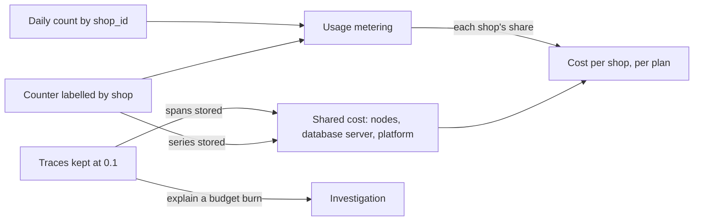

## Bạn cần biết trước

- [[sysdesign.l4.saas-design]] — bạn biết ADR `0033` giữ gói của cửa hàng là dữ liệu: một bộ con số mà dòng của cửa hàng trong `shops` ghi tên.
- [[backend.l3.trace-sampling]] — bạn biết một sampler dựa trên parent giữ hoặc bỏ cả một trace, quyết định một lần ở nơi trace bắt đầu, và metric của request không đến từ trace.
- [[k8s.l4.requests-drive-cluster-cost]] — bạn biết số node một cluster phải trả đi theo tổng request của các Pod, và mỗi cluster còn trả một phần cố định cho nền tảng.
- [[backend.l4.error-budget]] — bạn biết error budget là 1 trừ SLO trong cửa sổ của nó, và mỗi request lỗi đều tiêu vào đó.

## Tình huống

Gói đã là dữ liệu, và người quyết định sản phẩm làm gì muốn đặt giá cho từng gói. Câu hỏi của họ rất thẳng: mỗi tháng một cửa hàng tốn của Đơn Hàng bao nhiêu? Một đồng đội đề xuất câu trả lời gồm hai phần. Gắn nhãn cửa hàng lên mọi metric mà api xuất ra, kể cả histogram thời gian trả lời. Rồi bật tracing ở production, nơi hôm nay không giữ trace nào, và giữ mọi trace trong một tháng, để request chậm của cửa hàng nào cũng giải thích được. Cả hai đều cho thêm chi tiết. Cả hai cũng đều phải lưu, và lưu trữ là chi phí mọi cửa hàng cùng chịu.

Biết chi phí của từng cửa hàng thì tốn bao nhiêu, và chi tiết tới đâu là đủ?

## Khái niệm cốt lõi

- **đo mức dùng** (usage metering) — đếm phần mỗi tenant dùng, như số request, số đơn hay số dòng lưu, để chia một chi phí chung giữa các tenant.
- chi phí chung chia theo mức dùng — node, server database và nền tảng phục vụ mọi cửa hàng cùng lúc, nên chi phí của một cửa hàng là chi phí chung của tháng nhân với phần đo được của nó.
- mỗi giá trị label là thêm series — mỗi giá trị của một label của metric thêm time series, nên nhãn cửa hàng nhân những gì Prometheus lưu lên theo số cửa hàng.
- tỉ lệ chọn từ SLO — tỉ lệ trace được giữ được đặt sao cho một sự cố đốt error budget vẫn để lại đủ trace lỗi để giải thích nó.
- thời gian giữ chọn từ việc điều tra — telemetry được giữ đúng bằng thời gian cần để tìm ra nguyên nhân một sự cố, không trả tiền lâu hơn.

## Cơ chế hoạt động



Trong tình huống trên, "một cửa hàng tốn bao nhiêu" không có hóa đơn riêng nào để đọc. Node, server database và nền tảng phục vụ mọi cửa hàng cùng lúc, nên design doc `cost-per-shop.md` lấy chi phí chung của tháng nhân với phần đo được của cửa hàng. Đo mức dùng sẽ cho ra phần đó. Ở stage-4 nó là một mô hình, chưa phải code: số request mỗi cửa hàng lấy từ counter mà ADR `0016` quyết định, số đơn và số dòng lưu đếm theo `shop_id` mỗi ngày một lần, và số kết nối chat đang mở khi Support, service cho chat hỗ trợ (ADR `0032`), ra đời. Cách chia nào cũng là ước lượng. Chi phí nền tảng cố định của mỗi cluster được chia đều, vì nó không tăng theo mức dùng.

Hai mũi tên quay ngược về chi phí chung mới là chỗ mắc. Metric và trace cũng phải lưu, nên mỗi series và mỗi span trở thành một phần của chính chi phí đang được chia. Nhãn cửa hàng trên một counter thêm khoảng một series cho mỗi cửa hàng, với mỗi tổ hợp các label khác của nó. Trên một histogram, mỗi cửa hàng thêm một series cho từng bucket, cộng thêm các series `_sum` và `_count`. Vì vậy thiết kế chỉ để chi tiết theo cửa hàng trên counter, còn histogram thời gian trả lời không có nhãn cửa hàng.

Trace tăng theo lưu lượng, nên phải lấy mẫu. Một trace bắt đầu ở api được giữ với xác suất `Telemetry:SampleRatio`, là 0,1 nếu không cấu hình gì. SLI đến từ metric đếm mọi request, nên tỉ lệ này đổi những gì giải thích được, không đổi những gì đo được. Sau đó tỉ lệ và thời gian giữ trace được chọn từ các SLO.

## Trong hệ thống Đơn Hàng

Design doc liệt kê những gì nó đếm, và lý do nhãn cửa hàng chỉ nằm trên counter:

```markdown file=docs/design/cost-per-shop.md tag=stage-4 lines=20-39
### Đếm gì

Đếm mức dùng của từng cửa hàng (usage metering) bằng vài số:

| Số đếm | Nguồn | Chia phần nào của chi phí (ước lượng) |
|---|---|---|
| Request được phục vụ, bị từ chối, theo cửa hàng | Counter có nhãn cửa hàng của ADR 0016 | Node của api |
| Số đơn và số dòng lưu mỗi cửa hàng | Đếm theo `shop_id` trong database, mỗi ngày một lần | Server database, sao lưu |
| Kết nối chat mở mỗi cửa hàng | Support (ADR 0032), khi có | Node của Support |

Cửa hàng có database riêng (ADR 0026) mang trọn chi phí database đó, cộng phần
chia của phần còn lại.

### Nhãn cửa hàng chỉ trên counter

Mỗi giá trị của một nhãn thêm time series. Nhãn cửa hàng trên một counter thêm
một series cho mỗi cửa hàng: 1.000 cửa hàng là khoảng 1.000 series cho mỗi tổ
hợp nhãn khác. Trên một histogram, nó thêm một series cho mỗi cửa hàng nhân với
mỗi bucket. Vì vậy chi tiết theo cửa hàng chỉ nằm trên counter, như ADR 0016 đã
quyết; histogram thời gian trả lời giữ không có nhãn cửa hàng.
```

Bảng là kế hoạch đo mức dùng: mỗi số đếm ghi nguồn của nó và phần chi phí chung mà nó dùng để chia. Cửa hàng có database riêng theo ADR `0026` chịu trọn chi phí database đó, cộng phần được chia của phần còn lại. Đoạn cuối đặt con số vào lập luận về series.

Giữa hai đoạn trích, tài liệu ghi lại tracing hôm nay đang có gì. `Program.cs` đọc tỉ lệ với mặc định 0,1 và dùng sampler dựa trên parent, nên một trace được giữ hoặc bỏ nguyên cả. Compose đặt tỉ lệ là `1.0`, nên lab giữ mọi trace, và Tempo của lab giữ chúng 24 giờ (`block_retention: 24h` trong `tempo.yml`).

Staging và production thì khác. ConfigMap của api ở đó đặt `OTEL_SDK_DISABLED: "true"`, nên các môi trường này chưa giữ trace nào. Lựa chọn dưới đây là cho lúc chúng bắt đầu giữ.

```markdown file=docs/design/cost-per-shop.md tag=stage-4 lines=54-76
### Chọn tỉ lệ sampling theo SLO

Câu hỏi: tỉ lệ nào để lại đủ trace lỗi để giải thích một lần đốt error budget.

- S1: khoảng 1,4 triệu request đặt đơn trong 28 ngày (50.000 mỗi ngày, giả
  định). SLO 99,5% cho phép khoảng 7.000 request xấu. Một sự cố tiêu một phần
  tư budget (ngưỡng viết postmortem của `slo.md`) là khoảng 1.750 request xấu;
  với tỉ lệ 0,1, khoảng 175 trace lỗi được giữ. Đủ.
- S4: khoảng 14.000 yêu cầu hoàn tiền trong 28 ngày (giả định), SLO 99% cho
  phép khoảng 140 request xấu; một phần tư là khoảng 35, với 0,1 còn khoảng 3
  trace. Ít, nhưng log của request vẫn có đủ.

Quyết định cho production (giả định): giữ 0,1, mặc định của code, không đổi
code. Giữ trace theo kết quả (chờ cả trace rồi giữ mọi trace lỗi) giải quyết
trường hợp S4, nhưng chỉ là phương án nói bằng lời, chưa làm.

### Thời gian giữ

- Trace: giữ lâu hơn thời gian điều tra một sự cố và viết postmortem, vài ngày;
  production giữ 7 ngày (giả định). 24 giờ của lab không đủ: sự cố tối thứ Sáu
  được điều tra sáng thứ Hai.
- Log: cùng lý do, 7 ngày (giả định).
- Metric: theo cửa sổ 28 ngày của SLO, tối thiểu 28 ngày.
```

S1 và S4 là hai trong các SLO của `slo.md`. S1 là đặt đơn không gặp `5xx` (99,5% trong 28 ngày), S4 là yêu cầu hoàn tiền được trả lời trong 2 giây (99%). Error budget đặt ra câu hỏi: tỉ lệ này có để lại đủ trace lỗi để giải thích một lần đốt budget không? Với S1, theo giả định của tài liệu là 50.000 request đặt đơn mỗi ngày, một phần tư budget, ngưỡng viết postmortem của `slo.md`, là khoảng 1.750 request xấu, và ở 0,1 khoảng 175 trace của chúng được giữ. Với S4 chỉ còn khoảng 3, và tài liệu chấp nhận điều đó vì log của từng request vẫn còn. Vậy production giữ 0,1, mặc định của code. Giữ trace theo kết quả (chờ cả trace rồi giữ mọi trace lỗi) mới chỉ là phương án nói bằng lời.

Thời gian giữ theo cùng lập luận đó. 24 giờ của lab quá ngắn, vì sự cố tối thứ Sáu được điều tra vào sáng thứ Hai, nên trace và log được giữ 7 ngày (giả định). Metric được giữ ít nhất bằng cửa sổ 28 ngày của SLO — đây là mục tiêu trong tài liệu. Hôm nay Prometheus của staging giữ 2 ngày, còn production chưa có.

## Đánh đổi

Tài liệu nêu một điểm đánh đổi đứng sau mọi dòng: chi tiết đổi lấy chi phí. Yếu tố định hình kiến trúc của nó là biết chi phí mỗi cửa hàng của từng gói đủ để đặt giá, không hơn. Đo mức dùng chi tiết hơn và giữ nhiều trace hơn cho giá gói công bằng hơn và chẩn đoán nhanh hơn, nhưng series và span nào cũng phải trả tiền lưu, mà lưu trữ lại chính là chi phí chung.

| Điểm đánh đổi | Thiết kế mua được gì | Phải trả gì | Điều gì giới hạn chi phí, hoặc sẽ mở lại lựa chọn |
|---|---|---|---|
| Nhãn cửa hàng chỉ trên counter | số request mỗi cửa hàng, một series mỗi cửa hàng | không có thời gian trả lời theo cửa hàng | histogram có nhãn cửa hàng sẽ lưu số cửa hàng nhân số bucket |
| Tỉ lệ trace 0,1 | khoảng 175 trace lỗi từ một lần đốt một phần tư budget của S1 (lưu lượng giả định) | khoảng 3 với S4, nên lỗi hiếm phải dựa vào log | SLI đếm mọi request từ metric, dù tỉ lệ là bao nhiêu |
| Trace và log giữ 7 ngày (giả định), không phải 24 giờ như lab | sự cố cuối tuần đến thứ Hai vẫn còn trace | lưu thêm span và dòng log | metric, giữ ít nhất 28 ngày (mục tiêu của tài liệu, hôm nay staging giữ 2 ngày), vẫn cho thấy lần đốt budget sau khi trace hết hạn |
| Chi phí chung chia theo mức dùng đo được | giá mỗi gói dựa trên số đếm | mỗi cách chia là ước lượng, không phải hóa đơn | chi phí nền tảng cố định chia đều, vì nó không tăng theo mức dùng |

Điều ngược lại với dòng thứ hai là đúng trong một bối cảnh khác. Lab giữ mọi trace ở `1.0`, vì người học muốn thấy từng request, và lưu lượng cùng 24 giờ lưu trữ của lab đều nhỏ.

## Bạn sẽ chọn gì nếu…

…một gói cao hơn hứa cho mỗi cửa hàng số liệu thời gian trả lời riêng? Thời gian trả lời theo cửa hàng sẽ thành một yếu tố định hình, và giá của nó là một series mỗi cửa hàng cho từng bucket của histogram. Yếu tố của tài liệu chỉ đòi đủ chi tiết để đặt giá, không hơn, nên nhóm sẽ cân nhắc nó như một điểm đánh đổi mới trước khi thêm nhãn.

…lỗi của S4 cần nhiều hơn khoảng 3 trace mới giải thích được? Tăng tỉ lệ là giữ thêm mọi loại trace, lỗi hay không, nên lưu trữ tăng theo toàn bộ lưu lượng chỉ để giữ thêm vài lỗi hiếm. Câu trả lời hôm nay của tài liệu là log của từng request.

…một cửa hàng lớn chuyển sang database riêng theo ADR `0026`? Cửa hàng đó chịu trọn chi phí database của mình, cộng phần được chia của phần còn lại, theo cùng các số đếm.

## Senior hay nhầm rằng…

- **"Mình tính tiền được mỗi cửa hàng đúng bằng chi phí của nó, như thể nó chạy một mình."** → Thực ra phần lớn chi phí của một cửa hàng là chi phí chung, gồm node, server database và nền tảng, nên chi phí mỗi cửa hàng là chi phí chung chia theo mức dùng đo được, và cách chia nào cũng là ước lượng. Bạn sẽ nhận ra khi hai cách chia đều hợp lý lại cho cùng một cửa hàng hai chi phí khác nhau trong cùng một tháng.
- **"Giữ mọi trace là lựa chọn an toàn duy nhất, lấy mẫu sẽ che mất vấn đề."** → Thực ra SLI đến từ metric đếm mọi request, nên error budget được đo như nhau ở mọi tỉ lệ, và ở 0,1 một lần đốt một phần tư budget của S1 vẫn để lại khoảng 175 trace lỗi. Bạn sẽ nhận ra khi đổi tỉ lệ làm dung lượng lưu của Tempo thay đổi, còn tỉ lệ S1 mà query của `slo.md` tính ra thì không.
- **"Thêm nhãn cửa hàng vào mọi metric thì không tốn gì, vì chỉ là thêm một label."** → Thực ra mỗi giá trị label thêm series: một series mỗi cửa hàng trên counter, một series mỗi cửa hàng cho từng bucket trên histogram. Bạn sẽ nhận ra khi số series của Prometheus nhảy vọt sau một lần phát hành chỉ thêm đúng một label.

## Thử ngay (3 phút)

Dùng số liệu của tài liệu và hai giả định: Đơn Hàng phục vụ 1.000 cửa hàng, và histogram thời gian trả lời của api có 10 bucket (giả định).

1. Nhãn cửa hàng thêm bao nhiêu series vào counter request, với một tổ hợp các label khác của nó? Thêm bao nhiêu vào các bucket của histogram?
2. Với số liệu của S1, một lần đốt một phần tư budget sẽ để lại bao nhiêu trace lỗi ở tỉ lệ 0,05?

Kết quả mong đợi: hai con số cho câu 1 và một con số cho câu 2, mỗi con số kèm bước tính ra nó.

<details><summary>Gợi ý đáp án</summary>

1. Counter: khoảng 1.000, mỗi cửa hàng một series. Histogram: khoảng 10.000 series bucket, 1.000 cửa hàng nhân 10 bucket, chưa tính các series khác của histogram.
2. Khoảng 1.750 request xấu nhân 0,05, tức khoảng 88 trace: một nửa số mà 0,1 giữ. Của S4 sẽ giảm còn khoảng 2.

</details>

## Liên hệ

- [[sysdesign.l4.saas-design]] — thiết kế có các gói mà bài này định giá: gói là dữ liệu, và chi phí mỗi cửa hàng của nó là thứ đo mức dùng ước lượng.
- [[backend.l4.per-shop-limits]] — nguồn của counter có nhãn cửa hàng mà đo mức dùng dùng lại.
- [[devops.l2.histograms-and-percentiles]] — vì sao histogram nhân số series: nó lưu một series cho mỗi bucket.
- [[backend.l3.trace-sampling]] — sampler có tỉ lệ mà bài này chọn từ các SLO.
- [[backend.l4.error-budget]] — lần đốt budget mà các trace được giữ phải giải thích được.
- [[k8s.l4.requests-drive-cluster-cost]] — số node chiếm phần lớn chi phí chung được chia ở đây.
- [[design.l4.trade-off-points]] — ý tưởng được áp dụng ở đây: chi tiết đổi lấy chi phí.
- [[management.l3.total-cost-of-ownership]] — cùng câu hỏi ở một tầng cao hơn: telemetry là một phần của chi phí sở hữu nền tảng.
- [[sysdesign.l4.saas-challenges]] — bước tiếp theo: trả lời các câu chất vấn của buổi review bằng ADR.

## Tóm tắt 5 dòng

1. Biết chi phí của từng cửa hàng nghĩa là đo mức dùng của nó và lưu telemetry, mà telemetry lại là chi phí chung mọi cửa hàng cùng trả.
2. Phần lớn chi phí của một cửa hàng là chi phí chung, nên chi phí mỗi cửa hàng là chi phí chung của tháng nhân phần đo được của nó, một ước lượng.
3. Nhãn cửa hàng thêm một series mỗi cửa hàng trên counter, và trên histogram thì mỗi cửa hàng một series cho từng bucket cộng `_sum` và `_count`. Vì vậy chỉ gắn trên counter.
4. Trace bắt đầu ở api được giữ theo `Telemetry:SampleRatio`, mặc định 0,1. SLI đến từ metric, nên lấy mẫu giới hạn khả năng giải thích, không giới hạn phép đo.
5. Tỉ lệ và thời gian giữ đi theo SLO: đủ trace lỗi để giải thích một lần đốt budget, giữ lâu đúng bằng một lần điều tra.
