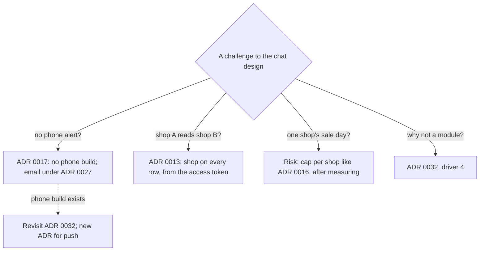

## Before you start

- [[sysdesign.l4.support-chat-trade-offs]] — you know chat runs out of open connections per Pod and a release closes each replaced Pod's connections.
- [[sysdesign.l4.answering-challenges]] — you know a good answer names the driver or ADR behind a decision, and a case the design does not cover becomes an open question with an owner.
- [[backend.l4.per-shop-limits]] — you know ADR `0016` caps each shop at a fixed share of a shared limit, and that the cap needs the shop from the access token.

## The situation

The review session for ADR `0032` starts, and you proposed the support chat design. Four questions arrive before the first diagram is finished.

The product owner asks why a customer who has closed the app gets no alert on their phone. Someone speaking for the shops asks whether shop A's staff could read shop B's chats. A shop owner asks what their sale day does to chat in every other shop. A backend developer asks why chat is not one more module of `DonHang.Api`.

Each one sounds like a gap. Where does each answer come from, and does any of them change ADR `0032`?

## Core concepts

- decision already made — an ADR that the chat design builds on and does not reopen, such as ADR `0013`, `0016` or `0017`; a challenge that touches it is answered by pointing to it.
- recorded risk — a case the design knows about but cannot size yet; it goes into the review's risks table with an owner by role and a next step.
- revisit condition — a change named in an ADR that would reopen it, such as a phone build for ADR `0032`; a challenge that asks for that change waits for it instead of reopening the design now.

## How it works



In the situation above, two answers point to a decision already made, one to a ranked driver of ADR `0032`, and one becomes a recorded risk.

The phone question is answered by ADR `0017`: Đơn Hàng keeps one Flutter code base and stage-4 builds it only for the browser. The same code can be built for phones later, so a phone build would not reopen ADR `0017`. Push needs that build, so a reply unread for 5 minutes (assumed) leaves through the outbox, and Notifications, the service that emails customers, sends it under ADR `0027`. ADR `0032` names a phone build as a revisit condition.

The privacy question is answered by ADR `0013` and driver 3: staff never see another shop's chats. Each saved message carries its shop, taken from the verified access token (which carries the shop from release 2), not from anything the client sends. Row-level security on the shop is the second guard, for a query that forgets the filter.

The sale-day question has no number yet. Chat is not built, and the connection counts are assumptions, so the review records a risk: a cap on open connections per shop, in the style of ADR `0016`, set only after connections per shop are measured.

The module question is answered by ADR `0032`'s driver 4, which is why chat runs in its own service, `DonHang.Support` (Support): connections held open for minutes would share the Pods, limits and canary releases of the process taking orders.

## In the Đơn Hàng system

The design review ends with three sections: risks and open questions, ADRs to write, and the challenges from the session:

```markdown file=docs/design/support-chat-design-review.md tag=stage-4 lines=98-106
### Câu hỏi phản biện trong buổi review

| Câu hỏi | Trả lời, trỏ driver, ADR hoặc rủi ro | Việc tiếp theo | Người phụ trách (vai trò) |
|---|---|---|---|
| Sao khách không nhận thông báo trên điện thoại? | ADR 0017: chưa có bản điện thoại; tin chưa đọc đi bằng email theo ADR 0027 | Không | |
| Nhân viên cửa hàng A đọc được chat cửa hàng B? | Không: mỗi dòng mang cửa hàng từ access token, row-level security như ADR 0013 | Không | |
| Ngày khuyến mãi một cửa hàng làm gì chat của cửa hàng khác? | Rủi ro: trần kết nối theo cửa hàng kiểu ADR 0016, đặt sau khi đo | Đo kết nối theo cửa hàng | Đội Đặt hàng |
| Sao chat không là một module của `DonHang.Api`? | ADR 0032, driver 4: kết nối giữ lâu dùng chung Pod, giới hạn và canary với nhận đơn | Không | |
| Phát hành Support thì chat đang mở ra sao? | ADR 0019 và 0032: rolling update đóng kết nối của Pod bị thay, app nối lại có jitter | Không | |
```

Read the second column first: every answer names an ADR, a driver or a risk, never a new argument. Four rows have the next step "none" and no owner, because a decision already made or a ranked driver answers them. The sale-day row alone has work left: measure connections per shop, owned by the Ordering team. The risks table repeats it, so it outlives the session; that table also asks whether the Gateway closes long idle connections, owned by the platform team. The fifth row cites ADR `0019`, the release strategy per component: a release closes connections, and apps reconnect with jitter.

Two of these answers were in ADR `0032` before the session:

```markdown file=docs/adr/0032-chat-ho-tro-qua-websocket-trong-service-rieng.md tag=stage-4 lines=63-71
Đội xem lại quyết định khi: app có bản cho điện thoại (push thay email cho
CT-5); ASP.NET Core có client SignalR chính thức cho Dart; số kết nối mỗi Pod
vượt khoảng dư đo được.

### Ý kiến đã nhận

Lập trình viên backend hỏi sao không để chat trong API cho đỡ một service.
Kết nối giữ lâu sẽ dùng chung Pod, giới hạn và canary với việc nhận đơn, trái
driver 4. Quyết định không đổi.
```

The first revisit condition is the phone answer written in advance: with a phone build, push replaces email for scenario CT-5, where a shop replies while the customer is off the chat screen. The list of ADRs to write adds a new ADR for push once that build exists. The comments section holds the module answer: a backend developer asked before acceptance; driver 4, decision unchanged.

## Trade-offs

| Way to answer a chat challenge | When it is right | What it costs |
|---|---|---|
| Point to a decision already made | the challenge asks about something ADR `0013`, `0016` or `0017` settled | nothing new; the asker must accept that the review does not reopen it |
| Point to a ranked driver | the challenge proposes an option the design already rejected, such as a module | the drivers must have been agreed before the session |
| Record a risk with an owner and a next step | the case is real but nothing has been measured, such as connections per shop | the design ships with a known gap until the measurement arrives |
| Name the revisit condition | the challenge asks for something a later change would bring, such as push | the asker waits for that change, then a new ADR |

The module answer has a fair opposing view. A module adds no service; ADR `0032` lists one more service, database and HTTPRoute as consequences of the separate one. That view is right when no driver protects ordering from chat, or when chat connections are too few to matter next to ordering's limits. In Đơn Hàng, driver 4 is ranked, and the estimate counts about 200 connections at peak (assumed), each held for minutes, so the separate service wins.

## What would you choose if…

…enough shops need an app installed on phones that the team builds one for Android? That meets ADR `0032`'s first revisit condition. The team writes a new ADR for push, as the review planned, and push replaces email for scenario CT-5. ADR `0017` is not reopened: it already allows a phone build from the same code.

…measurement shows one shop holding most of the open connections on its sale day? The recorded risk now has its number. The Ordering team sets a cap on open connections per shop in the style of ADR `0016`, which caps a shop at a share of a shared limit and is not a reserved share. The cap is the step the review recorded. Whether connections per Pod also pass the measured headroom, ADR `0032`'s third revisit condition, is a separate check.

…a developer proposes passing the shop's id as a parameter when the app opens the WebSocket? ADR `0013` already answers it: the shop comes from the verified access token, not from the client. How the connection carries the access token is an open question in the risks table, owned by the Ordering team and decided when chat is built.

## Seniors often assume…

- **"If a reviewer asks for phone notifications, the chat design is unfinished."** → Actually the design meets the agreed scenario by email, because ADR `0017` made no phone build and push needs one; ADR `0032` names a phone build as its revisit condition. You notice this when a review stays open for weeks, waiting on a phone app nobody has planned.
- **"Hiding other shops' conversations in the staff screen is enough to keep them apart."** → Actually a screen that hides rows has still received them; the review puts the shop on every row from the access token, with row-level security behind it. You notice this when someone asks what a caller who skips the screen would receive, and a screen-only design has no answer.
- **"A new service for chat is over-engineering when a module would do."** → Actually ADR `0032` weighed the module and rejected it on driver 4, because long-held connections would share Pods, limits and canary releases with order-taking. You notice this when an API release closes every chat connection, or chat connections fill the Pods that take orders.

## Try it (3 minutes)

Four more challenges arrive after the session. For each, say which kind it is: answered by a decision or driver (name the ADR), a recorded risk or open question (name the owner by role), or a revisit condition (name the ADR it reopens).

1. "Does the Gateway close a long connection that sends nothing for a while?"
2. "What happens to open chats when Support is released?"
3. "Once there is an Android build, can the reply arrive as a push notification?"
4. "Why not keep chat inside `DonHang.Api` to save a service?"

Expected result: one kind and one source or owner per challenge, with exactly one revisit condition.

<details><summary>Suggested answer</summary>

1. Open question: in the risks table, owned by the platform team, who check the Gateway's configuration before building.
2. Answered by ADRs `0019` and `0032`: a rolling update closes the replaced Pod's connections, and the app reconnects after a wait with jitter.
3. Revisit condition: a phone build reopens ADR `0032`, and the review plans a new ADR for push when that build exists.
4. Answered by ADR `0032`'s driver 4: long-held connections would share Pods, limits and canary releases with order-taking.

</details>

## Connections

- [[sysdesign.l4.support-chat-trade-offs]] — the costs these challenges probe.
- [[sysdesign.l4.answering-challenges]] — the method applied here.
- [[backend.l4.per-shop-limits]] — the cap per shop that the sale-day risk borrows its style from.
- [[sysdesign.l4.notification-challenges]] — the same exercise for notifications, whose email channel carries unread chat replies.
- [[backend.l4.shop-data-layout]] — where each shop's rows live, the ground for the privacy answer.
- [[management.l3.superseding-an-adr]] — what follows when a phone build arrives and push changes ADR `0032`.
- [[sysdesign.l4.saas-requirements]] — the next problem: shops that sign up, choose a plan and leave on their own.

## Five-line summary

1. A challenge to the chat design is answered from ADRs already made and the ranked drivers, and what nobody has measured becomes a recorded risk.
2. No phone alert comes from ADR `0017`: there is no phone build, so unread replies go by email under ADR `0027`.
3. Shop A cannot read shop B's chats: each row carries its shop from the access token, guarded by row-level security as in ADR `0013`.
4. One shop's sale day is a risk: a cap on connections per shop like ADR `0016`, set only after measuring.
5. Chat is a separate service by ADR `0032`'s driver 4, and a phone build is the condition that reopens it.
