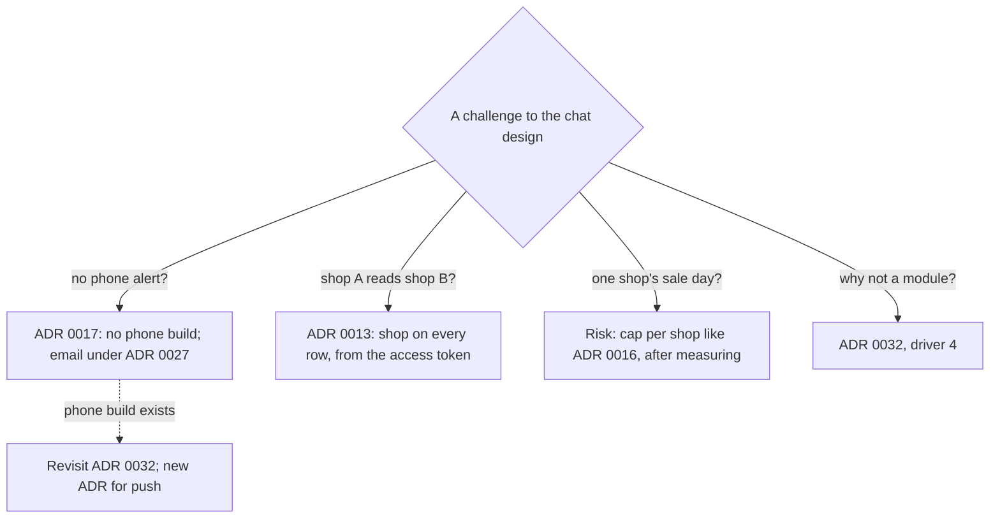

## Bạn cần biết trước

- [[sysdesign.l4.support-chat-trade-offs]] — bạn biết chat cạn trước ở số kết nối đang mở mỗi Pod, và mỗi lần phát hành đóng kết nối của từng Pod bị thay.
- [[sysdesign.l4.answering-challenges]] — bạn biết một câu trả lời tốt nêu tên yếu tố định hình hay ADR đứng sau quyết định, còn trường hợp thiết kế chưa tính tới thì thành câu hỏi mở có người phụ trách.
- [[backend.l4.per-shop-limits]] — bạn biết ADR `0016` giới hạn mỗi cửa hàng ở một phần cố định của giới hạn dùng chung, và giới hạn đó cần biết cửa hàng từ access token.

## Tình huống

Buổi review ADR `0032` bắt đầu, và bạn là người đề xuất thiết kế chat hỗ trợ. Sơ đồ đầu tiên chưa vẽ xong thì đã có bốn câu hỏi.

Product owner hỏi sao khách đã đóng app thì không nhận thông báo gì trên điện thoại. Người nói thay cho các cửa hàng hỏi nhân viên cửa hàng A có đọc được chat của cửa hàng B không. Một chủ cửa hàng hỏi ngày khuyến mãi của họ ảnh hưởng gì tới chat ở mọi cửa hàng khác. Một developer backend hỏi sao chat không là thêm một module của `DonHang.Api`.

Câu nào nghe cũng như một lỗ hổng. Mỗi câu trả lời lấy từ đâu, và có câu nào làm thay đổi ADR `0032` không?

## Khái niệm cốt lõi

- quyết định đã có — một ADR mà thiết kế chat dựa vào và không mở lại, như ADR `0013`, `0016` hay `0017`. Câu phản biện chạm tới nó được trả lời bằng cách trỏ tới nó.
- rủi ro đã ghi — trường hợp thiết kế biết có nhưng chưa đo được độ lớn. Nó vào bảng rủi ro của buổi review, kèm người phụ trách theo vai trò và một bước tiếp theo.
- điều kiện xem lại — một thay đổi được ADR nêu tên mà khi xảy ra sẽ mở lại ADR đó, như bản cho điện thoại với ADR `0032`. Câu phản biện đòi đúng thay đổi đó thì chờ nó tới, không mở lại thiết kế ngay.

## Cơ chế hoạt động



Trong tình huống trên, hai câu trả lời trỏ tới quyết định đã có, một câu trỏ tới một yếu tố đã xếp hạng của ADR `0032`, và một câu thành rủi ro đã ghi.

Câu về điện thoại được ADR `0017` trả lời: Đơn Hàng giữ một code base Flutter, và ở stage-4 chỉ build cho trình duyệt. Cùng code đó sau này build được cho điện thoại, nên có bản cho điện thoại cũng không mở lại ADR `0017`. Thông báo đẩy cần bản đó, nên tin trả lời chưa đọc sau 5 phút (giả định) đi ra qua outbox, và Notifications, service gửi email cho khách, gửi nó theo ADR `0027`. ADR `0032` ghi bản cho điện thoại là một điều kiện xem lại.

Câu về quyền riêng tư được ADR `0013` và yếu tố 3 trả lời: nhân viên không bao giờ thấy chat của cửa hàng khác. Mỗi tin đã lưu mang cửa hàng của nó, lấy từ access token đã xác minh (token mang cửa hàng từ release 2), không lấy từ thứ client gửi lên. Row-level security theo cửa hàng là lớp chặn thứ hai, cho câu truy vấn quên lọc.

Câu về ngày khuyến mãi chưa có con số. Chat chưa được xây, số kết nối đều là giả định, nên buổi review ghi một rủi ro: trần số kết nối đang mở theo từng cửa hàng, theo kiểu ADR `0016`, chỉ đặt sau khi đã đo số kết nối của mỗi cửa hàng.

Câu về module được trả lời bằng yếu tố 4 của ADR `0032`, lý do chat chạy trong service riêng, `DonHang.Support` (Support): kết nối giữ mở hàng phút sẽ dùng chung Pod, giới hạn và canary release với process đang nhận đơn.

## Trong hệ thống Đơn Hàng

Bản review thiết kế kết thúc bằng ba phần: rủi ro và câu hỏi mở, các ADR cần viết, và các câu phản biện trong buổi review:

```markdown file=docs/design/support-chat-design-review.md tag=stage-4 lines=98-106
### Câu hỏi phản biện trong buổi review

| Câu hỏi | Trả lời, trỏ driver, ADR hoặc rủi ro | Việc tiếp theo | Người phụ trách (vai trò) |
|---|---|---|---|
| Sao khách không nhận thông báo trên điện thoại? | ADR 0017: chưa có bản điện thoại; tin chưa đọc đi bằng email theo ADR 0027 | Không | |
| Nhân viên cửa hàng A đọc được chat cửa hàng B? | Không: mỗi dòng mang cửa hàng từ access token, row-level security như ADR 0013 | Không | |
| Ngày khuyến mãi một cửa hàng làm gì chat của cửa hàng khác? | Rủi ro: trần kết nối theo cửa hàng kiểu ADR 0016, đặt sau khi đo | Đo kết nối theo cửa hàng | Đội Đặt hàng |
| Sao chat không là một module của `DonHang.Api`? | ADR 0032, driver 4: kết nối giữ lâu dùng chung Pod, giới hạn và canary với nhận đơn | Không | |
| Phát hành Support thì chat đang mở ra sao? | ADR 0019 và 0032: rolling update đóng kết nối của Pod bị thay, app nối lại có jitter | Không | |
```

Đọc cột thứ hai trước: mọi câu trả lời đều nêu tên một ADR, một yếu tố định hình hay một rủi ro, không bao giờ là một lập luận mới. Bốn dòng có việc tiếp theo là "Không" và không có người phụ trách, vì một quyết định đã có hay một yếu tố đã xếp hạng trả lời chúng. Chỉ dòng ngày khuyến mãi còn việc phải làm: đo số kết nối theo cửa hàng, do Đội Đặt hàng phụ trách. Bảng rủi ro ghi lại dòng này, nên nó còn sống sau buổi review. Bảng đó cũng hỏi Gateway có đóng kết nối im lặng lâu không, do đội nền tảng phụ trách. Dòng thứ năm viện dẫn ADR `0019`, chiến lược phát hành cho từng thành phần: mỗi lần phát hành đóng kết nối, và app nối lại có jitter.

Hai trong số các câu trả lời này đã nằm trong ADR `0032` trước buổi review:

```markdown file=docs/adr/0032-chat-ho-tro-qua-websocket-trong-service-rieng.md tag=stage-4 lines=63-71
Đội xem lại quyết định khi: app có bản cho điện thoại (push thay email cho
CT-5); ASP.NET Core có client SignalR chính thức cho Dart; số kết nối mỗi Pod
vượt khoảng dư đo được.

### Ý kiến đã nhận

Lập trình viên backend hỏi sao không để chat trong API cho đỡ một service.
Kết nối giữ lâu sẽ dùng chung Pod, giới hạn và canary với việc nhận đơn, trái
driver 4. Quyết định không đổi.
```

Điều kiện xem lại đầu tiên chính là câu trả lời về điện thoại, viết sẵn từ trước: có bản cho điện thoại thì thông báo đẩy thay email cho kịch bản CT-5, khi cửa hàng trả lời lúc khách không ở màn hình chat. Danh sách ADR cần viết thêm một ADR mới cho thông báo đẩy khi bản đó có. Phần ý kiến đã nhận giữ câu trả lời về module: một developer backend đã hỏi trước khi ADR được chấp nhận, yếu tố 4, quyết định không đổi.

## Đánh đổi

| Cách trả lời một câu phản biện về chat | Khi nào đúng | Cái giá phải trả |
|---|---|---|
| Trỏ tới quyết định đã có | câu phản biện hỏi về điều ADR `0013`, `0016` hay `0017` đã chốt | không thêm gì mới, người hỏi phải chấp nhận rằng buổi review không mở lại quyết định đó |
| Trỏ tới một yếu tố đã xếp hạng | câu phản biện đề xuất một phương án thiết kế đã loại, như module | các yếu tố phải được thống nhất trước buổi review |
| Ghi rủi ro kèm người phụ trách và bước tiếp theo | trường hợp có thật nhưng chưa đo gì, như số kết nối theo cửa hàng | thiết kế ra đời với một lỗ hổng đã biết cho tới khi có số đo |
| Nêu tên điều kiện xem lại | câu phản biện đòi thứ mà một thay đổi về sau mới mang lại, như thông báo đẩy | người hỏi chờ thay đổi đó, rồi tới một ADR mới |

Câu trả lời về module có một quan điểm ngược đáng cân nhắc. Module không thêm service nào, còn ADR `0032` ghi thêm một service, một database và một HTTPRoute là hệ quả của service riêng. Quan điểm đó đúng khi không có yếu tố nào bảo vệ việc đặt đơn khỏi chat, hoặc khi số kết nối chat quá ít so với giới hạn của phần đặt đơn. Ở Đơn Hàng, yếu tố 4 đã được xếp hạng, và phần ước lượng tính khoảng 200 kết nối lúc đỉnh (giả định), mỗi kết nối giữ hàng phút, nên service riêng thắng.

## Bạn sẽ chọn gì nếu…

…đủ nhiều cửa hàng cần cài app trên điện thoại tới mức đội build một bản cho Android? Vậy là điều kiện xem lại đầu tiên của ADR `0032` đã thỏa. Đội viết một ADR mới cho thông báo đẩy, như buổi review đã lên kế hoạch, và thông báo đẩy thay email cho kịch bản CT-5. ADR `0017` không bị mở lại: nó vốn đã cho phép build bản điện thoại từ cùng code.

…số đo cho thấy một cửa hàng chiếm phần lớn kết nối đang mở trong ngày khuyến mãi của họ? Rủi ro đã ghi giờ có con số. Đội Đặt hàng đặt trần số kết nối đang mở theo từng cửa hàng theo kiểu ADR `0016`, tức giới hạn một cửa hàng ở một phần của giới hạn dùng chung, không phải phần dành riêng. Trần này là bước buổi review đã ghi. Còn số kết nối mỗi Pod có vượt khoảng dư đo được không, điều kiện xem lại thứ ba của ADR `0032`, là một phép kiểm riêng.

…một developer đề xuất truyền id cửa hàng làm tham số khi app mở WebSocket? ADR `0013` đã trả lời: cửa hàng lấy từ access token đã xác minh, không lấy từ client. Kết nối mang access token bằng cách nào là một câu hỏi mở trong bảng rủi ro, do Đội Đặt hàng phụ trách và quyết khi xây chat.

## Senior hay nhầm rằng…

- **"Người review đòi thông báo trên điện thoại nghĩa là thiết kế chat chưa xong."** → Thực ra thiết kế đáp ứng kịch bản đã thống nhất bằng email, vì ADR `0017` không làm bản điện thoại và thông báo đẩy cần bản đó. ADR `0032` ghi bản cho điện thoại là điều kiện xem lại của nó. Bạn sẽ nhận ra khi một buổi review treo hàng tuần, chờ một app điện thoại không ai lên kế hoạch.
- **"Giấu cuộc chat của cửa hàng khác trên màn hình nhân viên là đủ để tách chúng ra."** → Thực ra màn hình giấu dòng thì vẫn đã nhận các dòng đó. Buổi review gắn cửa hàng vào mọi dòng từ access token, với row-level security đứng sau. Bạn sẽ nhận ra khi có người hỏi một bên gọi thẳng mà bỏ qua màn hình sẽ nhận được gì, và thiết kế chỉ dựa vào màn hình không có câu trả lời.
- **"Tách service riêng cho chat là làm quá tay khi một module là đủ."** → Thực ra ADR `0032` đã cân module và loại nó vì yếu tố 4, do kết nối giữ lâu sẽ dùng chung Pod, giới hạn và canary release với phần nhận đơn. Bạn sẽ nhận ra khi một lần phát hành API đóng mọi kết nối chat, hoặc kết nối chat lấp đầy các Pod đang nhận đơn.

## Thử ngay (3 phút)

Sau buổi review có thêm bốn câu phản biện. Với mỗi câu, nói nó thuộc loại nào: được một quyết định hay yếu tố trả lời (nêu tên ADR), rủi ro đã ghi hay câu hỏi mở (nêu người phụ trách theo vai trò), hoặc điều kiện xem lại (nêu tên ADR nó mở lại).

1. "Gateway có đóng một kết nối lâu không gửi gì trong một lúc không?"
2. "Phát hành Support thì các cuộc chat đang mở ra sao?"
3. "Khi có bản Android, tin trả lời có tới bằng thông báo đẩy được không?"
4. "Sao không để chat trong `DonHang.Api` cho đỡ một service?"

Kết quả mong đợi: mỗi câu phản biện một loại và một nguồn hay người phụ trách, trong đó đúng một điều kiện xem lại.

<details><summary>Gợi ý đáp án</summary>

1. Câu hỏi mở: nằm trong bảng rủi ro, do đội nền tảng phụ trách, họ kiểm cấu hình của Gateway trước khi xây.
2. Được ADR `0019` và `0032` trả lời: rolling update đóng kết nối của Pod bị thay, và app nối lại sau một khoảng chờ có jitter.
3. Điều kiện xem lại: bản cho điện thoại mở lại ADR `0032`, và buổi review đã lên kế hoạch một ADR mới cho thông báo đẩy khi bản đó có.
4. Được yếu tố 4 của ADR `0032` trả lời: kết nối giữ lâu sẽ dùng chung Pod, giới hạn và canary release với phần nhận đơn.

</details>

## Liên hệ

- [[sysdesign.l4.support-chat-trade-offs]] — những cái giá mà các câu phản biện này dò tới.
- [[sysdesign.l4.answering-challenges]] — phương pháp được áp dụng ở đây.
- [[backend.l4.per-shop-limits]] — giới hạn theo cửa hàng mà rủi ro ngày khuyến mãi mượn kiểu.
- [[sysdesign.l4.notification-challenges]] — cùng bài tập cho phần thông báo, nơi kênh email mang các tin trả lời chat chưa đọc.
- [[backend.l4.shop-data-layout]] — nơi các dòng của mỗi cửa hàng nằm, nền cho câu trả lời về quyền riêng tư.
- [[management.l3.superseding-an-adr]] — chuyện gì tiếp theo khi có bản điện thoại và thông báo đẩy làm thay đổi ADR `0032`.
- [[sysdesign.l4.saas-requirements]] — bài toán tiếp theo: cửa hàng tự đăng ký, tự chọn gói và tự rời đi.

## Tóm tắt 5 dòng

1. Câu phản biện về thiết kế chat được trả lời bằng các ADR đã có và các yếu tố đã xếp hạng, còn điều chưa ai đo thì thành rủi ro đã ghi.
2. Không có thông báo trên điện thoại là do ADR `0017`: chưa có bản điện thoại, nên tin trả lời chưa đọc đi bằng email theo ADR `0027`.
3. Cửa hàng A không đọc được chat của cửa hàng B: mỗi dòng mang cửa hàng từ access token, có row-level security canh như ADR `0013`.
4. Ngày khuyến mãi của một cửa hàng là một rủi ro: trần kết nối theo cửa hàng kiểu ADR `0016`, chỉ đặt sau khi đo.
5. Chat là service riêng theo yếu tố 4 của ADR `0032`, và bản cho điện thoại là điều kiện mở lại quyết định đó.
