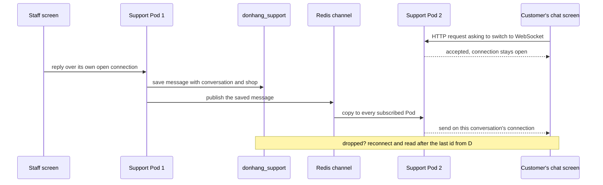

## Before you start

- [[sysdesign.l4.support-chat-requirements]] — you have the estimate (about 200 open connections at the busy hour, about 1.7 messages per second) and the four ranked drivers: 1, a message reaches an open screen within seconds; 2, no message is lost when delivery fails; 3, staff never see another shop's chats; 4, chat never takes capacity ordering needs.
- [[sysdesign.l4.deep-dive]] — you know a deep dive takes the part where a top driver is hardest and asks, among other things, what each dependency failing does.
- [[backend.l2.redis-key-value-store]] — you know Redis runs in its own process, every program connected to it sees the same data, and Đơn Hàng keeps only copies in it.
- [[backend.l3.exchanges-and-bindings]] — you know publish/subscribe: a publisher sends once, without knowing who receives, and each subscriber gets its own copy.

## The situation

The chat requirements are agreed, and you draw the path of one reply for the design review. The review plans two Pods for the new chat service. The customer's chat screen is connected to one Pod; the staff member's screen, by chance, to the other. The staff member presses send.

Nothing in Đơn Hàng today can write to a screen that did not ask, and a Pod knows only the screens connected to it. Then the customer's phone loses signal for a minute, just as a second reply goes out. What path must each reply take to reach the customer's open screen within seconds, whichever Pod it lands on, and still arrive after a dropped connection?

## Core concepts

- **WebSocket** — a protocol that, over HTTP/1.1, starts as an HTTP request asking to switch protocols, then keeps the connection open so either the client or the server can send a message at any time.
- the saved row as the record — a message counts as sent once its row is in PostgreSQL with its conversation and shop; delivery to screens comes after and may fail.
- a channel between Pods — a Redis publish/subscribe channel every chat Pod subscribes to, so a message saved on one Pod reaches the connections held by all of them.
- reading after the last id — on reconnecting, the app sends the id of the last message it has, and the Pod reads the newer ones from the database.
- the unread fallback — a reply still unread after minutes (assumed) leaves through the outbox, and Notifications emails the customer.

## How it works



In the situation above, the customer's chat screen opens a WebSocket to Pod 2: an HTTP request asking to switch protocols, which the Pod accepts. From then on the connection stays open, and Pod 2 can send to that screen without the screen asking. This is the arrow the requirements said was missing.

The staff member's screen holds its own connection, to Pod 1. When the reply arrives there, Pod 1 first saves it in `donhang_support`, with its conversation and shop. Only then does it deliver. If any later step fails, the row is still there: the saved row, not the delivery, is the record.

Pod 1 cannot write to the customer's connection, because Pod 2 holds it. So Pod 1 publishes the saved message to a Redis channel. Every Support Pod subscribes to that channel, and each passes the message to the connections it holds for that conversation.

The note is the deep dive. While the customer's phone has no signal, a message published to the channel reaches no connection of theirs. Unlike a RabbitMQ queue, a Redis channel hands a message only to subscribers connected at that moment and stores nothing. When the app reconnects, perhaps to the other Pod, it sends the id of the last message it has. The Pod reads every newer message from the database and sends those first. Nothing is lost, because nothing depended on Redis keeping it.

One step sits outside the diagram: a reply still unread after five minutes (assumed) becomes a message through the outbox, and Notifications emails the customer.

## In the Đơn Hàng system

None of this is built at stage-4. ADR `0032` says so in its header: the repository has no Support service, endpoint or chat code. The design lives in two documents. The decision first:

```markdown file=docs/adr/0032-chat-ho-tro-qua-websocket-trong-service-rieng.md tag=stage-4 lines=33-52
### Quyết định

Chọn service riêng `DonHang.Support`, đi theo golden path (`golden-path.md`).

- Database riêng `donhang_support` trên server `db`, như Notifications và
  Payments. WebSocket dùng hỗ trợ có sẵn của ASP.NET Core, không thêm thư viện.
- Mỗi tin được lưu vào PostgreSQL trước (cuộc trò chuyện, cửa hàng, người
  gửi), rồi mới gửi tới các kết nối đang mở. Dòng đã lưu là bản ghi, không phải
  việc chuyển tin.
- Nhiều Pod: Pod lưu tin xong thì publish lên một kênh publish/subscribe của
  Redis (Redis có sẵn, chỉ giữ bản sao, như `redis.yaml` ghi); mỗi Pod chuyển
  tin cho các kết nối nó đang giữ.
- App nối lại thì hỏi các tin sau id cuối nó có, đọc từ database.
- Tin trả lời chưa đọc sau 5 phút (giả định) thành một message qua outbox;
  Notifications gửi email theo ADR 0027.
- Cửa hàng lấy từ access token (từ release 2); row-level security như ADR 0013.
- Endpoint đề xuất `/api/v1/conversations`, một HTTPRoute mới tới Support.
- Phát hành bằng rolling update (ADR 0019): weight của Gateway chỉ quyết kết
  nối mới đi đâu, kết nối đang mở ở lại Pod cũ tới khi Pod đó dừng.
- Hỏi lại mỗi vài giây được giữ làm đường lui khi không mở được kết nối.
```

The first lines put chat in a service of its own, `DonHang.Support`, with its own database `donhang_support` on the server `db`, as Notifications and Payments have. Above the excerpt, the ADR lists a chat module inside `DonHang.Api` and its cost: connections held open for minutes would share Pods, limits and canary releases with the process taking orders; below it, the ADR answers a teammate that this goes against driver 4. Its context section defines WebSocket as this lesson does. The server uses ASP.NET Core's built-in WebSocket support, with no added library.

The next three bullets are the diagram: save first, publish to Redis, read after the last id. The Redis bullet points at `redis.yaml`, whose comment says everything in Redis is a copy of what PostgreSQL holds; that file runs Redis as one replica. The unread bullet hands off to ADR `0027`'s email. The shop comes from the access token, guarded by row-level security. The proposed endpoint gets a new HTTPRoute; at this tag `httproutes.yaml` already sends `/api/v1/refunds` to `payments` instead of `api`, because the longer path prefix wins: the same shape. The last two bullets, releases and the fallback when no connection opens, belong to the next lesson.

The review's path of one message and its deep dive:

```markdown file=docs/design/support-chat-design-review.md tag=stage-4 lines=44-57
Đường đi của một tin: app gửi qua kết nối đang mở → Pod lưu vào
`donhang_support` (kèm cửa hàng từ access token) → Pod publish lên kênh Redis →
mọi Pod chuyển tin cho kết nối của cuộc trò chuyện đó. Tin chưa đọc sau 5 phút
→ outbox → RabbitMQ → Notifications gửi email (ADR 0027).

### Đi sâu: kết nối rớt (bước 4)

- Kết nối rớt (mạng điện thoại, Pod bị thay khi phát hành): app nối lại sau một
  khoảng chờ có jitter, để các app không cùng nối lại một lúc.
- Khi nối lại, app gửi id của tin cuối nó có; Pod đọc các tin sau id đó từ
  database và gửi trước, rồi mới gửi tin mới.
- Tin tới trong lúc rớt chỉ bị lỡ ở phần chuyển qua Redis; database vẫn có, nên
  không mất tin (driver 2).
- Không mở lại được kết nối: app hỏi lại mỗi vài giây, đường lui của ADR 0032.
```

The first paragraph is the diagram in one line, with the email leg written out: outbox, RabbitMQ, Notifications. The heading's "bước 4" is the method's step 4, the deep dive; it asks what happens when the connection fails. It drops on a phone network or when a Pod is replaced in a release; the app reconnects after a wait with jitter, so apps do not all reconnect at once. It then sends its last id, and the Pod sends what the database holds after it before anything new. A message that arrived during the drop is missed only on the Redis leg; the database has it, which is how driver 2 holds. Below the excerpt, the review lists Redis, one replica, as a single point of failure for the relay between Pods only: losing it stops no saving or reading.

## Trade-offs

| Choice | What it gives | What it costs | Right when |
|---|---|---|---|
| Deliver first, save after | the screen sees the message a moment sooner | a Pod that stops between the two steps loses a message nobody can read again; fails driver 2 | nothing needs to be read later |
| Save first, then deliver (ADR `0032`) | a reconnecting app can always read what it missed | one short write per message, about 1.7 per second at the busy hour (assumed) | every message must survive a failed delivery |
| Each Pod delivers only to its own connections | no channel to run | a reply whose receiver sits on another Pod shows only after a reconnect; fails driver 1 | chat runs on one Pod and always will |
| Relay saved messages through a Redis channel (ADR `0032`) | any Pod's connections get the message within seconds | Redis passes it once and keeps nothing; a Pod cut off from Redis at that moment misses it | the database stays the record, so a miss is read again on reconnect |

The two chosen rows lean on each other. The Redis relay is acceptable only because the saved row makes a missed relay recoverable.

## What would you choose if…

…Support ran on a single Pod? The channel would carry messages no other Pod needs. If a second Pod is planned, as the review assumes, keep it: adding it later changes how every message travels.

…Redis were down for an hour? Messages still save, so driver 2 holds. Delivery that depends on the channel stops. The design adds nothing that makes a healthy connection reconnect, so a missed reply shows only after the app's next drop, when it reads after its last id; driver 1 slips for those conversations. This is the cost the review accepts for a single Redis.

…a teammate suggested the reconnecting app ask Redis for what it missed? Redis keeps nothing from the channel, and `redis.yaml` treats everything in Redis as a copy. The read after the last id goes to `donhang_support`, the record.

## Seniors often assume…

- **"With a WebSocket, a message sent is a message received, so nothing else is needed."** → Actually the connection can drop, on a phone network or when a Pod is replaced in a release, and a message sent to a dropped connection reaches no one. You notice this when a customer's screen skips a reply that the staff screen shows as sent.
- **"Each Pod only has to deliver to its own connections; the other Pods will take care of theirs."** → Actually a Pod hears only about messages that reach it, and the receiver's connection may be on another Pod. Without the Redis channel, that Pod never learns of the message. You notice this when chat works in a test with one Pod, but with two some replies appear only after a reconnect.
- **"Redis now holds the chat history, so if Redis goes down the messages are lost."** → Actually Redis only passes each saved message to the Pods subscribed at that moment and keeps no copy. The history is the rows in `donhang_support`. You notice this when Redis restarts: live messages between Pods pause, yet every conversation is complete again as soon as the app reconnects and reads after its last id.

## Try it (3 minutes)

The customer's app holds message 40 as its last one, on a connection to Pod 2. Pod 2 is replaced in a release. In the next seconds the staff member, on Pod 1, sends messages 41 and 42. The app reconnects after its wait and lands on Pod 1.

Write down what the app sends when it reconnects, where messages 41 and 42 come from, and whether the answer changes if Redis was down the whole time.

Expected result: one line for each of the three.

<details><summary>Suggested answer</summary>

The app sends 40, the id of the last message it has. Pod 1 reads 41 and 42 from `donhang_support` and sends them before any new message. Redis being down changes nothing for 41 and 42: when they were published, the customer had no open connection, so the channel delivered them to no screen of theirs anyway. Both were saved before any delivery was tried, and the database is where the reconnect reads.

</details>

## Connections

- [[sysdesign.l4.high-level-design]] — the step this lesson's diagram applies: the boxes and the path of one message before the deep dive.
- [[foundation.l1.tcp-vs-udp]] — the connection a WebSocket keeps open is the TCP connection from that lesson, held for minutes instead of one exchange.
- [[backend.l4.data-ownership]] — why conversations and messages get their own database, owned by Support.
- [[devops.l4.golden-path]] — the path `DonHang.Support` follows as a new service instead of its own setup.
- [[sysdesign.l4.notification-design]] — the email leg an unread reply joins, through the outbox under ADR `0027`.
- [[sysdesign.l4.support-chat-trade-offs]] — the next step: what this design runs out of, and the options ADR `0032` rejected.

## Five-line summary

1. A WebSocket keeps a connection open so the chat server sends each message to open screens once it is saved.
2. ADR `0032` puts chat in `DonHang.Support` with its own database, so long-held connections never share Pods with ordering.
3. Each message is saved in PostgreSQL with its conversation and shop first; the saved row, not the delivery, is the record.
4. A Pod publishes each saved message to a Redis channel, and every Pod passes it to the connections it holds.
5. A reconnecting app reads after its last id from the database; a reply unread for minutes goes out by email.
