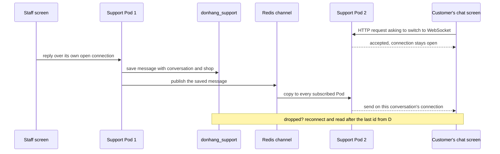

## Bạn cần biết trước

- [[sysdesign.l4.support-chat-requirements]] — bạn đã có phần ước lượng (khoảng 200 kết nối đang mở lúc giờ đông, khoảng 1,7 tin mỗi giây) và bốn yếu tố định hình kiến trúc đã xếp hạng: 1, tin tới một màn hình đang mở trong vài giây; 2, không mất tin khi gửi hỏng; 3, nhân viên không bao giờ thấy chat của cửa hàng khác; 4, chat không bao giờ lấy phần năng lực mà đặt đơn cần.
- [[sysdesign.l4.deep-dive]] — bạn biết bước đi sâu chọn phần mà một yếu tố đứng đầu khó thỏa nhất, và trong số các câu hỏi, nó hỏi chuyện gì xảy ra khi từng thành phần phụ thuộc hỏng.
- [[backend.l2.redis-key-value-store]] — bạn biết Redis chạy trong tiến trình riêng, mọi chương trình nối tới nó đều thấy cùng dữ liệu, và Đơn Hàng chỉ giữ bản sao trong đó.
- [[backend.l3.exchanges-and-bindings]] — bạn biết publish/subscribe: bên gửi gửi một lần, không cần biết ai nhận, và mỗi bên đăng ký nhận một bản riêng.

## Tình huống

Yêu cầu chat đã chốt, và bạn vẽ đường đi của một tin trả lời cho buổi review thiết kế. Buổi review tính hai Pod cho service chat mới. Màn hình chat của khách đang nối tới một Pod. Màn hình của nhân viên, tình cờ, nối tới Pod kia. Nhân viên bấm gửi.

Hôm nay chưa có gì trong Đơn Hàng ghi được tới một màn hình không hỏi, và một Pod chỉ biết các màn hình nối tới chính nó. Rồi điện thoại của khách mất sóng một phút, đúng lúc tin trả lời thứ hai được gửi đi. Mỗi tin trả lời phải đi đường nào để tới màn hình đang mở của khách trong vài giây, dù rơi vào Pod nào, và vẫn tới sau khi kết nối rớt?

## Khái niệm cốt lõi

- **WebSocket** (giao thức bắt đầu bằng một request HTTP rồi giữ kết nối mở, để cả client lẫn server gửi tin cho nhau bất cứ lúc nào) — một giao thức mà, trên HTTP/1.1, bắt đầu bằng một request HTTP xin đổi giao thức, rồi giữ kết nối mở để client hay server đều gửi tin được bất cứ lúc nào.
- dòng đã lưu là bản ghi — một tin được tính là đã gửi khi dòng của nó nằm trong PostgreSQL, kèm cuộc trò chuyện và cửa hàng. Việc chuyển tới màn hình đến sau và có thể hỏng.
- kênh giữa các Pod — một kênh publish/subscribe của Redis mà mọi Pod chat đều đăng ký nhận, nên tin lưu ở một Pod tới được các kết nối mà tất cả các Pod đang giữ.
- đọc sau id cuối — khi nối lại, app gửi id của tin cuối nó có, và Pod đọc các tin mới hơn từ database.
- đường lui cho tin chưa đọc — tin trả lời vẫn chưa đọc sau vài phút (giả định) đi ra qua outbox, và Notifications gửi email cho khách.

## Cơ chế hoạt động



Trong tình huống trên, màn hình chat của khách mở một WebSocket tới Pod 2: một request HTTP xin đổi giao thức, và Pod chấp nhận. Từ đó kết nối được giữ mở, và Pod 2 gửi được tới màn hình đó mà màn hình không cần hỏi. Đây là mũi tên mà phần yêu cầu nói còn thiếu.

Màn hình nhân viên giữ kết nối riêng, tới Pod 1. Khi tin trả lời tới đó, Pod 1 lưu nó vào `donhang_support` trước, kèm cuộc trò chuyện và cửa hàng. Chỉ sau đó Pod mới chuyển tin. Nếu bước nào phía sau hỏng, dòng đó vẫn còn: dòng đã lưu mới là bản ghi, không phải lần chuyển tin.

Pod 1 không ghi được vào kết nối của khách, vì Pod 2 đang giữ nó. Nên Pod 1 publish tin đã lưu lên một kênh Redis. Mọi Pod Support đều đăng ký nhận kênh đó, và mỗi Pod chuyển tin cho các kết nối nó đang giữ của cuộc trò chuyện đó.

Ghi chú trong sơ đồ là phần đi sâu. Trong lúc điện thoại của khách mất sóng, tin publish lên kênh không tới kết nối nào của họ. Khác hàng đợi RabbitMQ, kênh Redis chỉ trao tin cho các bên đăng ký đang nối vào đúng lúc đó, và không giữ lại gì. Khi app nối lại, có thể vào Pod kia, nó gửi id của tin cuối nó có. Pod đọc mọi tin mới hơn từ database và gửi những tin đó trước. Không mất tin nào, vì không gì phụ thuộc vào chuyện Redis giữ tin.

Có một bước nằm ngoài sơ đồ: tin trả lời vẫn chưa đọc sau năm phút (giả định) thành một message đi qua outbox, và Notifications gửi email cho khách.

## Trong hệ thống Đơn Hàng

Ở stage-4 chưa có phần nào trong số này được xây. ADR `0032` ghi rõ ở phần đầu: repo không có service, endpoint hay code chat nào cho Support. Thiết kế nằm trong hai tài liệu. Quyết định trước:

```markdown file=docs/adr/0032-chat-ho-tro-qua-websocket-trong-service-rieng.md tag=stage-4 lines=33-52
### Quyết định

Chọn service riêng `DonHang.Support`, đi theo golden path (`golden-path.md`).

- Database riêng `donhang_support` trên server `db`, như Notifications và
  Payments. WebSocket dùng hỗ trợ có sẵn của ASP.NET Core, không thêm thư viện.
- Mỗi tin được lưu vào PostgreSQL trước (cuộc trò chuyện, cửa hàng, người
  gửi), rồi mới gửi tới các kết nối đang mở. Dòng đã lưu là bản ghi, không phải
  việc chuyển tin.
- Nhiều Pod: Pod lưu tin xong thì publish lên một kênh publish/subscribe của
  Redis (Redis có sẵn, chỉ giữ bản sao, như `redis.yaml` ghi); mỗi Pod chuyển
  tin cho các kết nối nó đang giữ.
- App nối lại thì hỏi các tin sau id cuối nó có, đọc từ database.
- Tin trả lời chưa đọc sau 5 phút (giả định) thành một message qua outbox;
  Notifications gửi email theo ADR 0027.
- Cửa hàng lấy từ access token (từ release 2); row-level security như ADR 0013.
- Endpoint đề xuất `/api/v1/conversations`, một HTTPRoute mới tới Support.
- Phát hành bằng rolling update (ADR 0019): weight của Gateway chỉ quyết kết
  nối mới đi đâu, kết nối đang mở ở lại Pod cũ tới khi Pod đó dừng.
- Hỏi lại mỗi vài giây được giữ làm đường lui khi không mở được kết nối.
```

Mấy dòng đầu đặt chat vào một service riêng, `DonHang.Support`, với database riêng `donhang_support` trên server `db`, giống Notifications và Payments. Phía trên đoạn trích, ADR liệt kê phương án một module chat bên trong `DonHang.Api` và cái giá của nó: các kết nối giữ mở hàng phút sẽ dùng chung Pod, giới hạn và canary release với tiến trình nhận đơn. Phía dưới, ADR trả lời một đồng đội rằng phương án đó đi ngược yếu tố 4. Phần bối cảnh của ADR định nghĩa WebSocket đúng như bài này. Server dùng hỗ trợ WebSocket có sẵn của ASP.NET Core, không thêm thư viện.

Ba gạch đầu dòng tiếp theo chính là sơ đồ: lưu trước, publish lên Redis, đọc sau id cuối. Dòng về Redis trỏ tới `redis.yaml`, nơi chú thích ghi rằng mọi thứ trong Redis là bản sao của những gì PostgreSQL giữ. File đó chỉ chạy một bản Redis. Dòng về tin chưa đọc chuyển sang email theo ADR `0027`. Cửa hàng lấy từ access token, có row-level security canh giữ. Endpoint đề xuất có một HTTPRoute mới. Ở tag này, `httproutes.yaml` đã gửi `/api/v1/refunds` tới `payments` thay vì `api`, vì tiền tố đường dẫn dài hơn thắng: cùng một hình dạng. Hai dòng cuối, về phát hành và đường lui khi không mở được kết nối, thuộc về bài sau.

Đường đi của một tin và phần đi sâu trong buổi review:

```markdown file=docs/design/support-chat-design-review.md tag=stage-4 lines=44-57
Đường đi của một tin: app gửi qua kết nối đang mở → Pod lưu vào
`donhang_support` (kèm cửa hàng từ access token) → Pod publish lên kênh Redis →
mọi Pod chuyển tin cho kết nối của cuộc trò chuyện đó. Tin chưa đọc sau 5 phút
→ outbox → RabbitMQ → Notifications gửi email (ADR 0027).

### Đi sâu: kết nối rớt (bước 4)

- Kết nối rớt (mạng điện thoại, Pod bị thay khi phát hành): app nối lại sau một
  khoảng chờ có jitter, để các app không cùng nối lại một lúc.
- Khi nối lại, app gửi id của tin cuối nó có; Pod đọc các tin sau id đó từ
  database và gửi trước, rồi mới gửi tin mới.
- Tin tới trong lúc rớt chỉ bị lỡ ở phần chuyển qua Redis; database vẫn có, nên
  không mất tin (driver 2).
- Không mở lại được kết nối: app hỏi lại mỗi vài giây, đường lui của ADR 0032.
```

Đoạn đầu là sơ đồ gói trong một dòng, với chặng email được viết ra đủ: outbox, RabbitMQ, Notifications. "bước 4" ở tiêu đề là bước 4 của phương pháp, bước đi sâu. Nó hỏi chuyện gì xảy ra khi kết nối hỏng. Kết nối rớt trên mạng điện thoại, hoặc khi một Pod bị thay trong lúc phát hành. App nối lại sau một khoảng chờ có jitter, để các app không cùng nối lại một lúc. Sau đó app gửi id cuối của nó, và Pod gửi những gì database có sau id đó, trước mọi tin mới. Tin tới trong lúc rớt chỉ bị lỡ ở chặng Redis. Database vẫn có nó, và đó là cách yếu tố 2 được giữ. Phía dưới đoạn trích, buổi review ghi Redis, chỉ một bản, là điểm lỗi duy nhất cho riêng phần chuyển tin giữa các Pod: mất nó không làm dừng việc lưu hay đọc.

## Đánh đổi

| Lựa chọn | Được gì | Cái giá | Đúng khi |
|---|---|---|---|
| Chuyển tin trước, lưu sau | màn hình thấy tin sớm hơn một chút | Pod dừng giữa hai bước sẽ làm mất một tin không ai đọc lại được, trượt yếu tố 2 | không cần đọc lại gì sau này |
| Lưu trước, rồi mới chuyển (ADR `0032`) | app nối lại luôn đọc được những gì đã lỡ | mỗi tin một lần ghi ngắn, khoảng 1,7 lần mỗi giây lúc giờ đông (giả định) | mọi tin phải còn sau một lần chuyển hỏng |
| Mỗi Pod chỉ chuyển cho kết nối của chính nó | không có kênh nào phải vận hành | tin trả lời mà người nhận nằm ở Pod khác chỉ hiện sau khi nối lại, trượt yếu tố 1 | chat chạy trên một Pod và sẽ luôn như vậy |
| Chuyển tin đã lưu qua một kênh Redis (ADR `0032`) | kết nối ở Pod nào cũng nhận tin trong vài giây | Redis chuyển tin một lần và không giữ gì; Pod bị cắt khỏi Redis đúng lúc đó sẽ lỡ tin | database vẫn là bản ghi, nên tin bị lỡ được đọc lại khi nối lại |

Hai dòng được chọn dựa vào nhau. Chuyển tin qua Redis chỉ chấp nhận được vì dòng đã lưu giúp khôi phục một lần chuyển bị lỡ.

## Bạn sẽ chọn gì nếu…

…Support chỉ chạy trên một Pod? Kênh sẽ mang những tin không Pod nào khác cần. Nếu đã tính thêm Pod thứ hai, như buổi review giả định, hãy giữ kênh: thêm nó sau này sẽ đổi cách mọi tin đi.

…Redis sập một giờ? Tin vẫn được lưu, nên yếu tố 2 vẫn giữ. Phần chuyển tin dựa vào kênh thì dừng. Thiết kế không thêm gì khiến một kết nối còn tốt phải nối lại, nên tin trả lời bị lỡ chỉ hiện sau lần rớt kế tiếp của app, khi nó đọc sau id cuối. Yếu tố 1 bị trượt với những cuộc trò chuyện đó. Đây là cái giá buổi review chấp nhận khi chỉ có một Redis.

…một đồng đội đề nghị app nối lại thì hỏi Redis những gì nó đã lỡ? Redis không giữ gì từ kênh, và `redis.yaml` coi mọi thứ trong Redis là bản sao. Phần đọc sau id cuối đi tới `donhang_support`, nơi giữ bản ghi.

## Senior hay nhầm rằng…

- **"Có WebSocket rồi thì tin đã gửi là tin đã nhận, không cần gì thêm."** → Thực ra kết nối có thể rớt, trên mạng điện thoại hay khi một Pod bị thay lúc phát hành, và tin gửi vào một kết nối đã rớt không tới ai cả. Bạn sẽ nhận ra khi màn hình của khách thiếu một tin trả lời mà màn hình nhân viên vẫn báo đã gửi.
- **"Mỗi Pod chỉ cần chuyển cho kết nối của mình, các Pod khác sẽ lo phần của chúng."** → Thực ra một Pod chỉ biết những tin tới chính nó, còn kết nối của người nhận có thể nằm ở Pod khác. Không có kênh Redis, Pod kia không bao giờ biết tới tin đó. Bạn sẽ nhận ra khi chat chạy tốt lúc test với một Pod, nhưng với hai Pod thì vài tin trả lời chỉ hiện sau khi nối lại.
- **"Giờ Redis giữ lịch sử chat, nên Redis sập là mất tin."** → Thực ra Redis chỉ chuyển mỗi tin đã lưu cho các Pod đang đăng ký nhận ở thời điểm đó, và không giữ bản nào. Lịch sử là các dòng trong `donhang_support`. Bạn sẽ nhận ra khi Redis khởi động lại: tin trực tiếp giữa các Pod tạm dừng, nhưng mọi cuộc trò chuyện lại đầy đủ ngay khi app nối lại và đọc sau id cuối.

## Thử ngay (3 phút)

App của khách đang có tin 40 là tin cuối, trên một kết nối tới Pod 2. Pod 2 bị thay trong một lần phát hành. Trong vài giây sau đó, nhân viên, ở Pod 1, gửi tin 41 và 42. App nối lại sau khoảng chờ và rơi vào Pod 1.

Ghi ra app gửi gì khi nối lại, tin 41 và 42 lấy từ đâu, và câu trả lời có đổi không nếu Redis sập suốt thời gian đó.

Kết quả mong đợi: mỗi ý một dòng, ba dòng.

<details><summary>Gợi ý đáp án</summary>

App gửi 40, id của tin cuối nó có. Pod 1 đọc 41 và 42 từ `donhang_support` và gửi chúng trước mọi tin mới. Redis sập không đổi gì với 41 và 42: lúc chúng được publish, khách không có kết nối nào đang mở, nên dù sao kênh cũng không chuyển chúng tới màn hình nào của khách. Cả hai đã được lưu trước khi có lần chuyển nào, và database là nơi lần nối lại đọc.

</details>

## Liên hệ

- [[sysdesign.l4.high-level-design]] — bước mà sơ đồ của bài này áp dụng: các khối và đường đi của một tin, trước phần đi sâu.
- [[foundation.l1.tcp-vs-udp]] — kết nối mà WebSocket giữ mở chính là kết nối TCP trong bài đó, giữ hàng phút thay vì một lượt trao đổi.
- [[backend.l4.data-ownership]] — vì sao cuộc trò chuyện và tin nhắn có database riêng, do Support sở hữu.
- [[devops.l4.golden-path]] — con đường mà `DonHang.Support` đi theo khi là service mới, thay vì tự dựng riêng.
- [[sysdesign.l4.notification-design]] — chặng email mà một tin trả lời chưa đọc nhập vào, qua outbox theo ADR `0027`.
- [[sysdesign.l4.support-chat-trade-offs]] — bước tiếp theo: thiết kế này sẽ cạn ở đâu, và các phương án ADR `0032` đã loại.

## Tóm tắt 5 dòng

1. WebSocket giữ kết nối mở để server chat gửi mỗi tin tới các màn hình đang mở ngay khi tin được lưu.
2. ADR `0032` đặt chat vào `DonHang.Support` với database riêng, để các kết nối giữ lâu không bao giờ dùng chung Pod với đặt đơn.
3. Mỗi tin được lưu vào PostgreSQL trước, kèm cuộc trò chuyện và cửa hàng. Dòng đã lưu, không phải lần chuyển tin, là bản ghi.
4. Pod publish mỗi tin đã lưu lên một kênh Redis, và mọi Pod chuyển tin cho các kết nối nó đang giữ.
5. App nối lại thì đọc sau id cuối từ database. Tin trả lời chưa đọc sau vài phút được gửi đi bằng email.
