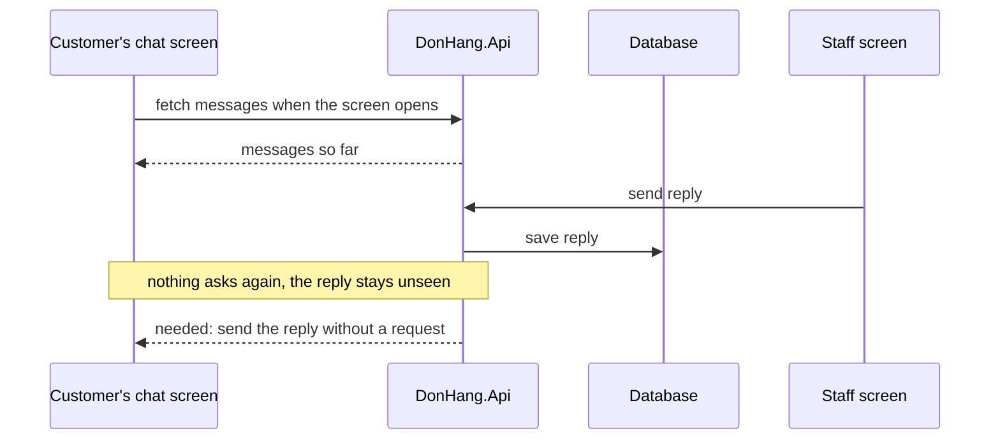

## Before you start

- [[sysdesign.l4.reporting-challenges]] — you finished the reporting problem with a design review; this lesson starts the module's first problem at step 1, requirements.
- [[sysdesign.l4.notification-requirements]] — you know Notifications sends Đơn Hàng's emails, and that a push notification needs a phone build the app does not have at stage-4.
- [[backend.l4.load-testing]] — you know Little's law: what is in flight equals the rate it arrives times how long each item stays.
- [[frontend.l2.futureprovider-and-asyncvalue]] — you know a `FutureProvider` runs its load, keeps the result, and a screen watching it shows loading, error or data.

## The situation

The product owner, the person who decides what the product must do, wants customers to chat with the staff of the shop they bought from. A customer opens order 42, sees "shipping", and asks "when will it arrive?". A teammate says: add a messages endpoint, a provider like `orderProvider`, and a matching screen.

The staff member answers; it is saved. The customer's chat screen fetched its messages when it opened, and nothing makes it ask again. The reply waits in the database until something makes the app load again: another customer signing in, or a page reload. What does chat need that the system does not do today, and what must the requirements measure before anyone picks a design?

## Core concepts

- a screen that shows what it fetched — every screen of `DonHang.App` shows what it loaded and loads again only when something tells it to.
- a message to an open screen — the server sends new data to a screen that is already showing, without that screen asking for it; this is what chat needs and the system lacks.
- open conversations — chats that have started and not yet ended at one moment; by Little's law, the rate they start times how long one stays open.
- open connections — the links each open chat screen keeps to the server while it waits, mostly carrying nothing; one per customer and one per staff member.
- ranked drivers — the scenarios, in order, that the design must satisfy first when two of them pull in different directions.

## How it works



The diagram shows chat built the way orders are. In the situation above, the customer's chat screen fetches the messages once, when it opens, and the API answers with what exists at that moment.

A minute later the staff screen sends a reply, and the API saves it. Every step so far works. The gap is the note: the customer's screen has its answer and does not ask again, so the reply waits in the database.

The last arrow is the requirement. The server must send a new message to a screen that is already open, without that screen asking. The requirements file records, in its opening section above the excerpt, that nothing in Đơn Hàng does this today: every screen shows only what it loaded, and the app has no timer that asks the API again.

The requirements then turn that need into scenarios with measures. The first one gives the arrow its time limit: a message shows on the other side within two seconds (assumed). Others say who may see a conversation, what happens when a connection drops, how long history is kept, and what happens when the customer is not looking.

Two numbers shape the design that follows. Messages per second are few. Open connections are not: each open chat screen keeps one, and by Little's law their number is the rate chats start times how long one stays open. That count is what the design must hold, not the request rate.

## In the Đơn Hàng system

The provider the teammate wants to copy, at this tag:

```dart file=DonHang.App/lib/features/ordering/orders_api.dart tag=stage-4 lines=60-65
// Watching authProvider too: signing in as someone else loads the order
// again with the new token instead of showing the previous customer's copy.
final orderProvider = FutureProvider.family<OrderResult, int>((ref, id) {
  ref.watch(authProvider);
  return ref.watch(ordersApiProvider).fetchOrder(id);
});
```

`.family` makes one provider per order id, so `orderProvider(42)` keeps order 42's result. It watches `authProvider` and `ordersApiProvider`; the second, defined just above the excerpt, gives the `OrdersApi` object that `fetchOrder` belongs to and watches nothing. So a change of signed-in customer is what loads the order again. Nothing in these lines watches the clock or the server. `order_detail_screen.dart` watches this provider and shows its result.

The team's requirements for chat, at the same tag:

```markdown file=docs/team/support-chat-requirements.md tag=stage-4 lines=27-51
| Số | Tình huống | Phản hồi | Đo |
|---|---|---|---|
| CT-1 | Một bên gửi tin khi bên kia đang mở màn hình chat | Tin hiện ở bên kia | Trong 2 giây (giả định) |
| CT-2 | Nhân viên cửa hàng A mở danh sách chat | Chỉ cuộc trò chuyện của cửa hàng A | Không cuộc nào của cửa hàng khác |
| CT-3 | Kết nối rớt khi đang có tin tới | Không mất tin; tin hiện khi nối lại | Mọi tin đã gửi thành công đều tới |
| CT-4 | Khách xem lại cuộc trò chuyện cũ | Lịch sử còn đủ | Giữ 12 tháng (giả định) |
| CT-5 | Cửa hàng trả lời khi khách không mở màn hình chat | Khách nhận email | Sau 5 phút chưa đọc (giả định) |

CT-5 dùng email vì push notification cần bản app cho điện thoại, mà ADR 0017
chưa làm; tài liệu này không quyết lại ADR 0017.

### Ước lượng

Theo định luật Little, số cuộc trò chuyện mở cùng lúc = số cuộc bắt đầu mỗi
giây × thời gian một cuộc mở.

- 5% số đơn dẫn tới một cuộc chat (giả định): ở giờ đông khoảng 3,3 × 0,05 =
  khoảng 0,17 cuộc mỗi giây.
- Một cuộc mở trung bình 10 phút, 600 giây (giả định): khoảng 100 cuộc mở cùng
  lúc, khoảng 200 kết nối (khách và nhân viên).
- Khoảng 10 tin mỗi cuộc (giả định): khoảng 1,7 tin mỗi giây, nhỏ so với đặt
  đơn.

Tài nguyên đáng đếm là kết nối giữ mở, phần lớn thời gian không có tin, không
phải số request mỗi giây.
```

CT-1 is the arrow from the diagram with a measure: a message shows on the other side within two seconds (assumed). CT-2 says staff of shop A see no conversation of another shop. CT-3 says a dropped connection loses no message; it shows on reconnecting. CT-4 keeps history for 12 months (assumed).

CT-5 answers a clarifying question: what happens when the customer is not on the chat screen? The reply waits in the conversation, and after five minutes unread (assumed) the customer gets an email. The note below the table gives the reason: a push notification needs a phone build of the app, which ADR `0017` has not made; at stage-4 it builds `DonHang.App` only for the browser. The file does not reopen that ADR.

The estimate applies Little's law. At the busy hour, about 3.3 orders per second (the figure from the team's capacity plan) and 5% of orders leading to a chat (assumed) give about 0.17 new conversations per second. Each stays open about 600 seconds (assumed), so about 100 are open at once, about 200 connections. Ten messages each (assumed) make about 1.7 messages per second. The last line names the resource to count: connections held open, mostly idle.

Below the excerpt, the file ranks four drivers: a message reaches an open screen within seconds (CT-1); no message is lost when delivery fails (CT-3); staff never see another shop's chats (CT-2); chat never takes capacity that ordering needs. The fourth has no CT row and no measure; it ties the design to the estimate's last line, the connections held open.

## Trade-offs

| How the team frames chat | What the design gets | What it costs | Right when |
|---|---|---|---|
| Like orders: fetch when the screen opens | no new kind of work | a reply stays unseen while the screen is open; fails CT-1 | messages are read later, like order history |
| Like orders, plus a timer that asks again | replies appear without leaving the screen | at 200 screens asking every 2 seconds, about 100 requests per second, nearly all answered "nothing new", against 1.7 messages | few screens are open, or the measure is minutes, not seconds |
| Server sends to an open screen, sized by open connections (the framing the requirements hand on) | CT-1 as written | a kind of work the system has never run; the design must hold connections apart from ordering | a reply must show within seconds while the screen is open |

The requirements do not pick the mechanism; the design lesson does. What they fix is the measure that every option is judged against, and the resource the estimate counts.

## What would you choose if…

…the product owner says a reply within 30 seconds is fine? Change CT-1's measure in the requirements first. A looser measure lets cheaper options pass, and the design is judged against the new number, not the old one.

…several shops ask for the reply to pop up on a phone when the app is closed? That needs a phone build, which ADR `0017` has not made. Record it as a new requirement with the product owner as owner; the chat requirements keep CT-5's email until that ADR is revisited.

…5% of orders becomes 20%? Redo the estimate: about 0.66 conversations start per second, about 400 open at once, about 800 connections. Messages rise to about 7 per second, still few. The design is sized by the connections.

## Seniors often assume…

- **"Chat is just another endpoint: the app can fetch new messages the way it fetches an order."** → Actually a fetch returns what exists at that moment, and `orderProvider` asks again when something it watches changes, and nothing it watches is the server. A reply saved a second later stays unseen, which fails CT-1. You notice this when a customer says "nobody answered" while the reply is already in the database.
- **"If there are only a few messages per second, chat is a small load for the system."** → Actually the load is connections held open, about 200 at the assumed peak, each mostly idle for minutes. Their number grows with how long a chat stays open, not with how many messages it carries. You notice this when the request rate looks tiny but the count of open connections keeps rising.
- **"When the customer has closed the app, we can still pop the reply up on their phone."** → Actually the requirements file notes that a push notification needs a phone build of the app, and ADR `0017` adds no phone build at stage-4. CT-5 therefore sends an email after five minutes unread (assumed). You notice this when "just add a push" turns out to need a new decision, not a new endpoint.

## Try it (3 minutes)

The product owner reports that support conversations stay open about 30 minutes, not 10. Using the excerpt's estimate, keep 0.17 conversations started per second and 10 messages per conversation. Work out the conversations open at once, the open connections, and the messages per second.

Expected result: three numbers, and one sentence on which of them changed and why.

<details><summary>Suggested answer</summary>

Thirty minutes is 1,800 seconds. Open conversations: 0.17 × 1,800, about 300. Open connections: two per conversation, about 600. Messages per second: 0.17 × 10, about 1.7, unchanged. Only the open conversations and connections tripled, because Little's law multiplies the start rate by the time each stays open. The messages per conversation did not change, so the message rate did not either.

</details>

## Connections

- [[sysdesign.l4.clarifying-requirements]] — the general step this lesson applies: a request becomes scenarios with measures and answers to shape-changing questions such as CT-5's.
- [[sysdesign.l4.back-of-the-envelope]] — the estimating habit behind the 100 conversations and 200 connections.
- [[design.l4.quality-attribute-scenarios]] — the form CT-1 to CT-5 follow: situation, required response, measure.
- [[frontend.l3.syncing-the-queue]] — the app sends its order queue only on a trigger, the same no-timer fact the requirements start from.
- [[backend.l4.load-testing]] — where Little's law was checked on requests in flight; here it counts open conversations instead.
- [[sysdesign.l4.support-chat-design]] — the next step: a design judged against these four ranked drivers.

## Five-line summary

1. Support chat needs the server to send a new message to a screen already open, which nothing in Đơn Hàng does today.
2. `orderProvider` fetches again when the signed-in customer changes, not when the server has news; no screen asks again on a timer.
3. `support-chat-requirements.md` measures it: a message within 2 seconds, staff see only their shop, no message lost, 12 months of history (assumed).
4. When the customer is not on the screen, the reply waits and an email follows, since ADR `0017` made no phone build.
5. By Little's law about 200 connections stay open at peak while messages stay near 1.7 per second, so connections are the load.
