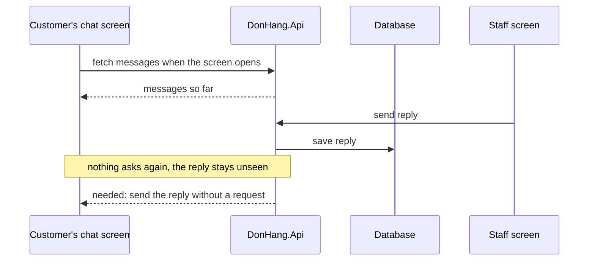

## Bạn cần biết trước

- [[sysdesign.l4.reporting-challenges]] — bạn đã khép lại bài toán báo cáo bằng một buổi review thiết kế. Bài này mở bài toán đầu tiên của module ở bước 1, yêu cầu.
- [[sysdesign.l4.notification-requirements]] — bạn biết Notifications gửi email của Đơn Hàng, và thông báo đẩy cần một bản app cho điện thoại mà ở stage-4 app chưa có.
- [[backend.l4.load-testing]] — bạn biết định luật Little: số việc đang dở bằng tốc độ việc tới nhân thời gian mỗi việc nằm lại.
- [[frontend.l2.futureprovider-and-asyncvalue]] — bạn biết `FutureProvider` chạy phần tải, giữ kết quả, và màn hình theo dõi nó hiện trạng thái đang tải, lỗi hoặc dữ liệu.

## Tình huống

Product owner, người quyết định sản phẩm phải làm gì, muốn khách chat được với nhân viên của cửa hàng họ đã mua. Một khách mở đơn 42, thấy "đang giao", và hỏi "khi nào tới?". Một đồng đội đề xuất: thêm endpoint cho tin nhắn, một provider giống `orderProvider`, và một màn hình tương ứng.

Nhân viên trả lời, tin được lưu. Màn hình chat của khách đã lấy tin nhắn lúc mở, và không có gì khiến nó hỏi lại. Tin trả lời nằm trong database cho tới khi có thứ gì đó làm app tải lại: một khách khác đăng nhập, hay trang được tải lại. Chat cần gì mà hệ thống hôm nay chưa làm, và yêu cầu phải đo những gì trước khi có ai chọn thiết kế?

## Khái niệm cốt lõi

- màn hình hiện thứ nó đã lấy — mọi màn hình của `DonHang.App` hiện thứ nó đã tải, và chỉ tải lại khi có gì đó báo nó.
- tin gửi tới một màn hình đang mở — server gửi dữ liệu mới tới một màn hình đang hiện, mà màn hình đó không cần hỏi. Đây là thứ chat cần và hệ thống còn thiếu.
- cuộc trò chuyện đang mở — các cuộc chat đã bắt đầu mà chưa kết thúc tại một thời điểm. Theo định luật Little, số này bằng tốc độ chúng bắt đầu nhân thời gian một cuộc mở.
- kết nối đang mở — đường nối mà mỗi màn hình chat đang mở giữ tới server trong lúc chờ, phần lớn thời gian không mang gì. Mỗi khách một kết nối, mỗi nhân viên một kết nối.
- các yếu tố định hình kiến trúc đã xếp hạng — các kịch bản, theo thứ tự, mà thiết kế phải thỏa trước khi hai trong số đó kéo về hai hướng khác nhau.

## Cơ chế hoạt động



Sơ đồ cho thấy chat được dựng theo đúng cách làm với đơn hàng. Trong tình huống trên, màn hình chat của khách lấy tin nhắn một lần, lúc mở, và API trả về những gì có ở thời điểm đó.

Một phút sau, màn hình nhân viên gửi một tin trả lời, và API lưu lại. Tới đây mọi bước đều chạy. Chỗ hổng nằm ở ghi chú: màn hình của khách đã có câu trả lời của nó và không hỏi lại, nên tin trả lời nằm yên trong database.

Mũi tên cuối là yêu cầu. Server phải gửi tin mới tới một màn hình đang mở, mà màn hình đó không cần hỏi. File yêu cầu ghi ở phần mở đầu, phía trên đoạn trích, rằng hôm nay chưa có gì trong Đơn Hàng làm điều này: mọi màn hình chỉ hiện thứ nó đã tải, và app không có bộ hẹn giờ nào hỏi lại API.

Sau đó, phần yêu cầu biến nhu cầu ấy thành các kịch bản có số đo. Kịch bản đầu cho mũi tên một giới hạn thời gian: tin hiện ở bên kia trong vòng hai giây (giả định). Các kịch bản khác nói ai được xem một cuộc trò chuyện, chuyện gì xảy ra khi kết nối rớt, lịch sử giữ bao lâu, và chuyện gì xảy ra khi khách không nhìn màn hình.

Hai con số định hình thiết kế phía sau. Số tin mỗi giây thì ít. Số kết nối đang mở thì không: mỗi màn hình chat đang mở giữ một kết nối, và theo định luật Little, số kết nối bằng tốc độ các cuộc chat bắt đầu nhân thời gian một cuộc mở. Thiết kế phải chịu được con số đó, không phải tốc độ request.

## Trong hệ thống Đơn Hàng

Provider mà đồng đội muốn chép, ở tag này:

```dart file=DonHang.App/lib/features/ordering/orders_api.dart tag=stage-4 lines=60-65
// Watching authProvider too: signing in as someone else loads the order
// again with the new token instead of showing the previous customer's copy.
final orderProvider = FutureProvider.family<OrderResult, int>((ref, id) {
  ref.watch(authProvider);
  return ref.watch(ordersApiProvider).fetchOrder(id);
});
```

`.family` tạo một provider cho mỗi id đơn, nên `orderProvider(42)` giữ kết quả của đơn 42. Nó theo dõi `authProvider` và `ordersApiProvider`. Cái thứ hai, khai báo ngay phía trên đoạn trích, trả về đối tượng `OrdersApi` chứa `fetchOrder` và không theo dõi gì. Vậy đổi khách đang đăng nhập là thứ làm đơn được tải lại. Không dòng nào ở đây theo dõi đồng hồ hay server. `order_detail_screen.dart` theo dõi provider này và hiện kết quả của nó.

Yêu cầu của đội cho chat, ở cùng tag:

```markdown file=docs/team/support-chat-requirements.md tag=stage-4 lines=27-51
| Số | Tình huống | Phản hồi | Đo |
|---|---|---|---|
| CT-1 | Một bên gửi tin khi bên kia đang mở màn hình chat | Tin hiện ở bên kia | Trong 2 giây (giả định) |
| CT-2 | Nhân viên cửa hàng A mở danh sách chat | Chỉ cuộc trò chuyện của cửa hàng A | Không cuộc nào của cửa hàng khác |
| CT-3 | Kết nối rớt khi đang có tin tới | Không mất tin; tin hiện khi nối lại | Mọi tin đã gửi thành công đều tới |
| CT-4 | Khách xem lại cuộc trò chuyện cũ | Lịch sử còn đủ | Giữ 12 tháng (giả định) |
| CT-5 | Cửa hàng trả lời khi khách không mở màn hình chat | Khách nhận email | Sau 5 phút chưa đọc (giả định) |

CT-5 dùng email vì push notification cần bản app cho điện thoại, mà ADR 0017
chưa làm; tài liệu này không quyết lại ADR 0017.

### Ước lượng

Theo định luật Little, số cuộc trò chuyện mở cùng lúc = số cuộc bắt đầu mỗi
giây × thời gian một cuộc mở.

- 5% số đơn dẫn tới một cuộc chat (giả định): ở giờ đông khoảng 3,3 × 0,05 =
  khoảng 0,17 cuộc mỗi giây.
- Một cuộc mở trung bình 10 phút, 600 giây (giả định): khoảng 100 cuộc mở cùng
  lúc, khoảng 200 kết nối (khách và nhân viên).
- Khoảng 10 tin mỗi cuộc (giả định): khoảng 1,7 tin mỗi giây, nhỏ so với đặt
  đơn.

Tài nguyên đáng đếm là kết nối giữ mở, phần lớn thời gian không có tin, không
phải số request mỗi giây.
```

CT-1 là mũi tên trong sơ đồ, kèm số đo: tin hiện ở bên kia trong vòng hai giây (giả định). CT-2 nói nhân viên cửa hàng A không thấy cuộc trò chuyện nào của cửa hàng khác. CT-3 nói kết nối rớt thì không mất tin, tin hiện ra khi nối lại. CT-4 giữ lịch sử 12 tháng (giả định).

CT-5 trả lời một câu hỏi làm rõ: chuyện gì xảy ra khi khách không ở màn hình chat? Tin trả lời nằm chờ trong cuộc trò chuyện, và sau năm phút chưa đọc (giả định), khách nhận một email. Ghi chú dưới bảng nêu lý do: thông báo đẩy cần một bản app cho điện thoại, thứ ADR `0017` chưa làm. Ở stage-4, ADR đó chỉ build `DonHang.App` cho trình duyệt. File này không mở lại ADR đó.

Phần ước lượng áp dụng định luật Little. Ở giờ đông, khoảng 3,3 đơn mỗi giây (con số từ kế hoạch dung lượng của đội) và 5% số đơn dẫn tới một cuộc chat (giả định) cho khoảng 0,17 cuộc trò chuyện mới mỗi giây. Mỗi cuộc mở khoảng 600 giây (giả định), nên khoảng 100 cuộc mở cùng lúc, khoảng 200 kết nối. Mười tin mỗi cuộc (giả định) cho khoảng 1,7 tin mỗi giây. Dòng cuối gọi tên tài nguyên cần đếm: các kết nối giữ mở, phần lớn thời gian rảnh.

Phía dưới đoạn trích, file xếp hạng bốn yếu tố định hình kiến trúc: tin tới một màn hình đang mở trong vài giây (CT-1), không mất tin khi gửi hỏng (CT-3), nhân viên không bao giờ thấy chat của cửa hàng khác (CT-2), chat không bao giờ lấy phần năng lực mà đặt đơn cần. Yếu tố thứ tư không có dòng CT nào và không có số đo. Nó buộc thiết kế vào dòng cuối của phần ước lượng, các kết nối giữ mở.

## Đánh đổi

| Đội nhìn chat theo cách nào | Thiết kế được gì | Cái giá | Đúng khi |
|---|---|---|---|
| Như đơn hàng: lấy dữ liệu khi màn hình mở | không có loại việc mới nào | tin trả lời không hiện trong lúc màn hình đang mở, trượt CT-1 | tin nhắn được đọc sau, như lịch sử đơn |
| Như đơn hàng, thêm bộ hẹn giờ hỏi lại | tin trả lời hiện mà không cần rời màn hình | 200 màn hình hỏi mỗi 2 giây là khoảng 100 request mỗi giây, gần như tất cả nhận "không có gì mới", so với 1,7 tin | ít màn hình mở, hoặc số đo tính bằng phút chứ không bằng giây |
| Server gửi tới màn hình đang mở, định cỡ theo số kết nối đang mở (cách nhìn mà phần yêu cầu chuyển tiếp) | CT-1 đúng như đã viết | một loại việc hệ thống chưa từng chạy, thiết kế phải giữ các kết nối tách khỏi đặt đơn | tin trả lời phải hiện trong vài giây khi màn hình đang mở |

Phần yêu cầu không chọn cơ chế, đó là việc của bài thiết kế. Thứ nó chốt là số đo mà mọi phương án được chấm theo, và tài nguyên mà phần ước lượng đếm.

## Bạn sẽ chọn gì nếu…

…product owner nói tin trả lời trong 30 giây là được? Sửa số đo của CT-1 trong phần yêu cầu trước. Số đo nới lỏng hơn cho các phương án rẻ hơn lọt qua, và thiết kế được chấm theo con số mới, không theo con số cũ.

…vài cửa hàng muốn tin trả lời bật lên trên điện thoại khi app đã đóng? Điều đó cần một bản app cho điện thoại, thứ ADR `0017` chưa làm. Ghi nó thành một yêu cầu mới, do product owner phụ trách. Phần yêu cầu chat giữ email của CT-5 cho tới khi ADR đó được xem lại.

…5% số đơn thành 20%? Làm lại phần ước lượng: khoảng 0,66 cuộc trò chuyện bắt đầu mỗi giây, khoảng 400 cuộc mở cùng lúc, khoảng 800 kết nối. Số tin tăng lên khoảng 7 mỗi giây, vẫn ít. Thiết kế được định cỡ theo số kết nối.

## Senior hay nhầm rằng…

- **"Chat chỉ là thêm một endpoint: app lấy tin mới giống như lấy một đơn hàng."** → Thực ra một lần lấy chỉ trả về những gì có ở thời điểm đó, và `orderProvider` hỏi lại khi thứ nó theo dõi thay đổi, mà không thứ nào nó theo dõi là server. Một tin trả lời lưu sau đó một giây sẽ không hiện, nên trượt CT-1. Bạn sẽ nhận ra khi khách than "không ai trả lời" trong khi tin trả lời đã nằm trong database.
- **"Nếu mỗi giây chỉ có vài tin thì chat là tải nhỏ với hệ thống."** → Thực ra tải là các kết nối giữ mở, khoảng 200 lúc đỉnh theo giả định, mỗi kết nối phần lớn thời gian rảnh hàng phút. Số kết nối tăng theo thời gian một cuộc chat mở, không theo số tin nó mang. Bạn sẽ nhận ra khi tốc độ request trông rất nhỏ mà số kết nối đang mở cứ tăng.
- **"Khi khách đã đóng app, ta vẫn bật được tin trả lời lên điện thoại của họ."** → Thực ra file yêu cầu ghi rằng thông báo đẩy cần một bản app cho điện thoại, và ở stage-4 ADR `0017` không thêm bản nào như vậy. Vì thế CT-5 gửi email sau năm phút chưa đọc (giả định). Bạn sẽ nhận ra khi câu "thêm push là xong" hóa ra cần một quyết định mới, không phải một endpoint mới.

## Thử ngay (3 phút)

Product owner báo rằng các cuộc trò chuyện hỗ trợ mở khoảng 30 phút, không phải 10. Dùng phần ước lượng trong đoạn trích, giữ 0,17 cuộc trò chuyện bắt đầu mỗi giây và 10 tin mỗi cuộc. Tính số cuộc trò chuyện mở cùng lúc, số kết nối đang mở, và số tin mỗi giây.

Kết quả mong đợi: ba con số, và một câu nói con số nào đã đổi và vì sao.

<details><summary>Gợi ý đáp án</summary>

Ba mươi phút là 1.800 giây. Cuộc trò chuyện đang mở: 0,17 × 1.800, khoảng 300. Kết nối đang mở: hai kết nối mỗi cuộc, khoảng 600. Số tin mỗi giây: 0,17 × 10, khoảng 1,7, không đổi. Chỉ số cuộc trò chuyện và số kết nối đang mở tăng gấp ba, vì định luật Little nhân tốc độ bắt đầu với thời gian mỗi cuộc mở. Số tin mỗi cuộc không đổi, nên tốc độ tin cũng không đổi.

</details>

## Liên hệ

- [[sysdesign.l4.clarifying-requirements]] — bước chung mà bài này áp dụng: một đề nghị trở thành các kịch bản có số đo, cùng câu trả lời cho những câu hỏi làm đổi hình dạng thiết kế, như câu của CT-5.
- [[sysdesign.l4.back-of-the-envelope]] — thói quen ước lượng đứng sau con số 100 cuộc trò chuyện và 200 kết nối.
- [[design.l4.quality-attribute-scenarios]] — khuôn mà CT-1 tới CT-5 theo: tình huống, phản hồi bắt buộc, số đo.
- [[frontend.l3.syncing-the-queue]] — app chỉ gửi hàng đợi đơn khi có một tác nhân kích hoạt, cùng sự thật "không có bộ hẹn giờ" mà phần yêu cầu bắt đầu từ đó.
- [[backend.l4.load-testing]] — nơi định luật Little được kiểm trên các request đang dở. Ở đây nó đếm các cuộc trò chuyện đang mở.
- [[sysdesign.l4.support-chat-design]] — bước tiếp theo: một thiết kế được chấm theo bốn yếu tố định hình kiến trúc đã xếp hạng này.

## Tóm tắt 5 dòng

1. Chat hỗ trợ cần server gửi tin mới tới một màn hình đang mở, điều mà hôm nay chưa có gì trong Đơn Hàng làm.
2. `orderProvider` lấy lại khi khách đang đăng nhập đổi, không phải khi server có tin mới. Không màn hình nào hỏi lại theo bộ hẹn giờ.
3. `support-chat-requirements.md` đo nhu cầu đó: tin tới trong 2 giây, nhân viên chỉ thấy cửa hàng mình, không mất tin, giữ lịch sử 12 tháng (giả định).
4. Khi khách không ở màn hình, tin trả lời nằm chờ và một email theo sau, vì ADR `0017` không làm bản app cho điện thoại.
5. Theo định luật Little, khoảng 200 kết nối mở lúc đỉnh trong khi số tin chỉ quanh 1,7 mỗi giây, nên kết nối mới là tải.
