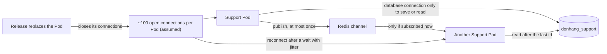

## Before you start

- [[sysdesign.l4.support-chat-design]] — you know ADR `0032`'s path of a message: saved first, published to Redis, passed on by each Pod, read again after the last id.
- [[design.l4.trade-off-points]] — you know a trade-off point is one decision that moves two quality attributes in opposite directions.
- [[backend.l3.retry-jitter]] — you know jitter adds a random part to each wait, so clients that failed together come back spread over time.
- [[devops.l4.release-strategy-per-component]] — you know ADR `0019` gives each component the release strategy its traffic allows, and that a route weight reaches only what passes through the Gateway.

## The situation

The design review for chat goes round before anything is built. Three replies come back. A backend developer points at the estimate, about 1.7 messages per second at the busy hour (assumed), far below what `api` already handles, and asks why chat needs a capacity plan at all. The person who runs PostgreSQL asks whether `max_connections` caps how many customers can chat. The release owner asks what happens to two hundred open chat screens every time Support is deployed.

What does support chat actually run out of, and what does each choice in ADR `0032` pay for what it gets?

## Core concepts

- open connections as the scarce resource — each chat screen holds one connection to a Support Pod for minutes, mostly with nothing to send, and the Pod must keep all of them at once.
- a database connection per save or read, not per screen — a Support Pod uses a database connection only while it saves or reads messages; `max_connections`, PostgreSQL's cap on connections open to the server at the same time, bounds those, not chat screens.
- the reconnect wave — every release closes the connections of each replaced Pod at once, and all those apps try to connect again.
- the relay that may miss — Redis passes a message only to Pods subscribed at that moment, at most once, and the design accepts that because the database keeps every message.
- the fallback that stays — asking the API again every few seconds (polling), rejected as the main path, kept for apps that cannot open a connection.

## How it works



In the situation above, the first reply counts the wrong thing. The review estimates about 200 open connections at the busy hour, about 100 on each of two Pods (assumed). Mostly idle, each one stays open on its Pod. A Pod can keep only so many open at once, so the plan holds the peak below a measured limit, with headroom. Messages per second say how often the database is written; open connections say how many the Pods must hold. So the review names connections at the peak as the scarce resource, and Support's capacity plan counts them, not requests per second.

The second reply mixes two kinds of connection. A chat screen is connected to a Support Pod, not to PostgreSQL; a Pod uses a database connection only while it saves or reads messages, about 1.7 short writes per second at the busy hour (assumed). `max_connections`, the cap on connections open to the server at the same time, therefore bounds how many saves and reads all services can run at once, not how many customers are connected.

The third reply is the release. A rolling update replaces each Pod, and the replaced Pod's connections close. Its apps reconnect after a wait with jitter, so they do not all return at the same moment, and each reads after its last id from `donhang_support`. A message published while an app was away does not reach that app. Redis passes it only to Pods subscribed then, none holding that app's connection, and does not send it again; the saved row is where the app finds it.

## In the Đơn Hàng system

The review's step on bottlenecks names the scarce resource and the relay's failure case:

```markdown file=docs/design/support-chat-design-review.md tag=stage-4 lines=59-68
### Nút cổ chai và điểm hỏng đơn lẻ (bước 5)

- Tài nguyên khan hiếm là số kết nối giữ mở mỗi Pod, phần lớn thời gian không
  có tin; kế hoạch dung lượng của Support đếm kết nối ở giờ đông, không đếm
  request mỗi giây.
- Kết nối chat không giữ kết nối database: Pod chỉ mở một kết nối khi lưu hay
  đọc tin. `max_connections` giới hạn tốc độ ghi tin, không giới hạn số khách
  đang nối.
- Redis (1 bản): sập thì chỉ mất chuyển tiếp giữa Pod; tin vẫn lưu, app đọc lại
  khi nối lại.
```

The first two bullets answer the first two replies; the second bullet's "tốc độ ghi tin" means how many saves and reads run at once, as above. Compare `capacity-plan.md`: for `api` it counts product reads and orders per second, because each request is short. Its rule for database connections still applies: `donhang_support` lives on the server `db`, as ADR `0032` decides, so each Support Pod adds its own database connections to the sum that `capacity-plan.md` keeps below `max_connections`. That sum grows with Support's Pods, not with screens. The third bullet is the relay's failure case.

The rejected options, among them SignalR, ASP.NET Core's real-time library, and the three trade-off points follow. The drivers they cite say: 1, a message reaches an open screen within seconds; 2, no message is lost when the relay fails; 4, chat never takes capacity that ordering needs.

```markdown file=docs/design/support-chat-design-review.md tag=stage-4 lines=72-84
### Phương án bị loại và điểm đánh đổi (bước 3 và 4)

- Hỏi lại mỗi vài giây: tải theo số màn hình × tần suất, tin chờ tới một chu
  kỳ; giữ làm đường lui.
- Module trong `DonHang.Api`: dùng chung Pod, giới hạn, canary với việc nhận
  đơn (trái driver 4).
- SignalR: hoãn, vì ASP.NET Core không có client SignalR cho Dart.
- Điểm đánh đổi, kết nối giữ mở so với hỏi lại: tin tới ngay (driver 1), đổi lại
  một tài nguyên mới phải đếm và mỗi lần phát hành đóng kết nối.
- Điểm đánh đổi, Redis nhiều nhất một lần: chuyển tin rẻ, chấp nhận vì
  PostgreSQL là bản ghi (driver 2).
- Điểm đánh đổi, WebSocket tự viết so với SignalR: tự viết nối lại và chuyển
  giữa Pod, đổi lại không cần client Dart chưa có.
```

Asking again every few seconds needs nothing new, but its load grows with open screens times frequency, and a message waits up to one interval. With 200 screens asking every 5 seconds (assumed), that is 40 requests per second that mostly find nothing. The module inside `DonHang.Api` was the previous lesson's rejected option. SignalR would give reconnection in its clients and passing messages between Pods through Redis, without the team writing either itself. ASP.NET Core's documented SignalR clients include none for Dart, which `DonHang.App` is written in.

ADR `0032` adds the release rule: rolling updates under ADR `0019`, because a Gateway weight decides only where new connections go; connections already open stay on the old Pod until it stops. It reopens when connections per Pod use up the headroom below the measured limit, or when ASP.NET Core ships an official SignalR client for Dart.

## Trade-offs

| Trade-off point | What the design buys | What it pays | What holds the cost, or reopens it |
|---|---|---|---|
| Connection held open instead of asking again | a message reaches the open screen at once (driver 1) | a new resource to count, and every release closes connections | the capacity plan counts connections; connections per Pod that use up the headroom below the measured limit reopen ADR `0032` |
| Redis relay, at most once | cheap delivery between Pods | a Pod not subscribed at that moment misses the message | PostgreSQL is the record, so a reconnecting app reads it (driver 2) |
| Hand-written WebSocket instead of SignalR | no Dart client that does not exist | the team writes reconnection and the relay between Pods itself | an official SignalR client for Dart reopens it |
| Rolling update instead of a canary weight | no canary Deployment, whose weight would move only new connections | each replaced Pod's apps reconnect, spread by jitter | reading after the last id loses nothing |

The opposite of the first row is right in another context. With few chat screens and replies that may wait some seconds, asking again costs little and adds no resource to count, no relay and no reconnect wave.

## What would you choose if…

…the busy hour doubled to about 200 open connections per Pod (assumed), while messages per second stayed the same? The writes would not change, so `max_connections` is not the question. Connections per Pod are, and ADR `0032`'s revisit condition asks whether they use up the headroom below the measured limit, before anyone adds Pods.

…ASP.NET Core shipped an official SignalR client for Dart? That meets the revisit condition: the team would weigh ready-made reconnection and relay against rewriting a working path, in a new ADR superseding `0032`.

…only a few customers a day used chat? Asking again every few seconds would load the API little, and a one-interval wait may be acceptable. The review chose open connections because driver 1 asks for seconds at the busy hour; with a weaker driver, the fallback could be the whole design.

## Seniors often assume…

- **"A connection that sends nothing costs nothing, so idle chat screens are free."** → Actually each open screen holds a connection on a Support Pod for minutes, and the Pod must keep all of them at once, so the plan counts connections at the peak. You notice this when messages per second stay tiny while connections per Pod eat into the headroom at the busy hour.
- **"Each open chat needs its own database connection, so `max_connections` caps how many customers can chat."** → Actually a Pod uses a database connection only while it saves or reads messages, so `max_connections` bounds how many saves and reads run at once, not how many customers chat. You notice this when open chats double and Support's database connections in use do not.
- **"A release that restarts the chat Pods loses the messages that were on their way."** → Actually every message is saved before delivery, and an app that reconnects after its jittered wait reads after its last id from `donhang_support`. You notice this when chat screens blink during a deploy and then show every reply, the missed ones first.
- **"Polling is always the wrong choice for chat."** → Actually asking again every few seconds needs nothing new and is right when screens are few and a reply may wait one interval. You notice this when a network that blocks the connection still gets replies, a few seconds late.

## Try it (3 minutes)

For each event, name the trade-off point or rule it touches and say what customers see:

1. Support is deployed by rolling update at the busy hour.
2. A teammate proposes raising `max_connections` so more customers can chat.
3. Redis restarts while a staff member, on Pod 1, replies to a customer connected to Pod 2.
4. A customer's network does not let the chat connection open.

Expected result: four answers, each naming one trade-off point or rule from the design review or ADR `0032`.

<details><summary>Suggested answer</summary>

1. Rolling update and the reconnect wave: each replaced Pod's chats close, the apps reconnect after a jittered wait and read after their last id; customers see a short gap, no lost reply.
2. A database connection per save or read: chat screens hold no database connection, so this would not let more customers chat; connections per Pod are what to measure.
3. The relay that may miss: the reply is saved, but Redis does not pass it to Pod 2; nothing in the design closes the app's connection when Redis restarts, so the customer sees the reply only when the app next reconnects, such as at a release, and reads after its last id.
4. The fallback: the app asks again every few seconds, and replies arrive up to one interval late.

</details>

## Connections

- [[sysdesign.l4.support-chat-design]] — the design whose costs this lesson lists.
- [[design.l4.trade-off-points]] — the idea applied here four times.
- [[backend.l4.capacity-planning]] — the same method with a different count: connections at the peak instead of requests per second.
- [[sysdesign.l4.finding-bottlenecks]] — the method's step on bottlenecks, which names the scarce resource here.
- [[backend.l3.retry-jitter]] — the same spread, for reconnecting apps instead of retrying refunds.
- [[devops.l4.release-strategy-per-component]] — why chat gets a rolling update: a weight moves new connections, not open ones.
- [[backend.l2.at-least-once-jobs]] — the opposite delivery promise; chat's relay settles for at most once because the database is the record.
- [[frontend.l4.library-reach]] — the same question as SignalR: a library is only an option where the client can use it.
- [[sysdesign.l4.support-chat-challenges]] — the next step: answering the review's challenges from ADRs.

## Five-line summary

1. Support chat runs out of open connections per Pod, held for minutes and mostly idle, so its plan counts connections, not requests.
2. A chat screen holds no database connection; `max_connections` bounds how many saves and reads run at once, not how many customers chat.
3. Every release closes each replaced Pod's connections; apps reconnect after a jittered wait, and a Gateway weight moves only new connections.
4. Redis passes each message at most once; the design accepts it because PostgreSQL keeps every message for the reconnecting app.
5. Asking every few seconds stays the fallback, and SignalR is deferred because ASP.NET Core documents no SignalR client for Dart.
