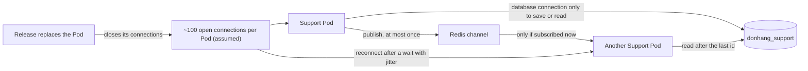

## Bạn cần biết trước

- [[sysdesign.l4.support-chat-design]] — bạn đã biết đường đi của một tin theo ADR `0032`: lưu trước, publish lên Redis, mỗi Pod chuyển tiếp, đọc lại sau id cuối.
- [[design.l4.trade-off-points]] — bạn biết điểm đánh đổi là một quyết định đẩy hai thuộc tính chất lượng đi hai hướng ngược nhau.
- [[backend.l3.retry-jitter]] — bạn biết jitter thêm một phần ngẫu nhiên vào mỗi lần chờ, nên các client cùng hỏng một lúc sẽ quay lại rải đều theo thời gian.
- [[devops.l4.release-strategy-per-component]] — bạn biết ADR `0019` cho mỗi thành phần chiến lược phát hành mà lưu lượng của nó cho phép, và weight của một route chỉ tác động tới những gì đi qua Gateway.

## Tình huống

Bản review thiết kế cho chat được gửi đi xin ý kiến trước khi xây gì. Có ba phản hồi. Một developer backend chỉ vào phần ước lượng, khoảng 1,7 tin mỗi giây lúc giờ đông (giả định), thấp xa so với những gì `api` đang chịu, và hỏi sao chat lại cần kế hoạch dung lượng. Người vận hành PostgreSQL hỏi `max_connections` có giới hạn số khách chat được không. Người phụ trách phát hành hỏi chuyện gì xảy ra với hai trăm màn hình chat đang mở mỗi lần Support được deploy.

Chat hỗ trợ thật ra cạn thứ gì trước, và mỗi lựa chọn trong ADR `0032` trả giá gì cho thứ nó nhận được?

## Khái niệm cốt lõi

- kết nối đang mở là tài nguyên khan hiếm — mỗi màn hình chat giữ một kết nối tới một Pod Support trong nhiều phút, phần lớn thời gian không có gì để gửi, và Pod phải giữ tất cả cùng lúc.
- kết nối database theo mỗi lần lưu hay đọc, không theo màn hình — Pod Support chỉ dùng một kết nối database trong lúc lưu hay đọc tin. `max_connections`, giới hạn của PostgreSQL về số kết nối mở tới server cùng lúc, chặn những kết nối đó, không chặn màn hình chat.
- đợt nối lại — mỗi lần phát hành đóng cùng lúc mọi kết nối của từng Pod bị thay, và tất cả các app đó cùng thử nối lại.
- kênh chuyển tiếp có thể lỡ — Redis chỉ trao tin cho các Pod đang đăng ký đúng lúc đó, nhiều nhất một lần, và thiết kế chấp nhận điều này vì database giữ mọi tin.
- đường lui được giữ lại — hỏi lại API mỗi vài giây (polling), bị loại khỏi vai trò đường chính, giữ lại cho các app không mở được kết nối.

## Cơ chế hoạt động



Trong tình huống trên, phản hồi đầu tiên đếm sai thứ. Bản review ước lượng khoảng 200 kết nối đang mở lúc giờ đông, khoảng 100 trên mỗi Pod trong hai Pod (giả định). Dù phần lớn thời gian im lặng, mỗi kết nối vẫn mở trên Pod của nó. Một Pod chỉ giữ được chừng ấy kết nối cùng lúc, nên kế hoạch giữ đỉnh dưới một giới hạn đã đo, kèm khoảng dư. Số tin mỗi giây cho biết database bị ghi thường xuyên tới đâu. Số kết nối đang mở cho biết các Pod phải giữ bao nhiêu. Vì vậy bản review gọi tên kết nối lúc đỉnh là tài nguyên khan hiếm, và kế hoạch dung lượng của Support đếm kết nối, không đếm request mỗi giây.

Phản hồi thứ hai trộn hai loại kết nối. Màn hình chat nối tới một Pod Support, không nối tới PostgreSQL. Pod chỉ dùng kết nối database trong lúc lưu hay đọc tin, khoảng 1,7 lần ghi ngắn mỗi giây lúc giờ đông (giả định). Do đó `max_connections`, giới hạn số kết nối mở tới server cùng lúc, chặn số lần lưu và đọc mà mọi service chạy được cùng lúc, không chặn số khách đang nối.

Phản hồi thứ ba là chuyện phát hành. Rolling update thay từng Pod, và các kết nối của Pod bị thay đóng lại. App của nó nối lại sau một khoảng chờ có jitter, nên không quay về cùng một lúc, và mỗi app đọc sau id cuối từ `donhang_support`. Tin được publish trong lúc app vắng mặt không tới app đó. Redis chỉ trao tin cho các Pod đang đăng ký lúc ấy, không Pod nào giữ kết nối của app, và không gửi lại. Dòng đã lưu là nơi app tìm thấy tin.

## Trong hệ thống Đơn Hàng

Bước về nút cổ chai trong bản review gọi tên tài nguyên khan hiếm và trường hợp hỏng của kênh chuyển tiếp:

```markdown file=docs/design/support-chat-design-review.md tag=stage-4 lines=59-68
### Nút cổ chai và điểm hỏng đơn lẻ (bước 5)

- Tài nguyên khan hiếm là số kết nối giữ mở mỗi Pod, phần lớn thời gian không
  có tin; kế hoạch dung lượng của Support đếm kết nối ở giờ đông, không đếm
  request mỗi giây.
- Kết nối chat không giữ kết nối database: Pod chỉ mở một kết nối khi lưu hay
  đọc tin. `max_connections` giới hạn tốc độ ghi tin, không giới hạn số khách
  đang nối.
- Redis (1 bản): sập thì chỉ mất chuyển tiếp giữa Pod; tin vẫn lưu, app đọc lại
  khi nối lại.
```

Hai gạch đầu dòng đầu trả lời hai phản hồi đầu. "tốc độ ghi tin" ở gạch thứ hai nghĩa là số lần lưu và đọc chạy cùng lúc, như đã nói ở trên. So với `capacity-plan.md`: với `api`, file này đếm lượt đọc sản phẩm và số đơn mỗi giây, vì mỗi request đều ngắn. Quy tắc về kết nối database của nó vẫn áp dụng. `donhang_support` nằm trên server `db`, như ADR `0032` quyết định, nên mỗi Pod Support cộng thêm kết nối database của mình vào tổng mà `capacity-plan.md` giữ dưới `max_connections`. Tổng đó tăng theo số Pod của Support, không theo số màn hình. Gạch thứ ba là trường hợp hỏng của kênh chuyển tiếp.

Tiếp theo là các phương án bị loại, trong đó có SignalR, thư viện real-time của ASP.NET Core, và ba điểm đánh đổi. Các yếu tố được viện dẫn là: yếu tố 1, tin tới một màn hình đang mở trong vài giây, yếu tố 2, không mất tin khi kênh chuyển tiếp hỏng, và yếu tố 4, chat không bao giờ lấy phần năng lực mà đặt đơn cần.

```markdown file=docs/design/support-chat-design-review.md tag=stage-4 lines=72-84
### Phương án bị loại và điểm đánh đổi (bước 3 và 4)

- Hỏi lại mỗi vài giây: tải theo số màn hình × tần suất, tin chờ tới một chu
  kỳ; giữ làm đường lui.
- Module trong `DonHang.Api`: dùng chung Pod, giới hạn, canary với việc nhận
  đơn (trái driver 4).
- SignalR: hoãn, vì ASP.NET Core không có client SignalR cho Dart.
- Điểm đánh đổi, kết nối giữ mở so với hỏi lại: tin tới ngay (driver 1), đổi lại
  một tài nguyên mới phải đếm và mỗi lần phát hành đóng kết nối.
- Điểm đánh đổi, Redis nhiều nhất một lần: chuyển tin rẻ, chấp nhận vì
  PostgreSQL là bản ghi (driver 2).
- Điểm đánh đổi, WebSocket tự viết so với SignalR: tự viết nối lại và chuyển
  giữa Pod, đổi lại không cần client Dart chưa có.
```

Hỏi lại mỗi vài giây không cần thêm gì mới, nhưng tải của nó tăng theo số màn hình đang mở nhân tần suất, và một tin phải chờ tới một chu kỳ. Với 200 màn hình hỏi mỗi 5 giây (giả định), đó là 40 request mỗi giây mà phần lớn không thấy gì. Module bên trong `DonHang.Api` là phương án bị loại ở bài trước. SignalR sẽ cho sẵn phần nối lại trong client của nó và phần chuyển tin giữa các Pod qua Redis, đội không phải tự viết thứ nào. Trong các client SignalR mà ASP.NET Core có tài liệu, không có client nào cho Dart, ngôn ngữ viết `DonHang.App`.

ADR `0032` thêm quy tắc phát hành: rolling update theo ADR `0019`, vì weight của Gateway chỉ quyết kết nối mới đi đâu, kết nối đang mở ở lại Pod cũ tới khi Pod đó dừng. ADR được mở lại khi số kết nối mỗi Pod dùng hết khoảng dư dưới giới hạn đã đo, hoặc khi ASP.NET Core ra một client SignalR chính thức cho Dart.

## Đánh đổi

| Điểm đánh đổi | Thiết kế mua được gì | Cái giá phải trả | Thứ giữ cái giá, hoặc mở lại quyết định |
|---|---|---|---|
| Giữ kết nối mở thay vì hỏi lại | tin tới màn hình đang mở ngay lập tức (yếu tố 1) | một tài nguyên mới phải đếm, và mỗi lần phát hành đóng kết nối | kế hoạch dung lượng đếm kết nối. Số kết nối mỗi Pod dùng hết khoảng dư dưới giới hạn đã đo thì mở lại ADR `0032` |
| Kênh chuyển tiếp Redis, nhiều nhất một lần | chuyển tin giữa các Pod rẻ | Pod không đăng ký đúng lúc đó sẽ lỡ tin | PostgreSQL là bản ghi, nên app nối lại đọc được tin (yếu tố 2) |
| WebSocket tự viết thay vì SignalR | không cần một client Dart chưa tồn tại | đội tự viết phần nối lại và phần chuyển tin giữa các Pod | một client SignalR chính thức cho Dart sẽ mở lại quyết định |
| Rolling update thay vì weight canary | không cần Deployment canary, vốn có weight chỉ dời được kết nối mới | app của mỗi Pod bị thay phải nối lại, được jitter rải ra | đọc sau id cuối nên không mất gì |

Lựa chọn ngược với dòng đầu đúng trong một bối cảnh khác. Khi ít màn hình chat và tin trả lời chờ vài giây cũng được, hỏi lại tốn rất ít và không thêm tài nguyên nào phải đếm, không kênh chuyển tiếp, không đợt nối lại.

## Bạn sẽ chọn gì nếu…

…giờ đông tăng gấp đôi, lên khoảng 200 kết nối đang mở mỗi Pod (giả định), trong khi số tin mỗi giây giữ nguyên? Lượng ghi không đổi, nên `max_connections` không phải là câu hỏi. Số kết nối mỗi Pod mới là câu hỏi, và điều kiện xem lại của ADR `0032` hỏi chúng có dùng hết khoảng dư dưới giới hạn đã đo không, trước khi ai đó thêm Pod.

…ASP.NET Core ra một client SignalR chính thức cho Dart? Điều kiện xem lại đã thỏa: đội sẽ cân phần nối lại và chuyển tiếp làm sẵn với cái giá viết lại một đường đang chạy tốt, trong một ADR mới thay thế `0032`.

…mỗi ngày chỉ vài khách dùng chat? Hỏi lại mỗi vài giây gần như không làm nặng API, và chờ một chu kỳ có thể chấp nhận được. Bản review chọn kết nối đang mở vì yếu tố 1 đòi vài giây lúc giờ đông. Với một yếu tố yếu hơn, đường lui có thể là toàn bộ thiết kế.

## Senior hay nhầm rằng…

- **"Kết nối không gửi gì thì không tốn gì, nên màn hình chat đang im là miễn phí."** → Thực ra mỗi màn hình đang mở giữ một kết nối trên Pod Support trong nhiều phút, và Pod phải giữ tất cả cùng lúc, nên kế hoạch đếm kết nối lúc đỉnh. Bạn sẽ nhận ra khi số tin mỗi giây vẫn rất nhỏ mà số kết nối mỗi Pod ăn dần vào khoảng dư lúc giờ đông.
- **"Mỗi cuộc chat đang mở cần một kết nối database riêng, nên `max_connections` giới hạn số khách chat được."** → Thực ra Pod chỉ dùng kết nối database trong lúc lưu hay đọc tin, nên `max_connections` chặn số lần lưu và đọc chạy cùng lúc, không chặn số khách chat. Bạn sẽ nhận ra khi số cuộc chat đang mở tăng gấp đôi mà số kết nối database Support đang dùng thì không.
- **"Một lần phát hành khởi động lại các Pod chat sẽ làm mất những tin đang trên đường đi."** → Thực ra mọi tin được lưu trước khi chuyển, và app nối lại sau khoảng chờ có jitter sẽ đọc sau id cuối từ `donhang_support`. Bạn sẽ nhận ra khi màn hình chat chớp một cái lúc deploy rồi hiện đủ mọi tin trả lời, các tin bị lỡ hiện trước.
- **"Polling luôn là lựa chọn sai cho chat."** → Thực ra hỏi lại mỗi vài giây không cần thêm gì mới, và là lựa chọn đúng khi ít màn hình và tin trả lời chờ một chu kỳ cũng được. Bạn sẽ nhận ra khi một mạng chặn kết nối vẫn nhận được tin trả lời, chỉ trễ vài giây.

## Thử ngay (3 phút)

Với mỗi sự kiện, gọi tên điểm đánh đổi hay quy tắc mà nó chạm tới, và nói khách thấy gì:

1. Support được deploy bằng rolling update lúc giờ đông.
2. Một đồng đội đề nghị tăng `max_connections` để nhiều khách chat được hơn.
3. Redis khởi động lại đúng lúc một nhân viên, ở Pod 1, trả lời một khách đang nối tới Pod 2.
4. Mạng của một khách không cho kết nối chat mở ra.

Kết quả mong đợi: bốn câu trả lời, mỗi câu gọi tên một điểm đánh đổi hay quy tắc trong bản review thiết kế hoặc ADR `0032`.

<details><summary>Gợi ý đáp án</summary>

1. Rolling update và đợt nối lại: chat của mỗi Pod bị thay đóng lại, app nối lại sau khoảng chờ có jitter và đọc sau id cuối. Khách thấy một khoảng ngắt ngắn, không mất tin trả lời nào.
2. Kết nối database theo mỗi lần lưu hay đọc: màn hình chat không giữ kết nối database nào, nên đề nghị này không giúp thêm khách chat được. Thứ cần đo là số kết nối mỗi Pod.
3. Kênh chuyển tiếp có thể lỡ: tin trả lời đã được lưu, nhưng Redis không chuyển nó tới Pod 2. Trong thiết kế không có gì đóng kết nối của app khi Redis khởi động lại, nên khách chỉ thấy tin trả lời ở lần nối lại kế tiếp của app, chẳng hạn lúc phát hành, khi app đọc sau id cuối.
4. Đường lui: app hỏi lại mỗi vài giây, và tin trả lời tới trễ nhiều nhất một chu kỳ.

</details>

## Liên hệ

- [[sysdesign.l4.support-chat-design]] — thiết kế mà bài này liệt kê cái giá.
- [[design.l4.trade-off-points]] — ý tưởng được áp dụng bốn lần ở đây.
- [[backend.l4.capacity-planning]] — cùng phương pháp nhưng đếm thứ khác: kết nối lúc đỉnh thay vì request mỗi giây.
- [[sysdesign.l4.finding-bottlenecks]] — bước về nút cổ chai của phương pháp, bước gọi tên tài nguyên khan hiếm ở đây.
- [[backend.l3.retry-jitter]] — cùng cách rải đều, cho app nối lại thay vì cho lần thử lại hoàn tiền.
- [[devops.l4.release-strategy-per-component]] — vì sao chat dùng rolling update: weight dời kết nối mới, không dời kết nối đang mở.
- [[backend.l2.at-least-once-jobs]] — lời hứa giao tin ngược lại. Kênh chuyển tiếp của chat chấp nhận nhiều nhất một lần vì database là bản ghi.
- [[frontend.l4.library-reach]] — cùng câu hỏi như với SignalR: một thư viện chỉ là phương án ở nơi client dùng được nó.
- [[sysdesign.l4.support-chat-challenges]] — bước tiếp theo: trả lời các câu chất vấn của buổi review bằng ADR.

## Tóm tắt 5 dòng

1. Chat hỗ trợ cạn trước ở số kết nối đang mở mỗi Pod, giữ hàng phút và phần lớn im lặng, nên kế hoạch đếm kết nối, không đếm request.
2. Màn hình chat không giữ kết nối database nào. `max_connections` chặn số lần lưu và đọc chạy cùng lúc, không chặn số khách chat.
3. Mỗi lần phát hành đóng kết nối của từng Pod bị thay. App nối lại sau khoảng chờ có jitter, và weight của Gateway chỉ dời kết nối mới.
4. Redis chuyển mỗi tin nhiều nhất một lần. Thiết kế chấp nhận điều đó vì PostgreSQL giữ mọi tin cho app nối lại.
5. Hỏi lại mỗi vài giây vẫn là đường lui, và SignalR bị hoãn vì ASP.NET Core không có tài liệu về client SignalR nào cho Dart.
