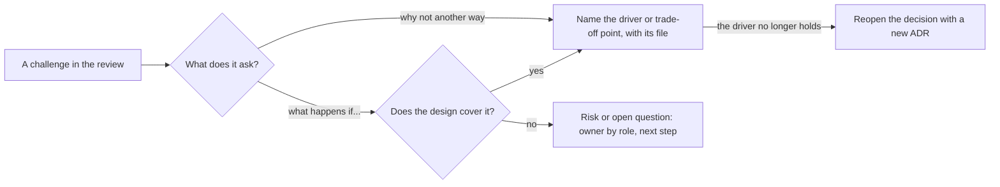

## Before you start

- [[sysdesign.l4.design-review-doc]] — you have the refund review document and its challenge table, which this lesson teaches you to fill.
- [[design.l4.trade-off-points]] — you can name the trade-off point in ADR `0003`: the gateway key in its own service, paid for by order and refund agreeing only later.
- [[management.l4.deciding-under-uncertainty]] — you know a decision states the assumptions and signals that would reopen it; a challenge can be such a signal.

## The situation

The refund design review has started, and the reviewers read the document in advance. One of them asks: calling the payment gateway inside the customer's request needs no status column and no job, so why all the extra parts? Another asks what happens if the gateway allows refunds only for some days after payment. You feel the pull to answer fast: you like messages, and a date check would be easy to add. Both answers would sound confident, yet nobody in the room could check either. What makes an answer to a challenge hold, and what do you say when you have none?

## Core concepts

- a challenge — a reviewer's question asking why the design is not another way, or what happens in a case it may not cover; it tests whether each decision has a reason.
- the reason behind a decision — the architectural driver or trade-off point that made it, named with the file where it is written: a requirement's id in `refund-requirements.md` (YC-1, YC-7, ...), an ADR, a risk in the design doc.
- an uncovered case — a case the design does not handle yet; it becomes a risk or an open question with an owner by role and a next step.
- a changed driver — a challenge that shows a requirement behind a decision no longer holds; the answer is a new ADR, not a defence of the old one.

## How it works



In the situation above, both questions are challenges, but of two kinds. The first asks why the design is not another way. A good answer names what decided it: calling the gateway in the request was rejected because of YC-7, which says a refund request is accepted and answered within 2 seconds even when the gateway fails. A liking for messages is not a reason a reviewer can check; YC-7 is, by opening `refund-requirements.md`.

The second asks what happens in a case. First look for it in the design: many such questions already have answers in the deep dive, such as what happens when the gateway is down for two days. When the design really does not cover the case, the answer is that it is not known yet. The question goes into the challenge table as open, with the role who will answer it and a next step. A date check invented in the session would be an untested change that no driver asked for.

A challenge is not a verdict that the design is wrong; it tests whether each decision traces to a reason. Sometimes the trace shows the reason is gone, because a driver has changed since the decision. Then the right answer is not to defend the decision. It is to reopen it with a new ADR that replaces the old one.

## In the Đơn Hàng system

The method file ends with sample challenges to the refund design and the rule for a changed driver:

```markdown file=docs/design/system-design-method.md tag=stage-4 lines=159-176
### Ví dụ hoàn tiền: câu hỏi phản biện

- Vì sao không gọi cổng ngay trong request của khách? YC-7: cổng lỗi hay chậm
  thì khách chờ rồi nhận lỗi, và yêu cầu không được ghi lại.
- Vì sao không dùng two-phase commit? ADR 0003 và `refund-design.md`: RabbitMQ
  và API HTTP của cổng không tham gia được transaction như thế.
- Cổng lỗi hai ngày thì sao? YC-10: thử lại 24 giờ, rồi dòng thành `failed`,
  đơn quay về `paid` và hiện cho nhân viên (YC-6).
- Gửi lại có hoàn hai lần không? Không, theo YC-9: mọi lần gửi lại dùng cùng key
  `refund-<id>`.
- Cổng không nhận idempotency key thì sao? Rủi ro R2 trong `refund-design.md`:
  bước gửi phải hỏi trạng thái hoàn tiền trước mỗi lần gửi lại.
- Cổng cho hoàn tiền tối đa bao nhiêu ngày sau thanh toán? Chưa biết. Đây là
  câu hỏi mở trong `refund-requirements.md`; bên cung cấp cổng trả lời, product
  owner hỏi.

Quy tắc: câu phản biện cho thấy một driver đã đổi thì quyết định được mở lại
bằng một ADR mới, không bảo vệ quyết định cũ trong buổi review.
```

Every answer points somewhere a reviewer can open. The first two answer "why not another way" with YC-7 and with ADR `0003` plus `refund-design.md`; two-phase commit is rejected because RabbitMQ and the gateway's HTTP API cannot take part in such a transaction. The next two answer "what happens if" with YC-10, YC-6 and YC-9, cases the design already covers. The fifth points to risk R2, a case the design names but does not yet handle, so it takes the diagram's "no" branch: a risk that says how the sending step would change. The last answers "not known yet" and names who answers and who asks. The closing rule matches the diagram's last arrow.

That last challenge comes from a question the requirements already left open:

```markdown file=docs/team/refund-requirements.md tag=stage-4 lines=52-59
## Câu hỏi mở

| Câu hỏi | Ai trả lời | Hạn |
|---|---|---|
| Cổng thanh toán cho hoàn tiền tối đa bao nhiêu ngày sau khi thanh toán? | Bên cung cấp cổng thanh toán, product owner hỏi | Tuần đầu Sprint 15 |
| Đơn chuyển khoản ngân hàng có hoàn qua cổng thanh toán được không? | Bên cung cấp cổng thanh toán, product owner hỏi | Tuần đầu Sprint 15 |
| Kế toán cần danh sách hoàn tiền dạng nào, bao lâu một lần? | Kế toán | Cuối Sprint 15 |
| Ai bên chăm sóc khách hàng nhận các yêu cầu bị cổng từ chối? | Trưởng nhóm chăm sóc khách hàng | Trước Sprint 16 |
```

Each open question already has who answers it and by when. The product owner, the person who decides what the refund feature must do, asks the gateway provider. So the honest answer in the review costs little, because the gap is already written down with an owner: "not known yet, it is in the requirements' open questions."

## Trade-offs

| How you answer a challenge | What the reviewer can check | What it costs | When it fits |
|---|---|---|---|
| Name the driver or trade-off point, with its file | the YC number, the ADR or the risk, by opening it | keeping each decision traced to a written reason before the review | a decision the design already made |
| Answer from preference or experience | nothing; the reviewer must trust the speaker | nothing before the review, but the doubt stays | never as the whole answer; experience can suggest where to look |
| Invent a fix on the spot | the fix sounds plausible, but nobody has weighed it against the drivers | an untested change that can break another driver | not in the review; the fix goes in the row's next step, weighed against the drivers after the review |
| Record it as open, with an owner and a next step | who answers, and by when | admitting a gap in front of reviewers | a case the design does not cover, or an answer only someone else has |
| Reopen the decision with a new ADR | which driver changed and what the old decision rested on | rework of the parts built on the decision | the challenge shows a driver behind the decision has changed |

The first answer needs preparation before the review; the review document already asks for it when each rejected option names its driver. The fourth can look weak in the room, but it holds once the owner brings the answer, because the gap was tracked instead of guessed.

## What would you choose if…

…a reviewer asks why refunds are not kept in `DonHang.Api`, which would save running one more service? Name the trade-off point recorded in ADR `0003`. Its context calls the gateway key and the money rows the most sensitive part of the system, and its consequences list the price: one more service to run, and order and refund agreeing only after a while. The answer is the driver and the cost the team accepted, not a claim that services are better.

…a reviewer asks how many refunds a second the Payments service, the refund service from ADR `0003`, must handle? Answer with the estimate, not a guess. The busiest hour has 12,000 orders, taken from `capacity-plan.md`; 1% of them is about 120 refunds, or about 0.03 a second. Both numbers are written in the estimate section of `system-design-method.md`. Say that both are assumptions, so a reviewer who knows a better share can change the number, and the conclusion with it.

…the product owner says in the session that customers must now see the refund completed, not only accepted, within 2 seconds? That changes YC-7, the driver the design starts from. Do not defend the old design against it. Record the change in the challenge table, and reopen the decisions that rest on YC-7 in a new ADR after the review.

## Seniors often assume…

- **"A good designer has a ready answer to every question in the review."** → Actually the method's own sample list ends with a question answered "not known yet", because the gateway provider has not replied. A ready answer to a question nobody can answer yet is a guess. You notice this when a date check promised in a review is later found to reject refunds that YC-1 allows, because the guessed window was shorter than the gateway's.
- **"Answering 'we do not know yet' in a review shows that the design is weak."** → Actually an unknown with an owner and a next step is a tracked assumption, as the open questions table in `refund-requirements.md` shows. A design is weak when its decisions have no reason behind them, not when one fact is still missing. You notice this when the challenge table has no open rows, yet the same question comes back after the code is built.
- **"A challenge from a reviewer means the reviewer thinks the design is wrong."** → Actually a challenge tests whether a decision traces to a driver; most of the method's sample challenges are answered by pointing to a YC number, an ADR or a risk. You notice this when a designer answers every question defensively and the reviewers stop asking, so the one challenge that would have found a changed driver is never asked.

## Try it (3 minutes)

Open the `don-hang` repository at tag `stage-4`, with `docs/team/refund-requirements.md` and `docs/design/refund-design.md` side by side. Answer each challenge with the file and the YC number or line that decides it:

1. "Can the same message arriving twice create two refund rows?"
2. "Can a customer ask for a refund on someone else's order?"
3. "Can an order paid by bank transfer be refunded through the gateway?"

Expected result: the first two trace to a requirement and a design step; the third has no answer in the design and stays open, with an owner.

<details><summary>Suggested answer</summary>

1. No. Step 3 of `refund-design.md`: the message id goes into `inbox_messages` in the same transaction, and a unique index on `order_id` for refund rows also blocks a second row. Step 3 names no YC for this; the closest requirement is YC-9 (an order is never refunded twice), which step 4 cites.
2. No. YC-2 in `refund-requirements.md`, checked in step 1 of `refund-design.md` before the order changes.
3. Not known yet. It is an open question in `refund-requirements.md`: the gateway provider answers, and the product owner asks. In the review it goes into the challenge table as open, not answered with a guess.

</details>

## Connections

- [[sysdesign.l4.design-review-doc]] — the step before: the document whose challenge table these answers fill.
- [[design.l4.trade-off-points]] — what a "why not another way" answer names when two quality attributes pulled apart.
- [[management.l4.deciding-under-uncertainty]] — the same idea at the decision level: assumptions and signals that reopen a choice.
- [[management.l3.weighing-options-in-an-adr]] — where the rejected options and their reasons are written before anyone challenges them.
- [[management.l3.superseding-an-adr]] — how to reopen a decision when a challenge shows its driver has changed.
- [[backend.l4.threat-modeling]] — the same "what happens if" questions, asked boundary by boundary about attacks.
- [[sysdesign.l4.multi-shop-requirements]] — the next lesson: the framework applied to a new problem, starting from decisions already recorded.

## Five-line summary

1. Answer a design challenge with the driver or trade-off point behind the decision, named with the file a reviewer can open.
2. Asked why the gateway is not called inside the customer's request, the answer is YC-7, not a liking for messages.
3. A case the design does not cover becomes a risk or open question with an owner, not a fix invented on the spot.
4. `system-design-method.md` traces its sample challenges to YC numbers, ADR `0003` and risk R2, and answers one "not known yet".
5. When a challenge shows a driver has changed, reopen the decision with a new ADR instead of defending the old one.
