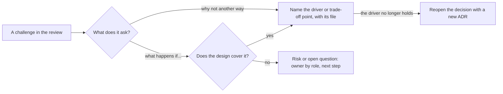

## Bạn cần biết trước

- [[sysdesign.l4.design-review-doc]] — bạn đã có tài liệu review cho hoàn tiền cùng bảng phản biện của nó. Bài này dạy bạn điền bảng đó.
- [[design.l4.trade-off-points]] — bạn gọi được tên điểm đánh đổi trong ADR `0003`: key của cổng thanh toán nằm trong service riêng, đổi lại đơn hàng và hoàn tiền chỉ khớp nhau sau một lúc.
- [[management.l4.deciding-under-uncertainty]] — bạn biết một quyết định ghi rõ các giả định và các tín hiệu sẽ khiến nó được mở lại. Một câu phản biện có thể chính là tín hiệu như thế.

## Tình huống

Buổi review thiết kế hoàn tiền đã bắt đầu, và người review đã đọc tài liệu từ trước. Một người hỏi: gọi cổng thanh toán ngay trong request của khách thì không cần cột trạng thái, cũng không cần job, vậy sao lại thêm chừng ấy thứ? Người khác hỏi chuyện gì xảy ra nếu cổng chỉ cho hoàn tiền trong vài ngày sau khi thanh toán. Bạn muốn trả lời ngay: bạn thích dùng message, và thêm một bước kiểm tra ngày thì dễ thôi. Cả hai câu trả lời đều nghe rất chắc, nhưng không ai trong phòng kiểm chứng được câu nào. Điều gì làm một câu trả lời phản biện đứng vững, và bạn nói gì khi chưa có câu trả lời?

## Khái niệm cốt lõi

- một câu phản biện — câu hỏi của người review: vì sao thiết kế không làm theo cách khác, hoặc chuyện gì xảy ra trong một trường hợp thiết kế có thể chưa tính tới. Nó kiểm tra xem mỗi quyết định có lý do hay không.
- lý do đứng sau một quyết định — yếu tố định hình kiến trúc hoặc điểm đánh đổi đã quyết định nó, nêu kèm file ghi nó: mã một yêu cầu trong `refund-requirements.md` (YC-1, YC-7, ...), một ADR, một rủi ro trong design doc.
- một trường hợp chưa được tính tới — trường hợp thiết kế chưa xử lý. Nó trở thành một rủi ro hoặc một câu hỏi mở, có người phụ trách theo vai trò và một bước tiếp theo.
- một yếu tố định hình đã đổi — câu phản biện cho thấy một yêu cầu đứng sau quyết định không còn đúng nữa. Câu trả lời là một ADR mới, không phải bảo vệ ADR cũ.

## Cơ chế hoạt động



Trong tình huống trên, cả hai câu hỏi đều là câu phản biện, nhưng thuộc hai loại. Câu đầu hỏi vì sao thiết kế không làm theo cách khác. Một câu trả lời tốt nêu ra cái đã quyết định: gọi cổng ngay trong request bị loại vì YC-7, yêu cầu rằng một yêu cầu hoàn tiền được nhận và trả lời trong vòng 2 giây kể cả khi cổng lỗi. Sở thích dùng message không phải lý do mà người review kiểm được. YC-7 thì kiểm được, chỉ cần mở `refund-requirements.md`.

Câu thứ hai hỏi chuyện gì xảy ra trong một trường hợp. Trước hết hãy tìm nó trong thiết kế: nhiều câu hỏi kiểu này đã có lời đáp trong phần đi sâu, chẳng hạn khi cổng sập hai ngày thì sao. Khi thiết kế thật sự chưa tính tới trường hợp đó, câu trả lời là chưa biết. Câu hỏi đi vào bảng phản biện ở trạng thái mở, kèm vai trò sẽ trả lời và một bước tiếp theo. Một bước kiểm tra ngày nghĩ ra ngay trong buổi họp là một thay đổi chưa kiểm chứng mà không yếu tố định hình nào đòi hỏi.

Câu phản biện không phải phán quyết rằng thiết kế sai. Nó kiểm tra xem mỗi quyết định có lần ngược về được một lý do không. Đôi khi lần ngược lại thấy lý do đã mất, vì một yếu tố định hình đã đổi kể từ lúc quyết định. Khi đó câu trả lời đúng không phải là bảo vệ quyết định. Đó là mở lại nó bằng một ADR mới thay thế ADR cũ.

## Trong hệ thống Đơn Hàng

File phương pháp kết thúc bằng các câu phản biện mẫu cho thiết kế hoàn tiền và quy tắc khi một yếu tố định hình đã đổi:

```markdown file=docs/design/system-design-method.md tag=stage-4 lines=159-176
### Ví dụ hoàn tiền: câu hỏi phản biện

- Vì sao không gọi cổng ngay trong request của khách? YC-7: cổng lỗi hay chậm
  thì khách chờ rồi nhận lỗi, và yêu cầu không được ghi lại.
- Vì sao không dùng two-phase commit? ADR 0003 và `refund-design.md`: RabbitMQ
  và API HTTP của cổng không tham gia được transaction như thế.
- Cổng lỗi hai ngày thì sao? YC-10: thử lại 24 giờ, rồi dòng thành `failed`,
  đơn quay về `paid` và hiện cho nhân viên (YC-6).
- Gửi lại có hoàn hai lần không? Không, theo YC-9: mọi lần gửi lại dùng cùng key
  `refund-<id>`.
- Cổng không nhận idempotency key thì sao? Rủi ro R2 trong `refund-design.md`:
  bước gửi phải hỏi trạng thái hoàn tiền trước mỗi lần gửi lại.
- Cổng cho hoàn tiền tối đa bao nhiêu ngày sau thanh toán? Chưa biết. Đây là
  câu hỏi mở trong `refund-requirements.md`; bên cung cấp cổng trả lời, product
  owner hỏi.

Quy tắc: câu phản biện cho thấy một driver đã đổi thì quyết định được mở lại
bằng một ADR mới, không bảo vệ quyết định cũ trong buổi review.
```

Câu trả lời nào cũng trỏ tới một chỗ người review mở ra xem được. Hai câu đầu trả lời "vì sao không làm cách khác" bằng YC-7, và bằng ADR `0003` cùng `refund-design.md`: two-phase commit bị loại vì RabbitMQ và API HTTP của cổng không tham gia được một transaction như thế. Hai câu tiếp trả lời "chuyện gì xảy ra nếu" bằng YC-10, YC-6 và YC-9, những trường hợp thiết kế đã tính tới. Câu thứ năm trỏ tới rủi ro R2, một trường hợp thiết kế có gọi tên nhưng chưa xử lý, nên nó đi theo nhánh "no" của sơ đồ: một rủi ro nói rõ bước gửi sẽ phải đổi ra sao. Câu cuối trả lời "chưa biết", kèm ai trả lời và ai hỏi. Quy tắc khép lại đoạn trích khớp với mũi tên cuối của sơ đồ.

Câu phản biện cuối cùng đến từ một câu hỏi mà tài liệu yêu cầu đã để mở sẵn:

```markdown file=docs/team/refund-requirements.md tag=stage-4 lines=52-59
## Câu hỏi mở

| Câu hỏi | Ai trả lời | Hạn |
|---|---|---|
| Cổng thanh toán cho hoàn tiền tối đa bao nhiêu ngày sau khi thanh toán? | Bên cung cấp cổng thanh toán, product owner hỏi | Tuần đầu Sprint 15 |
| Đơn chuyển khoản ngân hàng có hoàn qua cổng thanh toán được không? | Bên cung cấp cổng thanh toán, product owner hỏi | Tuần đầu Sprint 15 |
| Kế toán cần danh sách hoàn tiền dạng nào, bao lâu một lần? | Kế toán | Cuối Sprint 15 |
| Ai bên chăm sóc khách hàng nhận các yêu cầu bị cổng từ chối? | Trưởng nhóm chăm sóc khách hàng | Trước Sprint 16 |
```

Mỗi câu hỏi mở đã có người trả lời và hạn. Product owner, người quyết định tính năng hoàn tiền phải làm gì, là người đi hỏi bên cung cấp cổng. Vì vậy câu trả lời trung thực trong buổi review chẳng tốn gì mấy, bởi lỗ hổng đã được ghi lại kèm người phụ trách: "chưa biết, nó nằm trong phần câu hỏi mở của tài liệu yêu cầu."

## Đánh đổi

| Cách trả lời một câu phản biện | Người review kiểm được gì | Tốn gì | Hợp khi nào |
|---|---|---|---|
| Nêu yếu tố định hình hoặc điểm đánh đổi, kèm file ghi nó | mã YC, ADR hay rủi ro, bằng cách mở nó ra | phải giữ mỗi quyết định gắn với một lý do đã ghi, trước buổi review | một quyết định thiết kế đã đưa ra |
| Trả lời bằng sở thích hay kinh nghiệm | không gì cả, người review phải tin người nói | không tốn gì trước buổi review, nhưng mối nghi vẫn còn | không bao giờ làm cả câu trả lời. Kinh nghiệm có thể gợi ý nên tìm ở đâu |
| Nghĩ ra cách sửa ngay tại chỗ | cách sửa nghe hợp lý, nhưng chưa ai cân nó với các yếu tố định hình | một thay đổi chưa kiểm chứng, có thể làm vỡ một yếu tố định hình khác | không phải trong buổi review. Cách sửa đi vào cột bước tiếp theo của dòng đó, và được cân với các yếu tố định hình sau buổi review |
| Ghi là mở, kèm người phụ trách và bước tiếp theo | ai trả lời, và trước khi nào | thừa nhận một lỗ hổng trước mặt người review | một trường hợp thiết kế chưa tính tới, hoặc câu trả lời chỉ người khác mới có |
| Mở lại quyết định bằng một ADR mới | yếu tố định hình nào đã đổi, và quyết định cũ dựa trên gì | làm lại những phần xây trên quyết định đó | câu phản biện cho thấy một yếu tố định hình đứng sau quyết định đã đổi |

Cách đầu tiên cần chuẩn bị trước buổi review. Tài liệu review vốn đã đòi điều đó khi mỗi phương án bị loại phải ghi yếu tố định hình của nó. Cách thứ tư có thể trông yếu trong phòng họp, nhưng nó đứng vững khi người phụ trách mang câu trả lời về, vì lỗ hổng đã được theo dõi thay vì bị đoán.

## Bạn sẽ chọn gì nếu…

…người review hỏi vì sao không giữ hoàn tiền trong `DonHang.Api`, đỡ phải chạy thêm một service? Nêu điểm đánh đổi đã ghi trong ADR `0003`. Phần bối cảnh của nó gọi key của cổng và các dòng tiền là phần nhạy cảm nhất của hệ thống, còn phần hệ quả liệt kê cái giá: thêm một service phải chạy, và đơn hàng với hoàn tiền chỉ khớp nhau sau một lúc. Câu trả lời là yếu tố định hình và cái giá nhóm đã chấp nhận, không phải khẳng định rằng service thì tốt hơn.

…người review hỏi service Payments, tức service hoàn tiền trong ADR `0003`, phải xử lý bao nhiêu yêu cầu hoàn tiền mỗi giây? Trả lời bằng ước lượng, đừng đoán. Giờ cao điểm có 12.000 đơn, lấy từ `capacity-plan.md`. 1% trong số đó là khoảng 120 yêu cầu hoàn tiền, tức khoảng 0,03 mỗi giây. Cả hai con số đều ghi trong phần ước lượng của `system-design-method.md`. Nói rõ cả hai đều là giả định, để người review nào biết tỉ lệ sát hơn có thể sửa con số, và sửa luôn kết luận theo nó.

…product owner nói ngay trong buổi họp rằng giờ khách phải thấy hoàn tiền đã xong, không chỉ đã được nhận, trong vòng 2 giây? Điều đó làm đổi YC-7, yếu tố định hình mà thiết kế xuất phát từ đó. Đừng bảo vệ thiết kế cũ trước yêu cầu này. Ghi thay đổi vào bảng phản biện, rồi sau buổi review mở lại các quyết định dựa trên YC-7 bằng một ADR mới.

## Senior hay nhầm rằng…

- **"Người thiết kế giỏi có sẵn câu trả lời cho mọi câu hỏi trong buổi review."** → Thực ra chính danh sách mẫu của phương pháp kết thúc bằng một câu được trả lời "chưa biết", vì bên cung cấp cổng chưa phản hồi. Một câu trả lời có sẵn cho câu hỏi mà chưa ai trả lời được chỉ là phỏng đoán. Bạn sẽ nhận ra khi một bước kiểm tra ngày hứa trong buổi review về sau bị phát hiện là từ chối những yêu cầu hoàn tiền mà YC-1 cho phép, vì khoảng thời gian đoán ra ngắn hơn của cổng.
- **"Trả lời 'chúng tôi chưa biết' trong buổi review cho thấy thiết kế yếu."** → Thực ra một điều chưa biết có người phụ trách và bước tiếp theo là một giả định đang được theo dõi, như bảng câu hỏi mở trong `refund-requirements.md` cho thấy. Thiết kế yếu khi các quyết định của nó không có lý do đứng sau, chứ không phải khi còn thiếu một dữ kiện. Bạn sẽ nhận ra khi bảng phản biện không có dòng nào mở, vậy mà đúng câu hỏi đó quay lại sau khi code đã xây xong.
- **"Người review phản biện nghĩa là họ cho rằng thiết kế sai."** → Thực ra câu phản biện kiểm tra xem một quyết định có lần ngược về được một yếu tố định hình không. Phần lớn câu phản biện mẫu của phương pháp được trả lời bằng cách trỏ tới một mã YC, một ADR hay một rủi ro. Bạn sẽ nhận ra khi người thiết kế trả lời mọi câu hỏi với thái độ phòng thủ và người review thôi không hỏi nữa, nên câu phản biện duy nhất lẽ ra tìm ra một yếu tố định hình đã đổi không bao giờ được hỏi.

## Thử ngay (3 phút)

Mở repository `don-hang` ở tag `stage-4`, đặt `docs/team/refund-requirements.md` và `docs/design/refund-design.md` cạnh nhau. Trả lời từng câu phản biện, kèm file và mã YC hoặc dòng quyết định nó:

1. "Cùng một message đến hai lần có tạo ra hai dòng hoàn tiền không?"
2. "Khách có yêu cầu hoàn tiền cho đơn của người khác được không?"
3. "Đơn thanh toán bằng chuyển khoản ngân hàng có hoàn qua cổng được không?"

Kết quả mong đợi: hai câu đầu lần ngược về một yêu cầu và một bước thiết kế. Câu thứ ba không có lời đáp trong thiết kế và vẫn để mở, kèm người phụ trách.

<details><summary>Gợi ý đáp án</summary>

1. Không. Bước 3 của `refund-design.md`: id của message được ghi vào `inbox_messages` trong cùng transaction, và một unique index trên `order_id` cho các dòng hoàn tiền cũng chặn dòng thứ hai. Bước 3 không nêu YC nào cho chuyện này. Yêu cầu gần nhất là YC-9 (một đơn không bao giờ bị hoàn hai lần), được bước 4 trích dẫn.
2. Không. YC-2 trong `refund-requirements.md`, được kiểm ở bước 1 của `refund-design.md` trước khi đơn thay đổi.
3. Chưa biết. Đây là câu hỏi mở trong `refund-requirements.md`: bên cung cấp cổng trả lời, product owner đi hỏi. Trong buổi review, nó đi vào bảng phản biện ở trạng thái mở, không được trả lời bằng phỏng đoán.

</details>

## Liên hệ

- [[sysdesign.l4.design-review-doc]] — bước trước: tài liệu có bảng phản biện mà các câu trả lời này điền vào.
- [[design.l4.trade-off-points]] — thứ mà câu trả lời "vì sao không làm cách khác" gọi tên khi hai thuộc tính chất lượng kéo về hai phía.
- [[management.l4.deciding-under-uncertainty]] — cùng ý đó ở cấp quyết định: các giả định và tín hiệu khiến một lựa chọn được mở lại.
- [[management.l3.weighing-options-in-an-adr]] — nơi các phương án bị loại và lý do của chúng được ghi lại trước khi ai đó phản biện.
- [[management.l3.superseding-an-adr]] — cách mở lại một quyết định khi câu phản biện cho thấy yếu tố định hình của nó đã đổi.
- [[backend.l4.threat-modeling]] — cùng kiểu câu hỏi "chuyện gì xảy ra nếu", hỏi theo từng ranh giới về các cuộc tấn công.
- [[sysdesign.l4.multi-shop-requirements]] — bài tiếp theo: khung phương pháp áp dụng cho một bài toán mới, bắt đầu từ các quyết định đã ghi.

## Tóm tắt 5 dòng

1. Trả lời câu phản biện bằng yếu tố định hình hoặc điểm đánh đổi đứng sau quyết định, nêu kèm file mà người review mở ra được.
2. Bị hỏi vì sao không gọi cổng ngay trong request của khách, câu trả lời là YC-7, không phải sở thích dùng message.
3. Trường hợp thiết kế chưa tính tới trở thành rủi ro hoặc câu hỏi mở có người phụ trách, không phải cách sửa nghĩ ra tại chỗ.
4. `system-design-method.md` lần ngược các câu phản biện mẫu về mã YC, ADR `0003` và rủi ro R2, và trả lời một câu là "chưa biết".
5. Khi câu phản biện cho thấy một yếu tố định hình đã đổi, hãy mở lại quyết định bằng một ADR mới thay vì bảo vệ quyết định cũ.
