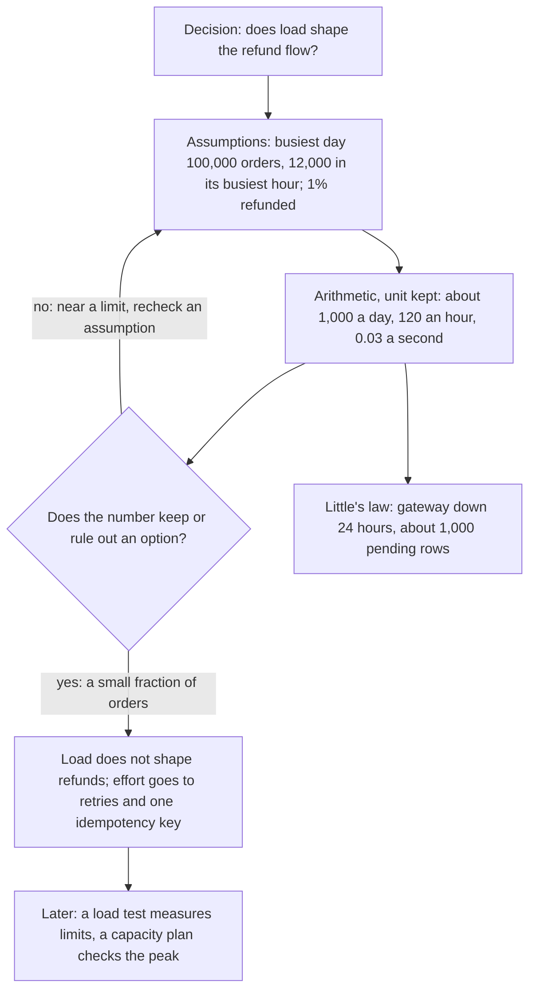

## Before you start

- [[sysdesign.l4.clarifying-requirements]] — you have the ranked refund drivers that step 2 receives: YC-7, YC-9 and the gateway key.
- [[backend.l4.load-testing]] — you know Little's law: requests in flight equal throughput times average time.
- [[backend.l4.capacity-planning]] — you know `capacity-plan.md` derives about 3.3 orders per second in the busiest hour from marked assumptions.

## The situation

You are at step 2 of `docs/design/system-design-method.md`, still looking back at the stage-3 refund flow. A colleague asks whether refunds need a scaling plan of their own, such as more copies of `DonHang.Payments`, the service that sends refund requests to the payment gateway, the outside service that moves the money back. Nobody can answer from the requirements: `refund-requirements.md` gives no number for how many refunds to expect. The method asks for this step before any part is drawn, so there is nothing to measure either. How can a few minutes of arithmetic tell you whether load should shape the refund flow at all?

## Core concepts

- **back-of-the-envelope estimate** — a few minutes of arithmetic with rounded numbers that shows the size of a load or of the data, tens, thousands or millions, not its exact value.
- the decision it serves — the one question the number must settle, such as "does load shape the refund flow?"; the estimate stops once the number settles it.
- stated assumption — an input written with the word "assumed" where it is used, such as the share of orders refunded.
- unit at every step — "per day", "per hour", "per second" carried with each number, so a step that mixes them shows up as wrong.

## How it works



Read the diagram from the top. The estimate starts with a decision, not with numbers: in the situation above, does load shape the refund flow? That question decides which numbers you need and when you may stop.

Next come the assumptions, each marked as one. The order count is not new: it is the busiest day in `capacity-plan.md`. Only the share refunded, 1%, is new, and it is the weakest input.

Then the arithmetic, with the unit at every step: about 1,000 refund requests on the busiest day, about 120 in its busiest hour, about 0.03 per second. The busiest hour is used, not the daily average, because a system fails at its peak.

At the diamond you ask whether the number settles the decision. Here it does: refunds are one hundredth of the order traffic, and the capacity plan already finds that placing 3.3 orders per second is not what limits the system; product reads through `catalog-reads` run out first. So load does not shape refunds; a failing payment gateway does. The design spends its effort on retries and one idempotency key per refund, not on more copies of Payments. A number near a limit would send you back to check an assumption.

In the stage-3 design, each refund request is a row that stays `pending` until the gateway confirms it. Little's law sizes what piles up during a failure. With the gateway down for 24 hours, about 1,000 requests a day times one day is about 1,000 `pending` rows, a count one table holds easily.

Last, the estimate is temporary: once something runs, measurement replaces it.

## In the Đơn Hàng system

The rules of step 2 in the team's method:

```markdown file=docs/design/system-design-method.md tag=stage-4 lines=61-71
### Ước lượng nhanh

- Số làm tròn: hàng chục, hàng nghìn hay hàng triệu, không phải số chính xác.
- Mọi giả định ghi chữ "giả định", ngay tại chỗ dùng.
- Giữ đơn vị ở từng bước (đơn mỗi ngày, rồi đơn mỗi giây), để thấy phép tính
  sai khi đơn vị không khớp.
- Ghi quyết định mà con số phục vụ, và dừng khi con số đã đủ để giữ hay loại
  một phương án.
- Ước lượng đến trước khi có gì để đo. Khi đã đo được (như
  `scripts/backend/load-steps.sh` đo trần đọc trong `capacity-plan.md`), số
  đo thay cho số ước lượng.
```

Line 63 asks for rounded numbers: tens, thousands or millions, not exact ones. Line 64 says every assumption is marked "assumed" where it is used. Lines 65–66 keep the unit at each step, orders per day and then orders per second, so a mismatched unit exposes a wrong step. Lines 67–68 name the decision the number serves and stop once it keeps or rules out an option. Lines 69–71 put the estimate before anything can be measured; once `load-steps.sh` measures a ceiling, as it did for reads in `capacity-plan.md`, the measured number replaces the estimate.

The method's refund estimate, with the rules applied:

```markdown file=docs/design/system-design-method.md tag=stage-4 lines=73-92
### Ví dụ hoàn tiền: ước lượng

Quyết định cần con số: tải có định hình luồng hoàn tiền không.

- Số đơn lấy từ giả định của `capacity-plan.md`, không đặt số mới: 100.000 đơn
  trong ngày đông nhất, 12.000 đơn trong giờ đông nhất của ngày đó (khoảng 3,3
  đơn mỗi giây).
- Tỉ lệ đơn bị yêu cầu hoàn tiền: 1% (giả định).
- Yêu cầu hoàn tiền: khoảng 1.000 mỗi ngày đông nhất, khoảng 120 trong giờ đông
  nhất, tức khoảng 0,03 yêu cầu mỗi giây. Một phần trăm của lượng đơn: một phần
  nhỏ.

Kết luận: tải không định hình luồng hoàn tiền; cổng thanh toán lỗi mới định
hình nó. Vì vậy thiết kế dồn công vào thử lại và idempotency key, không vào
việc mở rộng.

Theo định luật Little, số dòng đang chờ = tốc độ đến × thời gian chờ. Cổng lỗi
24 giờ (YC-10) thì số dòng `pending` khoảng 1.000 yêu cầu mỗi ngày × 1 ngày =
khoảng 1.000 dòng; kể cả khi cả 24 giờ đều đông như giờ đông nhất, 120 mỗi giờ
× 24 giờ là khoảng 3.000 dòng. Một bảng PostgreSQL chứa thoải mái.
```

Line 75 states the decision first. Lines 77–79 reuse the order counts of `capacity-plan.md` instead of inventing new ones, so both documents start from the same assumptions. Line 80 is the only new input, marked as assumed. Lines 81–83 give the size, about 0.03 requests per second, one hundredth of the orders. Lines 85–87 draw the conclusion: a failing gateway shapes the flow, so the effort goes to retries and the idempotency key, not to scaling. Lines 89–92 apply Little's law to the 24 hours of YC-10: about 1,000 `pending` rows, and about 3,000 even if all 24 hours were as busy as the busiest one.

## Trade-offs

| Way to size a design | What it needs | What it can decide | What it cannot decide |
|---|---|---|---|
| No number, plan for as much as possible | nothing | nothing; it adds parts no number explains | whether those parts are needed |
| Back-of-the-envelope estimate | minutes and a few stated assumptions | whether load keeps or rules out an option, such as scaling Payments | how close a peak is to a resource's real limit |
| Load test and capacity plan | a running system, ideally in an environment shaped like production | whether a planned peak fits measured limits with headroom | anything before parts exist to measure |

The estimate is cheap because it only needs the right size, and its weak point is the assumption, not the arithmetic. It is the right tool before any part is drawn. When a number lands near a limit, the estimate has done its job by pointing at what to measure.

## What would you choose if…

…the product owner, the stakeholder who decides what the product does, says refunds could be 5% of orders, not 1%? Redo it: about 5,000 a day, about 600 in the busiest hour, about 0.17 per second, and about 5,000 `pending` rows after 24 hours. The size is still a small fraction of the orders, so the decision stands and you stop.

…a colleague wants the refund share to the decimal before the review? Ask what it would change. Between 0.03 and 0.17 requests per second no part of the design moves, so more precision buys nothing here.

…the gateway stays down for two days? `refund-design.md` turns a row `failed` after 24 hours of retries, the minimum YC-10 asks for, so the `pending` count does not keep growing past the first day. The failed rows go to staff, which is a question about their workload, not about load on the system.

## Seniors often assume…

- **"Estimating in a design means estimating how many days the work will take."** → Actually step 2 sizes the load and the data, because the design needs to know which options are in play; how long the work takes is a planning question with its own tools, such as three-point estimation. You notice this when a review asks "how many per second?" and the design document holds only a schedule.
- **"An estimate is useless unless every number in it is exact."** → Actually the decision needs only the size. The 1% share could be off several times over, and refunds would still be a small fraction of orders. You notice this when a design waits weeks for a precise figure that would not change any part.
- **"If the estimate shows a small load, there is nothing left to design."** → Actually a small load only says that load is not the driver. The refund flow still needs retries for 24 hours, one idempotency key per refund and a place for the requests that wait, sized with Little's law. You notice this when a design with tiny traffic loses requests during its first gateway outage.

## Try it (3 minutes)

Open `docs/design/capacity-plan.md` in the `don-hang` repository at tag `stage-4`.

1. In the result table, lines 20–24, read the orders per day on an average weekday.
2. Redo the method's refund estimate with that number and the same 1% share, keeping the unit at every step: refunds per day, then per second (over the whole day, as the table's "about 0.6 orders per second" does), then `pending` rows after 24 hours of gateway failure.

Expected result: 50,000 orders a day gives about 500 refund requests a day, about 0.006 per second, and about 500 `pending` rows after 24 hours.

Now answer: does the decision change, and why does the method use the busiest day instead?

<details><summary>Suggested answer</summary>

No. A smaller number keeps the same conclusion: load does not shape the refund flow. The method uses the busiest day and its busiest hour, as the capacity plan does, because the system fails at its peak, not on an average day; an estimate made on the average would look safe exactly when it is not.

</details>

## Connections

- [[sysdesign.l4.high-level-design]] — the next step: it draws the parts the estimate kept in play.
- [[backend.l4.capacity-planning]] — the measured counterpart: it checks a planned peak against limits a load test found, after parts exist.
- [[management.l2.three-point-estimation]] — the other kind of estimate, of how long work takes, not of how much load a design carries.
- [[backend.l3.sharding]] — an option an estimate of large data could put in play; the refund numbers keep it out.
- [[backend.l4.read-routing]] — an option the capacity plan keeps for product reads, triggered when their peak passes the primary's headroom.

## Five-line summary

1. A back-of-the-envelope estimate is minutes of rounded arithmetic that shows which designs are in play by the size of the load and data.
2. It starts from stated assumptions, keeps the unit at every step, and stops once the number keeps or rules out an option.
3. The refund estimate reuses `capacity-plan.md`'s order counts and a 1% share: about 0.03 requests per second, a small fraction.
4. So a failing gateway, not load, shapes refunds; Little's law sizes 24 hours of failure at about 1,000 `pending` rows.
5. The estimate comes before anything is built; later a load test measures the limits and a capacity plan checks the peak against them.
