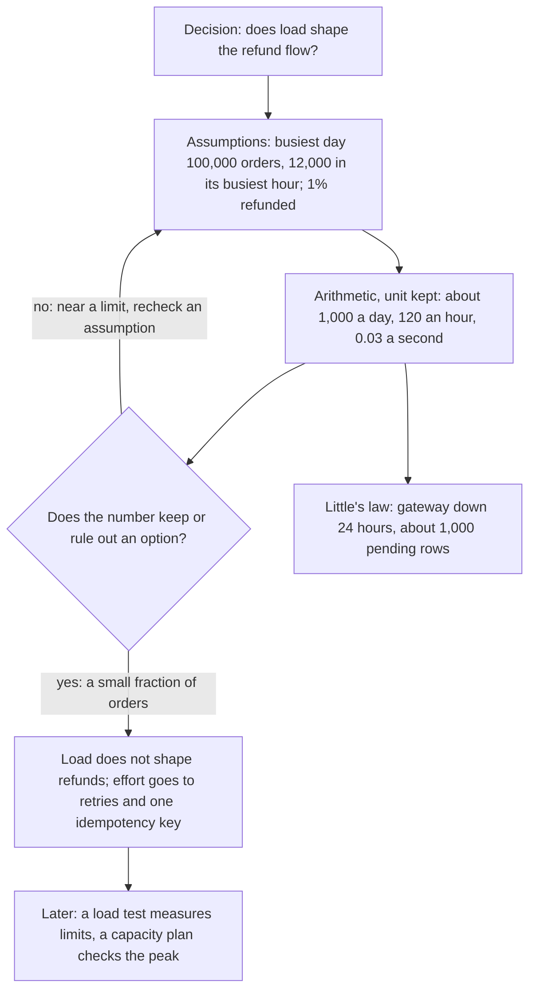

## Bạn cần biết trước

- [[sysdesign.l4.clarifying-requirements]] — bạn có danh sách yếu tố định hình kiến trúc đã xếp hạng của phần hoàn tiền mà bước 2 nhận vào: YC-7, YC-9 và key của cổng thanh toán.
- [[backend.l4.load-testing]] — bạn biết định luật Little: số request đang xử lý dở bằng thông lượng nhân thời gian trung bình.
- [[backend.l4.capacity-planning]] — bạn biết `capacity-plan.md` suy ra khoảng 3,3 đơn mỗi giây trong giờ đông nhất, từ các giả định có ghi rõ.

## Tình huống

Bạn đang ở bước 2 của `docs/design/system-design-method.md`, vẫn nhìn lại luồng hoàn tiền ở stage-3. Một đồng nghiệp hỏi phần hoàn tiền có cần kế hoạch mở rộng riêng không, chẳng hạn thêm bản chạy của `DonHang.Payments`, service gửi yêu cầu hoàn tiền tới cổng thanh toán, tức dịch vụ bên ngoài chuyển tiền lại cho khách. Không ai trả lời được từ yêu cầu: `refund-requirements.md` không có con số nào về số lượt hoàn tiền dự kiến. Phương pháp đặt bước này trước khi vẽ bất kỳ phần nào, nên cũng chưa có gì để đo. Vài phút làm tính có thể cho bạn biết tải có nên định hình luồng hoàn tiền hay không bằng cách nào?

## Khái niệm cốt lõi

- **ước lượng nhanh** (back-of-the-envelope estimate) — vài phút làm tính với số làm tròn, cho thấy cỡ của tải hay của dữ liệu, hàng chục, hàng nghìn hay hàng triệu, chứ không phải giá trị chính xác.
- quyết định mà nó phục vụ — câu hỏi duy nhất con số phải trả lời, như "tải có định hình luồng hoàn tiền không?". Phép ước lượng dừng khi con số đã trả lời được câu đó.
- giả định ghi rõ — một đầu vào kèm chữ "giả định" ngay tại chỗ dùng, như tỉ lệ đơn được hoàn tiền.
- đơn vị ở từng bước — "mỗi ngày", "mỗi giờ", "mỗi giây" đi kèm từng con số, để bước nào trộn lẫn đơn vị lộ ra là sai.

## Cơ chế hoạt động



Đọc sơ đồ từ trên xuống. Phép ước lượng bắt đầu từ một quyết định, không phải từ con số: trong tình huống trên, tải có định hình luồng hoàn tiền không? Câu hỏi đó quyết định bạn cần những con số nào và khi nào được dừng.

Tiếp theo là các giả định, mỗi cái đều ghi rõ là giả định. Số đơn không phải số mới: đó là ngày đông nhất trong `capacity-plan.md`. Chỉ tỉ lệ đơn được hoàn tiền, 1%, là mới, và đó là đầu vào yếu nhất.

Rồi đến phép tính, giữ đơn vị ở từng bước: khoảng 1.000 yêu cầu hoàn tiền trong ngày đông nhất, khoảng 120 trong giờ đông nhất của ngày đó, khoảng 0,03 mỗi giây. Phép tính dùng giờ đông nhất chứ không dùng trung bình cả ngày, vì hệ thống hỏng lúc đỉnh.

Đến hình thoi, bạn hỏi con số đã đủ để quyết chưa. Ở đây là đủ: lượt hoàn tiền chỉ bằng một phần trăm lượng đơn, và kế hoạch dung lượng đã cho thấy 3,3 đơn mỗi giây không phải thứ giới hạn hệ thống. Các lượt đọc sản phẩm qua `catalog-reads` cạn trước. Vậy tải không định hình luồng hoàn tiền, cổng thanh toán lỗi mới định hình nó. Thiết kế dồn công vào thử lại và một idempotency key cho mỗi lượt hoàn tiền, không vào thêm bản chạy của Payments. Nếu con số nằm sát một giới hạn, bạn sẽ quay lại kiểm một giả định.

Trong thiết kế stage-3, mỗi yêu cầu hoàn tiền là một dòng ở trạng thái `pending` cho tới khi cổng xác nhận. Định luật Little tính cỡ những gì dồn lại trong lúc lỗi. Cổng sập 24 giờ thì khoảng 1.000 yêu cầu mỗi ngày nhân một ngày là khoảng 1.000 dòng `pending`, một bảng chứa thoải mái.

Cuối cùng, phép ước lượng chỉ là tạm: khi đã có thứ chạy được, số đo thay cho nó.

## Trong hệ thống Đơn Hàng

Các quy tắc của bước 2 trong phương pháp của đội:

```markdown file=docs/design/system-design-method.md tag=stage-4 lines=61-71
### Ước lượng nhanh

- Số làm tròn: hàng chục, hàng nghìn hay hàng triệu, không phải số chính xác.
- Mọi giả định ghi chữ "giả định", ngay tại chỗ dùng.
- Giữ đơn vị ở từng bước (đơn mỗi ngày, rồi đơn mỗi giây), để thấy phép tính
  sai khi đơn vị không khớp.
- Ghi quyết định mà con số phục vụ, và dừng khi con số đã đủ để giữ hay loại
  một phương án.
- Ước lượng đến trước khi có gì để đo. Khi đã đo được (như
  `scripts/backend/load-steps.sh` đo trần đọc trong `capacity-plan.md`), số
  đo thay cho số ước lượng.
```

Dòng 63 đòi số làm tròn: hàng chục, hàng nghìn hay hàng triệu, không phải số chính xác. Dòng 64 nói mọi giả định đều ghi chữ "giả định" ngay tại chỗ dùng. Dòng 65–66 giữ đơn vị ở từng bước, đơn mỗi ngày rồi đơn mỗi giây, để đơn vị không khớp làm lộ bước tính sai. Dòng 67–68 ghi quyết định mà con số phục vụ và dừng khi con số đã giữ hay loại được một phương án. Dòng 69–71 đặt phép ước lượng trước khi có gì để đo. Khi `load-steps.sh` đã đo được một mức trần, như với lượt đọc trong `capacity-plan.md`, số đo thay cho số ước lượng.

Phần ước lượng hoàn tiền của phương pháp, áp đúng các quy tắc trên:

```markdown file=docs/design/system-design-method.md tag=stage-4 lines=73-92
### Ví dụ hoàn tiền: ước lượng

Quyết định cần con số: tải có định hình luồng hoàn tiền không.

- Số đơn lấy từ giả định của `capacity-plan.md`, không đặt số mới: 100.000 đơn
  trong ngày đông nhất, 12.000 đơn trong giờ đông nhất của ngày đó (khoảng 3,3
  đơn mỗi giây).
- Tỉ lệ đơn bị yêu cầu hoàn tiền: 1% (giả định).
- Yêu cầu hoàn tiền: khoảng 1.000 mỗi ngày đông nhất, khoảng 120 trong giờ đông
  nhất, tức khoảng 0,03 yêu cầu mỗi giây. Một phần trăm của lượng đơn: một phần
  nhỏ.

Kết luận: tải không định hình luồng hoàn tiền; cổng thanh toán lỗi mới định
hình nó. Vì vậy thiết kế dồn công vào thử lại và idempotency key, không vào
việc mở rộng.

Theo định luật Little, số dòng đang chờ = tốc độ đến × thời gian chờ. Cổng lỗi
24 giờ (YC-10) thì số dòng `pending` khoảng 1.000 yêu cầu mỗi ngày × 1 ngày =
khoảng 1.000 dòng; kể cả khi cả 24 giờ đều đông như giờ đông nhất, 120 mỗi giờ
× 24 giờ là khoảng 3.000 dòng. Một bảng PostgreSQL chứa thoải mái.
```

Dòng 75 nêu quyết định trước tiên. Dòng 77–79 dùng lại số đơn của `capacity-plan.md` thay vì đặt số mới, nên hai tài liệu xuất phát từ cùng giả định. Dòng 80 là đầu vào mới duy nhất, có ghi là giả định. Dòng 81–83 cho ra cỡ: khoảng 0,03 yêu cầu mỗi giây, bằng một phần trăm lượng đơn. Dòng 85–87 rút ra kết luận: cổng thanh toán lỗi mới định hình luồng, nên công sức dồn vào thử lại và idempotency key, không vào mở rộng. Dòng 89–92 áp định luật Little cho 24 giờ của YC-10: khoảng 1.000 dòng `pending`, và khoảng 3.000 dòng kể cả khi cả 24 giờ đều đông như giờ đông nhất.

## Đánh đổi

| Cách tính cỡ cho thiết kế | Cần gì | Quyết được gì | Không quyết được gì |
|---|---|---|---|
| Không có con số, chuẩn bị cho mức cao nhất có thể | không gì cả | không gì cả, nó thêm những phần không con số nào giải thích | những phần đó có cần không |
| Ước lượng nhanh | vài phút và vài giả định ghi rõ | tải giữ hay loại một phương án, như mở rộng Payments | lúc đỉnh cách giới hạn thật của một tài nguyên bao xa |
| Kiểm thử tải và kế hoạch dung lượng | một hệ thống đang chạy, tốt nhất trong môi trường giống production | một đỉnh dự kiến có vừa các giới hạn đã đo, kèm khoảng dư, không | bất cứ điều gì trước khi có phần để đo |

Ước lượng nhanh rẻ vì chỉ cần đúng cỡ, và điểm yếu của nó nằm ở giả định, không ở phép tính. Đây là công cụ đúng trước khi vẽ bất kỳ phần nào. Khi một con số rơi sát giới hạn, phép ước lượng đã làm xong việc của nó: chỉ ra thứ cần đo.

## Bạn sẽ chọn gì nếu…

…product owner, bên liên quan quyết định sản phẩm làm gì, nói lượt hoàn tiền có thể là 5% số đơn chứ không phải 1%? Tính lại: khoảng 5.000 mỗi ngày, khoảng 600 trong giờ đông nhất, khoảng 0,17 mỗi giây, và khoảng 5.000 dòng `pending` sau 24 giờ. Cỡ vẫn là một phần nhỏ của lượng đơn, nên quyết định giữ nguyên và bạn dừng.

…một đồng nghiệp muốn biết tỉ lệ hoàn tiền tới từng số thập phân trước buổi review? Hỏi xem con số đó sẽ thay đổi điều gì. Từ 0,03 tới 0,17 yêu cầu mỗi giây, không phần nào của thiết kế xê dịch, nên chính xác hơn ở đây không mua được gì.

…cổng thanh toán sập hai ngày? `refund-design.md` chuyển một dòng sang `failed` sau 24 giờ thử lại, mức tối thiểu YC-10 đòi, nên số dòng `pending` không tăng tiếp sau ngày đầu. Các dòng thất bại được chuyển cho nhân viên, và đó là câu hỏi về khối lượng việc của họ, không phải về tải lên hệ thống.

## Senior hay nhầm rằng…

- **"Ước lượng trong thiết kế nghĩa là ước lượng công việc mất bao nhiêu ngày."** → Thực ra bước 2 tính cỡ của tải và dữ liệu, vì thiết kế cần biết những phương án nào còn đáng xét. Công việc mất bao lâu là câu hỏi lập kế hoạch, có công cụ riêng như ước lượng ba điểm. Bạn sẽ nhận ra khi buổi review hỏi "bao nhiêu mỗi giây?" mà tài liệu thiết kế chỉ có lịch làm việc.
- **"Một phép ước lượng là vô dụng nếu mọi con số trong đó không chính xác."** → Thực ra quyết định chỉ cần cỡ. Tỉ lệ 1% có thể sai vài lần, và lượt hoàn tiền vẫn chỉ là một phần nhỏ của lượng đơn. Bạn sẽ nhận ra khi một thiết kế chờ hàng tuần để lấy một con số chính xác mà không làm đổi phần nào.
- **"Nếu phép ước lượng cho thấy tải nhỏ, thì chẳng còn gì để thiết kế."** → Thực ra tải nhỏ chỉ nói rằng tải không phải yếu tố định hình. Luồng hoàn tiền vẫn cần thử lại trong 24 giờ, một idempotency key cho mỗi lượt hoàn tiền và một chỗ cho các yêu cầu đang chờ, tính cỡ bằng định luật Little. Bạn sẽ nhận ra khi một thiết kế với lưu lượng rất nhỏ vẫn làm mất yêu cầu trong lần cổng thanh toán sập đầu tiên.

## Thử ngay (3 phút)

Mở `docs/design/capacity-plan.md` trong repository `don-hang` ở tag `stage-4`.

1. Trong bảng kết quả, dòng 20–24, đọc số đơn mỗi ngày của một ngày thường trung bình.
2. Làm lại phép ước lượng hoàn tiền của phương pháp với con số đó và cùng tỉ lệ 1%, giữ đơn vị ở từng bước: lượt hoàn tiền mỗi ngày, rồi mỗi giây (tính trên cả ngày, như "khoảng 0,6 đơn mỗi giây" trong bảng), rồi số dòng `pending` sau 24 giờ cổng thanh toán lỗi.

Kết quả mong đợi: 50.000 đơn mỗi ngày cho khoảng 500 yêu cầu hoàn tiền mỗi ngày, khoảng 0,006 mỗi giây, và khoảng 500 dòng `pending` sau 24 giờ.

Giờ trả lời: quyết định có đổi không, và vì sao phương pháp lại dùng ngày đông nhất?

<details><summary>Gợi ý đáp án</summary>

Không. Con số nhỏ hơn vẫn giữ nguyên kết luận: tải không định hình luồng hoàn tiền. Phương pháp dùng ngày đông nhất và giờ đông nhất của ngày đó, như kế hoạch dung lượng, vì hệ thống hỏng lúc đỉnh chứ không phải vào một ngày trung bình. Phép ước lượng dựa trên trung bình sẽ trông an toàn đúng vào lúc nó không an toàn.

</details>

## Liên hệ

- [[sysdesign.l4.high-level-design]] — bước tiếp theo: vẽ các phần mà phép ước lượng giữ lại.
- [[backend.l4.capacity-planning]] — phiên bản dùng số đo: kiểm một đỉnh dự kiến với các giới hạn kiểm thử tải tìm ra, khi các phần đã có.
- [[management.l2.three-point-estimation]] — loại ước lượng kia, về công việc mất bao lâu, không về thiết kế gánh bao nhiêu tải.
- [[backend.l3.sharding]] — một phương án mà ước lượng ra dữ liệu lớn có thể đưa vào cân nhắc, còn các con số hoàn tiền loại nó ra.
- [[backend.l4.read-routing]] — một phương án kế hoạch dung lượng giữ cho lượt đọc sản phẩm, dùng tới khi đỉnh của chúng vượt khoảng dư của primary.

## Tóm tắt 5 dòng

1. Ước lượng nhanh là vài phút làm tính với số làm tròn, cho thấy những thiết kế nào còn đáng xét qua cỡ của tải và dữ liệu.
2. Nó xuất phát từ các giả định ghi rõ, giữ đơn vị ở từng bước, và dừng khi con số đã giữ hay loại được một phương án.
3. Phép ước lượng hoàn tiền dùng lại số đơn của `capacity-plan.md` và tỉ lệ 1%: khoảng 0,03 yêu cầu mỗi giây, một phần nhỏ.
4. Vậy cổng thanh toán lỗi, chứ không phải tải, định hình luồng hoàn tiền. Định luật Little tính 24 giờ lỗi ra khoảng 1.000 dòng `pending`.
5. Phép ước lượng đi trước khi xây bất cứ thứ gì. Về sau kiểm thử tải đo các giới hạn và kế hoạch dung lượng kiểm đỉnh với chúng.
