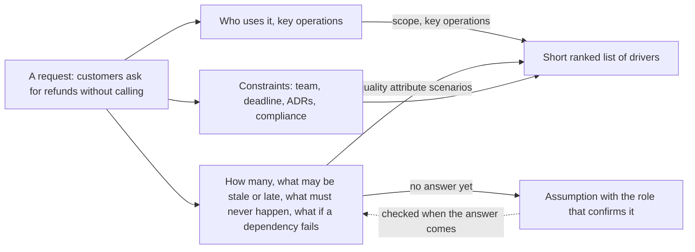

## Before you start

- [[sysdesign.l4.system-design-steps]] — you know step 1 clarifies the requirements and hands the drivers that matter most to the estimate.
- [[design.l4.quality-attribute-scenarios]] — you know YC-7 and YC-10 are quality attribute scenarios: trigger, conditions, required response and measure.
- [[backend.l4.service-level-objectives]] — you know a target such as an SLO comes from a need like YC-7, not from what a dashboard shows today.
- [[design.l4.a-thousand-shops]] — you know the same system gets different drivers when one answer, such as how many shops, changes.

## The situation

Your team now runs every new design problem through `docs/design/system-design-method.md`. To learn it, you redo step 1 of the stage-3 refund work using only `refund-requirements.md`. You start with YC-1 to YC-6: ask for a refund, refuse other people's orders, refund the full amount, show the status, send an email, list rejected refunds for staff. A few endpoints in the existing API seem enough. Yet the refund design that was built split Payments into its own service, joined to the API by a saga, as ADR `0003` records, and nothing in your six features calls for that. Which questions, asked before any part is drawn, change the shape of a design?

## Core concepts

- scope — what the work covers and what it leaves out, such as the out-of-scope list in `refund-requirements.md`.
- key operations — the few things users do that the design must carry, such as a customer asking for a refund and staff reviewing rejected ones.
- constraint — a limit the design must accept that is not a feature: the team, the deadline, a decision already taken in an ADR, a compliance rule.
- assumption — an answer nobody can give yet, written down with the role that will confirm it, so the design can go on.
- ranked drivers — the short list, most important first, of the architectural drivers the later steps must serve.

## How it works



Read the diagram from the left. Step 1 starts from a request and asks three kinds of question before anything is drawn.

The first kind asks who uses the system and what they do. Its answers are the scope and the key operations; in the situation above they are YC-1 to YC-6. They say what the design must carry, but rarely how to split it.

The second kind changes the shape. How many users, operations per second and rows, and at what peak? Which data may be stale or arrive late, and for how long? What must never happen? Which operations must keep working when a dependency fails?

In the refund work, YC-7 answers the last question: the request is answered within 2 seconds even when the gateway fails. That alone rules out calling the gateway inside the customer's request. Instead the API records the request and answers at once, and Payments calls the gateway later in the background; that split is the saga ADR `0003` chose. YC-9 answers "what must never happen", and every resend reusing one idempotency key comes from it. Written with trigger, conditions, response and measure, these answers are quality attribute scenarios.

The third kind collects constraints no feature list shows: who builds it, by when, what earlier ADRs decided, and which compliance rules apply.

Some questions get no answer yet. Each becomes an assumption with a named confirmer, the work goes on, and the dashed arrow shows the design checked again when the answer comes.

The step ends with a short ranked list of drivers, and that list is what the estimate receives. A long list of requirements of equal weight would not tell it what to size.

## In the Đơn Hàng system

The clarifying questions in the team's method, grouped as above:

```markdown file=docs/design/system-design-method.md tag=stage-4 lines=29-44
### Câu hỏi làm rõ

Danh sách tính năng ít khi đổi hình dạng của thiết kế. Các câu hỏi dưới đây
thường đổi được, nên bước 1 hỏi theo từng nhóm:

- Ai dùng, và thao tác chính của họ là gì.
- Bao nhiêu: người dùng, thao tác mỗi giây, dữ liệu, giờ đông nhất.
- Dữ liệu nào được phép cũ, hay được phép đến trễ, và bao lâu.
- Điều gì không bao giờ được xảy ra.
- Khi một phần phụ thuộc hỏng thì thao tác nào phải vẫn chạy.
- Ràng buộc không phải tính năng: đội làm, thời hạn, quyết định đã có trong
  ADR, yêu cầu tuân thủ.

Câu chưa ai trả lời được không chặn thiết kế: nó thành một giả định ghi rõ, kèm
người xác nhận theo vai trò. Thiết kế đi tiếp với giả định đó và được kiểm lại
khi có câu trả lời.
```

Lines 31–32 say a feature list rarely changes a design's shape, so step 1 asks by group. Lines 34–38 are the groups: who uses it and their key operations; how many users, operations per second, data and busiest hour; what data may be stale or late, and for how long; what must never happen; what must keep running when a dependency fails. Lines 39–40 add constraints that are not features: the team, the deadline, decisions already in ADRs, compliance. Lines 42–44: a question nobody can answer does not block the design; it becomes a stated assumption with a confirmer named by role, and is checked when the answer comes. `refund-requirements.md` has the same habit in its open-questions table, where each question names who answers it and by when.

The end of step 1 in the method's refund example:

```markdown file=docs/design/system-design-method.md tag=stage-4 lines=46-59
### Ví dụ hoàn tiền: driver

Đây là nhìn lại luồng hoàn tiền đã làm ở stage-3 (`refund-requirements.md`,
`refund-design.md`, ADR 0003), không quyết lại gì. Driver xếp hạng:

1. YC-7: yêu cầu hoàn tiền được nhận và trả lời trong 2 giây, kể cả khi cổng
   thanh toán lỗi.
2. YC-9: một đơn không bao giờ được hoàn tiền hai lần, kể cả khi phải gửi lại.
3. Khóa API của cổng và các dòng tiền là phần nhạy cảm nhất của hệ thống, như
   bối cảnh của ADR 0003.

YC-1 đến YC-6 thêm tính năng (ai được yêu cầu, số tiền, trạng thái, email,
danh sách cho nhân viên) mà không đổi hình dạng của thiết kế. YC-10 (thử lại
trong 24 giờ) đi theo YC-7 và YC-9.
```

Lines 51–55 rank three drivers: YC-7, YC-9, and the most sensitive part of the system: the gateway's API key, the secret used to call the gateway, and the money rows, the rows of the `payments` table. Lines 57–59 explain the rest: YC-1 to YC-6 add features without changing the shape, and YC-10, retrying for 24 hours, follows from YC-7 and YC-9.

ADR `0003`'s context names the same drivers, plus YC-10, and its decision splits Payments out so the key and the money rows sit in one service of their own. Its consequences answer "what may be late": the order and the refund agree only after a while. Note that the third driver is no YC at all; the feature list did not surface it.

## Trade-offs

| Way to start | Time before the first sketch | What tends to be found late | What a reviewer can check |
|---|---|---|---|
| From the feature list | minutes | the drivers, such as a failing gateway, once parts exist | the features, not why the parts exist |
| Every question answered first | long; it waits for answers that may come weeks later | little, but the design itself starts late | a full requirements file, no design yet |
| The shape questions, assumptions, a ranked list | one short session | an answer that overturns an assumption, at a known point | the drivers, each assumption with its confirmer, the ranking |

The third way costs a session of questions and a list to keep current as answers arrive. It pays back when a part is costly to undo, as splitting Payments out was: ADR `0003` lists another service to run, compensating steps instead of rollback, and an old table left behind. For a change that adds no part and is easy to undo, asking the shape questions in your head is enough.

## What would you choose if…

…the product owner, the stakeholder who decides what the product does, cannot say for weeks how many refunds to expect? Write an assumption, such as a share of orders refunded, name the product owner as the role that confirms it, and go on. When the real number comes, redo the estimate; only an answer of a different size, such as thousands of refund requests per second instead of a fraction of one, would send the sketch back.

…the gateway provider answers one of the questions in the open-questions table of `refund-requirements.md`: how many days after payment a refund is allowed? Ask whether the answer touches a driver. A limit on days decides which orders may ask, so it sits with YC-1 as a feature rule, and the ranked list likely stays the same.

…you join a project whose requirements file lists forty requirements in no order? Rank before you design. Keep the few whose answers would change the parts, and write which of the rest follow from them, as the method does with YC-10.

## Seniors often assume…

- **"The requirements are obvious from the feature list, so asking questions first wastes time."** → Actually features say what the design carries, not how it is split. YC-1 to YC-6 fit inside the existing API and its database; YC-7, YC-9 and the gateway key produced a separate service and a saga. You notice this belief when the first review question, such as "what happens while the gateway is down", forces the diagram to be redrawn.
- **"If nobody knows how many users there will be, the design should assume as many as possible."** → Actually an unknown number becomes a stated assumption with a confirmer, because designing for the maximum adds parts that no driver asks for. The method's refund estimate assumes 1% of orders are refunded, about 1,000 requests on the busiest day, about 120 in its busiest hour, and comes to about 0.03 requests per second, a load that shapes nothing; the next lesson works through such estimates. You notice this when a design has a cache or a second database that no number in it explains.
- **"Every requirement weighs the same, so the design must meet each one at its strictest."** → Actually requirements pull against each other, and the ranking says which one wins. The design that YC-7 ranks first in, a separate Payments service joined by a saga, costs an order and a refund that agree only after a while, as ADR `0003` accepts. You notice this when two requirements block each other and the document has no order to settle it.

## Try it (3 minutes)

Open `docs/team/refund-requirements.md` and `docs/design/system-design-method.md` in the `don-hang` repository at tag `stage-4`.

1. Put each of YC-1 to YC-10 into one group of the method's clarifying questions, lines 34–40.
2. Mark the ones you would expect to change the parts of the design, then compare with the method's lines 51–59.

Expected result: YC-1 to YC-6 fall under who uses it and the key operations, and the method says they add features without changing the shape. YC-7 and YC-10 fall under what must keep running when a dependency fails, YC-9 under what must never happen. YC-8 fits what must never happen, and its reason, accounting, can also be read as a compliance constraint. No requirement says how many refunds to expect.

Now answer: which of the method's three drivers comes from no YC at all, and where does it come from?

<details><summary>Suggested answer</summary>

The third: the gateway's API key and the money rows are the most sensitive part of the system. The method points to ADR `0003`'s context for it, not to `refund-requirements.md`. It is a security concern the team already knew about the system, written in ADR `0003`'s context: where a secret and the money rows may live. Asking only about features misses it.

</details>

## Connections

- [[sysdesign.l4.back-of-the-envelope]] — the next step: it takes the ranked drivers and sizes what they depend on.
- [[management.l2.non-functional-requirements]] — where requirements such as YC-7 to YC-10 were first written; this lesson asks which of them change a design's shape.
- [[design.l4.reduced-atam]] — the same ranked drivers, used later to check a finished design against its scenarios.
- [[backend.l4.cap-theorem]] — the choice that needs the answer to "what may be stale, and for how long".

## Five-line summary

1. Clarify first the needs that change a design's shape: how many, what may be stale or late, what must never happen, what survives a failure.
2. Step 1 turns a request into a scope, key operations, quality attribute scenarios and constraints, before any part is drawn.
3. Constraints that are not features count too: the team, the deadline, decisions already in ADRs, compliance.
4. A question nobody can answer becomes an assumption with the role that confirms it, so the design goes on.
5. The step ends with a short ranked list of drivers; for refunds, YC-7, YC-9 and the gateway key, where ADR `0003` starts.
