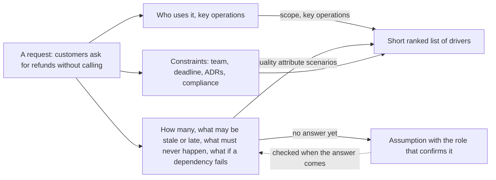

## Bạn cần biết trước

- [[sysdesign.l4.system-design-steps]] — bạn biết bước 1 làm rõ yêu cầu và trao cho bước ước lượng những yếu tố định hình kiến trúc quan trọng nhất.
- [[design.l4.quality-attribute-scenarios]] — bạn biết YC-7 và YC-10 là các kịch bản thuộc tính chất lượng: cái kích hoạt, điều kiện, phản hồi bắt buộc và thước đo.
- [[backend.l4.service-level-objectives]] — bạn biết một mục tiêu như SLO đến từ một nhu cầu như YC-7, không đến từ những gì dashboard đang hiện hôm nay.
- [[design.l4.a-thousand-shops]] — bạn biết cùng một hệ thống sẽ có những yếu tố định hình kiến trúc khác khi một câu trả lời thay đổi, chẳng hạn có bao nhiêu cửa hàng.

## Tình huống

Đội của bạn giờ đưa mọi bài toán thiết kế mới qua `docs/design/system-design-method.md`. Để học phương pháp này, bạn làm lại bước 1 của phần hoàn tiền ở stage-3, chỉ dựa vào `refund-requirements.md`. Bạn bắt đầu với YC-1 đến YC-6: yêu cầu hoàn tiền, từ chối đơn của người khác, hoàn đủ số tiền, hiện trạng thái, gửi email, liệt kê các yêu cầu bị từ chối cho nhân viên. Vài endpoint trong API hiện có có vẻ là đủ. Thế nhưng thiết kế hoàn tiền đã được xây lại tách Payments thành một service riêng, nối với API bằng một saga, như ADR `0003` ghi lại, và không tính năng nào trong sáu tính năng trên đòi điều đó. Những câu hỏi nào, đặt ra trước khi vẽ bất kỳ phần nào, làm đổi hình dạng của một thiết kế?

## Khái niệm cốt lõi

- phạm vi — công việc bao gồm gì và để lại gì bên ngoài, như danh sách ngoài phạm vi trong `refund-requirements.md`.
- thao tác chính — vài việc người dùng làm mà thiết kế phải gánh, như khách yêu cầu hoàn tiền và nhân viên xem lại các yêu cầu bị từ chối.
- ràng buộc — một giới hạn thiết kế phải chấp nhận mà không phải tính năng: đội làm, thời hạn, một quyết định đã có trong ADR, một quy định tuân thủ.
- giả định — một câu trả lời chưa ai đưa ra được, được ghi lại kèm vai trò sẽ xác nhận nó, để thiết kế đi tiếp được.
- danh sách yếu tố xếp hạng — danh sách ngắn, quan trọng nhất đứng đầu, gồm các yếu tố định hình kiến trúc mà những bước sau phải phục vụ.

## Cơ chế hoạt động



Đọc sơ đồ từ trái sang. Bước 1 bắt đầu từ một lời đề nghị và hỏi ba loại câu hỏi trước khi vẽ bất cứ thứ gì.

Loại thứ nhất hỏi ai dùng hệ thống và họ làm gì. Câu trả lời là phạm vi và các thao tác chính, trong tình huống trên chính là YC-1 đến YC-6. Chúng cho biết thiết kế phải gánh gì, nhưng hiếm khi cho biết phải chia nó ra sao.

Loại thứ hai làm đổi hình dạng. Bao nhiêu người dùng, bao nhiêu thao tác mỗi giây, bao nhiêu dòng dữ liệu, và lúc đông nhất là bao nhiêu? Dữ liệu nào được phép cũ hay đến trễ, và trong bao lâu? Điều gì không bao giờ được xảy ra? Thao tác nào phải vẫn chạy khi một phần phụ thuộc hỏng?

Trong phần hoàn tiền, YC-7 trả lời câu cuối: yêu cầu được trả lời trong 2 giây kể cả khi cổng thanh toán lỗi. Chỉ riêng điều đó đã loại bỏ chuyện gọi cổng ngay trong request của khách. Thay vào đó, API ghi yêu cầu lại và trả lời ngay, còn Payments gọi cổng sau, chạy nền. Cách tách đó chính là saga mà ADR `0003` đã chọn. YC-9 trả lời câu "điều gì không bao giờ được xảy ra", và mọi lần gửi lại dùng chung một idempotency key đều xuất phát từ nó. Khi viết thành cái kích hoạt, điều kiện, phản hồi và thước đo, những câu trả lời này là các kịch bản thuộc tính chất lượng.

Loại thứ ba gom các ràng buộc mà danh sách tính năng không cho thấy: ai xây, xong khi nào, các ADR trước đã quyết gì, và quy định tuân thủ nào áp dụng.

Có những câu hỏi chưa có câu trả lời. Mỗi câu thành một giả định kèm tên người xác nhận, công việc đi tiếp, và mũi tên nét đứt cho thấy thiết kế được kiểm lại khi câu trả lời tới.

Bước này kết thúc bằng một danh sách ngắn các yếu tố định hình kiến trúc đã xếp hạng, và bước ước lượng nhận đúng danh sách đó. Một danh sách dài các yêu cầu nặng nhẹ như nhau sẽ không cho bước ước lượng biết phải tính cỡ cho cái gì.

## Trong hệ thống Đơn Hàng

Các câu hỏi làm rõ trong phương pháp của đội, chia nhóm như trên:

```markdown file=docs/design/system-design-method.md tag=stage-4 lines=29-44
### Câu hỏi làm rõ

Danh sách tính năng ít khi đổi hình dạng của thiết kế. Các câu hỏi dưới đây
thường đổi được, nên bước 1 hỏi theo từng nhóm:

- Ai dùng, và thao tác chính của họ là gì.
- Bao nhiêu: người dùng, thao tác mỗi giây, dữ liệu, giờ đông nhất.
- Dữ liệu nào được phép cũ, hay được phép đến trễ, và bao lâu.
- Điều gì không bao giờ được xảy ra.
- Khi một phần phụ thuộc hỏng thì thao tác nào phải vẫn chạy.
- Ràng buộc không phải tính năng: đội làm, thời hạn, quyết định đã có trong
  ADR, yêu cầu tuân thủ.

Câu chưa ai trả lời được không chặn thiết kế: nó thành một giả định ghi rõ, kèm
người xác nhận theo vai trò. Thiết kế đi tiếp với giả định đó và được kiểm lại
khi có câu trả lời.
```

Dòng 31–32 nói danh sách tính năng ít khi đổi hình dạng của thiết kế, nên bước 1 hỏi theo nhóm. Dòng 34–38 là các nhóm: ai dùng và thao tác chính của họ, bao nhiêu người dùng, thao tác mỗi giây, dữ liệu và giờ đông nhất, dữ liệu nào được phép cũ hay trễ và bao lâu, điều gì không bao giờ được xảy ra, thao tác nào phải vẫn chạy khi một phần phụ thuộc hỏng. Dòng 39–40 thêm các ràng buộc không phải tính năng: đội làm, thời hạn, quyết định đã có trong ADR, tuân thủ. Dòng 42–44: câu hỏi chưa ai trả lời được không chặn thiết kế. Nó thành một giả định ghi rõ, kèm người xác nhận theo vai trò, và được kiểm lại khi câu trả lời tới. `refund-requirements.md` có cùng thói quen đó trong bảng câu hỏi còn mở, nơi mỗi câu ghi ai trả lời và trước ngày nào.

Phần kết bước 1 trong ví dụ hoàn tiền của phương pháp:

```markdown file=docs/design/system-design-method.md tag=stage-4 lines=46-59
### Ví dụ hoàn tiền: driver

Đây là nhìn lại luồng hoàn tiền đã làm ở stage-3 (`refund-requirements.md`,
`refund-design.md`, ADR 0003), không quyết lại gì. Driver xếp hạng:

1. YC-7: yêu cầu hoàn tiền được nhận và trả lời trong 2 giây, kể cả khi cổng
   thanh toán lỗi.
2. YC-9: một đơn không bao giờ được hoàn tiền hai lần, kể cả khi phải gửi lại.
3. Khóa API của cổng và các dòng tiền là phần nhạy cảm nhất của hệ thống, như
   bối cảnh của ADR 0003.

YC-1 đến YC-6 thêm tính năng (ai được yêu cầu, số tiền, trạng thái, email,
danh sách cho nhân viên) mà không đổi hình dạng của thiết kế. YC-10 (thử lại
trong 24 giờ) đi theo YC-7 và YC-9.
```

Dòng 51–55 xếp hạng ba yếu tố: YC-7, YC-9, và phần nhạy cảm nhất của hệ thống, tức API key của cổng thanh toán, secret dùng để gọi cổng, cùng các dòng tiền, tức các dòng của bảng `payments`. Dòng 57–59 giải thích phần còn lại: YC-1 đến YC-6 thêm tính năng mà không đổi hình dạng, còn YC-10, thử lại trong 24 giờ, đi theo YC-7 và YC-9.

Bối cảnh của ADR `0003` kể tên đúng những yếu tố này, cộng thêm YC-10, và quyết định của nó tách Payments ra để key và các dòng tiền nằm trong một service riêng. Phần hệ quả của nó trả lời câu "cái gì được phép trễ": đơn hàng và lượt hoàn tiền chỉ khớp nhau sau một lúc. Để ý rằng yếu tố thứ ba không phải YC nào cả. Danh sách tính năng không làm lộ ra nó.

## Đánh đổi

| Cách bắt đầu | Thời gian trước bản phác đầu tiên | Thứ thường bị phát hiện muộn | Người review kiểm được gì |
|---|---|---|---|
| Từ danh sách tính năng | vài phút | các yếu tố định hình kiến trúc, như cổng thanh toán lỗi, khi các phần đã có | các tính năng, không phải lý do các phần tồn tại |
| Trả lời hết mọi câu hỏi trước | lâu, phải chờ những câu trả lời có thể vài tuần sau mới tới | ít, nhưng bản thân thiết kế bắt đầu muộn | một file yêu cầu đầy đủ, chưa có thiết kế |
| Các câu hỏi về hình dạng, giả định, một danh sách xếp hạng | một buổi ngắn | một câu trả lời lật đổ một giả định, ở một điểm đã biết trước | các yếu tố định hình kiến trúc, từng giả định kèm người xác nhận, thứ tự xếp hạng |

Cách thứ ba tốn một buổi đặt câu hỏi và một danh sách phải cập nhật khi câu trả lời tới. Nó đáng giá khi một phần khó gỡ lại, như việc tách Payments ra: ADR `0003` liệt kê thêm một service phải vận hành, các hành động bù thay cho rollback, và một bảng cũ bị bỏ lại. Với thay đổi không thêm phần nào và dễ gỡ lại, tự hỏi trong đầu các câu về hình dạng là đủ.

## Bạn sẽ chọn gì nếu…

…product owner, bên liên quan quyết định sản phẩm làm gì, phải vài tuần nữa mới nói được dự kiến bao nhiêu lượt hoàn tiền? Ghi một giả định, chẳng hạn tỉ lệ đơn được hoàn tiền, ghi product owner là vai trò xác nhận, rồi đi tiếp. Khi con số thật tới, làm lại phần ước lượng. Chỉ một câu trả lời khác hẳn về cỡ, như hàng nghìn yêu cầu hoàn tiền mỗi giây thay vì chưa tới một, mới đẩy bản phác quay lại.

…bên cung cấp cổng thanh toán trả lời một câu trong bảng câu hỏi còn mở của `refund-requirements.md`: sau khi thanh toán bao nhiêu ngày thì còn được hoàn tiền? Hỏi xem câu trả lời có chạm tới yếu tố định hình kiến trúc nào không. Giới hạn số ngày quyết định đơn nào được yêu cầu, nên nó đi cùng YC-1 như một quy tắc tính năng, và danh sách xếp hạng nhiều khả năng giữ nguyên.

…bạn vào một dự án có file yêu cầu liệt kê bốn mươi yêu cầu không theo thứ tự nào? Xếp hạng trước khi thiết kế. Giữ lại vài yêu cầu mà câu trả lời sẽ làm đổi các phần, và ghi rõ những yêu cầu còn lại đi theo yêu cầu nào, như phương pháp làm với YC-10.

## Senior hay nhầm rằng…

- **"Yêu cầu đã rõ từ danh sách tính năng, nên hỏi trước chỉ tốn thời gian."** → Thực ra tính năng cho biết thiết kế gánh gì, không cho biết nó được chia ra sao. YC-1 đến YC-6 vừa vặn trong API hiện có và database của nó, còn YC-7, YC-9 và key của cổng thanh toán sinh ra một service riêng và một saga. Bạn sẽ nhận ra khi câu hỏi review đầu tiên, như "chuyện gì xảy ra lúc cổng thanh toán sập", buộc phải vẽ lại sơ đồ.
- **"Nếu không ai biết sẽ có bao nhiêu người dùng, thiết kế nên giả định càng nhiều càng tốt."** → Thực ra một con số chưa biết thành một giả định ghi rõ kèm người xác nhận, vì thiết kế cho mức tối đa sẽ thêm những phần không yếu tố định hình kiến trúc nào đòi. Phần ước lượng hoàn tiền của phương pháp giả định 1% đơn được hoàn tiền, khoảng 1.000 yêu cầu vào ngày đông nhất, khoảng 120 trong giờ đông nhất của ngày đó, và ra khoảng 0,03 yêu cầu mỗi giây, một mức tải không định hình gì cả. Bài sau đi qua những phép ước lượng như vậy. Bạn sẽ nhận ra khi một thiết kế có cache hay database thứ hai mà không con số nào trong nó giải thích được.
- **"Mọi yêu cầu nặng như nhau, nên thiết kế phải đáp ứng từng yêu cầu ở mức khắt khe nhất."** → Thực ra các yêu cầu kéo ngược nhau, và thứ tự xếp hạng cho biết yêu cầu nào thắng. Thiết kế mà YC-7 đứng đầu, một service Payments riêng nối bằng saga, phải trả giá là đơn hàng và lượt hoàn tiền chỉ khớp nhau sau một lúc, như ADR `0003` chấp nhận. Bạn sẽ nhận ra khi hai yêu cầu chặn nhau và tài liệu không có thứ tự nào để phân xử.

## Thử ngay (3 phút)

Mở `docs/team/refund-requirements.md` và `docs/design/system-design-method.md` trong repository `don-hang` ở tag `stage-4`.

1. Xếp từng yêu cầu từ YC-1 đến YC-10 vào một nhóm trong các câu hỏi làm rõ của phương pháp, dòng 34–40.
2. Đánh dấu những yêu cầu bạn nghĩ sẽ làm đổi các phần của thiết kế, rồi so với dòng 51–59 của phương pháp.

Kết quả mong đợi: YC-1 đến YC-6 rơi vào nhóm ai dùng và thao tác chính, và phương pháp nói chúng thêm tính năng mà không đổi hình dạng. YC-7 và YC-10 rơi vào nhóm thao tác nào phải vẫn chạy khi một phần phụ thuộc hỏng, YC-9 vào nhóm điều gì không bao giờ được xảy ra. YC-8 hợp với nhóm điều gì không bao giờ được xảy ra, và lý do của nó, kế toán, cũng có thể đọc như một ràng buộc tuân thủ. Không yêu cầu nào nói dự kiến bao nhiêu lượt hoàn tiền.

Giờ trả lời: yếu tố nào trong ba yếu tố của phương pháp không đến từ YC nào, và nó đến từ đâu?

<details><summary>Gợi ý đáp án</summary>

Yếu tố thứ ba: API key của cổng thanh toán và các dòng tiền là phần nhạy cảm nhất của hệ thống. Phương pháp dẫn về bối cảnh của ADR `0003` cho yếu tố này, không phải `refund-requirements.md`. Đây là một mối lo bảo mật mà đội đã biết về hệ thống, ghi trong bối cảnh của ADR `0003`: một secret và các dòng tiền được phép nằm ở đâu. Chỉ hỏi về tính năng thì bỏ sót nó.

</details>

## Liên hệ

- [[sysdesign.l4.back-of-the-envelope]] — bước tiếp theo: nhận các yếu tố định hình kiến trúc đã xếp hạng và ước lượng cỡ của những thứ chúng phụ thuộc vào.
- [[management.l2.non-functional-requirements]] — nơi các yêu cầu như YC-7 đến YC-10 được viết ra lần đầu, bài này hỏi yêu cầu nào trong số đó làm đổi hình dạng của thiết kế.
- [[design.l4.reduced-atam]] — cùng danh sách yếu tố xếp hạng đó, dùng về sau để kiểm một thiết kế đã xong theo các kịch bản của nó.
- [[backend.l4.cap-theorem]] — lựa chọn cần câu trả lời cho câu "cái gì được phép cũ, và bao lâu".

## Tóm tắt 5 dòng

1. Trước hết hỏi rõ những nhu cầu làm đổi hình dạng của thiết kế: bao nhiêu, cái gì được phép cũ hay trễ, điều gì không bao giờ được xảy ra, cái gì phải sống sót khi có lỗi.
2. Bước 1 biến một lời đề nghị thành phạm vi, các thao tác chính, các kịch bản thuộc tính chất lượng và các ràng buộc, trước khi vẽ phần nào.
3. Các ràng buộc không phải tính năng cũng tính: đội làm, thời hạn, quyết định đã có trong ADR, tuân thủ.
4. Câu hỏi chưa ai trả lời được thành một giả định kèm vai trò xác nhận nó, để thiết kế đi tiếp.
5. Bước này kết thúc bằng một danh sách ngắn các yếu tố đã xếp hạng, với hoàn tiền là YC-7, YC-9 và key của cổng thanh toán, nơi ADR `0003` bắt đầu.
