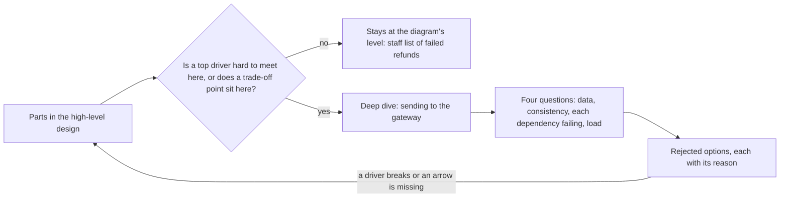

## Before you start

- [[sysdesign.l4.high-level-design]] — you have the refund diagram and the path of each key operation through it.
- [[design.l4.trade-off-points]] — you know ADR `0003`'s saga is a trade-off point: the gateway key gets its own service, but order and refund agree later.
- [[backend.l4.pacelc]] — you know each operation states how current its data must be, even when nothing has failed.
- [[backend.l3.saga]] — you know the refund flow is a chain of local transactions joined by outbox and inbox.

## The situation

The refund diagram is agreed, and you are at step 4 of `docs/design/system-design-method.md`. The team has two afternoons before the review. One colleague, who knows SQL well, starts on the staff list of `failed` refunds: filters, sort order, pagination. Another starts on the wording of the refund emails. Nobody has written down what happens when the gateway times out after taking the money, and the call is sent again. Which part should get the detail, and what must that detail answer?

## Core concepts

- **deep dive** — the detailed design of one part of a system, chosen where a top driver is hardest to meet or a trade-off point sits.
- the method's step 4 — "details one to three parts"; its output is the detailed design of the hardest part, with the options it rejected.
- the four questions — every deep dive answers the same ones about its part: which data it owns, how consistent each operation must be, what it does when each dependency fails, and how it grows with load.
- YC-9 and YC-10 — two refund requirements: no order is ever refunded twice, even when a call is sent again; a failing gateway is retried automatically for at least 24 hours before staff take over (the design retries for exactly 24).
- YC-6 and YC-7 — two more: staff see each refund the gateway refused, with its reason; the customer's refund request is accepted and answered within 2 seconds, even when the gateway fails.

## How it works



Start from the parts in the high-level design. Time allows one to three deep dives, so you ask of each part whether a top driver is hard to meet there, or a trade-off point sits there.

In the situation above, sending to the gateway passes that test twice. YC-9 is hardest there: a call that times out may have refunded the money, and the next call must not refund it again. YC-10 is hard there too: a request may wait 24 hours for the gateway. ADR `0003`'s trade-off point also sits there, because while Payments retries, the order is `refunding` and the Payments row is `pending`. The staff list fails the test: no driver makes a read query hard. It stays a box in the diagram.

The deep dive then answers the four questions for its part. For sending to the gateway, the answers are in `refund-design.md`, the design document of the refund flow. Payments owns the `payments` rows in `donhang_payments`, Payments' own database. Each step is a local transaction. A failing gateway is retried with the same key. Load comes from the method's estimate: about 1,000 `pending` rows after a 24-hour gateway outage, which one PostgreSQL table holds easily, so the deep dive needs nothing more on load.

Last, the deep dive writes down what it rejected and why. If an answer breaks a driver, the method sends you back to the high-level design; its steps are a loop. An answer that needs an arrow the diagram lacks goes back too, because the diagram must show every path.

## In the Đơn Hàng system

The method writes its choice of deep dive under the refund example:

```markdown file=docs/design/system-design-method.md tag=stage-4 lines=120-134
### Ví dụ hoàn tiền: đi sâu

Mỗi phần đi sâu trả lời cùng các câu hỏi: phần đó sở hữu dữ liệu nào; mỗi thao
tác cần nhất quán tới đâu; làm gì khi từng phụ thuộc hỏng; lớn lên theo tải ra
sao.

Ví dụ đi sâu phần gửi sang cổng, vì YC-9 và YC-10 khó nhất ở đó: gửi lại nhiều
lần mà không hoàn hai lần, chờ cổng tới 24 giờ. Không đi sâu danh sách `failed`
của nhân viên: không driver nào làm khó nó, nó chỉ là một truy vấn đọc.

Phần đi sâu đó chính là `refund-design.md`; file này không chép lại. Tóm lại:
mỗi bước là một transaction cục bộ nối bằng outbox và inbox, mỗi lần gửi lại
dùng cùng key `refund-<id>`, cổng được thử lại trong 24 giờ trước khi dòng
thành `failed`, và hai phương án bị loại (two-phase commit, gọi cổng ngay
trong request) có lý do ghi ở đó.
```

Lines 122–124 are the four questions. Lines 126–128 pick the part by its drivers and name the part left out, with the reason. Lines 130–134 point to `refund-design.md` as the deep dive itself and sum it up: local transactions joined by outbox and inbox, one key `refund-<id>` for every resend, 24 hours of retries before `failed`, and two rejected options.

Here is the part of `refund-design.md` that answers YC-9 and YC-10:

```markdown file=docs/design/refund-design.md tag=stage-4 lines=40-50
4. Một job nền trong `DonHang.Payments`, cùng cách với `NotificationSender`: hai
   giây một lần, nhận các dòng đến hạn bằng `FOR UPDATE SKIP LOCKED`, gọi API
   hoàn tiền của cổng thanh toán cho từng dòng, với idempotency key
   `refund-<id của dòng>`. Gửi lại sau lỗi mạng dùng đúng key đó, nên cổng
   không hoàn tiền lần hai (YC-9).
5. Cổng lỗi hoặc không trả lời: thử lại sau 1 phút, rồi 2, 4, 8 phút, tối đa 1
   giờ giữa hai lần, trong 24 giờ kể từ `requested_at` (YC-10). Hết 24 giờ, hoặc
   cổng từ chối hẳn, dòng thành `failed` kèm lý do, hiện trong
   `GET /api/v1/refunds?status=failed` cho nhân viên (YC-6), và một message
   `payment.refund-failed` được ghi vào outbox của Payments trong cùng
   transaction.
```

Lines 40–44 answer YC-9: a background job in `DonHang.Payments`, built like `NotificationSender`, the job that sends notifications, sends each due row with the key `refund-<id of the row>`, and a resend after a network error uses the same key. `FOR UPDATE SKIP LOCKED` locks the rows a run takes and skips rows another run has locked, so two runs never take the same row. Lines 45–50 answer YC-10 and the dependency question: retries after 1, 2, 4 and 8 minutes, at most 1 hour apart, for 24 hours from `requested_at`. Then the row becomes `failed`, staff see it (YC-6), and a `payment.refund-failed` message goes into Payments' outbox in the same transaction. The rejected options sit lower in the same file, outside this excerpt: two-phase commit, because RabbitMQ and the gateway's HTTP API cannot join such a transaction, and calling the gateway inside the customer's request, because it breaks YC-7.

## Trade-offs

| Where the detail goes | What it catches before the review | What it costs | What stays unknown |
|---|---|---|---|
| Every part to the same depth | little in each part | all the time, spread thin | the hard part, detailed no deeper than the easy ones |
| The part the designer knows best | detail in a part that was already safe | the time, on the wrong part | the part that fails first |
| One to three parts chosen by drivers and trade-off points | double refunds, a day-long gateway outage, order and refund out of step | parts left at the diagram's level | the detail of parts no driver makes hard |

The third row is the method's choice. It is right when time is short and a few drivers carry the risk, as in the refund flow. It is too little when every part carries a driver of the same weight. Then step 4's limit no longer fits: cut the scope so one to three parts cover the drivers, or plan more deep dives and record why in the design document.

## What would you choose if…

…the gateway turns out not to accept an idempotency key? `refund-design.md` lists this as risk R2: step 4 would ask the gateway for the refund's status before each resend. That changes the inside of the part, not the diagram. Redo the deep dive's answer to the dependency question, and keep the high-level design.

…the gateway reports results later, by calling back into the system? `refund-design.md` files this under risk R1, the gateway's API behaving unlike its documentation: step 6, where the gateway's confirmation is saved, would change. R1 adds a path the diagram does not draw, the gateway calling inward. Go back to the high-level design, redraw the path of receiving the result with the new arrow and its owner, then return to the deep dive.

…a reviewer asks for the staff list of `failed` refunds to be detailed as well? Ask which driver makes it hard. The method answers that none does: it is one read query. Spend the time on sending to the gateway, and say what would change the choice, such as a requirement on how fast staff must see a failure.

## Seniors often assume…

- **"A thorough design details every part to the same depth."** → Actually step 4 allows one to three parts. With little time before a review, detail spent evenly leaves the risky part as shallow as the safe ones. You notice this when a design document has a page on the staff list's filters and one line on what happens when the gateway times out.
- **"The deep dive should go into the part the designer knows best, to show expertise."** → Actually the part is chosen by the drivers and the trade-off points, because the deep dive exists to catch the failure before it is built. A colleague's SQL skill does not make the staff list risky. You notice this when a reviewer's first question, "what if the call is sent twice?", has no written answer.
- **"Once the high-level design is agreed, a deep dive cannot change it."** → Actually the method's steps are a loop: a deep dive that breaks a driver sends you back to the diagram. Risk R1 would also send you back, since a gateway that calls back needs a new arrow. You notice this when a team works a new arrow into one part's detail, and the diagram no longer matches what is built.

## Try it (3 minutes)

Open `docs/design/refund-design.md` in the `don-hang` repository at tag `stage-4`, section "Thiết kế", lines 26–59.

1. For sending to the gateway, find the lines that answer each of the four questions: data owned, consistency, each dependency failing, growth with load.
2. Note which question no line in this section answers directly.

Expected result: data owned is in step 3 (the `payments` table in Payments' own database, plus `inbox_messages`); consistency is in steps 3, 5 and 6, each a single transaction, with step 4 claiming due rows by `FOR UPDATE SKIP LOCKED` so two runs never take the same row; dependency failure is in steps 4 and 5. Growth with load has no direct answer.

Now answer: where does the answer on load come from, and is it enough?

<details><summary>Suggested answer</summary>

It comes from the method's estimate, lines 75–92 of `system-design-method.md`: about 0.03 refund requests per second, and about 1,000 `pending` rows after a 24-hour gateway outage, or about 3,000 if all 24 hours were as busy as the busiest hour. A single PostgreSQL table holds that easily, so the deep dive needs no more on load. The other three questions are where its effort belongs.

</details>

## Connections

- [[sysdesign.l4.high-level-design]] — the step before: the diagram whose parts the deep dive chooses from, and where it returns when a driver breaks.
- [[sysdesign.l4.finding-bottlenecks]] — the next step: it checks the whole design under load, which the deep dive leaves to it.
- [[design.l4.trade-off-points]] — one of the two tests for choosing the part to detail.
- [[backend.l3.saga]] — the mechanism the refund deep dive details: local transactions joined by messages.
- [[backend.l2.idempotent-endpoints]] — why one key `refund-<id>` for every resend keeps YC-9.
- [[management.l3.weighing-options-in-an-adr]] — the same habit of writing down rejected options with their reasons.
- [[backend.l4.cap-theorem]] — the choice under a failure that the consistency question asks about for each operation.

## Five-line summary

1. A deep dive details one to three parts, chosen where a top driver is hardest to meet or a trade-off point sits.
2. Each deep dive answers the same four questions: data owned, consistency per operation, each dependency failing, growth with load.
3. The refund example dives into sending to the gateway, where YC-9 and YC-10 are hardest, and leaves the staff list at the diagram's level.
4. `refund-design.md` is that deep dive: local transactions, one key `refund-<id>` for every resend, 24 hours of retries before `failed`.
5. It ends with rejected options and reasons; an answer that breaks a driver sends you back to the high-level design.
