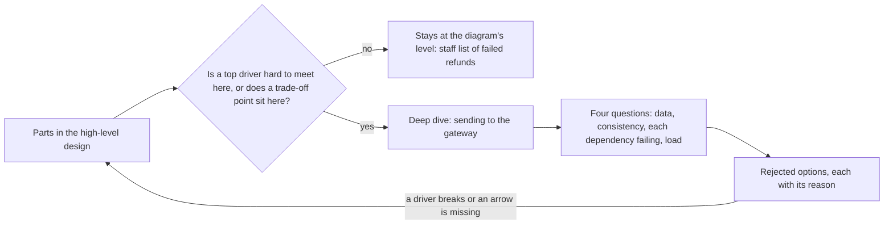

## Bạn cần biết trước

- [[sysdesign.l4.high-level-design]] — bạn đã có sơ đồ hoàn tiền và đường đi của từng thao tác chính qua nó.
- [[design.l4.trade-off-points]] — bạn biết saga của ADR `0003` là một điểm đánh đổi: key của cổng có service riêng, nhưng đơn và lượt hoàn tiền chỉ khớp nhau về sau.
- [[backend.l4.pacelc]] — bạn biết mỗi thao tác phải nói rõ dữ liệu của nó cần mới tới đâu, kể cả khi không có gì hỏng.
- [[backend.l3.saga]] — bạn biết luồng hoàn tiền là một chuỗi transaction cục bộ nối với nhau bằng outbox và inbox.

## Tình huống

Sơ đồ hoàn tiền đã được thống nhất, và bạn đang ở bước 4 của `docs/design/system-design-method.md`. Đội còn hai buổi chiều trước buổi review. Một đồng nghiệp rành SQL bắt tay vào danh sách các lượt hoàn tiền `failed` cho nhân viên: bộ lọc, thứ tự sắp xếp, phân trang. Một người khác bắt đầu viết nội dung các email hoàn tiền. Chưa ai ghi lại chuyện gì xảy ra khi cổng hết thời gian chờ sau khi đã trừ tiền, và lời gọi bị gửi lại. Phần nào nên được chi tiết, và chi tiết đó phải trả lời được những gì?

## Khái niệm cốt lõi

- **đi sâu** (deep dive) — thiết kế chi tiết một phần của hệ thống, chọn ở chỗ một yếu tố định hình hàng đầu khó đáp ứng nhất, hoặc ở chỗ có một điểm đánh đổi.
- bước 4 của phương pháp — "đi vào chi tiết một đến ba phần". Đầu ra của nó là thiết kế chi tiết của phần khó nhất, kèm các phương án đã bị loại.
- bốn câu hỏi — phần đi sâu nào cũng trả lời cùng những câu hỏi về phần của nó: phần đó sở hữu dữ liệu nào, mỗi thao tác cần nhất quán tới đâu, làm gì khi từng phụ thuộc hỏng, và lớn lên theo tải ra sao.
- YC-9 và YC-10 — hai yêu cầu của luồng hoàn tiền: không đơn nào bị hoàn tiền hai lần, kể cả khi lời gọi bị gửi lại. Cổng lỗi thì được tự động thử lại ít nhất 24 giờ trước khi nhân viên tiếp quản (thiết kế thử lại đúng 24 giờ).
- YC-6 và YC-7 — thêm hai yêu cầu: nhân viên thấy từng lượt hoàn tiền mà cổng từ chối, kèm lý do. Yêu cầu hoàn tiền của khách được nhận và trả lời trong 2 giây, kể cả khi cổng lỗi.

## Cơ chế hoạt động



Bắt đầu từ các phần trong thiết kế tổng thể. Thời gian chỉ đủ cho một đến ba phần đi sâu, nên với mỗi phần bạn hỏi: ở đây có yếu tố định hình hàng đầu nào khó đáp ứng không, hay có điểm đánh đổi nào nằm ở đây không.

Trong tình huống trên, phần gửi sang cổng qua phép thử này hai lần. YC-9 khó nhất ở đó: một lời gọi hết thời gian chờ có thể đã hoàn tiền rồi, và lời gọi sau không được hoàn thêm lần nữa. YC-10 cũng khó ở đó: một yêu cầu có thể phải chờ cổng tới 24 giờ. Điểm đánh đổi của ADR `0003` cũng nằm ở đó, vì trong lúc Payments thử lại, đơn ở `refunding` còn dòng của Payments ở `pending`. Danh sách cho nhân viên không qua phép thử: không yếu tố định hình nào làm khó một truy vấn đọc. Nó vẫn chỉ là một ô trong sơ đồ.

Sau đó phần đi sâu trả lời bốn câu hỏi cho phần của nó. Với phần gửi sang cổng, câu trả lời nằm trong `refund-design.md`, design doc của luồng hoàn tiền. Payments sở hữu các dòng `payments` trong `donhang_payments`, database riêng của Payments. Mỗi bước là một transaction cục bộ. Cổng lỗi thì được thử lại với cùng key. Tải lấy từ phép ước lượng của phương pháp: khoảng 1.000 dòng `pending` sau 24 giờ cổng sập, một bảng PostgreSQL chứa thoải mái, nên phần đi sâu không cần thêm gì về tải.

Cuối cùng, phần đi sâu ghi lại những gì nó đã loại và vì sao. Nếu một câu trả lời làm hỏng một yếu tố định hình, phương pháp đưa bạn về thiết kế tổng thể, vì các bước của nó là một vòng lặp. Một câu trả lời cần mũi tên mà sơ đồ chưa có cũng phải quay về, vì sơ đồ phải cho thấy mọi đường đi.

## Trong hệ thống Đơn Hàng

Phương pháp ghi lựa chọn phần đi sâu ngay dưới ví dụ hoàn tiền:

```markdown file=docs/design/system-design-method.md tag=stage-4 lines=120-134
### Ví dụ hoàn tiền: đi sâu

Mỗi phần đi sâu trả lời cùng các câu hỏi: phần đó sở hữu dữ liệu nào; mỗi thao
tác cần nhất quán tới đâu; làm gì khi từng phụ thuộc hỏng; lớn lên theo tải ra
sao.

Ví dụ đi sâu phần gửi sang cổng, vì YC-9 và YC-10 khó nhất ở đó: gửi lại nhiều
lần mà không hoàn hai lần, chờ cổng tới 24 giờ. Không đi sâu danh sách `failed`
của nhân viên: không driver nào làm khó nó, nó chỉ là một truy vấn đọc.

Phần đi sâu đó chính là `refund-design.md`; file này không chép lại. Tóm lại:
mỗi bước là một transaction cục bộ nối bằng outbox và inbox, mỗi lần gửi lại
dùng cùng key `refund-<id>`, cổng được thử lại trong 24 giờ trước khi dòng
thành `failed`, và hai phương án bị loại (two-phase commit, gọi cổng ngay
trong request) có lý do ghi ở đó.
```

Dòng 122–124 là bốn câu hỏi. Dòng 126–128 chọn phần theo các yếu tố định hình, và gọi tên phần bị bỏ ra cùng lý do. Dòng 130–134 trỏ tới `refund-design.md` như chính phần đi sâu và tóm tắt nó: các transaction cục bộ nối bằng outbox và inbox, một key `refund-<id>` cho mọi lần gửi lại, 24 giờ thử lại trước khi thành `failed`, và hai phương án bị loại.

Đây là đoạn trong `refund-design.md` trả lời YC-9 và YC-10:

```markdown file=docs/design/refund-design.md tag=stage-4 lines=40-50
4. Một job nền trong `DonHang.Payments`, cùng cách với `NotificationSender`: hai
   giây một lần, nhận các dòng đến hạn bằng `FOR UPDATE SKIP LOCKED`, gọi API
   hoàn tiền của cổng thanh toán cho từng dòng, với idempotency key
   `refund-<id của dòng>`. Gửi lại sau lỗi mạng dùng đúng key đó, nên cổng
   không hoàn tiền lần hai (YC-9).
5. Cổng lỗi hoặc không trả lời: thử lại sau 1 phút, rồi 2, 4, 8 phút, tối đa 1
   giờ giữa hai lần, trong 24 giờ kể từ `requested_at` (YC-10). Hết 24 giờ, hoặc
   cổng từ chối hẳn, dòng thành `failed` kèm lý do, hiện trong
   `GET /api/v1/refunds?status=failed` cho nhân viên (YC-6), và một message
   `payment.refund-failed` được ghi vào outbox của Payments trong cùng
   transaction.
```

Dòng 40–44 trả lời YC-9: một background job trong `DonHang.Payments`, dựng giống `NotificationSender` (job gửi thông báo), gửi từng dòng đến hạn với key `refund-<id của dòng>`, và lần gửi lại sau lỗi mạng dùng đúng key đó. `FOR UPDATE SKIP LOCKED` khóa các dòng mà một lượt chạy nhận và bỏ qua các dòng lượt khác đã khóa, nên hai lượt chạy không bao giờ nhận cùng một dòng. Dòng 45–50 trả lời YC-10 và câu hỏi về phụ thuộc: thử lại sau 1, 2, 4 rồi 8 phút, cách nhau tối đa 1 giờ, trong 24 giờ kể từ `requested_at`. Sau đó dòng thành `failed`, nhân viên thấy nó (YC-6), và một message `payment.refund-failed` vào outbox của Payments trong cùng transaction. Các phương án bị loại nằm phía dưới trong cùng file, ngoài đoạn trích này: two-phase commit, vì RabbitMQ và HTTP API của cổng không tham gia được một transaction như vậy, và gọi cổng ngay trong request của khách, vì nó làm hỏng YC-7.

## Đánh đổi

| Chi tiết dồn vào đâu | Bắt được gì trước buổi review | Tốn gì | Vẫn chưa biết gì |
|---|---|---|---|
| Mọi phần sâu như nhau | mỗi phần một ít | toàn bộ thời gian, rải mỏng | phần khó, không được chi tiết hơn các phần dễ |
| Phần người thiết kế rành nhất | chi tiết ở một phần vốn đã an toàn | thời gian, dồn sai chỗ | phần sẽ hỏng trước tiên |
| Một đến ba phần chọn theo yếu tố định hình và điểm đánh đổi | hoàn tiền hai lần, cổng sập cả ngày, đơn và lượt hoàn tiền lệch nhau | các phần chỉ dừng ở mức sơ đồ | chi tiết của những phần không yếu tố định hình nào làm khó |

Hàng thứ ba là lựa chọn của phương pháp. Nó đúng khi thời gian ít và chỉ vài yếu tố định hình gánh rủi ro, như trong luồng hoàn tiền. Nó là chưa đủ khi phần nào cũng gánh một yếu tố định hình nặng như nhau. Khi đó giới hạn của bước 4 không còn vừa: thu hẹp phạm vi để một đến ba phần phủ được các yếu tố định hình, hoặc lên kế hoạch thêm phần đi sâu và ghi lý do vào design doc.

## Bạn sẽ chọn gì nếu…

…hóa ra cổng không nhận idempotency key? `refund-design.md` ghi điều này là rủi ro R2: bước 4 sẽ hỏi cổng trạng thái của lượt hoàn tiền trước mỗi lần gửi lại. Điều đó đổi bên trong phần, không đổi sơ đồ. Làm lại câu trả lời của phần đi sâu cho câu hỏi về phụ thuộc, và giữ nguyên thiết kế tổng thể.

…cổng báo kết quả về sau, bằng cách gọi ngược vào hệ thống? `refund-design.md` xếp điều này vào rủi ro R1, API của cổng chạy khác với tài liệu của nó: bước 6, nơi lưu xác nhận của cổng, sẽ thay đổi. R1 thêm một đường đi mà sơ đồ không vẽ, cổng gọi vào trong. Quay về thiết kế tổng thể, vẽ lại đường nhận kết quả với mũi tên mới và chủ của nó, rồi mới trở lại phần đi sâu.

…một người review đòi chi tiết luôn danh sách các lượt hoàn tiền `failed` cho nhân viên? Hỏi xem yếu tố định hình nào làm khó nó. Phương pháp trả lời là không có: nó chỉ là một truy vấn đọc. Dành thời gian cho phần gửi sang cổng, và nói rõ điều gì sẽ đổi lựa chọn này, chẳng hạn một yêu cầu về việc nhân viên phải thấy lỗi nhanh tới đâu.

## Senior hay nhầm rằng…

- **"Một thiết kế kỹ lưỡng chi tiết mọi phần sâu như nhau."** → Thực ra bước 4 chỉ cho phép một đến ba phần, vì còn ít thời gian trước buổi review mà chi tiết rải đều thì phần rủi ro cũng nông như các phần an toàn. Bạn sẽ nhận ra khi một design doc có cả trang về bộ lọc của danh sách cho nhân viên, nhưng chỉ một dòng về chuyện gì xảy ra khi cổng hết thời gian chờ.
- **"Phần đi sâu nên là phần người thiết kế rành nhất, để thể hiện chuyên môn."** → Thực ra phần được chọn theo các yếu tố định hình và điểm đánh đổi, vì phần đi sâu tồn tại để bắt lỗi trước khi nó được xây. Đồng nghiệp giỏi SQL không làm danh sách cho nhân viên thành rủi ro. Bạn sẽ nhận ra khi câu hỏi đầu tiên của người review, "nếu lời gọi bị gửi hai lần thì sao?", không có câu trả lời nào được ghi lại.
- **"Thiết kế tổng thể đã thống nhất thì phần đi sâu không đổi được nó nữa."** → Thực ra các bước của phương pháp là một vòng lặp, vì phần đi sâu nào làm hỏng một yếu tố định hình cũng đưa bạn về sơ đồ. Rủi ro R1 cũng sẽ đưa bạn về, vì cổng gọi ngược cần một mũi tên mới. Bạn sẽ nhận ra khi đội nhét một mũi tên mới vào chi tiết của một phần, và sơ đồ không còn khớp với thứ được xây.

## Thử ngay (3 phút)

Mở `docs/design/refund-design.md` trong repository `don-hang` ở tag `stage-4`, mục "Thiết kế", dòng 26–59.

1. Với phần gửi sang cổng, tìm các dòng trả lời từng câu trong bốn câu hỏi: dữ liệu sở hữu, độ nhất quán, khi từng phụ thuộc hỏng, lớn lên theo tải.
2. Ghi lại câu hỏi nào không có dòng nào trong mục này trả lời trực tiếp.

Kết quả mong đợi: dữ liệu sở hữu nằm ở bước 3 (bảng `payments` trong database riêng của Payments, cộng `inbox_messages`). Độ nhất quán nằm ở bước 3, 5 và 6, mỗi bước một transaction, còn bước 4 nhận các dòng đến hạn bằng `FOR UPDATE SKIP LOCKED` nên hai lượt chạy không bao giờ nhận cùng một dòng. Khi phụ thuộc hỏng nằm ở bước 4 và 5. Lớn lên theo tải không có câu trả lời trực tiếp.

Giờ trả lời: câu trả lời về tải đến từ đâu, và như vậy đã đủ chưa?

<details><summary>Gợi ý đáp án</summary>

Nó đến từ phép ước lượng của phương pháp, dòng 75–92 của `system-design-method.md`: khoảng 0,03 yêu cầu hoàn tiền mỗi giây, và khoảng 1.000 dòng `pending` sau 24 giờ cổng sập, hoặc khoảng 3.000 nếu cả 24 giờ đều đông như giờ cao điểm nhất. Một bảng PostgreSQL chứa thoải mái chừng đó, nên phần đi sâu không cần thêm gì về tải. Công sức của nó nên dồn vào ba câu hỏi còn lại.

</details>

## Liên hệ

- [[sysdesign.l4.high-level-design]] — bước trước: sơ đồ mà phần đi sâu chọn phần từ đó, và là nơi nó quay về khi một yếu tố định hình bị hỏng.
- [[sysdesign.l4.finding-bottlenecks]] — bước tiếp theo: kiểm tra cả thiết kế dưới tải, việc mà phần đi sâu để lại cho nó.
- [[design.l4.trade-off-points]] — một trong hai phép thử để chọn phần cần chi tiết.
- [[backend.l3.saga]] — cơ chế mà phần đi sâu của luồng hoàn tiền chi tiết hóa: các transaction cục bộ nối với nhau bằng message.
- [[backend.l2.idempotent-endpoints]] — vì sao một key `refund-<id>` cho mọi lần gửi lại giữ được YC-9.
- [[management.l3.weighing-options-in-an-adr]] — cùng thói quen ghi lại các phương án bị loại kèm lý do.
- [[backend.l4.cap-theorem]] — lựa chọn khi có sự cố, điều mà câu hỏi về độ nhất quán đặt ra cho từng thao tác.

## Tóm tắt 5 dòng

1. Đi sâu là chi tiết một đến ba phần, chọn ở chỗ một yếu tố định hình hàng đầu khó đáp ứng nhất hoặc có một điểm đánh đổi.
2. Phần đi sâu nào cũng trả lời cùng bốn câu hỏi: dữ liệu sở hữu, độ nhất quán của từng thao tác, khi từng phụ thuộc hỏng, lớn lên theo tải.
3. Ví dụ hoàn tiền đi sâu phần gửi sang cổng, nơi YC-9 và YC-10 khó nhất, và để danh sách cho nhân viên ở mức sơ đồ.
4. `refund-design.md` chính là phần đi sâu đó: các transaction cục bộ, một key `refund-<id>` cho mọi lần gửi lại, 24 giờ thử lại trước khi thành `failed`.
5. Nó kết thúc bằng các phương án bị loại kèm lý do. Câu trả lời nào làm hỏng một yếu tố định hình thì đưa bạn về thiết kế tổng thể.
