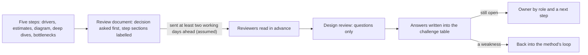

## Before you start

- [[sysdesign.l4.finding-bottlenecks]] — you have step 5's output for refunds: the bottleneck, the part after it, and what each key operation does when one part is lost.
- [[management.l4.presenting-to-leadership]] — you know a brief opens with the decision it asks for; the review document opens the same way for technical readers.
- [[design.l4.architecture-review-findings]] — you know a review ends in risks tied to decisions, each with an owner and a next step, not a pass or fail.
- [[management.l3.proposing-an-adr]] — you know a decision is proposed for comment and then taken by the decider the ADR names; the review feeds that step.

## The situation

The five steps for Đơn Hàng's refund flow are done, and the team will review the design next week. The outputs are spread out: the ranked drivers, the estimate and the single-point-of-failure table sit in `docs/design/system-design-method.md`; the deep dive and its rejected options sit in `docs/design/refund-design.md`. A colleague offers to present it all from slides in the meeting, so reviewers react without reading anything first. You suspect the hour would go on explaining boxes, and nobody would ask why the payment gateway is retried for 24 hours instead of called inside the request. What should reviewers get, when, and in what order?

## Core concepts

- **design review** — a meeting (the session below) where others challenge a proposed design before it is built, working from a document they have read in advance.
- the review document — one file copied from `docs/design/design-review-template.md`, holding the output of the five steps under headings that name the step each section comes from.
- a challenge — a reviewer's question asking why a decision was made this way, or what happens in a case the design may not cover.
- the challenge table — the document's last section, where each question asked in the session is written with its answer, its next step and the role that owns it.

## How it works



In the situation above, the outputs already exist; what is missing is one document that puts them in the order a reviewer needs. After step 5 the method gathers them into a copy of `design-review-template.md` and sends it to the reviewers, at least two working days before the session (an assumed number), so the session is spent only on questions.

The document opens with the decision asked for and the proposal, because a reviewer reads that first. The next sections follow the method's steps: the context and ranked drivers (step 1), pointing to the requirements instead of copying them; the estimates (step 2), each with its assumption and the decision it serves; one diagram (step 3) with the path of each key operation, including when a part fails; one to three deep dives (step 4); and the bottleneck with the single points of failure (step 5).

The last sections turn reading into challenge. Each rejected option names the driver that ruled it out, and each trade-off point names the quality attribute that gains, the one that loses and the driver that decided. Risks and open questions name who answers them, by role, and the ADRs the design will need are listed.

Each question goes into the challenge table with its answer; one nobody can answer stays open, with an owner and a next step. Because the step sections are labelled, a weakness recorded there shows which step's output it sits in. The method calls its steps a loop, not a straight line, and says where to go next: a deep dive that breaks a driver goes back to the high-level design, and a question nobody can answer goes back to clarifying requirements.

## In the Đơn Hàng system

The template's opening sets the rules of the session and its first three sections:

```markdown file=docs/design/design-review-template.md tag=stage-4 lines=3-26
Mẫu cho tài liệu đem ra buổi review thiết kế, theo năm bước của
`system-design-method.md`. Chép file này, điền từng mục, gửi trước buổi review
ít nhất hai ngày làm việc (giả định): người review đọc trước, buổi review chỉ
dành cho câu hỏi. Mỗi mục ghi bước của khung mà nó đến từ, để người review biết
một chỗ yếu bắt nguồn từ bước nào. Mọi con số giả định ghi chữ "giả định".

Trạng thái: bản nháp | đã review | đã chốt
Người đề xuất: ghi theo vai trò

### Quyết định cần review

Một hai câu: cần quyết điều gì, và đề xuất là gì. Người review đọc mục này
trước hết, nên nó đứng đầu, không nằm cuối tài liệu.

### Bối cảnh và driver (bước 1)

Trỏ tài liệu yêu cầu, không chép lại. Ghi phạm vi, những quyết định đã có mà
tài liệu này không mở lại (mỗi cái một đường dẫn), và danh sách driver xếp
hạng.

### Ước lượng và giả định (bước 2)

Các con số, mỗi số kèm giả định của nó và quyết định mà nó phục vụ. Ghi giả
định nào có người xác nhận, theo vai trò.
```

The first paragraph says send ahead, read before, questions only, and mark every assumed number. The status line keeps `đã review` (reviewed) apart from `đã chốt` (settled): being reviewed is not being decided. The decision section stands at the top on purpose, the template says, because reviewers read it first. Step 1's section lists decisions already taken that this review does not reopen, each with a path.

Lines 28–42, between the two excerpts, ask for the diagram with each store's owner from `data-ownership.md`, the deep dives, and the bottleneck section. The template then closes like this:

```markdown file=docs/design/design-review-template.md tag=stage-4 lines=43-67
### Phương án bị loại và điểm đánh đổi (bước 3 và 4)

Mỗi phương án bị loại kèm driver làm nó bị loại. Mỗi điểm đánh đổi ghi thuộc
tính chất lượng được lợi, thuộc tính bị thiệt và driver đã quyết; điểm nhạy
ghi riêng.

### Rủi ro và câu hỏi mở

| Rủi ro hoặc câu hỏi | Ai trả lời (vai trò) | Hạn hoặc bước tiếp theo |
|---|---|---|

### ADR sẽ viết

Phần nào của thiết kế tốn kém nếu phải đảo ngược, cần một ADR; số ADR khi đã
có.

### Câu hỏi phản biện trong buổi review

Ghi lại trong buổi review, ngay vào tài liệu này.

| Câu hỏi | Trả lời, trỏ driver, ADR hoặc rủi ro | Việc tiếp theo | Người phụ trách (vai trò) |
|---|---|---|---|

Câu nào chưa trả lời được thì ghi "mở", kèm người phụ trách và việc tiếp theo,
không trả lời bằng một cách sửa nghĩ ra tại chỗ.
```

Every rejected option and trade-off point carries the driver behind it, and sensitivity points get their own lines. The risks table has a column for who answers, by role, and one for the deadline or next step. The challenge table is empty in the template because the session fills it, and its last rule forbids answering an open question with a fix invented on the spot.

Compare this with `refund-design.md`, a design doc for one feature. Its headings follow the feature: a summary, why Payments was split, the design steps, two rejected options, what it leaves out, risks and open questions, and history. It has no estimate and no bottleneck section, so a reviewer could not tell which step a gap comes from. The method calls that file the deep dive and points to it instead of copying it.

## Trade-offs

| How the design reaches reviewers | What reviewers can challenge | What it costs | When it fits |
|---|---|---|---|
| A review document read in advance, a session for questions only | every stated choice with its driver, and which step a weakness comes from | the designer's time to fill every section, and the reviewers' reading time | a design with decisions costly to undo, reviewed by people who were not in the steps |
| Slides presented in the meeting, nothing read before | only what the presenter shows, at the speed of the talk | little preparation, but the session goes on explaining | informing people about a design already settled |
| The feature's design doc alone, such as `refund-design.md` | its steps and rejected options, but no estimate or bottleneck, which it does not contain | nothing extra | a change that no driver makes hard |
| Written comments on a pull request, no session | each point in writing, at the reviewer's own pace | slow when a question needs discussion and goes back and forth | a single decision, such as a proposed ADR |

Of the four, a review document takes the most preparation, and is worth it when a wrong choice is costly to undo. For a small change, the same effort delays work that a design doc and a pull request review would catch. A review held only in writing, with no session, suits reviewers who rarely meet, as long as each comment and answer is kept in the document the same way.

## What would you choose if…

…the change adds a filter to the staff list of failed refunds? The method already skips that list in its deep dive: no driver makes it hard, and it is only a read query. A design doc and a pull request review are enough here.

…leadership asks to sign off the refund design? They decide on business effect, not on deep dives. Write a brief that opens with the decision and its effect, and point to the review document for detail. Keep the design review with people who can challenge the drivers and trade-off points.

…nobody can confirm the assumed refund share of 1% before the session? Send the document anyway, with the number marked as an assumption and the role who will confirm it, as the estimate section asks. Add it to the risks and open questions table with a next step. Holding the review until every number is known delays the challenges that could change the design more than that number would.

## Seniors often assume…

- **"A design review is where the senior people approve or reject the design."** → Actually the session produces answers, risks and open questions with owners; the template's status keeps "reviewed" apart from "settled", and a decision costly to undo goes into an ADR that its decider takes. You notice this when a session ends in "approved" with an empty challenge table, and the first hard question comes after the code is built.
- **"The more pages and diagrams the document has, the better the review goes."** → Actually the template asks for one diagram and one to three deep dives, and has step 1 point to the requirements instead of copying them; the method points to `refund-design.md` as the deep dive instead of copying it. A page copied from another document is reading time taken from finding weaknesses. You notice this when reviewers ask where a decision is written instead of why it was taken.
- **"Reviewers should see the design for the first time in the meeting, so their reactions are fresh."** → Actually a reviewer cannot check an estimate against its assumptions, or a rejected option against its driver, at the speed of a talk. The template sends the document ahead so the session holds only questions. You notice this when most questions in the session ask what a box means rather than why the design is not another way.

## Try it (3 minutes)

Open `docs/design/design-review-template.md` in the `don-hang` repository at tag `stage-4`, next to `docs/design/system-design-method.md` and `docs/design/refund-design.md`.

1. Take each heading of the template from "Bối cảnh và driver" to "Nút cổ chai và điểm hỏng đơn lẻ".
2. For each, find the file and section where the refund work already holds its content.

Expected result: the drivers, the estimate, the diagram and the single-point-of-failure table are in `system-design-method.md`; the deep dive is `refund-design.md`. Most of the content already exists and has to be gathered and pointed to; what is missing, such as the role who confirms the 1% share, is written in as an assumption or an open question.

Now answer: which section that comes before "Bối cảnh và driver" does none of these files hold, and why does the template put it first?

<details><summary>Suggested answer</summary>

"Quyết định cần review": the one or two sentences saying what must be decided and what is proposed. The method and the design doc describe the design, but neither states the decision the reviewers are asked to challenge. It goes first because reviewers read it first; without it they must guess which choice is on the table.

</details>

## Connections

- [[sysdesign.l4.finding-bottlenecks]] — the step before: its output fills the template's step 5 section.
- [[sysdesign.l4.answering-challenges]] — the next lesson: how to answer the questions this document invites.
- [[management.l2.design-doc]] — the feature document the review points to as its deep dive instead of copying it.
- [[design.l4.architecture-review-findings]] — the same rule for what stays open: an owner and a next step, not a verdict.
- [[management.l4.presenting-to-leadership]] — the same decision-first opening, for readers who decide on business effect.
- [[management.l3.proposing-an-adr]] — where a decision the review examined is proposed and taken.
- [[backend.l4.backend-review-checklist]] — reviews a change against decisions already recorded; a design review comes before those decisions exist.
- [[k8s.l4.cluster-review-checklist]] — the same kind of checklist for changes to the cluster.

## Five-line summary

1. A design review lets others challenge a proposed design before it is built, from a document they read in advance, not drawings shown live.
2. `design-review-template.md` opens with the decision asked for, then drivers, estimates, the diagram, deep dives and bottlenecks, in step order.
3. It ends with rejected options, trade-off points, risks and open questions with owners, and the ADRs needed, so reviewers attack stated choices.
4. Unlike a feature's design doc, each step's section names its step, so a weakness shows which step's output it sits in.
5. Questions from the session go into the document with answers; open ones get an owner by role and a next step.
