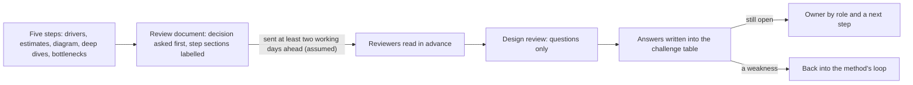

## Bạn cần biết trước

- [[sysdesign.l4.finding-bottlenecks]] — bạn đã có đầu ra bước 5 cho hoàn tiền: nút cổ chai, phần đến sau nó, và mỗi thao tác chính ra sao khi mất một phần.
- [[management.l4.presenting-to-leadership]] — bạn biết một bản tóm tắt mở đầu bằng quyết định nó xin. Tài liệu review mở đầu y như vậy, cho người đọc kỹ thuật.
- [[design.l4.architecture-review-findings]] — bạn biết một buổi review kết thúc bằng các rủi ro gắn với quyết định, mỗi rủi ro có người phụ trách và bước tiếp theo, chứ không phải đạt hay không đạt.
- [[management.l3.proposing-an-adr]] — bạn biết một quyết định được đề xuất để góp ý, rồi người quyết định mà ADR ghi tên sẽ chốt. Buổi review cung cấp đầu vào cho bước đó.

## Tình huống

Năm bước cho luồng hoàn tiền của Đơn Hàng đã xong, và tuần sau nhóm sẽ review thiết kế. Đầu ra đang nằm rải rác: các yếu tố định hình đã xếp hạng, phần ước lượng và bảng điểm lỗi duy nhất nằm trong `docs/design/system-design-method.md`. Phần đi sâu và các phương án bị loại nằm trong `docs/design/refund-design.md`. Một đồng nghiệp đề nghị trình bày tất cả bằng slide trong buổi họp, nên người review phản ứng mà không cần đọc gì trước. Bạn ngờ rằng cả tiếng đồng hồ sẽ trôi vào giải thích các ô vuông, và chẳng ai hỏi vì sao cổng thanh toán được thử lại trong 24 giờ thay vì gọi ngay trong request. Người review nên nhận gì, lúc nào, theo thứ tự nào?

## Khái niệm cốt lõi

- **review thiết kế** (design review) — một buổi họp (buổi review dưới đây) nơi người khác phản biện một thiết kế được đề xuất trước khi nó được xây, dựa trên tài liệu họ đã đọc trước.
- tài liệu review — một file chép từ `docs/design/design-review-template.md`, chứa đầu ra của năm bước dưới các tiêu đề ghi rõ mỗi mục đến từ bước nào.
- một câu phản biện — câu hỏi của người review: vì sao quyết định này lại chọn như vậy, hoặc chuyện gì xảy ra trong một trường hợp thiết kế có thể chưa tính tới.
- bảng phản biện — mục cuối của tài liệu. Mỗi câu hỏi trong buổi review được ghi vào đó, kèm câu trả lời, bước tiếp theo và vai trò phụ trách.

## Cơ chế hoạt động



Trong tình huống trên, đầu ra đã có sẵn. Cái còn thiếu là một tài liệu xếp chúng theo đúng thứ tự người review cần. Sau bước 5, phương pháp gom chúng vào một bản chép của `design-review-template.md` và gửi cho người review, ít nhất hai ngày làm việc trước buổi review (con số giả định), để cả buổi chỉ dành cho câu hỏi.

Tài liệu mở đầu bằng quyết định cần review và đề xuất, vì người review đọc chỗ đó trước tiên. Các mục tiếp theo đi theo các bước của phương pháp: bối cảnh và các yếu tố định hình đã xếp hạng (bước 1), trỏ tới yêu cầu thay vì chép lại. Các ước lượng (bước 2), mỗi số kèm giả định và quyết định mà nó phục vụ. Một sơ đồ (bước 3) với đường đi của từng thao tác chính, kể cả khi một phần hỏng. Một đến ba phần đi sâu (bước 4). Cuối cùng là nút cổ chai cùng các điểm lỗi duy nhất (bước 5).

Các mục cuối biến việc đọc thành phản biện. Mỗi phương án bị loại ghi yếu tố định hình đã loại nó. Mỗi điểm đánh đổi ghi thuộc tính chất lượng được lợi, thuộc tính bị thiệt và yếu tố định hình đã quyết. Rủi ro và câu hỏi mở ghi ai trả lời, theo vai trò, và tài liệu liệt kê các ADR mà thiết kế sẽ cần.

Mỗi câu hỏi đi vào bảng phản biện cùng câu trả lời. Câu nào không ai trả lời được thì để mở, kèm người phụ trách và bước tiếp theo. Vì các mục theo bước đều có nhãn, một chỗ yếu ghi ở đó cho thấy nó nằm trong đầu ra của bước nào. Phương pháp gọi các bước của nó là một vòng lặp, không phải đường thẳng, và nói rõ đi đâu tiếp: một phần đi sâu làm vỡ một yếu tố định hình thì quay về thiết kế tổng thể, còn một câu hỏi không ai trả lời được thì quay về làm rõ yêu cầu.

## Trong hệ thống Đơn Hàng

Phần mở đầu của mẫu đặt luật cho buổi review và ba mục đầu tiên:

```markdown file=docs/design/design-review-template.md tag=stage-4 lines=3-26
Mẫu cho tài liệu đem ra buổi review thiết kế, theo năm bước của
`system-design-method.md`. Chép file này, điền từng mục, gửi trước buổi review
ít nhất hai ngày làm việc (giả định): người review đọc trước, buổi review chỉ
dành cho câu hỏi. Mỗi mục ghi bước của khung mà nó đến từ, để người review biết
một chỗ yếu bắt nguồn từ bước nào. Mọi con số giả định ghi chữ "giả định".

Trạng thái: bản nháp | đã review | đã chốt
Người đề xuất: ghi theo vai trò

### Quyết định cần review

Một hai câu: cần quyết điều gì, và đề xuất là gì. Người review đọc mục này
trước hết, nên nó đứng đầu, không nằm cuối tài liệu.

### Bối cảnh và driver (bước 1)

Trỏ tài liệu yêu cầu, không chép lại. Ghi phạm vi, những quyết định đã có mà
tài liệu này không mở lại (mỗi cái một đường dẫn), và danh sách driver xếp
hạng.

### Ước lượng và giả định (bước 2)

Các con số, mỗi số kèm giả định của nó và quyết định mà nó phục vụ. Ghi giả
định nào có người xác nhận, theo vai trò.
```

Đoạn đầu dặn: gửi trước, đọc trước, buổi review chỉ dành cho câu hỏi, và đánh dấu mọi con số giả định. Dòng trạng thái tách `đã review` khỏi `đã chốt`: đã được review chưa có nghĩa là đã được quyết. Mẫu nói rõ mục quyết định cố ý đứng đầu, vì người review đọc nó trước tiên. Mục của bước 1 liệt kê các quyết định đã có mà buổi review này không mở lại, mỗi cái kèm một đường dẫn.

Dòng 28–42, nằm giữa hai đoạn trích, đòi sơ đồ kèm chủ sở hữu của từng kho dữ liệu theo `data-ownership.md`, các phần đi sâu và mục nút cổ chai. Sau đó mẫu kết thúc như sau:

```markdown file=docs/design/design-review-template.md tag=stage-4 lines=43-67
### Phương án bị loại và điểm đánh đổi (bước 3 và 4)

Mỗi phương án bị loại kèm driver làm nó bị loại. Mỗi điểm đánh đổi ghi thuộc
tính chất lượng được lợi, thuộc tính bị thiệt và driver đã quyết; điểm nhạy
ghi riêng.

### Rủi ro và câu hỏi mở

| Rủi ro hoặc câu hỏi | Ai trả lời (vai trò) | Hạn hoặc bước tiếp theo |
|---|---|---|

### ADR sẽ viết

Phần nào của thiết kế tốn kém nếu phải đảo ngược, cần một ADR; số ADR khi đã
có.

### Câu hỏi phản biện trong buổi review

Ghi lại trong buổi review, ngay vào tài liệu này.

| Câu hỏi | Trả lời, trỏ driver, ADR hoặc rủi ro | Việc tiếp theo | Người phụ trách (vai trò) |
|---|---|---|---|

Câu nào chưa trả lời được thì ghi "mở", kèm người phụ trách và việc tiếp theo,
không trả lời bằng một cách sửa nghĩ ra tại chỗ.
```

Mỗi phương án bị loại và mỗi điểm đánh đổi đều mang theo yếu tố định hình đứng sau nó, còn điểm nhạy được ghi thành dòng riêng. Bảng rủi ro có một cột ghi ai trả lời, theo vai trò, và một cột ghi hạn hoặc bước tiếp theo. Bảng phản biện trong mẫu để trống, vì buổi review sẽ điền nó. Quy tắc cuối cấm trả lời một câu hỏi mở bằng một kiểu sửa nghĩ ra tại chỗ.

So với `refund-design.md`, một design doc cho một tính năng. Các tiêu đề của nó đi theo tính năng: tóm tắt, vì sao tách Payments, các bước thiết kế, hai phương án bị loại, những gì nó không làm, rủi ro và câu hỏi mở, và lịch sử. Nó không có phần ước lượng hay mục nút cổ chai, nên người review không biết được một lỗ hổng đến từ bước nào. Phương pháp gọi file đó là phần đi sâu, và trỏ tới nó thay vì chép lại.

## Đánh đổi

| Thiết kế đến tay người review bằng cách nào | Người review phản biện được gì | Tốn gì | Hợp khi nào |
|---|---|---|---|
| Một tài liệu review đọc trước, buổi review chỉ dành cho câu hỏi | mọi lựa chọn đã ghi kèm yếu tố định hình của nó, và một chỗ yếu đến từ bước nào | thời gian người thiết kế điền mọi mục, và thời gian đọc của người review | một thiết kế có những quyết định tốn kém nếu phải đảo ngược, do những người không tham gia các bước review |
| Slide trình bày trong buổi họp, không đọc gì trước | chỉ những gì người trình bày đưa ra, theo tốc độ của bài nói | chuẩn bị ít, nhưng buổi họp mải giải thích | báo cho mọi người về một thiết kế đã chốt |
| Chỉ design doc của tính năng, như `refund-design.md` | các bước và phương án bị loại của nó, nhưng không có ước lượng hay nút cổ chai, vì nó không chứa | không tốn thêm gì | một thay đổi mà không yếu tố định hình nào làm khó |
| Góp ý bằng văn bản trên pull request, không có buổi review | từng điểm bằng văn bản, theo nhịp riêng của người review | chậm khi một câu hỏi cần bàn qua lại | một quyết định đơn lẻ, chẳng hạn một ADR được đề xuất |

Trong bốn cách, tài liệu review tốn công chuẩn bị nhất, và đáng công khi một lựa chọn sai tốn kém để đảo ngược. Với một thay đổi nhỏ, cùng công sức đó chỉ làm chậm việc mà một design doc cùng một lượt review pull request đã đủ bắt lỗi. Một buổi review chỉ bằng văn bản, không họp, hợp với những người review hiếm khi gặp nhau, miễn là mỗi góp ý và câu trả lời đều được giữ trong tài liệu theo cùng cách đó.

## Bạn sẽ chọn gì nếu…

…thay đổi chỉ thêm một bộ lọc vào danh sách hoàn tiền thất bại của nhân viên? Phương pháp vốn đã bỏ qua danh sách đó khi đi sâu: không yếu tố định hình nào làm nó khó, và nó chỉ là một truy vấn đọc. Ở đây một design doc và một lượt review pull request là đủ.

…ban lãnh đạo muốn ký duyệt thiết kế hoàn tiền? Họ quyết dựa trên tác động kinh doanh, không dựa trên các phần đi sâu. Viết một bản tóm tắt mở đầu bằng quyết định và tác động của nó, rồi trỏ tới tài liệu review cho chi tiết. Giữ buổi review thiết kế cho những người phản biện được các yếu tố định hình và điểm đánh đổi.

…không ai xác nhận được tỉ lệ hoàn tiền giả định 1% trước buổi review? Cứ gửi tài liệu, ghi con số đó là giả định kèm vai trò sẽ xác nhận, đúng như mục ước lượng yêu cầu. Thêm nó vào bảng rủi ro và câu hỏi mở với một bước tiếp theo. Hoãn buổi review cho tới khi biết hết mọi con số sẽ làm chậm những câu phản biện có thể đổi thiết kế nhiều hơn chính con số đó.

## Senior hay nhầm rằng…

- **"Review thiết kế là nơi những người senior duyệt hoặc bác thiết kế."** → Thực ra buổi review cho ra câu trả lời, rủi ro và câu hỏi mở có người phụ trách. Trạng thái trong mẫu tách "đã review" khỏi "đã chốt", và một quyết định tốn kém để đảo ngược sẽ vào một ADR do người quyết định của nó chốt. Bạn sẽ nhận ra khi một buổi review kết thúc bằng "đã duyệt" với bảng phản biện trống trơn, và câu hỏi khó đầu tiên chỉ đến sau khi code đã xây xong.
- **"Tài liệu càng nhiều trang, nhiều sơ đồ thì buổi review càng tốt."** → Thực ra mẫu chỉ đòi một sơ đồ và một đến ba phần đi sâu, và bảo bước 1 trỏ tới yêu cầu thay vì chép lại. Phương pháp cũng trỏ tới `refund-design.md` làm phần đi sâu thay vì chép nó. Một trang chép từ tài liệu khác là thời gian đọc bị lấy khỏi việc tìm chỗ yếu. Bạn sẽ nhận ra khi người review hỏi một quyết định được ghi ở đâu, thay vì hỏi vì sao lại chọn nó.
- **"Người review nên thấy thiết kế lần đầu trong buổi họp, để phản ứng còn mới."** → Thực ra người review không thể đối chiếu một ước lượng với giả định của nó, hay một phương án bị loại với yếu tố định hình của nó, theo tốc độ của bài nói. Mẫu gửi tài liệu trước để buổi review chỉ còn câu hỏi. Bạn sẽ nhận ra khi phần lớn câu hỏi trong buổi review là một ô vuông nghĩa là gì, chứ không phải vì sao thiết kế không làm theo cách khác.

## Thử ngay (3 phút)

Mở `docs/design/design-review-template.md` trong repository `don-hang` ở tag `stage-4`, đặt cạnh `docs/design/system-design-method.md` và `docs/design/refund-design.md`.

1. Lấy từng tiêu đề của mẫu, từ "Bối cảnh và driver" tới "Nút cổ chai và điểm hỏng đơn lẻ".
2. Với mỗi tiêu đề, tìm file và mục nơi công việc hoàn tiền đã chứa nội dung của nó.

Kết quả mong đợi: các yếu tố định hình, phần ước lượng, sơ đồ và bảng điểm lỗi duy nhất nằm trong `system-design-method.md`. Phần đi sâu là `refund-design.md`. Phần lớn nội dung đã có, chỉ cần gom lại và trỏ tới. Cái còn thiếu, chẳng hạn vai trò xác nhận tỉ lệ 1%, được ghi vào dưới dạng giả định hoặc câu hỏi mở.

Giờ trả lời: mục nào đứng trước "Bối cảnh và driver" mà không file nào trong số này chứa, và vì sao mẫu đặt nó lên đầu?

<details><summary>Gợi ý đáp án</summary>

"Quyết định cần review": một hai câu nói cần quyết điều gì và đề xuất là gì. Phương pháp và design doc mô tả thiết kế, nhưng không file nào nêu quyết định mà người review được mời phản biện. Nó đứng đầu vì người review đọc nó trước tiên. Thiếu nó, họ phải đoán lựa chọn nào đang được đem ra bàn.

</details>

## Liên hệ

- [[sysdesign.l4.finding-bottlenecks]] — bước trước: đầu ra của nó điền mục bước 5 trong mẫu.
- [[sysdesign.l4.answering-challenges]] — bài tiếp theo: cách trả lời những câu hỏi mà tài liệu này mời gọi.
- [[management.l2.design-doc]] — tài liệu của tính năng mà buổi review trỏ tới làm phần đi sâu, thay vì chép lại.
- [[design.l4.architecture-review-findings]] — cùng quy tắc cho những gì còn mở: một người phụ trách và một bước tiếp theo, không phải một phán quyết.
- [[management.l4.presenting-to-leadership]] — cùng cách mở đầu bằng quyết định, cho người đọc quyết dựa trên tác động kinh doanh.
- [[management.l3.proposing-an-adr]] — nơi một quyết định mà buổi review đã xem xét được đề xuất và chốt.
- [[backend.l4.backend-review-checklist]] — review một thay đổi theo các quyết định đã ghi lại. Review thiết kế đến trước khi những quyết định đó tồn tại.
- [[k8s.l4.cluster-review-checklist]] — cùng loại checklist, cho các thay đổi trên cluster.

## Tóm tắt 5 dòng

1. Review thiết kế để người khác phản biện một thiết kế được đề xuất trước khi xây, dựa trên tài liệu họ đọc trước, không phải hình vẽ trình chiếu tại chỗ.
2. `design-review-template.md` mở đầu bằng quyết định cần review, rồi tới yếu tố định hình, ước lượng, sơ đồ, phần đi sâu và nút cổ chai, theo thứ tự các bước.
3. Nó kết thúc bằng phương án bị loại, điểm đánh đổi, rủi ro và câu hỏi mở có người phụ trách, và các ADR cần viết, để người review tấn công những lựa chọn đã ghi rõ.
4. Khác design doc của một tính năng, mỗi mục ghi tên bước của nó, nên một chỗ yếu cho thấy nó nằm trong đầu ra của bước nào.
5. Câu hỏi trong buổi review được ghi vào tài liệu cùng câu trả lời. Câu còn mở có người phụ trách theo vai trò và một bước tiếp theo.
