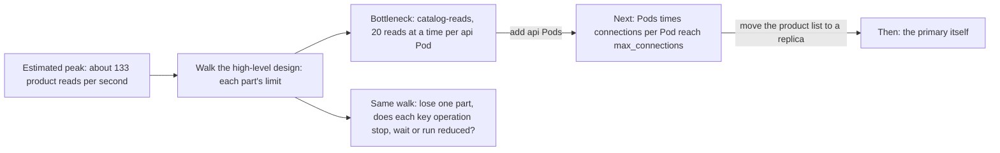

## Before you start

- [[sysdesign.l4.deep-dive]] — you have the refund design detailed where it is most likely to fail; this lesson checks the whole design instead.
- [[backend.l4.capacity-planning]] — you know `capacity-plan.md` compares a peak of about 133 product reads per second with each shared resource's limit.
- [[k8s.l3.highly-available-entry-point]] — you know a single point of failure is a part whose failure alone stops something the system must do; this lesson asks that per key operation.

## The situation

The refund deep dive is done, and you are at step 5 of `docs/design/system-design-method.md`. A colleague wants to add a second copy of `DonHang.Payments` and of RabbitMQ before the review, "so the system scales". The refund job is also the slowest code in the flow: one call to the payment gateway, the outside provider that makes the refund, can take seconds. Yet the busiest hour sends about 133 product reads per second and about 0.03 refund requests per second. Which part runs out first as load grows, and what happens to each key operation when one part is lost?

## Core concepts

- **bottleneck** — the part with the lowest limit on a path; the whole path can carry no more than it, so adding capacity anywhere else changes nothing.
- a part's limit — the most work it can do per second or hold at once, such as 20 product reads at a time per api process in `catalog-reads`; each api Pod runs one api process, so per process and per Pod give the same number here.
- the method's step 5 — its output is the part that limits first, the part that comes next, and, for each single point of failure, whether each key operation stops, waits or works in a reduced way.

## How it works



You take the estimated peak and walk it along the high-level design, comparing it with each part's limit. In the situation above, `capacity-plan.md` already did this walk for orders and product reads. Product reads pass through `catalog-reads`, which lets each api process run 20 reads at a time. By Little's law, reads per second per process are 20 divided by the time of one read. At 200 ms that is 100, and under the headroom rule only one of the 2 Pods counts, so 100 falls below the peak of 133. Order placement and refunds meet the primary instead; the plan gives it no number, but judges about 3.3 short transactions per second as passing, and the method finds 0.03 refund requests per second touch no limit.

So `catalog-reads` is the bottleneck. A second copy of Payments or RabbitMQ adds capacity where product reads never pass, and changes nothing for them.

Removing a bottleneck moves it. More api Pods add read slots, but each Pod also opens its own pool of database connections, a fixed set the process keeps open and reuses. Every service shares one PostgreSQL server, so the next limit is `max_connections`, the server's setting for how many connections it accepts at once, minus a few slots kept for administrators. After that, the plan moves the product list to a read replica, and the primary itself is the limit to watch. So a design names the part that comes next and the load at which it arrives.

The same walk lists single points of failure. For each part, you ask what happens to each key operation when that part alone is lost: it stops, it waits, or it works in a reduced way.

## In the Đơn Hàng system

`capacity-plan.md` names what runs out first and what to do before it does:

```markdown file=docs/design/capacity-plan.md tag=stage-4 lines=60-73
### Tài nguyên hết trước

Trần `catalog-reads` tính theo thời gian một lần đọc. Khi Redis dừng hay
database chậm, mỗi lần đọc lâu hơn và trần tụt theo: nếu một lần đọc mất 200
ms, trần mỗi process còn 100 mỗi giây, một nửa trần của 2 Pod còn 100, thấp
hơn đỉnh 133. Vì vậy `catalog-reads` hết trước, trả `503` cho đọc sản phẩm,
trong khi đặt đơn vẫn chạy.

Bước làm trước khi tới đó, theo thứ tự:

1. Thêm Pod api; mỗi Pod thêm 20 chỗ đọc nhưng cũng thêm một pool kết nối,
   nên số Pod bị chặn bởi `max_connections`.
2. Chuyển danh sách sản phẩm sang replica (mục dưới), khi đỉnh đọc sản phẩm
   vượt khoảng dư của primary.
```

The first paragraph finds the bottleneck with the arithmetic above: when Redis stops or the database is slow, reads reach 200 ms, and product reads get `503` while orders still go through.

The numbered steps say what comes next, in order: more api Pods, capped by `max_connections`, then the product list on a replica once its peak crosses the primary's headroom. The plan gives no number for `max_connections`; it says elsewhere to read it with `SHOW max_connections` rather than guess.

The method's refund example does not recompute load. It records the single points of failure:

```markdown file=docs/design/system-design-method.md tag=stage-4 lines=136-157
### Ví dụ hoàn tiền: nút cổ chai và điểm hỏng đơn lẻ

Nút cổ chai về tải: không tính lại ở đây. `capacity-plan.md` đã đi tải đỉnh qua
các phần dùng chung và ghi phần cạn trước ở mục "Tài nguyên hết trước"
(`catalog-reads`, không phải đặt đơn hay hoàn tiền). Với khoảng 0,03 yêu cầu
mỗi giây, hoàn tiền không chạm giới hạn nào trong đó.

Điểm hỏng đơn lẻ của luồng, theo repo stage-4 (`api` có 2 Pod; các phần còn
lại một bản):

| Phần hỏng | Gửi yêu cầu | Hoàn tiền xong |
|---|---|---|
| Cổng thanh toán | Chạy: outbox nhận, `202` | Chờ: thử lại 24 giờ, rồi `failed` cho nhân viên |
| Server PostgreSQL `db` (ba database) | Dừng: không ghi được đơn | Dừng |
| RabbitMQ | Chạy: dòng nằm trong outbox | Chờ tới khi RabbitMQ quay lại |
| `DonHang.Payments` (1 bản) | Chạy | Chờ: message nằm trong hàng đợi |
| `DonHang.Notifications` (1 bản) | Chạy | Đơn vẫn `cancelled`; chỉ email chờ |
| Keycloak (1 bản) | Dừng với khách cần đăng nhập lại | Chạy |
| Một Pod `api` | Chạy ở mức giảm trên Pod còn lại | Chạy |

Cổng thanh toán là điểm hỏng đơn lẻ cho việc hoàn tiền xong, nhưng không cho
việc nhận yêu cầu: outbox và 24 giờ thử lại để yêu cầu chờ.
```

The first paragraph points to the plan's bottleneck and notes that refunds touch none of its limits. The table has one row per part and two columns, one per key operation: sending the request and completing the refund. Each cell says whether the operation runs, runs reduced, waits or stops. In the gateway row, accepting runs, because the outbox takes the request and the customer gets `202`; completing waits for up to 24 hours of retries. Only the `db` server stops both operations; Keycloak stops sending for customers who must log in again, while completing runs.

Losing Notifications only delays the email; the order stays `cancelled`. The last sentence states the conclusion: the gateway is a single point of failure for completing refunds, not for accepting them.

## Trade-offs

| What you do about a part that limits or stops a key operation | What the operation does when the part is full or lost | What it costs | What comes next |
|---|---|---|---|
| Add copies, such as more api Pods | runs in a reduced way on the copies left | headroom on each copy, and one more connection pool per api Pod | `max_connections` on the shared `db` server |
| Let work wait in front of it, such as the outbox and retries before the gateway | accepting runs; completing waits | status columns, a retry job, one idempotency key per refund, and a customer who waits | how much piles up: about 1,000 `pending` rows (accepted, not yet refunded) per day of gateway outage, since the method estimates about 1,000 requests on the busiest day; 0.03 per second is only its busiest hour |
| Accept that the operation stops, as stage-4 does for the one `db` server | stops until the part is back | nothing now | the stop stays a known risk in the design |

Adding copies fits a part whose limit the peak can reach, like the api. Letting work wait fits a part the system does not run, like the gateway, when a driver allows waiting: YC-10 allows 24 hours. Accepting a stop is right only while no driver forbids it; the method's table makes that choice visible instead of hiding it.

## What would you choose if…

…a sale is expected to double the orders per shop? The plan's own rule asks for a new plan when the orders per shop move by more than a quarter. Its assumed 40 product reads per order make that about 266 reads per second, so redo the walk with that peak. If `catalog-reads` falls short, take the plan's next step, more api Pods, after checking that all Pods times connections per Pod stay below `max_connections`.

…a reviewer asks for a second copy of RabbitMQ to make refunds faster? Walk it first. Refunds touch no limit, and losing RabbitMQ only makes completing wait, since requests sit in the outbox. A second copy moves neither the bottleneck nor the gateway's single point of failure. Choose it only if a driver requires refunds to complete while RabbitMQ is down.

…the gateway's provider offers a second gateway as a backup? If it can refund payments taken through the first gateway, it would remove the single point of failure for completing refunds. But YC-10 already allows 24 hours of waiting, and a second gateway brings a second API key, the secret Đơn Hàng sends to prove a call comes from it; the method's third driver names that key the most sensitive thing in the system. Keep one gateway unless refunds must complete within hours.

## Seniors often assume…

- **"Adding more servers removes any bottleneck."** → Actually more api Pods raise the `catalog-reads` ceiling only until Pods times connections per Pod approach `max_connections` on the one `db` server every service shares. More copies of a part off the path change nothing at all. You notice this when new Pods start but PostgreSQL refuses their connections, and other services on the same server are refused too.
- **"The slowest piece of code is always the bottleneck."** → Actually the bottleneck is the lowest limit against the load that reaches it. The refund job waits on the gateway, yet 0.03 requests per second reach no limit. A product read is fast, yet 133 per second share 20 slots per process. You notice this when a team speeds up the refund job while product reads return `503` at the busiest hour.
- **"Once the bottleneck is fixed, the system can grow without limit."** → Actually removing it moves it to the part with the next lowest limit: after `catalog-reads` comes `max_connections`, then the primary itself. You notice this when the next peak fails in a part nobody measured, because the design named only the first limit.

## Try it (3 minutes)

Open `docs/design/capacity-plan.md` in the `don-hang` repository at tag `stage-4`, sections "Giới hạn đã biết" and "Tài nguyên hết trước".

1. Suppose a third api Pod is added, and one read takes 200 ms as in the plan's example.
2. Keep the headroom rule: the peak must fit on all api Pods but one. Compute that ceiling and compare it with the peak of 133.

Expected result: each process carries 20 / 0.2 = 100 reads per second; all Pods but one is 2 Pods, so 200 reads per second, above 133. The bottleneck is pushed back.

Now answer: what limits how many Pods you can add, and what number do you still need?

<details><summary>Suggested answer</summary>

Each api Pod adds one connection pool, and Payments, Notifications, migrations and the backup job open connections to the same server. All Pods times connections per Pod, across every service, must stay below `max_connections`. The plan gives no value for it: read it with `SHOW max_connections`. That number tells you the load at which the next bottleneck arrives.

</details>

## Connections

- [[sysdesign.l4.deep-dive]] — the step before: it details the riskiest part and leaves growth under load to this step.
- [[sysdesign.l4.design-review-doc]] — the next step: the review doc carries the bottleneck, the part after it and the single points of failure.
- [[backend.l4.capacity-planning]] — where the walk for load was done; this step reuses it instead of recomputing.
- [[k8s.l3.highly-available-entry-point]] — the same single-point-of-failure question one layer down, for the cluster's entry point.
- [[backend.l3.bulkhead]] — why `catalog-reads` running out returns `503` for product reads while orders still go through.
- [[backend.l3.slow-dependencies]] — why a slow dependency lowers a ceiling that depends on how long each request takes.
- [[backend.l4.read-routing]] — the plan's second step, which moves the next bottleneck off the primary.

## Five-line summary

1. A bottleneck is the part with the lowest limit on a path; adding capacity anywhere else changes nothing.
2. Walk the estimated peak along the high-level design; `capacity-plan.md` finds `catalog-reads` runs out first when reads slow down.
3. Removing a bottleneck moves it: more api Pods meet `max_connections` next, so a design names the next part and its load.
4. The same walk lists single points of failure and says whether each key operation stops, waits or runs reduced.
5. The gateway is a single point of failure for completing refunds, not accepting them, because the outbox and retries let requests wait.
