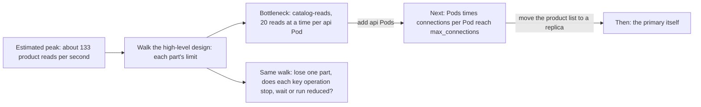

## Bạn cần biết trước

- [[sysdesign.l4.deep-dive]] — bạn đã chi tiết thiết kế hoàn tiền ở chỗ nó dễ hỏng nhất. Bài này kiểm tra cả thiết kế.
- [[backend.l4.capacity-planning]] — bạn biết `capacity-plan.md` so đỉnh khoảng 133 lượt đọc sản phẩm mỗi giây với giới hạn của từng tài nguyên dùng chung.
- [[k8s.l3.highly-available-entry-point]] — bạn biết điểm lỗi duy nhất là một phần mà chỉ riêng nó hỏng cũng đủ làm dừng một việc hệ thống phải làm. Bài này hỏi câu đó cho từng thao tác chính.

## Tình huống

Phần đi sâu về hoàn tiền đã xong, và bạn đang ở bước 5 của `docs/design/system-design-method.md`. Một đồng nghiệp muốn thêm bản thứ hai của `DonHang.Payments` và của RabbitMQ trước buổi review, "để hệ thống scale". Job hoàn tiền cũng là đoạn code chậm nhất trong luồng: một lời gọi tới cổng thanh toán, nhà cung cấp bên ngoài thực hiện lượt hoàn tiền, có thể mất vài giây. Thế nhưng giờ đông nhất chỉ có khoảng 133 lượt đọc sản phẩm mỗi giây và khoảng 0,03 yêu cầu hoàn tiền mỗi giây. Khi tải tăng, phần nào cạn sức trước, và mỗi thao tác chính ra sao khi mất một phần?

## Khái niệm cốt lõi

- **nút cổ chai** (bottleneck) — phần có giới hạn thấp nhất trên một đường đi. Cả đường đi không chở được nhiều hơn nó, nên thêm năng lực ở bất kỳ chỗ nào khác cũng không đổi gì.
- giới hạn của một phần — lượng việc lớn nhất nó làm được mỗi giây hoặc giữ cùng lúc, chẳng hạn 20 lượt đọc sản phẩm cùng lúc trên mỗi process api trong `catalog-reads`. Mỗi Pod api chạy một process api, nên ở đây tính theo process hay theo Pod cũng ra cùng một số.
- bước 5 của phương pháp — đầu ra của nó là phần chạm giới hạn trước, phần đến sau đó, và với mỗi điểm lỗi duy nhất, từng thao tác chính sẽ dừng, chờ hay chạy ở mức giảm.

## Cơ chế hoạt động



Bạn lấy đỉnh tải đã ước lượng, cho nó đi dọc thiết kế tổng thể và so với giới hạn của từng phần. Trong tình huống trên, `capacity-plan.md` đã đi lượt này cho đơn hàng và lượt đọc sản phẩm. Lượt đọc sản phẩm đi qua `catalog-reads`, nơi mỗi process api được chạy 20 lượt đọc cùng lúc. Theo định luật Little, số lượt đọc mỗi giây của một process bằng 20 chia cho thời gian một lần đọc. Ở 200 ms con số đó là 100, và theo quy tắc khoảng dư chỉ một trong 2 Pod được tính, nên 100 thấp hơn đỉnh 133. Đặt đơn và hoàn tiền thì đi vào primary. Kế hoạch không cho primary con số nào, nhưng đánh giá khoảng 3,3 transaction ngắn mỗi giây là đạt, còn phương pháp kết luận 0,03 yêu cầu hoàn tiền mỗi giây không chạm giới hạn nào.

Vậy `catalog-reads` là nút cổ chai. Bản thứ hai của Payments hay RabbitMQ thêm năng lực ở chỗ lượt đọc sản phẩm không bao giờ đi qua, nên không đổi gì cho chúng.

Gỡ một nút cổ chai thì nó dời sang chỗ khác. Thêm Pod api là thêm chỗ đọc, nhưng mỗi Pod cũng mở pool kết nối database riêng, một nhóm kết nối cố định mà process giữ mở và dùng lại. Mọi service dùng chung một server PostgreSQL, nên giới hạn tiếp theo là `max_connections`, thiết lập của server cho biết nó nhận tối đa bao nhiêu kết nối cùng lúc, trừ đi vài chỗ để dành cho quản trị viên. Sau đó, kế hoạch chuyển danh sách sản phẩm sang read replica, và chính primary là giới hạn cần theo dõi. Vì vậy một thiết kế phải gọi tên phần đến sau và mức tải mà nó xuất hiện.

Cũng lượt đi đó liệt kê các điểm lỗi duy nhất. Với mỗi phần, bạn hỏi mỗi thao tác chính ra sao khi chỉ riêng phần đó mất: dừng, chờ, hay chạy ở mức giảm.

## Trong hệ thống Đơn Hàng

`capacity-plan.md` gọi tên thứ hết trước và việc cần làm trước khi tới đó:

```markdown file=docs/design/capacity-plan.md tag=stage-4 lines=60-73
### Tài nguyên hết trước

Trần `catalog-reads` tính theo thời gian một lần đọc. Khi Redis dừng hay
database chậm, mỗi lần đọc lâu hơn và trần tụt theo: nếu một lần đọc mất 200
ms, trần mỗi process còn 100 mỗi giây, một nửa trần của 2 Pod còn 100, thấp
hơn đỉnh 133. Vì vậy `catalog-reads` hết trước, trả `503` cho đọc sản phẩm,
trong khi đặt đơn vẫn chạy.

Bước làm trước khi tới đó, theo thứ tự:

1. Thêm Pod api; mỗi Pod thêm 20 chỗ đọc nhưng cũng thêm một pool kết nối,
   nên số Pod bị chặn bởi `max_connections`.
2. Chuyển danh sách sản phẩm sang replica (mục dưới), khi đỉnh đọc sản phẩm
   vượt khoảng dư của primary.
```

Đoạn đầu tìm ra nút cổ chai bằng đúng phép tính ở trên: khi Redis dừng hay database chậm, một lần đọc lên tới 200 ms, và lượt đọc sản phẩm nhận `503` trong khi đơn vẫn đặt được.

Các bước đánh số nói điều gì đến sau, theo thứ tự: thêm Pod api, bị chặn bởi `max_connections`, rồi đưa danh sách sản phẩm sang replica khi đỉnh của nó vượt khoảng dư của primary. Kế hoạch không cho con số nào cho `max_connections`. Ở chỗ khác, nó dặn đọc giá trị đó bằng `SHOW max_connections` thay vì đoán.

Ví dụ hoàn tiền của phương pháp không tính lại tải. Nó ghi lại các điểm lỗi duy nhất:

```markdown file=docs/design/system-design-method.md tag=stage-4 lines=136-157
### Ví dụ hoàn tiền: nút cổ chai và điểm hỏng đơn lẻ

Nút cổ chai về tải: không tính lại ở đây. `capacity-plan.md` đã đi tải đỉnh qua
các phần dùng chung và ghi phần cạn trước ở mục "Tài nguyên hết trước"
(`catalog-reads`, không phải đặt đơn hay hoàn tiền). Với khoảng 0,03 yêu cầu
mỗi giây, hoàn tiền không chạm giới hạn nào trong đó.

Điểm hỏng đơn lẻ của luồng, theo repo stage-4 (`api` có 2 Pod; các phần còn
lại một bản):

| Phần hỏng | Gửi yêu cầu | Hoàn tiền xong |
|---|---|---|
| Cổng thanh toán | Chạy: outbox nhận, `202` | Chờ: thử lại 24 giờ, rồi `failed` cho nhân viên |
| Server PostgreSQL `db` (ba database) | Dừng: không ghi được đơn | Dừng |
| RabbitMQ | Chạy: dòng nằm trong outbox | Chờ tới khi RabbitMQ quay lại |
| `DonHang.Payments` (1 bản) | Chạy | Chờ: message nằm trong hàng đợi |
| `DonHang.Notifications` (1 bản) | Chạy | Đơn vẫn `cancelled`; chỉ email chờ |
| Keycloak (1 bản) | Dừng với khách cần đăng nhập lại | Chạy |
| Một Pod `api` | Chạy ở mức giảm trên Pod còn lại | Chạy |

Cổng thanh toán là điểm hỏng đơn lẻ cho việc hoàn tiền xong, nhưng không cho
việc nhận yêu cầu: outbox và 24 giờ thử lại để yêu cầu chờ.
```

Đoạn đầu trỏ tới nút cổ chai trong kế hoạch và ghi rằng hoàn tiền không chạm giới hạn nào trong đó. Bảng có một hàng cho mỗi phần và hai cột, mỗi cột một thao tác chính: gửi yêu cầu và hoàn tiền xong. Mỗi ô cho biết thao tác chạy, chạy ở mức giảm, chờ hay dừng. Ở hàng cổng thanh toán, việc nhận vẫn chạy, vì outbox giữ yêu cầu và khách nhận `202`. Việc hoàn tiền xong thì chờ tối đa 24 giờ thử lại. Chỉ server `db` làm dừng cả hai thao tác. Keycloak làm dừng việc gửi với khách phải đăng nhập lại, còn việc hoàn tiền xong vẫn chạy.

Mất Notifications chỉ làm email đến muộn, đơn vẫn ở `cancelled`. Câu cuối nêu kết luận: cổng thanh toán là điểm lỗi duy nhất cho việc hoàn tiền xong, không phải cho việc nhận yêu cầu.

## Đánh đổi

| Làm gì với một phần đang giới hạn hoặc làm dừng một thao tác chính | Thao tác ra sao khi phần đó đầy hoặc mất | Tốn gì | Điều gì đến sau |
|---|---|---|---|
| Thêm bản, chẳng hạn thêm Pod api | chạy ở mức giảm trên các bản còn lại | khoảng dư trên mỗi bản, và thêm một pool kết nối cho mỗi Pod api | `max_connections` trên server `db` dùng chung |
| Để việc chờ trước nó, chẳng hạn outbox và thử lại trước cổng thanh toán | nhận vẫn chạy, hoàn tất thì chờ | các cột trạng thái, một job thử lại, một idempotency key cho mỗi lượt hoàn tiền, và một khách hàng phải chờ | lượng việc dồn lại: khoảng 1.000 dòng `pending` (đã nhận, chưa hoàn tiền) cho mỗi ngày cổng sập, vì phương pháp ước lượng khoảng 1.000 yêu cầu trong ngày đông nhất, còn 0,03 mỗi giây chỉ là giờ đông nhất của ngày đó |
| Chấp nhận thao tác dừng, như stage-4 làm với server `db` duy nhất | dừng tới khi phần đó quay lại | hiện chưa tốn gì | việc dừng vẫn là một rủi ro đã biết trong thiết kế |

Thêm bản hợp với một phần mà đỉnh tải có thể chạm giới hạn, như api. Để việc chờ hợp với một phần hệ thống không tự vận hành, như cổng thanh toán, khi một yếu tố định hình cho phép chờ: YC-10 cho phép 24 giờ. Chấp nhận dừng chỉ đúng khi chưa yếu tố định hình nào cấm điều đó. Bảng của phương pháp làm lựa chọn này hiện ra thay vì giấu đi.

## Bạn sẽ chọn gì nếu…

…một đợt khuyến mãi được dự đoán làm số đơn mỗi cửa hàng tăng gấp đôi? Quy tắc của chính kế hoạch đòi lập kế hoạch mới khi số đơn mỗi cửa hàng đổi quá một phần tư. Với giả định 40 lượt đọc sản phẩm cho mỗi đơn, con số thành khoảng 266 lượt đọc mỗi giây, nên đi lại lượt đó với đỉnh mới. Nếu `catalog-reads` không đủ, làm bước tiếp theo của kế hoạch, thêm Pod api, sau khi kiểm tra tổng số Pod nhân số kết nối mỗi Pod vẫn dưới `max_connections`.

…một người review đòi bản thứ hai của RabbitMQ để hoàn tiền nhanh hơn? Đi lượt kiểm tra trước. Hoàn tiền không chạm giới hạn nào, và mất RabbitMQ chỉ làm việc hoàn tất phải chờ, vì yêu cầu nằm trong outbox. Bản thứ hai không dời nút cổ chai, cũng không gỡ điểm lỗi duy nhất ở cổng thanh toán. Chỉ chọn nó khi một yếu tố định hình đòi hoàn tiền phải xong cả khi RabbitMQ sập.

…nhà cung cấp cổng thanh toán đề nghị một cổng thứ hai làm dự phòng? Nếu cổng đó hoàn tiền được cho các khoản thu qua cổng thứ nhất, nó sẽ gỡ điểm lỗi duy nhất cho việc hoàn tiền xong. Nhưng YC-10 đã cho phép chờ 24 giờ, và cổng thứ hai kéo theo API key thứ hai, thứ bí mật Đơn Hàng gửi kèm để chứng minh lời gọi đến từ mình. Yếu tố định hình thứ ba của phương pháp gọi key đó là thứ nhạy cảm nhất trong hệ thống. Giữ một cổng, trừ khi hoàn tiền phải xong trong vòng vài giờ.

## Senior hay nhầm rằng…

- **"Thêm server là gỡ được mọi nút cổ chai."** → Thực ra thêm Pod api chỉ nâng trần `catalog-reads` cho tới khi số Pod nhân số kết nối mỗi Pod gần chạm `max_connections` trên server `db` duy nhất mà mọi service dùng chung. Thêm bản của một phần nằm ngoài đường đi thì không đổi gì cả. Bạn sẽ nhận ra khi các Pod mới khởi động nhưng PostgreSQL từ chối kết nối của chúng, và các service khác trên cùng server cũng bị từ chối.
- **"Đoạn code chậm nhất luôn là nút cổ chai."** → Thực ra nút cổ chai là giới hạn thấp nhất so với lượng tải đi tới nó. Job hoàn tiền chờ cổng thanh toán, vậy mà 0,03 yêu cầu mỗi giây không chạm giới hạn nào. Một lần đọc sản phẩm thì nhanh, vậy mà 133 lượt mỗi giây phải chia nhau 20 chỗ trên mỗi process. Bạn sẽ nhận ra khi một đội tăng tốc job hoàn tiền trong lúc lượt đọc sản phẩm trả `503` vào giờ đông nhất.
- **"Gỡ xong nút cổ chai thì hệ thống lớn lên không giới hạn."** → Thực ra gỡ nó chỉ dời nó sang phần có giới hạn thấp kế tiếp: sau `catalog-reads` là `max_connections`, rồi tới chính primary. Bạn sẽ nhận ra khi đỉnh tải tiếp theo làm hỏng một phần chưa ai đo, vì thiết kế chỉ gọi tên giới hạn đầu tiên.

## Thử ngay (3 phút)

Mở `docs/design/capacity-plan.md` trong repository `don-hang` ở tag `stage-4`, mục "Giới hạn đã biết" và "Tài nguyên hết trước".

1. Giả sử thêm Pod api thứ ba, và một lần đọc mất 200 ms như ví dụ trong kế hoạch.
2. Giữ quy tắc khoảng dư: đỉnh phải vừa trên mọi Pod api trừ một. Tính trần đó và so với đỉnh 133.

Kết quả mong đợi: mỗi process chở 20 / 0,2 = 100 lượt đọc mỗi giây. Mọi Pod trừ một là 2 Pod, tức 200 lượt đọc mỗi giây, cao hơn 133. Nút cổ chai bị đẩy lùi.

Giờ trả lời: điều gì giới hạn số Pod bạn thêm được, và bạn vẫn cần con số nào?

<details><summary>Gợi ý đáp án</summary>

Mỗi Pod api thêm một pool kết nối, và Payments, Notifications, migration cùng job backup cũng mở kết nối vào cùng server đó. Tổng số Pod nhân số kết nối mỗi Pod, trên mọi service, phải ở dưới `max_connections`. Kế hoạch không cho giá trị của nó: đọc bằng `SHOW max_connections`. Con số đó cho bạn biết ở mức tải nào nút cổ chai tiếp theo xuất hiện.

</details>

## Liên hệ

- [[sysdesign.l4.deep-dive]] — bước trước: chi tiết phần rủi ro nhất, và để chuyện lớn lên theo tải cho bước này.
- [[sysdesign.l4.design-review-doc]] — bước tiếp theo: tài liệu review mang theo nút cổ chai, phần đến sau nó và các điểm lỗi duy nhất.
- [[backend.l4.capacity-planning]] — nơi lượt đi tải đã được làm. Bước này dùng lại thay vì tính lại.
- [[k8s.l3.highly-available-entry-point]] — cùng câu hỏi về điểm lỗi duy nhất, ở tầng thấp hơn, cho điểm vào của cluster.
- [[backend.l3.bulkhead]] — vì sao `catalog-reads` cạn thì lượt đọc sản phẩm nhận `503` trong khi đơn vẫn đặt được.
- [[backend.l3.slow-dependencies]] — vì sao một phụ thuộc chậm kéo tụt một cái trần vốn phụ thuộc vào thời gian của mỗi request.
- [[backend.l4.read-routing]] — bước thứ hai của kế hoạch, dời nút cổ chai tiếp theo ra khỏi primary.

## Tóm tắt 5 dòng

1. Nút cổ chai là phần có giới hạn thấp nhất trên một đường đi. Thêm năng lực ở chỗ khác không đổi gì.
2. Cho đỉnh tải ước lượng đi dọc thiết kế tổng thể. `capacity-plan.md` thấy `catalog-reads` cạn trước khi lượt đọc chậm đi.
3. Gỡ nút cổ chai thì nó dời đi: thêm Pod api sẽ gặp `max_connections` tiếp theo, nên thiết kế phải gọi tên phần kế tiếp và mức tải của nó.
4. Cũng lượt đi đó liệt kê các điểm lỗi duy nhất và nói mỗi thao tác chính dừng, chờ hay chạy ở mức giảm.
5. Cổng thanh toán là điểm lỗi duy nhất cho việc hoàn tiền xong, không phải cho việc nhận yêu cầu, vì outbox và thử lại cho yêu cầu chờ được.
