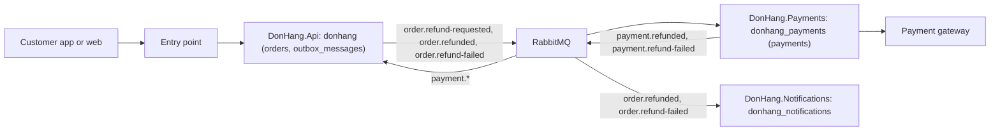

## Before you start

- [[sysdesign.l4.back-of-the-envelope]] — you know refunds arrive at about 0.03 requests per second, so a failing gateway, not load, shapes the flow.
- [[backend.l4.data-ownership]] — you know each kind of data has one owner, and `data-ownership.md` lists them.
- [[design.l4.where-boundaries-are-enforced]] — you know Đơn Hàng keeps modules inside `DonHang.Api` and splits off two services that each own a database.
- [[design.l4.over-abstraction]] — you know a part earns its place with a reason that exists today.

## The situation

You are at step 3 of `docs/design/system-design-method.md`, still looking back at the stage-3 refund flow. The estimate said load does not shape refunds. One colleague sketches three boxes, `DonHang.Api`, `DonHang.Payments` and the payment gateway, with one arrow each way. Another wants a Redis cache and a second queue added to be safe. Neither sketch says where a refund request waits while the gateway is down, which part changes the order when the refund fails, or how staff find failed refunds. What must one drawing show so that gaps like these appear before anyone works out a part in detail?

## Core concepts

- **high-level design** — one diagram of a system's main parts, such as clients, entry points, services, stores and queues, with the path each key operation takes through them.
- key operation — one of the few things users do that the ranked drivers are about, such as a customer asking for a refund; step 1 of the method lists them.
- path — the parts one key operation passes through, in order, including where it waits when a part fails.
- owner of a store — the one module or service that writes it, as `data-ownership.md` records; the diagram writes each store inside its owner's box.
- the method's steps — step 1 clarifies requirements and ranks the drivers, step 2 estimates, step 3 draws the high-level design, and step 4 details one to three parts.
- the refund drivers, ranked in step 1 — YC-7: a refund request is answered within 2 seconds, even while the gateway fails; YC-9: no order is refunded twice; third: the gateway key, the secret for calling the gateway, and the money rows are the most sensitive data.

## How it works



The high-level design is this one drawing: seven parts and the messages between them. The entry point is where clients' calls arrive; the method does not name what runs there.

The drawing holds the fewest parts that meet the drivers. The outbox and the asynchronous step are there because YC-7 asks for an answer within 2 seconds even while the gateway fails, so the request cannot wait for the gateway; RabbitMQ carries that step between the API and Payments because Payments is a separate service. Payments is its own box because of the third driver: only it holds the gateway key. No cache appears: at about 0.03 refund requests per second, no number calls for one.

Each store sits inside its owner's box: `orders` and `outbox_messages` in `donhang` under `DonHang.Api`, `payments` in `donhang_payments` under `DonHang.Payments`. So the drawing also says who writes what.

Then walk each key operation, failures included:

- Submitting: in one transaction the API sets the order to `refunding` and writes the outbox row, then answers `202 Accepted`: received, not yet done. A failing gateway never touches this path.
- Sending: a relay, background code in the service that publishes unsent outbox rows, sends it to RabbitMQ. Payments writes a `pending` row; a background job calls the gateway and, when it fails, retries later.
- Receiving the result: Payments writes the result and a message (`payment.*`: either of its two) to its own outbox. The API, owner of orders, sets the order to `cancelled`, or back to `paid` on failure, and publishes `order.refunded` or `order.refund-failed` for Notifications to email.

A walk that finds no arrow for a step, a store with two writers or a part no driver needs sends you back to the drawing before detailing any part.

## In the Đơn Hàng system

The method writes the paths under its refund diagram:

```markdown file=docs/design/system-design-method.md tag=stage-4 lines=108-118
Mỗi kho có một chủ theo `data-ownership.md`; không service nào ghi vào
database của service khác. Đường đi của từng thao tác chính:

- Gửi yêu cầu: khách → điểm vào → API đổi đơn sang `refunding` và ghi outbox
  trong một transaction → `202`. Cổng lỗi không chạm tới đường này.
- Gửi sang cổng: relay đưa outbox lên RabbitMQ → Payments ghi dòng `pending`
  → job nền gọi cổng. Cổng lỗi: dòng chờ và được thử lại.
- Nhận kết quả: Payments ghi kết quả và message vào outbox của nó → RabbitMQ →
  API đổi đơn → Notifications gửi email.
- Nhân viên xem yêu cầu `failed`: điểm vào → `GET /api/v1/refunds?status=failed`
  của Payments.
```

Lines 108–109 state the rule the boxes follow: each store has one owner, and no service writes another service's database. Lines 111–118 then walk four key operations, one bullet each. Look at what each bullet adds beyond the arrows: lines 112 and 114 say what happens on the path when the gateway fails. Line 117 is the only operation a member of staff starts, and it ends at Payments, not at the API; the walk above leaves it for Try it.

The owners the diagram repeats come from the team's table:

```markdown file=docs/design/data-ownership.md tag=stage-4 lines=11-16
| Dữ liệu | Chủ (module/service, database) | Ai giữ bản sao | Bản sao cập nhật thế nào, hoặc vì sao không | Khi lệch thì tin ai |
|---|---|---|---|---|
| Sản phẩm, giá (`products`) | Catalog, `donhang` | Redis (`product:{id}`) | Xóa sau khi đổi giá; dù lệnh xóa bị lỡ, bản sao sống tối đa 5 phút (TTL). `order_items.unit_price_vnd` không phải bản sao: đó là giá khách đã trả, một dữ kiện của đơn, cố ý không đổi theo giá mới | `products` |
| Đơn (`orders`, `order_items`), khách (`customers`) | Ordering, `donhang` | `order_status_history` (read model); Payments chỉ giữ `order_id` | `RecordOrderStatusHistory` ghi read model cùng transaction với đơn; `order_id` bên Payments là một con số, không có khóa ngoại | `orders` |
| Thanh toán, hoàn tiền (`payments`) | Payments, `donhang_payments` | Bảng `payments` cũ trong `donhang` | Không ai cập nhật: bản chép lúc tách service (ADR 0003); kế toán đối soát với `donhang_payments`, nên bảng cũ chỉ bị xóa sau khi kế toán xác nhận (ADR 0008) | `donhang_payments` |
| Email cần gửi (`notifications`) | Notifications, `donhang_notifications` | Không còn: bảng cũ trong `donhang` đã xóa ở stage-4 (ADR 0008, bước 2) | | `donhang_notifications` |
```

Line 13, products, is not on the refund path. Line 14 gives orders to Ordering, the module inside `DonHang.Api`, in `donhang`. Line 15 gives payments and refunds to Payments, in `donhang_payments`, and names the old `payments` table in `donhang` as a copy nobody updates. Line 16 gives emails to Notifications. Those are the labels inside the diagram's boxes; Payments also keeps its own outbox, which its label leaves out. A path that answered from the old copy would give stale data: nobody updates it, and when the two differ the table says to trust `donhang_payments`.

## Trade-offs

| How the first drawing is made | What it catches early | What it costs | What it misses |
|---|---|---|---|
| Normal path only | the main parts and their order | the least time | where a request waits when a part fails, and who acts on a failure |
| Parts added up front, such as a cache and extra queues | nothing a driver asked for | more to run, to fail and to keep current | which part serves which driver |
| Fewest parts, every key operation walked with its failures | missing arrows, stores with two writers, parts no driver needs | time to walk each operation | the detail inside each part, left to step 4 |
| Every part detailed now | detail nobody has asked for yet | the most time, spent on parts no driver makes hard | whether the whole fits, until it is redrawn |

The walked drawing costs more than a sketch of the normal path, but less than detailing everything, and it tests the drivers against the whole system at the lowest cost of the four. It is the right choice when a review must agree on the parts before anyone details one. It is too little when a single part holds all the risk; then step 4 starts sooner.

## What would you choose if…

…a reviewer asks for Redis in front of the staff list of `failed` refunds? Ask which driver or estimate calls for it. The method treats that list as one read query that no driver makes hard, and nothing estimates a read load on it. Leave the cache out, and say what would bring it back: a measured read load the query cannot carry.

…the gateway turns out to report results later, by calling back into the system? `refund-design.md`, the design document of the refund flow, lists this as risk R1: the step where Payments records the gateway's answer would change. In the drawing it is a new arrow from the gateway inward, so walking it asks at once which part receives the call and which owner writes the result. Redraw before detailing anything.

…`DonHang.Notifications` is down when a refund finishes? Walk it. The API, not Notifications, owns the order and sets it to `cancelled` when `payment.refunded` arrives; Notifications hangs off its own arrow from RabbitMQ, so only the email waits. The method's failure table says the same. The drawing needs no new part.

## Seniors often assume…

- **"A high-level design should already show the classes and the table columns."** → Actually it shows parts, owners and paths, because a review must first agree the parts are right; detail such as classes and columns comes later, only for the parts that need it. You notice this when a review spends its time on column names and nobody asks where a refund waits while RabbitMQ is down.
- **"Adding a cache, a queue and an API gateway up front makes any design more scalable."** → Actually each part is one more thing to run, to fail and to keep current, so it belongs only where a driver or an estimate calls for it: a cache for a measured read load, a queue for a failure the request must survive, as YC-7 does for the refund queue. Every part in the refund drawing names its driver, and there is no cache because 0.03 requests per second needs none. You notice this when nobody in the review can say which driver a box serves.
- **"Drawing the normal path of a request is enough; failures can be designed later."** → Actually failure decides parts: the outbox and the `pending` row exist because YC-7 must hold while the gateway fails. A drawing of the normal path alone could put the gateway call inside the customer's request, the option `refund-design.md` rejects. You notice this when the first gateway outage turns into errors for customers.

## Try it (3 minutes)

Open `docs/design/system-design-method.md` in the `don-hang` repository at tag `stage-4`.

1. Take the last path, lines 117–118: staff view the `failed` refunds through the entry point, answered by Payments.
2. Trace it on the method's diagram, lines 96–106, arrow by arrow, starting at the entry point.

Expected result: the entry point has one arrow, to `DonHang.Api`. No arrow from the entry point reaches `DonHang.Payments`, so the staff path cannot be traced on the diagram as drawn.

Now answer: what would you add, and why not let the API answer from its own database?

<details><summary>Suggested answer</summary>

Add an arrow from the entry point to `DonHang.Payments` for `GET /api/v1/refunds?status=failed`. Payments owns `payments` in `donhang_payments`; the only payments data in the API's database is the old `payments` table, a copy nobody updates, so an answer from it would be out of date. Walking one more key operation found the missing arrow before any part was detailed.

</details>

## Connections

- [[sysdesign.l4.back-of-the-envelope]] — the step before: its numbers decide which parts the drawing needs at all.
- [[sysdesign.l4.deep-dive]] — the next step: it works out in detail the part where the drivers are hardest to meet.
- [[backend.l4.data-ownership]] — the rule the drawing applies: one owner per store, and everyone else asks it.
- [[backend.l3.outbox-pattern]] — the mechanism behind the arrow from `DonHang.Api` to RabbitMQ.
- [[backend.l3.payments-service]] — why `DonHang.Payments` is its own box with its own database.
- [[management.l2.design-doc]] — where the drawing and its paths are written down for others to read.

## Five-line summary

1. A high-level design is one diagram of a system's main parts with the path each key operation takes through them.
2. It starts from the fewest parts that meet the ranked drivers; each extra part, such as a cache, names its driver or estimate.
3. Each store sits inside its one owner's box, as `data-ownership.md` records, so the diagram shows which service writes which data.
4. The refund diagram runs from `DonHang.Api` through its outbox and RabbitMQ to `DonHang.Payments` and the gateway, and back as a message.
5. Walking every key operation, failures included, shows a missing arrow or an unclear owner before any part is detailed.
