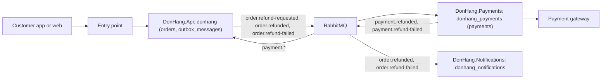

## Bạn cần biết trước

- [[sysdesign.l4.back-of-the-envelope]] — bạn biết yêu cầu hoàn tiền đến khoảng 0,03 lượt mỗi giây, nên thứ định hình luồng là cổng thanh toán lỗi, không phải tải.
- [[backend.l4.data-ownership]] — bạn biết mỗi loại dữ liệu có một chủ, và `data-ownership.md` liệt kê các chủ đó.
- [[design.l4.where-boundaries-are-enforced]] — bạn biết Đơn Hàng giữ các module bên trong `DonHang.Api` và tách ra hai service, mỗi service sở hữu một database.
- [[design.l4.over-abstraction]] — bạn biết một phần chỉ đáng có mặt khi có lý do tồn tại ngay hôm nay.

## Tình huống

Bạn đang ở bước 3 của `docs/design/system-design-method.md`, vẫn nhìn lại luồng hoàn tiền ở stage-3. Phép ước lượng đã cho thấy tải không định hình luồng hoàn tiền. Một đồng nghiệp phác ba ô, `DonHang.Api`, `DonHang.Payments` và cổng thanh toán, mỗi chiều một mũi tên. Người khác muốn thêm Redis cache và một hàng đợi thứ hai cho chắc. Cả hai bản phác đều không nói yêu cầu hoàn tiền nằm chờ ở đâu khi cổng sập, phần nào đổi trạng thái đơn khi hoàn tiền thất bại, hay nhân viên tìm các lượt hoàn tiền thất bại bằng cách nào. Một bản vẽ phải cho thấy những gì để các lỗ hổng như vậy lộ ra trước khi ai đó đi vào chi tiết một phần?

## Khái niệm cốt lõi

- **thiết kế tổng thể** (high-level design) — một sơ đồ các phần chính của hệ thống, như client, điểm vào, service, kho dữ liệu và hàng đợi, kèm đường đi của từng thao tác chính qua chúng.
- thao tác chính — một trong số ít việc người dùng làm mà các yếu tố định hình kiến trúc đã xếp hạng nói tới, như khách yêu cầu hoàn tiền. Bước 1 của phương pháp liệt kê chúng.
- đường đi — các phần mà một thao tác chính đi qua, theo thứ tự, kể cả chỗ nó nằm chờ khi một phần lỗi.
- chủ của một kho — module hay service duy nhất ghi vào kho đó, như `data-ownership.md` ghi lại. Sơ đồ đặt mỗi kho bên trong ô của chủ nó.
- các bước của phương pháp — bước 1 làm rõ yêu cầu và xếp hạng các yếu tố định hình, bước 2 ước lượng, bước 3 vẽ thiết kế tổng thể, bước 4 đi vào chi tiết một đến ba phần.
- các yếu tố định hình của luồng hoàn tiền, xếp hạng ở bước 1 — YC-7: yêu cầu hoàn tiền được trả lời trong 2 giây, kể cả khi cổng lỗi. YC-9: không đơn nào bị hoàn tiền hai lần. Thứ ba: key của cổng, tức khóa bí mật để gọi cổng, và các dòng tiền là dữ liệu nhạy cảm nhất.

## Cơ chế hoạt động



Thiết kế tổng thể chính là bản vẽ này: bảy phần và các message đi giữa chúng. Điểm vào là nơi các lời gọi của client đến. Phương pháp không nêu thứ gì chạy ở đó.

Bản vẽ giữ ít phần nhất mà vẫn đáp ứng các yếu tố định hình. Outbox và bước bất đồng bộ có mặt vì YC-7 đòi trả lời trong 2 giây kể cả khi cổng lỗi, nên yêu cầu không thể chờ cổng. RabbitMQ chở bước đó giữa API và Payments vì Payments là một service riêng. Payments có ô riêng vì yếu tố định hình thứ ba: chỉ nó giữ key của cổng. Không có cache nào: với khoảng 0,03 yêu cầu hoàn tiền mỗi giây, không con số nào đòi tới nó.

Mỗi kho nằm trong ô của chủ nó: `orders` và `outbox_messages` trong `donhang` thuộc `DonHang.Api`, `payments` trong `donhang_payments` thuộc `DonHang.Payments`. Nhờ vậy bản vẽ cũng cho biết ai ghi vào đâu.

Sau đó, đi lại từng thao tác chính, tính cả các trường hợp lỗi:

- Gửi yêu cầu: trong cùng một giao dịch, API đổi đơn sang `refunding` và ghi dòng outbox, rồi trả `202 Accepted`: đã nhận, chưa xong. Cổng lỗi không bao giờ chạm tới đường này.
- Gửi sang cổng: một relay, đoạn code chạy nền trong service chuyên đẩy các dòng outbox chưa gửi, đưa nó lên RabbitMQ. Payments ghi một dòng `pending`. Một background job gọi cổng, và khi cổng lỗi thì thử lại sau.
- Nhận kết quả: Payments ghi kết quả cùng một message (`payment.*`: một trong hai loại của nó) vào outbox của chính mình. API, chủ của đơn, đổi đơn sang `cancelled`, hoặc về lại `paid` nếu thất bại, rồi phát `order.refunded` hay `order.refund-failed` để Notifications gửi email.

Khi đi lại mà gặp một bước không có mũi tên, một kho có hai bên ghi, hay một phần không yếu tố định hình nào cần, bạn quay về bản vẽ trước khi đi vào chi tiết bất kỳ phần nào.

## Trong hệ thống Đơn Hàng

Phương pháp ghi các đường đi ngay dưới sơ đồ hoàn tiền:

```markdown file=docs/design/system-design-method.md tag=stage-4 lines=108-118
Mỗi kho có một chủ theo `data-ownership.md`; không service nào ghi vào
database của service khác. Đường đi của từng thao tác chính:

- Gửi yêu cầu: khách → điểm vào → API đổi đơn sang `refunding` và ghi outbox
  trong một transaction → `202`. Cổng lỗi không chạm tới đường này.
- Gửi sang cổng: relay đưa outbox lên RabbitMQ → Payments ghi dòng `pending`
  → job nền gọi cổng. Cổng lỗi: dòng chờ và được thử lại.
- Nhận kết quả: Payments ghi kết quả và message vào outbox của nó → RabbitMQ →
  API đổi đơn → Notifications gửi email.
- Nhân viên xem yêu cầu `failed`: điểm vào → `GET /api/v1/refunds?status=failed`
  của Payments.
```

Dòng 108–109 nêu quy tắc mà các ô tuân theo: mỗi kho có một chủ, và không service nào ghi vào database của service khác. Dòng 111–118 rồi đi qua bốn thao tác chính, mỗi thao tác một gạch đầu dòng. Hãy xem mỗi gạch đầu dòng thêm được gì ngoài các mũi tên: dòng 112 và 114 nói chuyện gì xảy ra trên đường đi khi cổng lỗi. Dòng 117 là thao tác duy nhất do nhân viên khởi động, và nó kết thúc ở Payments, không ở API. Phần đi lại ở trên chừa nó cho mục Thử ngay.

Các chủ mà sơ đồ lặp lại lấy từ bảng của đội:

```markdown file=docs/design/data-ownership.md tag=stage-4 lines=11-16
| Dữ liệu | Chủ (module/service, database) | Ai giữ bản sao | Bản sao cập nhật thế nào, hoặc vì sao không | Khi lệch thì tin ai |
|---|---|---|---|---|
| Sản phẩm, giá (`products`) | Catalog, `donhang` | Redis (`product:{id}`) | Xóa sau khi đổi giá; dù lệnh xóa bị lỡ, bản sao sống tối đa 5 phút (TTL). `order_items.unit_price_vnd` không phải bản sao: đó là giá khách đã trả, một dữ kiện của đơn, cố ý không đổi theo giá mới | `products` |
| Đơn (`orders`, `order_items`), khách (`customers`) | Ordering, `donhang` | `order_status_history` (read model); Payments chỉ giữ `order_id` | `RecordOrderStatusHistory` ghi read model cùng transaction với đơn; `order_id` bên Payments là một con số, không có khóa ngoại | `orders` |
| Thanh toán, hoàn tiền (`payments`) | Payments, `donhang_payments` | Bảng `payments` cũ trong `donhang` | Không ai cập nhật: bản chép lúc tách service (ADR 0003); kế toán đối soát với `donhang_payments`, nên bảng cũ chỉ bị xóa sau khi kế toán xác nhận (ADR 0008) | `donhang_payments` |
| Email cần gửi (`notifications`) | Notifications, `donhang_notifications` | Không còn: bảng cũ trong `donhang` đã xóa ở stage-4 (ADR 0008, bước 2) | | `donhang_notifications` |
```

Dòng 13, sản phẩm, không nằm trên đường hoàn tiền. Dòng 14 giao đơn cho Ordering, module bên trong `DonHang.Api`, trong `donhang`. Dòng 15 giao thanh toán và hoàn tiền cho Payments, trong `donhang_payments`, và gọi tên bảng `payments` cũ trong `donhang` là một bản sao không ai cập nhật. Dòng 16 giao email cho Notifications. Đó chính là nhãn trong các ô của sơ đồ. Payments còn giữ outbox riêng, thứ mà nhãn của nó bỏ qua. Một đường đi trả lời từ bản sao cũ sẽ cho dữ liệu lỗi thời: không ai cập nhật nó, và khi hai bên lệch nhau, bảng nói tin `donhang_payments`.

## Đánh đổi

| Cách vẽ bản đầu tiên | Bắt được sớm điều gì | Tốn gì | Bỏ sót gì |
|---|---|---|---|
| Chỉ đường bình thường | các phần chính và thứ tự của chúng | ít thời gian nhất | yêu cầu nằm chờ ở đâu khi một phần lỗi, và ai xử lý khi thất bại |
| Thêm phần ngay từ đầu, như cache và thêm hàng đợi | không gì mà yếu tố định hình nào đòi | thêm thứ phải vận hành, có thể hỏng và phải giữ cập nhật | phần nào phục vụ yếu tố định hình nào |
| Ít phần nhất, đi lại mọi thao tác chính cùng các trường hợp lỗi | mũi tên còn thiếu, kho có hai bên ghi, phần không yếu tố định hình nào cần | thời gian để đi lại từng thao tác | chi tiết bên trong mỗi phần, để lại cho bước 4 |
| Chi tiết mọi phần ngay bây giờ | chi tiết chưa ai hỏi tới | nhiều thời gian nhất, tốn vào những phần không yếu tố định hình nào làm khó | cả hệ thống có khớp với nhau không, cho tới khi vẽ lại |

Bản vẽ có đi lại tốn hơn một bản phác đường bình thường, nhưng ít hơn chi tiết mọi thứ, và nó thử các yếu tố định hình trên cả hệ thống với chi phí thấp nhất trong bốn cách. Đây là lựa chọn đúng khi buổi review phải thống nhất các phần trước khi ai đó đi vào chi tiết một phần. Nó là chưa đủ khi một phần duy nhất gánh toàn bộ rủi ro. Khi đó bước 4 bắt đầu sớm hơn.

## Bạn sẽ chọn gì nếu…

…một người review đòi đặt Redis trước danh sách các lượt hoàn tiền `failed` cho nhân viên? Hỏi xem yếu tố định hình hay phép ước lượng nào đòi điều đó. Phương pháp coi danh sách đó là một truy vấn đọc mà không yếu tố định hình nào làm khó, và không ai ước lượng tải đọc lên nó. Bỏ cache ra, và nói rõ điều gì sẽ đưa nó trở lại: một tải đọc đo được mà truy vấn không gánh nổi.

…hóa ra cổng báo kết quả về sau, bằng cách gọi ngược vào hệ thống? `refund-design.md`, design doc của luồng hoàn tiền, ghi điều này là rủi ro R1: bước Payments ghi nhận câu trả lời của cổng sẽ thay đổi. Trên bản vẽ, đó là một mũi tên mới từ cổng đi vào, nên đi lại nó sẽ hỏi ngay phần nào nhận lời gọi và chủ nào ghi kết quả. Vẽ lại trước khi đi vào chi tiết bất cứ thứ gì.

…`DonHang.Notifications` đang sập khi một lượt hoàn tiền xong? Đi lại nó. API, chứ không phải Notifications, là chủ của đơn và đổi đơn sang `cancelled` khi `payment.refunded` tới. Notifications treo trên mũi tên riêng từ RabbitMQ, nên chỉ có email phải chờ. Bảng lỗi của phương pháp cũng nói vậy. Bản vẽ không cần thêm phần nào.

## Senior hay nhầm rằng…

- **"Một thiết kế tổng thể phải cho thấy luôn các class và các cột của bảng."** → Thực ra nó cho thấy các phần, các chủ và các đường đi, vì buổi review trước hết phải thống nhất là các phần đã đúng. Chi tiết như class và cột đến sau, và chỉ cho những phần cần. Bạn sẽ nhận ra khi buổi review dành hết thời gian cho tên cột mà không ai hỏi yêu cầu hoàn tiền nằm chờ ở đâu khi RabbitMQ sập.
- **"Thêm cache, hàng đợi và API gateway ngay từ đầu giúp thiết kế nào cũng dễ mở rộng hơn."** → Thực ra mỗi phần là thêm một thứ phải vận hành, có thể hỏng và phải giữ cập nhật, nên nó chỉ có chỗ khi một yếu tố định hình hay một phép ước lượng đòi tới nó: cache cho một tải đọc đo được, hàng đợi cho một sự cố mà yêu cầu phải sống sót qua, như YC-7 đòi ở hàng đợi hoàn tiền. Mỗi phần trong bản vẽ hoàn tiền đều nêu được yếu tố định hình của nó, và không có cache vì 0,03 yêu cầu mỗi giây không cần tới. Bạn sẽ nhận ra khi không ai trong buổi review nói được một ô phục vụ yếu tố định hình nào.
- **"Vẽ đường bình thường của một request là đủ, các trường hợp lỗi thiết kế sau cũng được."** → Thực ra lỗi quyết định các phần: outbox và dòng `pending` tồn tại vì YC-7 phải đứng vững trong lúc cổng lỗi. Một bản vẽ chỉ có đường bình thường có thể đặt lời gọi cổng ngay trong request của khách, đúng phương án mà `refund-design.md` đã loại. Bạn sẽ nhận ra khi lần cổng sập đầu tiên biến thành lỗi trả về cho khách.

## Thử ngay (3 phút)

Mở `docs/design/system-design-method.md` trong repository `don-hang` ở tag `stage-4`.

1. Lấy đường đi cuối cùng, dòng 117–118: nhân viên xem các lượt hoàn tiền `failed` qua điểm vào, do Payments trả lời.
2. Lần theo nó trên sơ đồ của phương pháp, dòng 96–106, từng mũi tên một, bắt đầu từ điểm vào.

Kết quả mong đợi: điểm vào chỉ có một mũi tên, tới `DonHang.Api`. Không mũi tên nào từ điểm vào tới được `DonHang.Payments`, nên không thể lần theo đường của nhân viên trên sơ đồ như nó đang được vẽ.

Giờ trả lời: bạn sẽ thêm gì, và vì sao không để API trả lời từ database của chính nó?

<details><summary>Gợi ý đáp án</summary>

Thêm một mũi tên từ điểm vào tới `DonHang.Payments` cho `GET /api/v1/refunds?status=failed`. Payments là chủ của `payments` trong `donhang_payments`. Dữ liệu thanh toán duy nhất trong database của API là bảng `payments` cũ, một bản sao không ai cập nhật, nên câu trả lời lấy từ đó sẽ lỗi thời. Đi lại thêm một thao tác chính đã tìm ra mũi tên còn thiếu trước khi phần nào được đi vào chi tiết.

</details>

## Liên hệ

- [[sysdesign.l4.back-of-the-envelope]] — bước trước: các con số của nó quyết định bản vẽ có cần những phần nào.
- [[sysdesign.l4.deep-dive]] — bước tiếp theo: đi vào chi tiết phần mà các yếu tố định hình khó đáp ứng nhất.
- [[backend.l4.data-ownership]] — quy tắc mà bản vẽ áp dụng: mỗi kho một chủ, mọi bên khác hỏi chủ.
- [[backend.l3.outbox-pattern]] — cơ chế đứng sau mũi tên từ `DonHang.Api` tới RabbitMQ.
- [[backend.l3.payments-service]] — vì sao `DonHang.Payments` có ô riêng với database riêng.
- [[management.l2.design-doc]] — nơi bản vẽ và các đường đi được ghi lại cho người khác đọc.

## Tóm tắt 5 dòng

1. Thiết kế tổng thể là một sơ đồ các phần chính của hệ thống, kèm đường đi của từng thao tác chính qua chúng.
2. Nó bắt đầu từ ít phần nhất đáp ứng được các yếu tố định hình đã xếp hạng. Mỗi phần thêm vào, như cache, phải nêu được yếu tố định hình hay phép ước lượng của nó.
3. Mỗi kho nằm trong ô của chủ duy nhất của nó, như `data-ownership.md` ghi lại, nên sơ đồ cho thấy service nào ghi dữ liệu nào.
4. Sơ đồ hoàn tiền đi từ `DonHang.Api` qua outbox và RabbitMQ tới `DonHang.Payments` và cổng, rồi quay về dưới dạng message.
5. Đi lại mọi thao tác chính, tính cả các trường hợp lỗi, làm lộ ra mũi tên còn thiếu hay chủ chưa rõ trước khi đi vào chi tiết phần nào.
