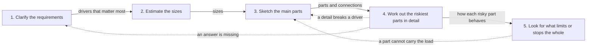

## Before you start

- [[design.l4.architectural-drivers]] — you know a shape is chosen from the drivers, the needs and constraints, not from a style.
- [[management.l2.requirements-document]] — you know `refund-requirements.md` states the problem, goals, scope, numbered requirements and open questions.
- [[management.l2.design-doc]] — you know `refund-design.md` says how refunds are built and names the options it rejected.
- [[management.l3.architecture-decision-record]] — you know ADR `0003` keeps one decision, why Payments became a service, with its context and consequences.

## The situation

In Sprint 17 your team lead asks you to lead the design of the next feature that crosses services. You have read the refund work: `refund-requirements.md`, `refund-design.md` and ADR `0003`. Each file makes sense on its own, but none says which came first, and `refund-design.md` is already its second version, rewritten after Payments became a service. A teammate suggests starting the new work by choosing between RabbitMQ and plain HTTP calls. You cannot tell whether that choice is the first step or the fourth. In what order is the design of a whole system worked out, and what does each step hand to the next?

## Core concepts

- **system design** — deciding the parts of a whole system, how they connect, where each kind of data lives, and how the system behaves under load and when a part fails.
- the steps — clarify the requirements, estimate the sizes, sketch the main parts, work out the riskiest parts in detail, then look for what limits or stops the whole.
- hand-off — what one step gives the next: the drivers that matter most say what to estimate, and the sizes say which parts the sketch needs at all.
- going back — a step that finds a problem sends the work to an earlier step, so the steps form a loop, not a line.

## How it works



Read the solid arrows first. Each one is labelled with what a step hands to the next, and that label is the reason for the order.

Step 1 turns a request into requirements and picks out the drivers that matter most. In the refund work, ADR `0003` names them: YC-7, YC-9 and YC-10 from the requirements file, plus keeping the gateway's API key, the secret that lets a service call it, in as few places as possible. The requirements file itself does not state that last concern. The drivers tell step 2 what to estimate: if refunds must be retried for 24 hours, you need to know how many can pile up in that time. Step 2 answers with rough sizes, and the sizes tell step 3 which parts it needs at all. A few requests a day and a few thousand a second do not need the same parts.

Step 3 sketches the main parts and how they connect. Step 4 picks the parts most likely to fail and works out in detail how each behaves. Step 5 needs that behaviour to look along the whole path for the part that runs out first or stops everything when it fails.

The dashed arrows make the order a loop. When a detail breaks a driver, the sketch changes. When a question nobody has answered blocks the detail, the work goes back to the requirements to get that answer. When step 5 finds a part that cannot carry the load, the sketch changes again.

The choice your teammate raised, a broker or plain calls, is a detail of step 3 or 4. It comes after the drivers and sizes that would decide it.

## In the Đơn Hàng system

The non-functional requirements in `refund-requirements.md`, the output of step 1:

```markdown file=docs/team/refund-requirements.md tag=stage-3 lines=43-50
- YC-7: Yêu cầu hoàn tiền của khách được nhận và trả lời trong 2 giây, kể cả
  khi cổng thanh toán không trả lời hoặc báo lỗi.
- YC-8: Mỗi yêu cầu hoàn tiền lưu người yêu cầu và thời điểm yêu cầu; hai thông
  tin này không bị sửa hay xóa về sau, để kế toán đối soát.
- YC-9: Một đơn không bao giờ được hoàn tiền hai lần, kể cả khi việc gửi sang
  cổng thanh toán phải thử lại.
- YC-10: Khi cổng thanh toán lỗi, yêu cầu được gửi lại tự động trong ít nhất 24
  giờ trước khi chuyển cho nhân viên xử lý.
```

YC-7 asks for an answer within 2 seconds even when the gateway fails, YC-8 for a record of who asked and when that is never changed or deleted, YC-9 for never refunding an order twice, and YC-10 for automatic resending for at least 24 hours. These lines are what step 2 would size. None of the three refund files states how many refunds to expect, so the estimate step left no output there.

From `refund-design.md`, the rejected option of one distributed transaction:

```markdown file=docs/design/refund-design.md tag=stage-3 lines=67-74
Bản 1 ghi dòng hoàn tiền, trạng thái đơn và email trong một transaction, vì
mọi thứ cùng nằm trong một cơ sở dữ liệu. Sau khi tách, giữ được điều đó cần
two-phase commit qua `donhang`, `donhang_payments`, RabbitMQ và cổng thanh
toán. Không làm được: RabbitMQ không tham gia được transaction của PostgreSQL,
API HTTP của cổng không có bước prepare, và chính PostgreSQL của Đơn Hàng tắt
`PREPARE TRANSACTION` (`max_prepared_transactions` là 0). Kể cả làm được, một
coordinator dừng giữa chừng sẽ để các dòng bị khóa cho tới khi nó quay lại.
Vì vậy mỗi bước là một transaction cục bộ, nối với nhau bằng outbox và inbox.
```

Lines 67–68: version 1 wrote the refund row, the order status and the email in one transaction, because everything sat in one database. Lines 68–72: once Payments was split off, keeping that would take two-phase commit across two databases, RabbitMQ and the gateway, and the file names three reasons it cannot work. Lines 72–73 add that even if it worked, a stop halfway would leave rows locked. Line 74: so each step became a local transaction, joined by outbox and inbox. This is the loop at work: a sketch with Payments split off met a detail it could not survive, and the way the parts connect changed. The file's opening lines, outside this excerpt, say it is version 2 for that reason.

Together the three files hold the output of steps 1, 3 and 4. `refund-requirements.md` is step 1. `refund-design.md` holds the sketch, as numbered steps in prose, and the detail, with its rejected options. ADR `0003` keeps the one decision taken at step 3 that is costly to undo, splitting Payments out. No file draws the flow as a diagram. The later lessons of this module add the missing steps to the same refund example.

## Trade-offs

| Way of working | When the first diagram appears | When a detail breaks a driver | What a later reader can check |
|---|---|---|---|
| Start from products, such as a database and a broker | at once | often found late; the products tend to stay and the design bends around them | the products, not the reasons for them |
| The steps once, in a line | after every requirement is settled | often found late; with no planned way back, the plan tends to ignore it or start over | each step's output, but not why it changed |
| The steps as a loop | after a first pass through requirements and sizes | sends the work back one or two steps; the files are edited | each version, the drivers and the rejected options |

The loop costs the most passes and the most file edits. It pays back when a mistake found late is expensive, as splitting Payments out was. For a change that is small and easy to undo, one quick pass through the steps is enough.

## What would you choose if…

…the change were a new filter on `GET /api/v1/refunds`? It moves no data, adds no part and is easy to undo. Run the steps in your head in a minute and describe the change in the pull request. No ADR is needed for a choice that is easy to undo.

…the gateway provider answered that it does not accept idempotency keys? That is a missing answer arriving, so go back to step 1 and add the fact as a constraint, then redo the detail that rested on it. `refund-design.md` already names this case under its risks: the fourth numbered item of its refund flow, the job that calls the gateway, would have to ask for the refund's status before each resend.

…you had one hour in a room to design a system you had never seen, as in a job interview? Run the same five steps, but in minutes each. Ask the questions of step 1 aloud, say your assumptions when nobody can answer, and keep time for steps 4 and 5, where the design is tested.

## Seniors often assume…

- **"System design starts by picking the database and the message broker."** → Actually products are answers to drivers and sizes, so they come at step 3 or 4. In the refund work, the database `donhang_payments` appears only in version 2, after the gateway's API key had made a separate service worth it. You notice this belief when a design doc opens with products and its requirements read as if written afterwards to justify them.
- **"An experienced designer goes straight to the final diagram and needs no steps."** → Actually experience makes each step faster; it does not remove the steps or the way back. The refund design itself needed a second version once Payments was split off. You notice this when a confident diagram breaks on the first question about a driver, such as what happens while the gateway is down for an hour.
- **"A system design method is for job interviews, not for real projects."** → Actually an interview squeezes the steps into one sitting, and a project spreads them over sprints and files. Đơn Hàng's refund work left a requirements file, a design doc in two versions and an ADR, the outputs of the same steps. You notice this when a project skips the estimate and a later load surprises everyone.

## Try it (3 minutes)

Open `docs/team/refund-requirements.md`, `docs/design/refund-design.md` and `docs/adr/0003-tach-payments-thanh-service.md` in the `don-hang` repository at tag `stage-3`.

1. Write which of the five steps produced each of these: the requirements file, the design doc's numbered list under its `## Thiết kế` heading, its two rejected options, and ADR `0003`.
2. Search the three files for a number of refunds to expect per day or per hour.

Expected result: the requirements file is step 1, including its table of open questions with who answers each. The numbered list is the sketch, step 3, and the rejected options are detail, step 4. ADR `0003` records a decision taken at step 3, splitting Payments out. You find no expected number of refunds and no diagram.

Your teammate's question from the situation was RabbitMQ or plain HTTP calls. Write which step that question belongs to, and the two things you would need from earlier steps before answering it.

<details><summary>Suggested answer</summary>

It belongs to step 3 or step 4, since it is about how the parts connect. Before answering it you need, from step 1, the drivers that matter most, such as whether the request must be accepted while the other service is down, as YC-7 demands for refunds. From step 2 you need the sizes: how many requests to expect and how many may wait while a part is down. Without those, either choice is a guess.

</details>

## Connections

- [[sysdesign.l4.clarifying-requirements]] — step 1 in detail: the questions that change a design's shape.
- [[backend.l4.capacity-planning]] — sizing for a running system; step 2 does the same arithmetic earlier, before parts are chosen.
- [[design.l4.reduced-atam]] — a way to check a finished sketch against its scenarios; it tests the output of steps 3 and 4.
- [[design.l4.evolutionary-architecture]] — the same loop over a longer time: drivers change after release and send the design back again.

## Five-line summary

1. System design moves through steps that each feed the next, and a step that finds a problem sends the work back.
2. Clarify the requirements, estimate the sizes, sketch the main parts, work out the riskiest parts in detail, then look for limits.
3. The drivers that matter most say what to estimate, and the sizes say which parts the design needs at all.
4. Đơn Hàng's refund work left three steps in files: requirements, a design doc with rejected options, and ADR `0003`.
5. None of those files counts the refunds to expect or draws the flow; this module's later lessons add those steps.
