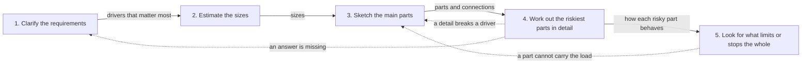

## Bạn cần biết trước

- [[design.l4.architectural-drivers]] — bạn biết hình dạng của hệ thống được chọn từ các yếu tố định hình kiến trúc, tức các nhu cầu và ràng buộc, chứ không từ một kiểu kiến trúc.
- [[management.l2.requirements-document]] — bạn biết `refund-requirements.md` nêu vấn đề, mục tiêu, phạm vi, các yêu cầu đánh số và những câu hỏi còn mở.
- [[management.l2.design-doc]] — bạn biết `refund-design.md` nói hoàn tiền được xây thế nào và kể tên các phương án đã loại.
- [[management.l3.architecture-decision-record]] — bạn biết ADR `0003` giữ một quyết định, vì sao Payments thành một service, cùng bối cảnh và hệ quả của nó.

## Tình huống

Ở Sprint 17, trưởng nhóm giao bạn dẫn dắt phần thiết kế cho tính năng tiếp theo đi qua nhiều service. Bạn đã đọc phần làm hoàn tiền: `refund-requirements.md`, `refund-design.md` và ADR `0003`. Từng file đọc riêng đều hợp lý, nhưng không file nào cho biết cái nào có trước, và `refund-design.md` đã là bản thứ hai, viết lại sau khi Payments thành một service. Một đồng đội đề nghị bắt đầu việc mới bằng cách chọn giữa RabbitMQ và gọi HTTP thẳng. Bạn không biết lựa chọn đó là bước đầu tiên hay bước thứ tư. Thiết kế cả một hệ thống được làm theo thứ tự nào, và mỗi bước trao gì cho bước sau?

## Khái niệm cốt lõi

- **thiết kế hệ thống** (system design) — quyết định các phần của cả một hệ thống, chúng nối với nhau ra sao, mỗi loại dữ liệu nằm ở đâu, và hệ thống cư xử thế nào khi chịu tải và khi một phần bị lỗi.
- các bước — làm rõ yêu cầu, ước lượng quy mô, phác các phần chính, đi sâu vào những phần rủi ro nhất, rồi tìm thứ giới hạn hoặc làm dừng cả hệ thống.
- bàn giao — thứ một bước trao cho bước sau: các yếu tố định hình kiến trúc quan trọng nhất cho biết cần ước lượng gì, còn các con số quy mô cho biết bản phác có cần những phần nào.
- quay lại — bước nào phát hiện vấn đề thì đẩy công việc về một bước trước đó, nên các bước tạo thành một vòng lặp, không phải một đường thẳng.

## Cơ chế hoạt động



Đọc các mũi tên liền trước. Mỗi mũi tên ghi thứ một bước trao cho bước sau, và nhãn đó chính là lý do của thứ tự.

Bước 1 biến một lời đề nghị thành yêu cầu và chọn ra các yếu tố định hình kiến trúc quan trọng nhất. Trong phần làm hoàn tiền, ADR `0003` kể tên chúng: YC-7, YC-9 và YC-10 trong file yêu cầu, cộng thêm mong muốn giữ API key của cổng thanh toán, tức bí mật cho phép một service gọi cổng, ở càng ít nơi càng tốt. Bản thân file yêu cầu không nêu mối lo cuối cùng này. Các yếu tố đó cho bước 2 biết cần ước lượng gì: nếu hoàn tiền phải được thử lại trong 24 giờ, bạn cần biết bao nhiêu yêu cầu có thể dồn lại trong khoảng đó. Bước 2 trả lời bằng các con số quy mô thô, và các con số đó cho bước 3 biết nó có cần những phần nào. Vài yêu cầu mỗi ngày và vài nghìn yêu cầu mỗi giây không cần cùng những phần như nhau.

Bước 3 phác các phần chính và cách chúng nối với nhau. Bước 4 chọn những phần dễ hỏng nhất và tính kỹ từng phần cư xử ra sao. Bước 5 cần chính cách cư xử đó để nhìn dọc cả đường đi, tìm phần cạn sức trước tiên hoặc làm dừng mọi thứ khi nó lỗi.

Các mũi tên nét đứt biến thứ tự thành vòng lặp. Khi một chi tiết phá vỡ một yếu tố định hình kiến trúc, bản phác thay đổi. Khi một câu hỏi chưa ai trả lời chặn phần chi tiết, công việc quay về phần yêu cầu để lấy câu trả lời. Khi bước 5 tìm ra một phần không gánh nổi tải, bản phác lại thay đổi.

Lựa chọn mà đồng đội nêu, một broker hay gọi thẳng, là chi tiết của bước 3 hoặc 4. Nó đến sau các yếu tố định hình kiến trúc và các con số quy mô, những thứ sẽ quyết định nó.

## Trong hệ thống Đơn Hàng

Các yêu cầu phi chức năng trong `refund-requirements.md`, đầu ra của bước 1:

```markdown file=docs/team/refund-requirements.md tag=stage-3 lines=43-50
- YC-7: Yêu cầu hoàn tiền của khách được nhận và trả lời trong 2 giây, kể cả
  khi cổng thanh toán không trả lời hoặc báo lỗi.
- YC-8: Mỗi yêu cầu hoàn tiền lưu người yêu cầu và thời điểm yêu cầu; hai thông
  tin này không bị sửa hay xóa về sau, để kế toán đối soát.
- YC-9: Một đơn không bao giờ được hoàn tiền hai lần, kể cả khi việc gửi sang
  cổng thanh toán phải thử lại.
- YC-10: Khi cổng thanh toán lỗi, yêu cầu được gửi lại tự động trong ít nhất 24
  giờ trước khi chuyển cho nhân viên xử lý.
```

YC-7 đòi trả lời trong 2 giây kể cả khi cổng thanh toán lỗi, YC-8 đòi một bản ghi ai yêu cầu và khi nào, không bao giờ bị sửa hay xóa, YC-9 đòi một đơn không bao giờ bị hoàn tiền hai lần, và YC-10 đòi tự động gửi lại trong ít nhất 24 giờ. Những dòng này là thứ bước 2 sẽ ước lượng. Cả ba file hoàn tiền đều không nói dự kiến bao nhiêu lượt hoàn tiền, nên bước ước lượng không để lại đầu ra nào ở đây.

Trong `refund-design.md`, phương án bị loại là một giao dịch phân tán:

```markdown file=docs/design/refund-design.md tag=stage-3 lines=67-74
Bản 1 ghi dòng hoàn tiền, trạng thái đơn và email trong một transaction, vì
mọi thứ cùng nằm trong một cơ sở dữ liệu. Sau khi tách, giữ được điều đó cần
two-phase commit qua `donhang`, `donhang_payments`, RabbitMQ và cổng thanh
toán. Không làm được: RabbitMQ không tham gia được transaction của PostgreSQL,
API HTTP của cổng không có bước prepare, và chính PostgreSQL của Đơn Hàng tắt
`PREPARE TRANSACTION` (`max_prepared_transactions` là 0). Kể cả làm được, một
coordinator dừng giữa chừng sẽ để các dòng bị khóa cho tới khi nó quay lại.
Vì vậy mỗi bước là một transaction cục bộ, nối với nhau bằng outbox và inbox.
```

Dòng 67–68: bản 1 ghi dòng hoàn tiền, trạng thái đơn và email trong một giao dịch, vì mọi thứ nằm chung một database. Dòng 68–72: khi Payments đã tách ra, giữ được điều đó cần two-phase commit qua hai database, RabbitMQ và cổng thanh toán, và file nêu ba lý do không làm được. Dòng 72–73 thêm rằng kể cả làm được, dừng giữa chừng sẽ để các dòng bị khóa. Dòng 74: vì vậy mỗi bước thành một giao dịch cục bộ, nối với nhau bằng outbox và inbox. Đây là vòng lặp đang chạy: một bản phác có Payments tách riêng gặp một chi tiết nó không vượt qua được, và cách các phần nối với nhau thay đổi. Mấy dòng mở đầu của file, nằm ngoài đoạn trích, nói đây là bản 2 vì lý do đó.

Gộp lại, ba file giữ đầu ra của bước 1, 3 và 4. `refund-requirements.md` là bước 1. `refund-design.md` giữ bản phác, viết thành các bước đánh số bằng văn xuôi, và phần chi tiết, kèm các phương án đã loại. ADR `0003` giữ một quyết định ở bước 3 mà khó quay lui, tách Payments ra. Không file nào vẽ luồng thành sơ đồ. Các bài sau của module này bổ sung những bước còn thiếu trên chính ví dụ hoàn tiền này.

## Đánh đổi

| Cách làm | Khi nào sơ đồ đầu tiên xuất hiện | Khi một chi tiết phá vỡ một yếu tố định hình kiến trúc | Người đọc sau kiểm được gì |
|---|---|---|---|
| Bắt đầu từ sản phẩm, như một database và một broker | ngay lập tức | thường phát hiện muộn, sản phẩm có xu hướng ở lại và thiết kế bị uốn quanh chúng | các sản phẩm, không phải lý do chọn chúng |
| Các bước làm một lần, theo đường thẳng | sau khi mọi yêu cầu đã chốt | thường phát hiện muộn, không có đường quay lại định sẵn nên kế hoạch có xu hướng lờ nó đi hoặc làm lại từ đầu | đầu ra của từng bước, nhưng không biết vì sao nó đổi |
| Các bước làm thành vòng lặp | sau lượt đầu qua yêu cầu và quy mô | đẩy công việc lùi một hai bước, các file được sửa | từng phiên bản, các yếu tố định hình kiến trúc và các phương án đã loại |

Vòng lặp tốn nhiều lượt nhất và phải sửa file nhiều nhất. Nó đáng giá khi một sai lầm phát hiện muộn sẽ đắt, như việc tách Payments ra. Với thay đổi nhỏ và dễ quay lui, đi nhanh qua các bước một lượt là đủ.

## Bạn sẽ chọn gì nếu…

…thay đổi là một bộ lọc mới trên `GET /api/v1/refunds`? Nó không chuyển dữ liệu đi đâu, không thêm phần nào và dễ quay lui. Chạy các bước trong đầu trong một phút rồi mô tả thay đổi trong pull request. Không cần ADR cho một lựa chọn dễ quay lui.

…bên cung cấp cổng thanh toán trả lời rằng họ không nhận idempotency key? Đó là một câu trả lời còn thiếu vừa tới, nên quay về bước 1, thêm sự thật đó thành một ràng buộc, rồi làm lại phần chi tiết đã dựa vào nó. `refund-design.md` đã nêu trường hợp này trong mục rủi ro: mục thứ tư trong luồng hoàn tiền đánh số, job gọi cổng thanh toán, sẽ phải hỏi trạng thái của lượt hoàn tiền trước mỗi lần gửi lại.

…bạn có một giờ trong phòng họp để thiết kế một hệ thống chưa từng thấy, như trong buổi phỏng vấn xin việc? Chạy đúng năm bước đó, nhưng mỗi bước vài phút. Hỏi thành tiếng các câu của bước 1, nói rõ giả định khi không ai trả lời được, và chừa thời gian cho bước 4 và 5, nơi thiết kế bị thử thách.

## Senior hay nhầm rằng…

- **"Thiết kế hệ thống bắt đầu bằng việc chọn database và message broker."** → Thực ra sản phẩm là câu trả lời cho các yếu tố định hình kiến trúc và các con số quy mô, nên chúng đến ở bước 3 hoặc 4. Trong phần làm hoàn tiền, database `donhang_payments` chỉ xuất hiện ở bản 2, sau khi API key của cổng thanh toán khiến một service riêng trở nên đáng làm. Bạn sẽ nhận ra khi một design doc mở đầu bằng sản phẩm, còn phần yêu cầu đọc như được viết sau để biện minh cho chúng.
- **"Người thiết kế có kinh nghiệm đi thẳng tới sơ đồ cuối cùng, không cần bước nào."** → Thực ra kinh nghiệm làm mỗi bước nhanh hơn, nó không xóa các bước hay đường quay lại. Chính thiết kế hoàn tiền cũng cần bản thứ hai khi Payments tách ra. Bạn sẽ nhận ra khi một sơ đồ đầy tự tin gãy ngay ở câu hỏi đầu tiên về một yếu tố định hình kiến trúc, chẳng hạn chuyện gì xảy ra khi cổng thanh toán sập một giờ.
- **"Phương pháp thiết kế hệ thống là để đi phỏng vấn, không phải cho dự án thật."** → Thực ra buổi phỏng vấn nén các bước vào một lần ngồi, còn dự án trải chúng ra qua nhiều sprint và nhiều file. Phần làm hoàn tiền của Đơn Hàng để lại một file yêu cầu, một design doc hai phiên bản và một ADR, đầu ra của chính những bước đó. Bạn sẽ nhận ra khi một dự án bỏ qua bước ước lượng và một đợt tải về sau làm mọi người bất ngờ.

## Thử ngay (3 phút)

Mở `docs/team/refund-requirements.md`, `docs/design/refund-design.md` và `docs/adr/0003-tach-payments-thanh-service.md` trong repository `don-hang` ở tag `stage-3`.

1. Ghi xem bước nào trong năm bước đã tạo ra từng thứ sau: file yêu cầu, danh sách đánh số dưới tiêu đề `## Thiết kế` của design doc, hai phương án bị loại của nó, và ADR `0003`.
2. Tìm trong ba file một con số dự kiến về lượt hoàn tiền mỗi ngày hoặc mỗi giờ.

Kết quả mong đợi: file yêu cầu là bước 1, kể cả bảng câu hỏi còn mở ghi ai trả lời từng câu. Danh sách đánh số là bản phác, bước 3, còn các phương án bị loại là phần chi tiết, bước 4. ADR `0003` ghi một quyết định đưa ra ở bước 3, tách Payments ra. Bạn không tìm thấy con số dự kiến nào về lượt hoàn tiền, và không có sơ đồ nào.

Câu hỏi của đồng đội trong tình huống là RabbitMQ hay gọi HTTP thẳng. Ghi xem câu hỏi đó thuộc bước nào, và hai thứ bạn cần từ các bước trước khi trả lời nó.

<details><summary>Gợi ý đáp án</summary>

Nó thuộc bước 3 hoặc bước 4, vì nó nói về cách các phần nối với nhau. Trước khi trả lời, bạn cần từ bước 1 các yếu tố định hình kiến trúc quan trọng nhất, chẳng hạn yêu cầu có phải được nhận trong lúc service kia sập không, như YC-7 đòi cho hoàn tiền. Từ bước 2, bạn cần các con số quy mô: dự kiến bao nhiêu yêu cầu, và bao nhiêu yêu cầu có thể phải chờ khi một phần sập. Thiếu những thứ đó, chọn bên nào cũng chỉ là đoán.

</details>

## Liên hệ

- [[sysdesign.l4.clarifying-requirements]] — bước 1 chi tiết: những câu hỏi làm đổi hình dạng của thiết kế.
- [[backend.l4.capacity-planning]] — ước lượng quy mô cho một hệ thống đang chạy, bước 2 làm đúng phép tính đó nhưng sớm hơn, trước khi chọn các phần.
- [[design.l4.reduced-atam]] — cách kiểm một bản phác đã xong theo các kịch bản của nó, phép kiểm này thử đầu ra của bước 3 và 4.
- [[design.l4.evolutionary-architecture]] — cùng vòng lặp đó nhưng trên thời gian dài hơn: các yếu tố định hình kiến trúc đổi sau khi phát hành và lại đẩy thiết kế quay về.

## Tóm tắt 5 dòng

1. Thiết kế hệ thống đi qua từng bước, bước trước nuôi bước sau, và bước nào phát hiện vấn đề thì đẩy công việc quay lại.
2. Làm rõ yêu cầu, ước lượng quy mô, phác các phần chính, đi sâu vào những phần rủi ro nhất, rồi tìm giới hạn.
3. Các yếu tố định hình kiến trúc quan trọng nhất cho biết cần ước lượng gì, còn các con số quy mô cho biết thiết kế có cần những phần nào.
4. Phần làm hoàn tiền của Đơn Hàng để lại ba bước trong file: yêu cầu, một design doc kèm các phương án đã loại, và ADR `0003`.
5. Không file nào đếm số lượt hoàn tiền dự kiến hay vẽ luồng, các bài sau của module này bổ sung những bước đó.
