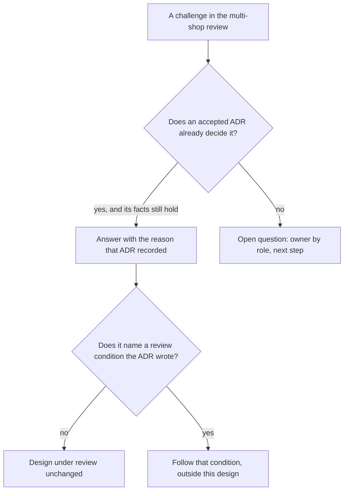

## Before you start

- [[sysdesign.l4.multi-shop-trade-offs]] — you know the review's two trade-off points for ADR `0026`, and that its rejected options keep their reasons in ADRs `0013` and `0012`.
- [[sysdesign.l4.answering-challenges]] — you answer a challenge with the driver or trade-off point behind a decision, named with its file, and turn an uncovered case into an open question with an owner.

## The situation

The design review for ADR `0026` reaches its last part: the challenges. Four questions come fast. Why not give every shop its own database and be done? What protects the other shops while the largest one waits for its move? How does a report across all shops read a shop that now lives in another database? What if a large shop's contract demands a copy of the whole system for itself?

You could answer each with a fresh argument made up on the spot. Yet some of these questions were settled before this design began, in ADRs the team accepted.

Which challenges need a new answer, and which already have one?

## Core concepts

- a challenge that reopens a decision — a question that asks to decide an accepted ADR again, such as "why not a database for every shop"; its answer is the reason that ADR recorded.
- a challenge that finds a gap — a question about a case the design does not cover; its answer is an open question with an owner by role and a next step.
- a review condition — the case an ADR lists under "the team reviews the decision when"; a challenge that names it is answered by what the condition already says, not by changing the design under review.

## How it works



In the situation above, the four questions sort into two kinds. Three ask about something an accepted ADR already decided: a database for every shop (ADR `0013`), protection from a busy shop (ADR `0016`), a contract demanding its own copy (ADR `0012`). The fourth, the report across shops, finds a case no decision covers yet.

For the first kind, the answer is the reason already written in the ADR, given with its number. That reason was weighed against other options and was open for the team's comments until a set date before it was accepted, so a reviewer can open the file and check it. An argument made up in the session has no such record. The review document says so at its start: it does not reopen ADRs `0012`, `0013` and `0016`. This holds only while the facts the ADR weighed still hold; if the challenge shows one changed, it is recorded with an owner and weighed again in a new ADR.

A review condition is a special case of the first kind. The ADR expected the challenge and wrote what happens then, so the answer quotes the condition. Whatever the condition says to do, such as a separate copy for one shop, happens outside the design under review.

For the second kind, no ADR holds the answer, and none is invented in the session. The review records an open question with an owner by role and a next step. The design is still accepted for the cases it does cover; the gap gets its decision when the work that meets it begins.

## In the Đơn Hàng system

The challenge table at the end of the design review holds all four questions, plus one more:

```markdown file=docs/design/multi-shop-design-review.md tag=stage-4 lines=109-117
### Câu hỏi phản biện trong buổi review

| Câu hỏi | Trả lời, trỏ driver, ADR hoặc rủi ro | Việc tiếp theo | Người phụ trách (vai trò) |
|---|---|---|---|
| Sao không cho mỗi cửa hàng một database luôn? | ADR 0013: mỗi migration chạy 1.000 lần | Không | |
| Trong lúc cửa hàng lớn chờ chuyển, gì bảo vệ cửa hàng khác? | ADR 0016: trần theo cửa hàng, có khi access token mang cửa hàng từ release 2 | Không | |
| Báo cáo gộp mọi cửa hàng đọc cửa hàng có database riêng thế nào? | Mở: một truy vấn không join được hai database | Ghi vào câu hỏi mở | Product owner, cùng lập trình viên backend |
| Hợp đồng đòi bản riêng thì sao? | Điều kiện xem lại của ADR 0012, không đổi thiết kế này | Không | |
| Cửa hàng chuyển rồi lại nhỏ đi thì có chuyển về không? | Mở: chưa có điều kiện chuyển ngược | Thêm vào điều kiện xem lại khi có trường hợp đầu tiên | Trưởng nhóm |
```

The first row answers "a database for every shop" with ADR `0013`'s reason, not a new one. That ADR found that, with 1,000 shops, a database or schema for each would turn every release of a service into 1,000 migration runs, and every new shop into creating a database. Its next step is "none": the decision stands.

The second row answers with ADR `0016`: each shop has a ceiling, a fixed share out of the 20 concurrent reads each process allows today (assumed a quarter of them). The ceiling needs the shop of each request, so it starts later. `multi-shop-data-rollout.md` is the plan that adds the shop to the data in three releases; release 2 is the one where the access token starts carrying the caller's shop. Until then, `Program.cs` keeps its shared limits unchanged at stage-4, such as `catalog-reads`, which every shop's product reads count against together. ADR `0016` names the next step for a shop that keeps needing more than its share: ADR `0013`'s review condition, which moves that shop to a database of its own. The large shop waiting for ADR `0026` is that case.

The third row is a gap. One query cannot name a table in another database: PostgreSQL refuses it with "cross-database references are not implemented". At the time of the review, no ADR decided how a report across shops should work, so the review writes it down as open, with the product owner and a backend developer as owners. The same document says the report design will need an ADR of its own.

The fourth row names a review condition. ADR `0012` wrote it, and also recorded the same question asked once before:

```markdown file=docs/adr/0012-phuc-vu-moi-cua-hang-tu-mot-ban-trien-khai.md tag=stage-4 lines=52-63
Đội xem lại quyết định khi:

- Một cửa hàng có hợp đồng đòi một bản hệ thống riêng. Cửa hàng đó được cấp
  một bản riêng của cùng hệ thống, các cửa hàng khác vẫn được phục vụ như cũ.
- Số đội tăng tới mức các đội phải chờ nhau để sửa cùng một module; lúc đó
  ranh giới module, và có thể là service, được xem lại theo ranh giới đội.

### Ý kiến đã nhận

Product owner hỏi một cửa hàng lớn có được bản riêng ngay từ đầu không.
Không, cho tới khi hợp đồng đòi; điều kiện xem lại thứ nhất ghi trường hợp
đó, và bản riêng khi ấy không đổi cách phục vụ các cửa hàng còn lại.
```

The first condition is the contract case: that shop gets a separate copy of the same system, and every other shop is served as before. Under "comments received", the product owner had already asked whether a large shop could have its own copy from the start; the answer was no, until a contract demands it.

The last row is a second gap, not in the situation: a shop that moved and later shrinks has no condition for moving back. The team lead owns it, and the next step is to add a review condition when the first such case appears.

## Trade-offs

| Way to answer | What it buys | What it pays | When it is the wrong choice |
|---|---|---|---|
| Point at the accepted ADR's reason | a short answer the reviewer can check; the session reaches the real gaps | depends on the ADR's context still holding | the challenge brings a fact the ADR never weighed |
| Argue the ADR again in the session | a chance to notice a changed driver | time spent on settled questions; a new reason with no record | nothing has changed since the ADR |
| Record a gap as an open question | the design is accepted for what it covers | the gap waits, and needs an owner who follows it up | the gap breaks one of the design's own drivers |
| Fix a gap in the session | the gap closes at once | a change no driver asked for and nobody reviewed | almost always, at review time |

Pointing at an ADR rests on one assumption: the facts it weighed still hold. When a challenge shows one has changed, arguing again is right: the challenge becomes the reason to write a new ADR that replaces the old one.

## What would you choose if…

…a reviewer says the largest shop has just signed a contract that demands a copy of the system for itself? The challenge meets ADR `0012`'s first review condition. That shop gets a separate copy of the same system, and ADR `0026`'s design stays as it is for every other shop.

…a reviewer shows that the business now expects about 50 shops, not 1,000? ADR `0013`'s reason was 1,000 migration runs per release, built on the assumed 1,000 shops. With that driver changed, quoting ADR `0013` no longer answers the challenge. You record it with an owner, and the decision is weighed again in a new ADR.

…the product owner wants the report across shops in the next sprint, and asks the review to decide it now? The review still records it as open, with its owners. The report design comes with its own ADR, as the review document already plans.

## Seniors often assume…

- **"An accepted ADR has to be argued again from the start in every review."** → Actually the accepted ADR already holds the options, the reason and the conditions that reopen it, so the review answers with that reason. It argues again only when a challenge shows a driver has changed. You notice this when a review spends its time on "why not a database for every shop" and never reaches the report question.
- **"If a reviewer finds a case the design misses, it must be fixed before the session ends."** → Actually the report across shops stays open, with owners and a next step, and ADR `0026` is still accepted for what it covers. A fix made up in the session has no driver behind it and no review. You notice this when a quick answer from a session turns up later as a decision nobody wrote down.
- **"Pointing at an old ADR is a way to avoid the reviewer's question."** → Actually the answer names the ADR and its reason, so the reviewer can open the file and check it: 1,000 migration runs is a reason, not a dismissal. You notice this when a reviewer replies "which part of that ADR answers my question?"

## Try it (3 minutes)

Three more challenges come up later in the same review session. For each one, decide: is it answered by an accepted ADR, and which one, or is it a gap?

1. "Why not put each shop in a schema of its own? It is lighter than a database."
2. "A shop runs a big sale and its product reads take all 20 places in one process. What stops it from blocking the other shops?"
3. "How does a monthly total of all orders count a shop after it has moved to its own database?"

Expected result: an ADR number with its reason, or "open" with its owners, for each of the three.

<details><summary>Suggested answer</summary>

1. ADR `0013`. It weighed a schema for each shop too: every schema change would run once per shop, 1,000 times, and opening a shop would mean creating a schema.
2. ADR `0016`. Each shop has a ceiling, a share of the concurrent reads in each process, from release 2, when the access token carries the shop. Until then only the shared limits apply, and they count every shop together, so nothing stops one shop from taking all 20 places.
3. Open, at the time of the review. It is the question already in the table, a report across shops when one query cannot join two databases; the product owner and a backend developer own it.

</details>

## Connections

- [[sysdesign.l4.multi-shop-trade-offs]] — the step before: its rejected options are the challenges this lesson answers.
- [[sysdesign.l4.answering-challenges]] — the method applied here, to a problem where most reasons were already written down.
- [[backend.l4.shop-data-layout]] — where ADR `0013`'s reason was decided.
- [[backend.l4.per-shop-limits]] — where ADR `0016`'s ceiling was decided.
- [[design.l4.one-deployment-for-all-shops]] — where ADR `0012` wrote the review condition for a contract that demands its own copy.
- [[management.l3.superseding-an-adr]] — what to do instead when a challenge shows a driver has changed.
- [[sysdesign.l4.reporting-requirements]] — where the open question about a report across shops is picked up.
- [[sysdesign.l4.notification-requirements]] — the next problem in this module.

## Five-line summary

1. Most challenges to the multi-shop design ask to decide an accepted ADR again, and their answer is the reason that ADR already recorded.
2. "Why not a database for every shop" is answered by ADR `0013`: every migration would run once per shop, 1,000 times.
3. "What protects other shops meanwhile" is answered by ADR `0016`'s per-shop ceiling, which waits for the shop in the access token from release 2.
4. A report across shops is a real gap: one query cannot join two databases, so it stays an open question with owners.
5. A contract demanding its own copy meets ADR `0012`'s review condition, so the answer is that condition, not a change to this design.
