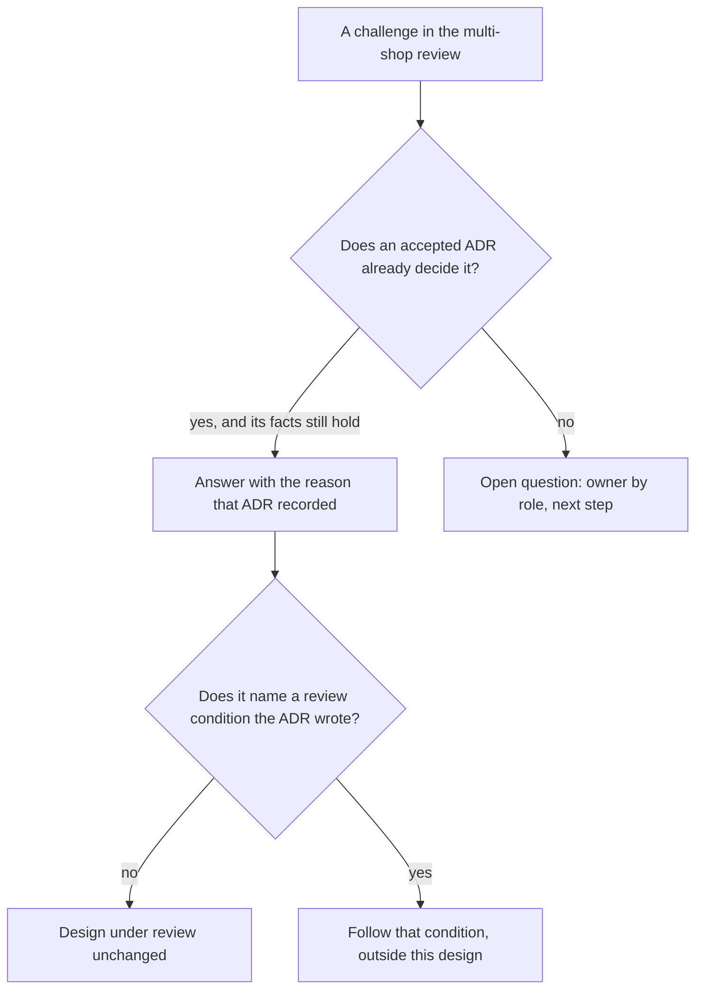

## Bạn cần biết trước

- [[sysdesign.l4.multi-shop-trade-offs]] — bạn biết hai điểm đánh đổi mà buổi review ghi cho ADR `0026`, và các phương án bị loại vẫn giữ lý do của chúng trong ADR `0013` và `0012`.
- [[sysdesign.l4.answering-challenges]] — bạn trả lời một câu phản biện bằng yếu tố định hình kiến trúc hay điểm đánh đổi đứng sau quyết định, kèm tên file, và biến một trường hợp chưa được phủ thành câu hỏi mở có người phụ trách.

## Tình huống

Buổi review thiết kế cho ADR `0026` tới phần cuối: các câu phản biện. Bốn câu hỏi tới liên tiếp. Sao không cho mỗi cửa hàng một database riêng cho xong? Trong lúc cửa hàng lớn nhất chờ chuyển, cái gì bảo vệ các cửa hàng khác? Báo cáo gộp mọi cửa hàng đọc thế nào một cửa hàng giờ nằm ở database khác? Nếu hợp đồng của một cửa hàng lớn đòi một bản hệ thống của riêng nó thì sao?

Bạn có thể trả lời từng câu bằng một lập luận nghĩ ra ngay tại chỗ. Nhưng vài câu trong số này đã được quyết từ trước khi thiết kế này bắt đầu, trong những ADR mà đội đã chấp nhận.

Câu nào cần một câu trả lời mới, và câu nào đã có sẵn câu trả lời?

## Khái niệm cốt lõi

- câu phản biện mở lại một quyết định — câu hỏi đòi quyết lại một ADR đã được chấp nhận, như "sao không mỗi cửa hàng một database". Câu trả lời là lý do mà ADR đó đã ghi.
- câu phản biện tìm ra lỗ hổng — câu hỏi về một trường hợp thiết kế chưa phủ. Câu trả lời là một câu hỏi mở có người phụ trách theo vai trò và một việc tiếp theo.
- điều kiện xem lại — trường hợp mà một ADR liệt kê dưới "đội xem lại quyết định khi". Câu phản biện chạm đúng trường hợp đó được trả lời bằng chính điều kiện đã viết, chứ không bằng cách đổi thiết kế đang được review.

## Cơ chế hoạt động



Trong tình huống trên, bốn câu hỏi chia thành hai loại. Ba câu hỏi về thứ mà một ADR đã chấp nhận quyết rồi: mỗi cửa hàng một database (ADR `0013`), bảo vệ khỏi một cửa hàng đông khách (ADR `0016`), hợp đồng đòi bản riêng (ADR `0012`). Câu thứ tư, báo cáo gộp mọi cửa hàng, chạm một trường hợp chưa quyết định nào phủ.

Với loại thứ nhất, câu trả lời là lý do đã viết trong ADR, nêu kèm số của nó. Lý do đó đã được cân với các phương án khác, và đã mở cho cả đội góp ý tới một hạn định sẵn trước khi được chấp nhận, nên người review có thể mở file ra kiểm tra. Một lập luận nghĩ ra trong buổi họp không có bản ghi nào như vậy. Tài liệu review nói rõ ngay từ đầu: nó không mở lại ADR `0012`, `0013` và `0016`. Điều này chỉ đúng khi các dữ kiện mà ADR đã cân vẫn còn đúng. Nếu câu phản biện cho thấy một dữ kiện đã đổi, nó được ghi lại kèm người phụ trách và được cân lại trong một ADR mới.

Điều kiện xem lại là một trường hợp đặc biệt của loại thứ nhất. ADR đã lường trước câu phản biện và viết sẵn điều xảy ra khi đó, nên câu trả lời trích chính điều kiện. Điều kiện bảo làm gì, chẳng hạn một bản riêng cho một cửa hàng, thì việc đó diễn ra bên ngoài thiết kế đang được review.

Với loại thứ hai, không ADR nào giữ câu trả lời, và buổi họp cũng không nghĩ ra câu trả lời nào. Buổi review ghi một câu hỏi mở có người phụ trách theo vai trò và một việc tiếp theo. Thiết kế vẫn được chấp nhận cho những trường hợp nó phủ. Lỗ hổng sẽ có quyết định khi phần việc chạm tới nó bắt đầu.

## Trong hệ thống Đơn Hàng

Bảng câu phản biện ở cuối buổi review thiết kế giữ cả bốn câu hỏi, cùng thêm một câu nữa:

```markdown file=docs/design/multi-shop-design-review.md tag=stage-4 lines=109-117
### Câu hỏi phản biện trong buổi review

| Câu hỏi | Trả lời, trỏ driver, ADR hoặc rủi ro | Việc tiếp theo | Người phụ trách (vai trò) |
|---|---|---|---|
| Sao không cho mỗi cửa hàng một database luôn? | ADR 0013: mỗi migration chạy 1.000 lần | Không | |
| Trong lúc cửa hàng lớn chờ chuyển, gì bảo vệ cửa hàng khác? | ADR 0016: trần theo cửa hàng, có khi access token mang cửa hàng từ release 2 | Không | |
| Báo cáo gộp mọi cửa hàng đọc cửa hàng có database riêng thế nào? | Mở: một truy vấn không join được hai database | Ghi vào câu hỏi mở | Product owner, cùng lập trình viên backend |
| Hợp đồng đòi bản riêng thì sao? | Điều kiện xem lại của ADR 0012, không đổi thiết kế này | Không | |
| Cửa hàng chuyển rồi lại nhỏ đi thì có chuyển về không? | Mở: chưa có điều kiện chuyển ngược | Thêm vào điều kiện xem lại khi có trường hợp đầu tiên | Trưởng nhóm |
```

Dòng đầu trả lời "mỗi cửa hàng một database" bằng lý do của ADR `0013`, không bằng lý do mới. ADR đó thấy rằng với 1.000 cửa hàng, mỗi cửa hàng một database hay một schema sẽ biến mỗi lần phát hành một service thành 1.000 lượt chạy migration, và mỗi cửa hàng mới thành một lần tạo database. Việc tiếp theo là "không": quyết định giữ nguyên.

Dòng thứ hai trả lời bằng ADR `0016`: mỗi cửa hàng có một trần, một phần cố định trong 20 lượt đọc đồng thời mà mỗi tiến trình cho phép hiện nay (giả định là một phần tư). Trần cần biết cửa hàng của từng request, nên nó bắt đầu muộn hơn. `multi-shop-data-rollout.md` là kế hoạch thêm cửa hàng vào dữ liệu qua ba release. Release 2 là lúc access token bắt đầu mang cửa hàng của bên gọi. Tới lúc đó, `Program.cs` ở stage-4 vẫn giữ nguyên các giới hạn dùng chung, như `catalog-reads`, nơi lượt đọc sản phẩm của mọi cửa hàng cùng bị đếm chung. ADR `0016` nêu bước tiếp theo cho một cửa hàng cứ cần nhiều hơn phần của mình: điều kiện xem lại của ADR `0013`, chuyển cửa hàng đó sang database riêng. Cửa hàng lớn đang chờ ADR `0026` chính là trường hợp đó.

Dòng thứ ba là một lỗ hổng. Một truy vấn không gọi được bảng ở database khác: PostgreSQL từ chối với lỗi "cross-database references are not implemented". Lúc buổi review diễn ra, chưa ADR nào quyết báo cáo gộp mọi cửa hàng phải chạy thế nào, nên buổi review ghi nó là câu hỏi mở, do product owner và một lập trình viên backend phụ trách. Cũng tài liệu đó ghi rằng thiết kế báo cáo sẽ cần một ADR riêng.

Dòng thứ tư chạm một điều kiện xem lại. ADR `0012` viết nó, và cũng ghi lại chính câu hỏi này từng được hỏi một lần:

```markdown file=docs/adr/0012-phuc-vu-moi-cua-hang-tu-mot-ban-trien-khai.md tag=stage-4 lines=52-63
Đội xem lại quyết định khi:

- Một cửa hàng có hợp đồng đòi một bản hệ thống riêng. Cửa hàng đó được cấp
  một bản riêng của cùng hệ thống, các cửa hàng khác vẫn được phục vụ như cũ.
- Số đội tăng tới mức các đội phải chờ nhau để sửa cùng một module; lúc đó
  ranh giới module, và có thể là service, được xem lại theo ranh giới đội.

### Ý kiến đã nhận

Product owner hỏi một cửa hàng lớn có được bản riêng ngay từ đầu không.
Không, cho tới khi hợp đồng đòi; điều kiện xem lại thứ nhất ghi trường hợp
đó, và bản riêng khi ấy không đổi cách phục vụ các cửa hàng còn lại.
```

Điều kiện đầu là trường hợp hợp đồng: cửa hàng đó được cấp một bản riêng của cùng hệ thống, còn mọi cửa hàng khác vẫn được phục vụ như cũ. Dưới "Ý kiến đã nhận", product owner từng hỏi một cửa hàng lớn có được bản riêng ngay từ đầu không. Câu trả lời là không, cho tới khi hợp đồng đòi.

Dòng cuối là lỗ hổng thứ hai, không có trong tình huống: một cửa hàng đã chuyển rồi về sau nhỏ đi thì chưa có điều kiện nào để chuyển về. Trưởng nhóm phụ trách nó, và việc tiếp theo là thêm một điều kiện xem lại khi trường hợp đầu tiên xuất hiện.

## Đánh đổi

| Cách trả lời | Nhận được gì | Cái giá | Khi nào là lựa chọn sai |
|---|---|---|---|
| Trỏ tới lý do của ADR đã chấp nhận | câu trả lời ngắn mà người review kiểm tra được, buổi họp đi tới được những lỗ hổng thật | phụ thuộc vào việc bối cảnh của ADR vẫn còn đúng | câu phản biện đưa ra một dữ kiện mà ADR chưa từng cân |
| Tranh luận lại ADR ngay trong buổi họp | cơ hội nhận ra một yếu tố định hình kiến trúc đã đổi | thời gian tốn vào câu hỏi đã xong, một lý do mới không có bản ghi | không có gì thay đổi kể từ ADR |
| Ghi lỗ hổng thành câu hỏi mở | thiết kế được chấp nhận cho phần nó phủ | lỗ hổng phải chờ, và cần một người phụ trách theo sát | lỗ hổng phá vỡ một trong các yếu tố định hình kiến trúc của chính thiết kế |
| Vá lỗ hổng ngay trong buổi họp | lỗ hổng đóng lại ngay | một thay đổi không yếu tố định hình kiến trúc nào đòi, và không ai review | gần như luôn luôn, lúc đang review |

Trỏ tới một ADR dựa trên một giả định: các dữ kiện nó đã cân vẫn còn đúng. Khi câu phản biện cho thấy một dữ kiện đã đổi, tranh luận lại là đúng: câu phản biện trở thành lý do để viết một ADR mới thay thế ADR cũ.

## Bạn sẽ chọn gì nếu…

…một người review nói cửa hàng lớn nhất vừa ký hợp đồng đòi một bản hệ thống của riêng nó? Câu phản biện chạm điều kiện xem lại thứ nhất của ADR `0012`. Cửa hàng đó được cấp một bản riêng của cùng hệ thống, còn thiết kế của ADR `0026` giữ nguyên cho mọi cửa hàng khác.

…một người review chỉ ra rằng doanh nghiệp giờ chỉ chờ khoảng 50 cửa hàng, không phải 1.000? Lý do của ADR `0013` là 1.000 lượt chạy migration mỗi lần phát hành, dựa trên giả định 1.000 cửa hàng. Yếu tố định hình kiến trúc đó đã đổi, nên trích ADR `0013` không còn trả lời được câu phản biện. Bạn ghi nó lại kèm người phụ trách, và quyết định được cân lại trong một ADR mới.

…product owner muốn có báo cáo gộp mọi cửa hàng ngay sprint tới, và xin buổi review quyết luôn bây giờ? Buổi review vẫn ghi nó là câu hỏi mở, kèm người phụ trách. Thiết kế báo cáo đi cùng ADR riêng của nó, như tài liệu review đã lên kế hoạch.

## Senior hay nhầm rằng…

- **"ADR đã chấp nhận phải được tranh luận lại từ đầu trong mỗi buổi review."** → Thực ra ADR đã chấp nhận giữ sẵn các phương án, lý do và những điều kiện mở lại nó, nên buổi review trả lời bằng lý do đó. Nó chỉ tranh luận lại khi một câu phản biện cho thấy một yếu tố định hình kiến trúc đã đổi. Bạn sẽ nhận ra khi một buổi review dành hết thời gian cho "sao không mỗi cửa hàng một database" mà không bao giờ tới được câu hỏi về báo cáo.
- **"Người review tìm ra trường hợp thiết kế bỏ sót thì phải vá xong trước khi buổi họp kết thúc."** → Thực ra báo cáo gộp mọi cửa hàng vẫn để mở, có người phụ trách và việc tiếp theo, và ADR `0026` vẫn được chấp nhận cho phần nó phủ. Một bản vá nghĩ ra trong buổi họp không có yếu tố định hình kiến trúc nào đứng sau và không qua review. Bạn sẽ nhận ra khi một câu trả lời vội trong buổi họp về sau hiện ra thành một quyết định không ai ghi lại.
- **"Trỏ tới một ADR cũ là cách né câu hỏi của người review."** → Thực ra câu trả lời nêu tên ADR và lý do của nó, nên người review mở file ra kiểm tra được: 1.000 lượt chạy migration là một lý do, không phải một cái gạt đi. Bạn sẽ nhận ra khi người review hỏi lại "phần nào của ADR đó trả lời câu hỏi của tôi?"

## Thử ngay (3 phút)

Ba câu phản biện nữa tới sau đó trong cùng buổi review. Với mỗi câu, quyết định: nó đã được một ADR đã chấp nhận trả lời, và là ADR nào, hay nó là một lỗ hổng?

1. "Sao không cho mỗi cửa hàng một schema riêng? Nó nhẹ hơn một database."
2. "Một cửa hàng chạy đợt giảm giá lớn và lượt đọc sản phẩm của nó chiếm hết 20 chỗ trong một tiến trình. Cái gì ngăn nó chặn các cửa hàng khác?"
3. "Tổng hằng tháng của mọi đơn đếm một cửa hàng thế nào sau khi nó đã chuyển sang database riêng?"

Kết quả mong đợi: với mỗi câu trong ba câu, một số ADR kèm lý do, hoặc "mở" kèm người phụ trách.

<details><summary>Gợi ý đáp án</summary>

1. ADR `0013`. Nó cũng đã cân phương án mỗi cửa hàng một schema: mỗi thay đổi schema sẽ chạy một lần cho mỗi cửa hàng, 1.000 lần, và mở một cửa hàng nghĩa là tạo một schema.
2. ADR `0016`. Mỗi cửa hàng có một trần, một phần trong số lượt đọc đồng thời của mỗi tiến trình, từ release 2, khi access token mang cửa hàng. Tới lúc đó chỉ có các giới hạn dùng chung, đếm mọi cửa hàng cùng nhau, nên không gì ngăn một cửa hàng chiếm hết 20 chỗ.
3. Mở, tại thời điểm buổi review. Đây chính là câu hỏi đã có trong bảng, báo cáo gộp mọi cửa hàng khi một truy vấn không join được hai database. Product owner và một lập trình viên backend phụ trách nó.

</details>

## Liên hệ

- [[sysdesign.l4.multi-shop-trade-offs]] — bước trước: các phương án bị loại ở đó chính là những câu phản biện bài này trả lời.
- [[sysdesign.l4.answering-challenges]] — phương pháp được áp dụng ở đây, cho một bài toán mà phần lớn lý do đã được viết sẵn.
- [[backend.l4.shop-data-layout]] — nơi lý do của ADR `0013` được quyết.
- [[backend.l4.per-shop-limits]] — nơi trần theo cửa hàng của ADR `0016` được quyết.
- [[design.l4.one-deployment-for-all-shops]] — nơi ADR `0012` viết điều kiện xem lại cho hợp đồng đòi bản riêng.
- [[management.l3.superseding-an-adr]] — nên làm gì khi một câu phản biện cho thấy một yếu tố định hình kiến trúc đã đổi.
- [[sysdesign.l4.reporting-requirements]] — nơi câu hỏi mở về báo cáo gộp mọi cửa hàng được nhận tiếp.
- [[sysdesign.l4.notification-requirements]] — bài toán tiếp theo trong module này.

## Tóm tắt 5 dòng

1. Phần lớn câu phản biện về thiết kế đa cửa hàng đòi quyết lại một ADR đã chấp nhận, và câu trả lời là lý do mà ADR đó đã ghi.
2. "Sao không mỗi cửa hàng một database" được trả lời bằng ADR `0013`: mỗi migration sẽ chạy một lần cho mỗi cửa hàng, 1.000 lần.
3. "Trong lúc chờ, cái gì bảo vệ các cửa hàng khác" được trả lời bằng trần theo cửa hàng của ADR `0016`, thứ chờ access token mang cửa hàng từ release 2.
4. Báo cáo gộp mọi cửa hàng là một lỗ hổng thật: một truy vấn không join được hai database, nên nó là câu hỏi mở có người phụ trách.
5. Hợp đồng đòi bản riêng chạm điều kiện xem lại của ADR `0012`, nên câu trả lời là điều kiện đó, không phải một thay đổi cho thiết kế này.
