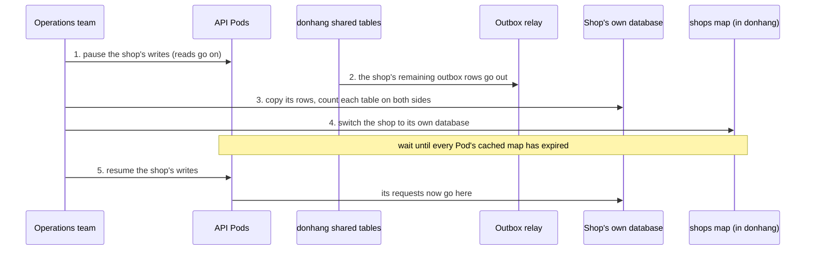

## Before you start

- [[sysdesign.l4.multi-shop-requirements]] — you have CH-5 (a moving shop stops taking writes for at most 15 minutes, assumed, and the other shops see no change), CH-6 (one shop restored alone) and the three ranked drivers this design is judged against.
- [[sysdesign.l4.deep-dive]] — you know a deep dive takes the part where a top driver is hardest and asks, among other things, what each dependency failing does.
- [[backend.l3.rebalancing-shards]] — you know a shard map sits between a key and the place its data lives, every request looks it up first, and data being moved must take its writes in only one place at a time.
- [[backend.l3.outbox-relay]] — you know the relay publishes outbox rows after the transaction that wrote them, so a row can still be waiting in the outbox when you look.

## The situation

The largest shop is close to the size at which the capacity plan says to act, and the team must take its data out of the shared tables in `donhang`. Every API Pod serves all 1,000 shops, and every request goes to the same database, so no code ever asks where a shop lives.

The requirements set the bar. The moving shop may stop taking writes for 15 minutes (assumed), and the other 999 must not notice. Another shop wants yesterday's products back, without anyone else going back in time.

How does a request find its shop's database, and how can one shop move, or be restored, while every other shop keeps working?

## Core concepts

- the shop map — a column on each row of `shops` that records the database holding that shop's data, the shared `donhang` by default; it is a shard map keyed by shop.
- the cached map — each Pod keeps the map in memory for 30 seconds (assumed), so it does not read `shops` on every request.
- the write pause — while a shop moves, the API answers that shop's writes with a temporary error and keeps serving its reads from the shared tables.
- the check period — after a move, the shop's old rows stay in the shared tables for a week (assumed) before they are deleted.
- restoring beside — recovering a copy of the whole server into a separate instance, then copying back only one shop's rows, while the real server keeps running.

## How it works



In the situation above, the request path changes first. Once the rollout's release 2 puts the shop in the access token, each request takes it from there. The Pod looks that shop up in its cached map and connects to the database written there. For 999 shops that is still `donhang`. No request can pick a database without the map, so the map is a dependency of every request.

The diagram is the deep dive: moving the large shop. The operations team pauses the shop's writes; its reads go on from the shared tables. They wait until the relay has sent the shop's remaining outbox rows, so no message is left behind in the old place; the review gives no further reason. They copy the shop's rows to its own database and count the rows of each table on both sides. If the counts differ, they stop and reopen writes in the old place. Only when the counts match does the map switch.

The wait before step 5 is the step that is easy to miss. A Pod that read the map just before the switch still holds the old entry for up to 30 seconds. Writes resume only after every Pod's copy has expired, so no Pod writes the shop's new rows into the shared tables. No other shop pauses at any step.

## In the Đơn Hàng system

None of this is built at stage-4. ADR `0026` says so in its header: the repository has no multi-shop code, and the design lives in `multi-shop-design-review.md`. The decision first:

```markdown file=docs/adr/0026-cua-hang-lon-chuyen-sang-database-rieng.md tag=stage-4 lines=34-47
### Quyết định

Chọn phương án thứ hai. Bảng `shops` (chủ là Ordering, trong `donhang`) thêm
một cột ghi database giữ dữ liệu của cửa hàng; mặc định là database chung
`donhang`. Từ release 2 của `multi-shop-data-rollout.md`, mỗi request lấy cửa
hàng từ access token, tra database của cửa hàng đó trong bảng ánh xạ, rồi mở
kết nối tới đó. Mỗi Pod giữ bảng ánh xạ trong bộ nhớ một thời gian ngắn (giả
định 30 giây).

Chỉ database của `DonHang.Api` (`donhang`) chuyển cửa hàng ra. Notifications và
Payments giữ mọi cửa hàng trong bảng chung, vì dữ liệu mỗi cửa hàng ở đó nhỏ.

Một cửa hàng chuyển khi chạm một trong hai điều kiện (giả định): giữ hơn 10%
tổng số đơn của ngày đông nhất, hoặc cần khôi phục riêng theo hợp đồng.
```

"Phương án thứ hai" is the second option: a database of its own for a large shop, through a map keyed by shop. The first paragraph is the map: a column of `shops`, in `donhang`, naming each shop's database, `donhang` by default, looked up on every request and kept in each Pod's memory for 30 seconds (assumed).

The second paragraph limits the move to `DonHang.Api`'s database: Notifications and Payments hold little data per shop, so every shop stays in their shared tables. The last paragraph, when a shop moves, belongs to the next lesson.

The ADR's consequences open with the dependency: if the map cannot be read, no request knows its database. The review adds that the cached copy lets requests run on for up to 30 seconds; after that, new requests stop. The map is a new single point of failure.

The review's two deep dives:

```markdown file=docs/design/multi-shop-design-review.md tag=stage-4 lines=50-72
### Đi sâu: chuyển một cửa hàng (bước 4)

1. Dừng ghi của cửa hàng đó: API trả lỗi tạm thời cho lệnh ghi của nó; đọc vẫn
   chạy từ bảng chung.
2. Chờ relay gửi hết các dòng outbox của cửa hàng đó, để không message nào
   còn nằm lại ở chỗ cũ.
3. Chép các dòng của cửa hàng sang database riêng, rồi đếm dòng từng bảng ở hai
   bên; lệch thì dừng, mở lại ghi ở chỗ cũ.
4. Đổi dòng của cửa hàng trong bảng ánh xạ sang database riêng.
5. Mở lại ghi, sau khi đã qua hết thời gian cache bảng ánh xạ của mọi Pod.

Thời gian dừng ghi dài hơn thời gian cache bảng ánh xạ, nên sau khi đổi không
Pod nào còn ghi vào chỗ cũ. Các cửa hàng khác không dừng ở bước nào. Dòng cũ
trong bảng chung chỉ bị xóa sau một khoảng kiểm tra (giả định một tuần).

### Đi sâu: khôi phục một cửa hàng (bước 4)

- Cửa hàng ở bảng chung: khôi phục cả server về ngay trước sự cố vào một
  instance riêng, như `scripts/devops/pitr.sh` làm với container `db-pitr`;
  đọc các dòng của cửa hàng đó từ instance riêng và chép lại vào `donhang`.
  Các cửa hàng khác không quay về quá khứ, nhưng việc chép là việc tay, chậm.
- Cửa hàng có database riêng: khôi phục database đó một mình; không cửa hàng
  nào khác bị chạm.
```

The heading's "bước 4" marks this as the review's deep-dive step; steps 1 to 5 are the diagram. A count that does not match stops the move and reopens writes in the old place. The paragraph under the steps states the rule: the pause outlasts the cache, no other shop pauses, and the old rows are deleted only after a check period, assumed a week.

Below the excerpt, the risks table adds that matching counts can hide changed content, and gives a tester the job of comparing checksums over a few columns before the map switches.

The second deep dive is CH-6. A shop in the shared tables is restored beside: the whole server is recovered to just before the mistake into a separate instance, as `scripts/devops/pitr.sh` does with the `db-pitr` container while `db`, the container running the real server, keeps running. That shop's rows are then copied back into `donhang`; no other shop goes back in time, but the copying is manual and slow. A shop with its own database is simpler when that database has a server of its own: that server is restored alone, from the backup the ADR's consequences give every own database. While it still shares a server with `donhang`, it is restored beside too.

## Trade-offs

| Choice | What it gives | What it costs | Right when |
|---|---|---|---|
| Resume writes as soon as the map switches | a shorter pause for the moving shop | a Pod still holding the old entry writes new rows into the shared tables, which the shop's own database never sees | no Pod caches the map |
| Resume only after every Pod's cache time (the review's choice) | after the switch, no Pod writes to the old place | the shop refuses writes until the switch (outbox wait, copy, counts) plus the cache time | the shop accepts a short pause at a quiet hour, as CH-5 assumes |
| Read `shops` on every request, no cache | a switch takes effect at once | one more query on every request; if `shops` cannot be read, every request stops at once instead of within 30 seconds | a switch must take effect with no wait, and one more query per request is affordable |
| Restore the whole server in place | one step, no copying | every other shop loses what it wrote since the chosen moment; fails driver 2, restoring one shop without taking the others back (CH-6) | the server holds one shop only |
| Restore beside, copy one shop back (the review's choice for shared tables) | the other shops keep every row and never stop | manual, slow copying | restores are rare, as the operations team assumes |
## What would you choose if…

…someone proposed raising the cache time to five minutes, to read `shops` less often? Every move's pause then lasts the time to the switch (outbox wait, copy and counts) plus five minutes. Check that against CH-5's 15 minutes (assumed) before agreeing; a slow copy may no longer fit.

…the row counts matched, but a tester found one order with a different total in the shop's own database? That is the open risk the review names. Stop before step 4, reopen writes in the old place, and add the checksum comparison over a few columns that the risks table asks for.

…a shop that already has its own database deleted its products by mistake? Restore that database alone, from its own backup, if that database has a server of its own. No other shop is touched.

## Seniors often assume…

- **"Moving a shop to another database means stopping the whole system for a night."** → Actually only the moving shop pauses, and only its writes: its reads go on from the shared tables, and the other shops pause at no step. The switch changes one row of `shops`, so no other shop's requests change where they go. You notice this when a move plan stops all 1,000 shops for hours to move the data of one.
- **"Once a shop has its own database, it also needs its own deployment of the services."** → Actually the same API Pods serve it; the map only changes which database a request connects to. A separate deployment is what ADR `0012` keeps for a contract that demands one, and ADR `0026` lists that case as a review condition, not as part of a move. You notice this when a move plan adds a second copy of every service for a shop that only needed its rows elsewhere.
- **"To restore one shop, the whole database has to be taken back in time."** → Actually the recovery goes back in a separate instance, not in `donhang`, and only the shop's rows are copied back. You notice this when a restore plan for one shop would erase every other shop's orders since the chosen moment.

## Try it (3 minutes)

A move starts at minute 0, when the large shop's writes pause. The relay has sent the shop's outbox rows by minute 1. The copy and the counts finish at minute 6, and the map switches at once. The Pods read the map at different moments, and you cannot know when each last did; one of them last read it at minute 5.9. Each Pod caches the map for 30 seconds (assumed).

Write down the earliest minute writes may resume, what would go wrong if they resumed at minute 6, and whether the pause still meets CH-5.

Expected result: one minute value and two sentences.

<details><summary>Suggested answer</summary>

Minute 6.5: a Pod that read the map just before the switch may hold the old entry for 30 seconds after it. At minute 6, the Pod that read at minute 5.9 still sends the shop to `donhang` until minute 6.4, so a new order it accepts lands in the shared tables, where the shop's own database never sees it. The pause lasts 6.5 minutes, inside CH-5's 15 (assumed).

</details>

## Connections

- [[sysdesign.l4.high-level-design]] — the step the review's diagram applies: one request's path through the map to its database.
- [[backend.l3.tenant-isolation-models]] — the layouts this design mixes: shared tables for most shops, a database each for the few largest.
- [[devops.l3.point-in-time-recovery]] — the recovery into `db-pitr` that restoring beside reuses for one shop's rows.
- [[backend.l4.shop-id-rollout]] — release 2, which puts the shop in the access token that the map lookup needs.
- [[sysdesign.l4.multi-shop-trade-offs]] — the next step: what each extra database costs in migrations, backups and connections.

## Five-line summary

1. ADR `0026` keeps shared tables for most shops and lets a large shop move to its own database through a shop map.
2. Each row of `shops` names the database holding that shop's data; every request looks it up, so every request depends on it.
3. Only `donhang` moves shops out; Notifications and Payments keep every shop in shared tables, because their data per shop is small.
4. A move pauses one shop's writes, waits for its outbox, copies and counts, switches the map, then resumes after every Pod's cache expires.
5. A shop in shared tables is restored beside: recover the server into a separate instance and copy back only its rows.
