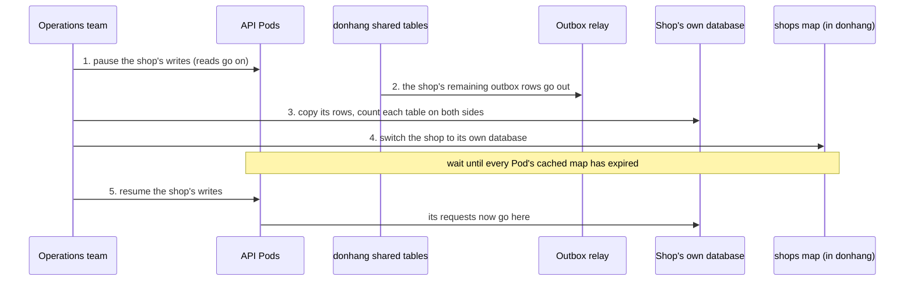

## Bạn cần biết trước

- [[sysdesign.l4.multi-shop-requirements]] — bạn đã có CH-5 (cửa hàng đang chuyển dừng nhận ghi tối đa 15 phút, giả định, và các cửa hàng khác không thấy thay đổi), CH-6 (khôi phục riêng một cửa hàng) và ba yếu tố định hình kiến trúc xếp hạng mà thiết kế này được chấm theo.
- [[sysdesign.l4.deep-dive]] — bạn biết phần đi sâu chọn chỗ mà yếu tố định hình kiến trúc đứng đầu khó đáp ứng nhất, và hỏi, trong số các câu khác, chuyện gì xảy ra khi từng phụ thuộc hỏng.
- [[backend.l3.rebalancing-shards]] — bạn biết shard map đứng giữa một khóa và nơi dữ liệu của khóa đó nằm, request nào cũng tra nó trước, và dữ liệu đang chuyển chỉ được nhận ghi ở một chỗ tại mỗi thời điểm.
- [[backend.l3.outbox-relay]] — bạn biết relay publish các dòng outbox sau khi transaction ghi chúng đã xong, nên lúc bạn nhìn vào, một dòng có thể vẫn đang chờ trong outbox.

## Tình huống

Cửa hàng lớn nhất sắp chạm cỡ mà kế hoạch năng lực nói phải hành động, và nhóm phải đưa dữ liệu của nó ra khỏi các bảng chung trong `donhang`. Mỗi Pod API phục vụ cả 1.000 cửa hàng, request nào cũng tới cùng một database, nên chưa đoạn code nào phải hỏi một cửa hàng nằm ở đâu.

Phần yêu cầu đã đặt mức phải đạt. Cửa hàng đang chuyển được dừng nhận ghi 15 phút (giả định), còn 999 cửa hàng kia không được nhận ra điều gì. Một cửa hàng khác muốn lấy lại sản phẩm như hôm qua, mà không ai khác bị đưa về quá khứ.

Một request tìm database của cửa hàng mình bằng cách nào, và làm sao chuyển, hay khôi phục, một cửa hàng trong khi mọi cửa hàng khác vẫn chạy bình thường?

## Khái niệm cốt lõi

- bảng ánh xạ cửa hàng — một cột trên mỗi dòng của `shops`, ghi database giữ dữ liệu của cửa hàng đó, mặc định là `donhang` dùng chung. Đây là một shard map có khóa là cửa hàng.
- bảng ánh xạ trong cache — mỗi Pod giữ bảng ánh xạ trong bộ nhớ 30 giây (giả định), để không phải đọc `shops` ở mỗi request.
- khoảng dừng ghi — trong lúc một cửa hàng chuyển, API trả lỗi tạm thời cho lệnh ghi của cửa hàng đó, còn lệnh đọc vẫn chạy từ các bảng chung.
- khoảng kiểm tra — sau khi chuyển, các dòng cũ của cửa hàng ở lại trong bảng chung một tuần (giả định) rồi mới bị xóa.
- khôi phục ở bên cạnh — đưa một bản sao của cả server về thời điểm cần, trong một instance riêng, rồi chỉ chép lại các dòng của một cửa hàng, trong khi server thật vẫn chạy.

## Cơ chế hoạt động



Trong tình huống trên, đường đi của request đổi trước tiên. Khi release 2 của kế hoạch triển khai đưa cửa hàng vào access token, mỗi request lấy cửa hàng từ đó. Pod tra cửa hàng ấy trong bảng ánh xạ đang cache, rồi kết nối tới database ghi ở đó. Với 999 cửa hàng, database đó vẫn là `donhang`. Không request nào chọn được database nếu thiếu bảng ánh xạ, nên bảng ánh xạ là phụ thuộc của mọi request.

Sơ đồ chính là phần đi sâu: chuyển cửa hàng lớn. Đội vận hành dừng ghi của cửa hàng đó, còn đọc vẫn chạy từ bảng chung. Họ chờ relay gửi hết các dòng outbox còn lại của cửa hàng, để không message nào nằm lại ở chỗ cũ. Buổi review không nêu thêm lý do nào khác. Họ chép các dòng của cửa hàng sang database riêng và đếm số dòng từng bảng ở hai bên. Số đếm lệch thì họ dừng và mở lại ghi ở chỗ cũ. Chỉ khi số đếm khớp, bảng ánh xạ mới đổi.

Khoảng chờ trước bước 5 là bước dễ bị bỏ sót. Một Pod vừa đọc bảng ánh xạ ngay trước lúc đổi vẫn giữ dòng cũ thêm tối đa 30 giây. Ghi chỉ mở lại khi bản sao của mọi Pod đã hết hạn, nên không Pod nào ghi các dòng mới của cửa hàng vào bảng chung. Không cửa hàng nào khác phải dừng ở bất kỳ bước nào.

## Trong hệ thống Đơn Hàng

Ở stage-4 chưa có gì trong số này được xây. ADR `0026` nói rõ ở phần đầu: repo chưa có code đa cửa hàng nào, và thiết kế nằm trong `multi-shop-design-review.md`. Trước hết là quyết định:

```markdown file=docs/adr/0026-cua-hang-lon-chuyen-sang-database-rieng.md tag=stage-4 lines=34-47
### Quyết định

Chọn phương án thứ hai. Bảng `shops` (chủ là Ordering, trong `donhang`) thêm
một cột ghi database giữ dữ liệu của cửa hàng; mặc định là database chung
`donhang`. Từ release 2 của `multi-shop-data-rollout.md`, mỗi request lấy cửa
hàng từ access token, tra database của cửa hàng đó trong bảng ánh xạ, rồi mở
kết nối tới đó. Mỗi Pod giữ bảng ánh xạ trong bộ nhớ một thời gian ngắn (giả
định 30 giây).

Chỉ database của `DonHang.Api` (`donhang`) chuyển cửa hàng ra. Notifications và
Payments giữ mọi cửa hàng trong bảng chung, vì dữ liệu mỗi cửa hàng ở đó nhỏ.

Một cửa hàng chuyển khi chạm một trong hai điều kiện (giả định): giữ hơn 10%
tổng số đơn của ngày đông nhất, hoặc cần khôi phục riêng theo hợp đồng.
```

"Phương án thứ hai" là database riêng cho một cửa hàng lớn, qua một bảng ánh xạ có khóa là cửa hàng. Đoạn đầu mô tả bảng ánh xạ: một cột của `shops`, nằm trong `donhang`, ghi database của từng cửa hàng, mặc định là `donhang`, được tra ở mỗi request và giữ trong bộ nhớ mỗi Pod 30 giây (giả định).

Đoạn thứ hai giới hạn cuộc chuyển ở database của `DonHang.Api`. Notifications và Payments giữ ít dữ liệu cho mỗi cửa hàng, nên mọi cửa hàng ở lại bảng chung của chúng. Đoạn cuối, khi nào một cửa hàng chuyển, thuộc về bài sau.

Phần hệ quả của ADR mở đầu bằng chính phụ thuộc đó: nếu không đọc được bảng ánh xạ, không request nào biết database của mình. Buổi review thêm rằng bản trong cache cho request chạy tiếp tối đa 30 giây, sau đó request mới dừng. Bảng ánh xạ là một điểm lỗi duy nhất mới.

Hai phần đi sâu của buổi review:

```markdown file=docs/design/multi-shop-design-review.md tag=stage-4 lines=50-72
### Đi sâu: chuyển một cửa hàng (bước 4)

1. Dừng ghi của cửa hàng đó: API trả lỗi tạm thời cho lệnh ghi của nó; đọc vẫn
   chạy từ bảng chung.
2. Chờ relay gửi hết các dòng outbox của cửa hàng đó, để không message nào
   còn nằm lại ở chỗ cũ.
3. Chép các dòng của cửa hàng sang database riêng, rồi đếm dòng từng bảng ở hai
   bên; lệch thì dừng, mở lại ghi ở chỗ cũ.
4. Đổi dòng của cửa hàng trong bảng ánh xạ sang database riêng.
5. Mở lại ghi, sau khi đã qua hết thời gian cache bảng ánh xạ của mọi Pod.

Thời gian dừng ghi dài hơn thời gian cache bảng ánh xạ, nên sau khi đổi không
Pod nào còn ghi vào chỗ cũ. Các cửa hàng khác không dừng ở bước nào. Dòng cũ
trong bảng chung chỉ bị xóa sau một khoảng kiểm tra (giả định một tuần).

### Đi sâu: khôi phục một cửa hàng (bước 4)

- Cửa hàng ở bảng chung: khôi phục cả server về ngay trước sự cố vào một
  instance riêng, như `scripts/devops/pitr.sh` làm với container `db-pitr`;
  đọc các dòng của cửa hàng đó từ instance riêng và chép lại vào `donhang`.
  Các cửa hàng khác không quay về quá khứ, nhưng việc chép là việc tay, chậm.
- Cửa hàng có database riêng: khôi phục database đó một mình; không cửa hàng
  nào khác bị chạm.
```

"Bước 4" trong tiêu đề đánh dấu đây là bước đi sâu của buổi review, còn bước 1 tới 5 chính là sơ đồ. Số đếm không khớp thì dừng cuộc chuyển và mở lại ghi ở chỗ cũ. Đoạn dưới các bước nêu quy tắc: khoảng dừng dài hơn thời gian cache, không cửa hàng nào khác dừng, và dòng cũ chỉ bị xóa sau một khoảng kiểm tra, giả định một tuần.

Bên dưới đoạn trích, bảng rủi ro nói thêm rằng số đếm khớp vẫn có thể che nội dung đã khác, và giao cho một tester so checksum trên vài cột trước khi bảng ánh xạ đổi.

Phần đi sâu thứ hai là CH-6. Cửa hàng ở bảng chung được khôi phục ở bên cạnh: cả server được đưa về ngay trước sự cố, trong một instance riêng, như `scripts/devops/pitr.sh` làm với container `db-pitr`, trong khi `db`, container chạy server thật, vẫn chạy. Sau đó các dòng của cửa hàng đó được chép lại vào `donhang`. Không cửa hàng nào khác quay về quá khứ, nhưng chép tay thì chậm. Cửa hàng có database riêng đơn giản hơn khi database đó có server riêng: chỉ khôi phục server đó, từ bản sao lưu mà phần hệ quả của ADR cấp cho mọi database riêng. Còn khi nó vẫn dùng chung server với `donhang`, nó cũng được khôi phục ở bên cạnh.

## Đánh đổi

| Lựa chọn | Nhận được gì | Cái giá | Đúng khi |
|---|---|---|---|
| Mở lại ghi ngay khi bảng ánh xạ đổi | khoảng dừng ngắn hơn cho cửa hàng đang chuyển | một Pod còn giữ dòng cũ ghi các dòng mới vào bảng chung, nơi database riêng của cửa hàng không bao giờ thấy | không Pod nào cache bảng ánh xạ |
| Chỉ mở lại sau thời gian cache của mọi Pod (lựa chọn của buổi review) | sau khi đổi, không Pod nào ghi vào chỗ cũ | cửa hàng từ chối ghi suốt tới lúc đổi (chờ outbox, chép, đếm) cộng thêm thời gian cache | cửa hàng chấp nhận dừng ngắn vào giờ thấp điểm, như CH-5 giả định |
| Đọc `shops` ở mỗi request, không cache | lần đổi có hiệu lực ngay | thêm một truy vấn ở mỗi request; nếu không đọc được `shops`, mọi request dừng ngay thay vì trong vòng 30 giây | lần đổi phải có hiệu lực không chờ, và chịu được thêm một truy vấn mỗi request |
| Khôi phục cả server tại chỗ | một bước, không phải chép | mọi cửa hàng khác mất những gì đã ghi từ thời điểm được chọn, trượt yếu tố định hình kiến trúc thứ hai, khôi phục một cửa hàng mà không kéo các cửa hàng khác lùi theo (CH-6) | server chỉ giữ một cửa hàng |
| Khôi phục ở bên cạnh, chép lại một cửa hàng (lựa chọn của buổi review cho bảng chung) | các cửa hàng khác giữ mọi dòng và không bao giờ dừng | chép tay, chậm | khôi phục là việc hiếm, như đội vận hành giả định |

## Bạn sẽ chọn gì nếu…

…có người đề xuất nâng thời gian cache lên năm phút, để đọc `shops` ít hơn? Khi đó khoảng dừng của mỗi cuộc chuyển bằng thời gian tới lúc đổi (chờ outbox, chép và đếm) cộng năm phút. So con số đó với 15 phút (giả định) của CH-5 trước khi đồng ý, vì một lần chép chậm có thể không còn vừa.

…số dòng khớp, nhưng tester thấy một đơn có tổng tiền khác trong database riêng của cửa hàng? Đó là rủi ro còn mở mà buổi review đã nêu tên. Dừng trước bước 4, mở lại ghi ở chỗ cũ, và thêm bước so checksum trên vài cột mà bảng rủi ro yêu cầu.

…một cửa hàng đã có database riêng xóa nhầm sản phẩm của mình? Khôi phục riêng database đó, từ bản sao lưu của chính nó, nếu database đó có server riêng. Không cửa hàng nào khác bị chạm.

## Senior hay nhầm rằng…

- **"Chuyển một cửa hàng sang database khác nghĩa là dừng cả hệ thống một đêm."** → Thực ra chỉ cửa hàng đang chuyển dừng, và chỉ dừng ghi: đọc vẫn chạy từ bảng chung, còn các cửa hàng khác không dừng ở bước nào. Lần đổi chỉ sửa một dòng của `shops`, nên request của cửa hàng khác không đổi nơi đến. Bạn sẽ nhận ra khi một kế hoạch chuyển dừng cả 1.000 cửa hàng hàng giờ liền chỉ để chuyển dữ liệu của một cửa hàng.
- **"Khi một cửa hàng có database riêng, nó cũng cần một bản triển khai riêng của các service."** → Thực ra vẫn chính các Pod API đó phục vụ nó, bảng ánh xạ chỉ đổi database mà request kết nối tới. Bản triển khai riêng là thứ ADR `0012` để dành cho một hợp đồng đòi điều đó, và ADR `0026` ghi trường hợp này là một điều kiện xem lại, không phải một phần của cuộc chuyển. Bạn sẽ nhận ra khi một kế hoạch chuyển thêm một bản sao của mọi service cho một cửa hàng chỉ cần đặt các dòng của nó ở chỗ khác.
- **"Muốn khôi phục một cửa hàng thì phải đưa cả database về quá khứ."** → Thực ra lần khôi phục quay về quá khứ trong một instance riêng, không phải trong `donhang`, và chỉ các dòng của cửa hàng đó được chép lại. Bạn sẽ nhận ra khi kế hoạch khôi phục cho một cửa hàng sẽ xóa sạch đơn của mọi cửa hàng khác kể từ thời điểm được chọn.

## Thử ngay (3 phút)

Một cuộc chuyển bắt đầu ở phút 0, khi ghi của cửa hàng lớn dừng. Tới phút 1, relay đã gửi hết các dòng outbox của cửa hàng. Chép và đếm xong ở phút 6, và bảng ánh xạ đổi ngay lúc đó. Các Pod đọc bảng ánh xạ vào những thời điểm khác nhau, và bạn không biết mỗi Pod đọc lần cuối khi nào. Một trong số đó đọc lần cuối ở phút 5,9. Mỗi Pod cache bảng ánh xạ 30 giây (giả định).

Ghi ra phút sớm nhất có thể mở lại ghi, chuyện gì sẽ hỏng nếu mở lại ở phút 6, và khoảng dừng có còn đạt CH-5 không.

Kết quả mong đợi: một giá trị phút và hai câu.

<details><summary>Gợi ý đáp án</summary>

Phút 6,5: một Pod đọc bảng ánh xạ ngay trước lúc đổi có thể giữ dòng cũ thêm 30 giây sau đó. Ở phút 6, Pod đã đọc ở phút 5,9 vẫn gửi cửa hàng tới `donhang` cho tới phút 6,4, nên một đơn mới nó nhận sẽ nằm trong bảng chung, nơi database riêng của cửa hàng không bao giờ thấy. Khoảng dừng kéo dài 6,5 phút, nằm trong 15 phút (giả định) của CH-5.

</details>

## Liên hệ

- [[sysdesign.l4.high-level-design]] — bước mà sơ đồ của buổi review áp dụng: đường đi của một request qua bảng ánh xạ tới database của nó.
- [[backend.l3.tenant-isolation-models]] — các cách bố trí mà thiết kế này trộn lại: bảng chung cho phần lớn cửa hàng, mỗi cửa hàng một database cho vài cửa hàng lớn nhất.
- [[devops.l3.point-in-time-recovery]] — lần khôi phục vào `db-pitr` mà cách khôi phục ở bên cạnh dùng lại cho các dòng của một cửa hàng.
- [[backend.l4.shop-id-rollout]] — release 2, bản đưa cửa hàng vào access token mà lượt tra bảng ánh xạ cần.
- [[sysdesign.l4.multi-shop-trade-offs]] — bước tiếp theo: mỗi database thêm vào tốn gì về migration, sao lưu và kết nối.

## Tóm tắt 5 dòng

1. ADR `0026` giữ bảng chung cho phần lớn cửa hàng và cho một cửa hàng lớn chuyển sang database riêng qua một bảng ánh xạ cửa hàng.
2. Mỗi dòng của `shops` ghi database giữ dữ liệu của cửa hàng đó, request nào cũng tra nó, nên request nào cũng phụ thuộc vào nó.
3. Chỉ `donhang` chuyển cửa hàng ra, Notifications và Payments giữ mọi cửa hàng trong bảng chung vì dữ liệu mỗi cửa hàng ở đó nhỏ.
4. Một cuộc chuyển dừng ghi của một cửa hàng, chờ outbox, chép và đếm, đổi bảng ánh xạ, rồi mở lại ghi sau khi cache của mọi Pod hết hạn.
5. Cửa hàng ở bảng chung được khôi phục ở bên cạnh: đưa server về thời điểm cần trong một instance riêng và chỉ chép lại các dòng của nó.
